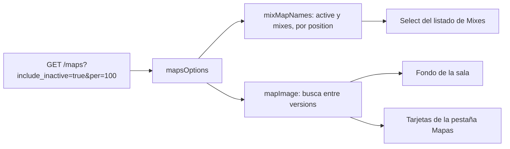
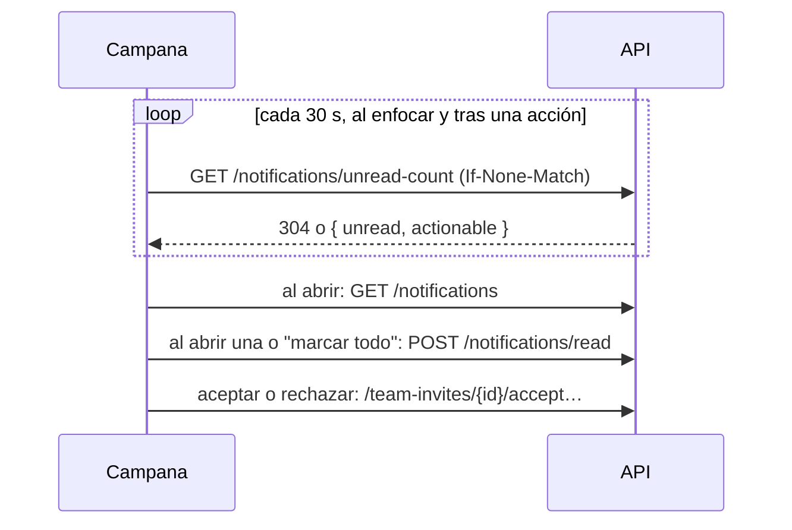

# Plan: ajustes del frontend en los módulos que ya existen

> Planeación original. Estado: **aprobada por Daniel el 2026-10-25**, sobre el mockup [Ajustes al frontend CM League](https://claude.ai/artifact/QPGmobxarDpvhQBbxwUFeB) (versión 3). Las decisiones marcadas como "Propuesta de Claude" no las eligió Daniel.

## El pedido

El frontend tiene que usar lo que el backend ya entrega, **sin módulos nuevos** (pedido de Daniel del 2026-10-25). Entran cinco módulos que ya existen:
- Mixes (listado y sala);
- Ranking › Jugadores (temporada);
- Perfil público;
- la campana de notificaciones;
- Mi perfil › Preferencias.

Todo en la rama `feat/frontend-fase-1`, que ya tiene el backend del replanteo `30` y los tipos regenerados (`src/api/schema.d.ts`).

**Queda afuera, porque son módulos nuevos:**
- Administración › Mapas;
- el pool de mapas en Torneos y PCW;
- el perfil sin reclamar;
- la advertencia de mapas por servidor.

**También queda afuera, bloqueado por el backend:** el nivel de cada jugador en la sala, "ELO pendiente" en el listado y el salto de la sala en vivo a la sala final.

## Decisiones tomadas

| Tema | Decisión | Origen |
|---|---|---|
| Select de mapas de Mixes | Los mapas del catálogo con `active` y `mixes`, en el orden de `position` | Daniel (mockup) |
| Foto del marcador y de la pestaña Mapas | Se busca el mapa jugado entre las `versions` de cada mapa del catálogo, retirados incluidos | Daniel (mockup) |
| Estadísticas por versión | `de_inferno` y `de_inferno_classic` siguen en tarjetas separadas en Mapas. Solo comparten la foto | Daniel |
| Pestañas de la sala | General, Avanzado, Entrada y Clutch, con las columnas y fórmulas del plan [`2026-10-25-stats-partida`](../2026-10-25-stats-partida/PLAN.md) (secciones 4.1 a 4.3 y 4.5) | Plan aprobado |
| Ranking de una temporada | Filtro de nivel. Columnas Equipo, Rating y K/D, que ordenan. El pico va debajo del ELO, en chico | Daniel (mockup) |
| Equipo con varios equipos | El primero (`TeamsCell`): el más antiguo, con "+n" y un tooltip con los demás. Sin equipo: "Sin equipo" | Daniel |
| Tarjeta del perfil | Se llama **"Jugadas clave"**. Lleva multi-kills, entradas, clutches ganados y objetivos (plan `stats-partida`, 4.4) | Daniel |
| Campana | El mismo diseño, con notificaciones reales: • contador con ETag cada 30 s, al enfocar y después de cada acción propia; • la lista se pide al abrir el menú; • una fila resuelta muestra cómo quedó | Daniel (mockup); contrato `notificaciones.md` |
| Preferencias | Tarjeta Notificaciones debajo de Tema, con un interruptor por categoría que se guarda al tocarlo y las aclaraciones de las obligatorias. Administración, solo para admins | Daniel (mockup) |
| Texto de cada notificación | Se arma en el frontend con `type` y `data`. Un tipo que la web no conoce muestra un texto genérico de su categoría | Propuesta de Claude |

## 1. Mapas (Mixes y Perfil público)

- **`features/maps/queries.ts`:**
  - `MapEntry` pasa a ser el tipo generado `MapItem`;
  - `mapsOptions` llama a la API;
  - `activeMapNames` pasa a llamarse `mixMapNames`;
  - `mapImage` busca entre las `versions`.
- **`MixesList.tsx`:** usa `mixMapNames`.
- **Pruebas:** las unitarias de `queries.test.ts` y la prueba de la pestaña Mapas con un mapa de dos versiones.

## 2. Ranking de una temporada

- **`ranking/search.ts`:** `level` (y su limpieza) también para una temporada. Al cambiar de temporada, `level` se conserva.
- **`ranking/queries.ts`:** `toStandingsQuery` manda `level` y `sort` `rating` y `kd`.
- **`PlayersRanking.tsx` (`SeasonView`):**
  - el selector de niveles del Histórico, en un componente compartido;
  - las columnas Equipo (`TeamsCell`), Rating y K/D, con orden;
  - el pico debajo del ELO;
  - se quita la columna Pico.
- **Pruebas:** `Ranking.test.tsx` cubre las columnas, los filtros y el orden.

## 3. Sala del mix: pestañas de estadísticas

Según el plan `2026-10-25-stats-partida`, sección 4:
- **Archivos nuevos:** `features/mixes/stats.ts` (fórmulas, mejor valor y orden, con pruebas) y `StatsTabs.tsx` (selector y definición de columnas).
- **`room.ts`:** pasa a cada jugador `k2`–`k5`, `first_kills`, `first_deaths`, `plants`, `defuses` y `clutches`, y a la sala, `clutch_data`.
- **`MixRoom.tsx`:** la tabla de cada bando usa las columnas de la pestaña, con la primera columna fija.
- **Pestaña en la URL:** `stats` en `validateSearch` de `match.$id.tsx` y `mixes.live.$uid.tsx`.
- **En vivo:** sin Δ ELO, y en Clutch, "Los clutches se cuentan al terminar el mix."

## 4. Perfil público: "Jugadas clave"

- **Dónde:** `player/tabs.tsx`, pestaña Resumen, debajo de Logros y Ajustes de ELO.
- **Datos:** salen de `stats` de `GET /players/{nick}`, con las fórmulas de `stats.ts`.
- **Sin partidas:** "Todavía no jugó partidas en el servidor."

## 5. Campana de notificaciones

- **`shell/notifications/model.ts`:**
  - pasa del modelo de ejemplo a uno sobre `Schemas["Notification"]`;
  - `describe(n)` arma título, cuerpo, icono y link a partir de `type` y `data`;
  - `isUrgent`, `isActionable` y las pestañas usan `actionable` y `resolution`.
- **`shell/queries.ts`:** consultas del contador (ETag, `refetchInterval` de 30 s y `refetchOnWindowFocus`) y de la lista, más las mutaciones de marcar leídas y de aceptar o rechazar.
- **`NotificationsMenu.tsx` e `InviteDialog.tsx`:** las mismas pantallas, con los datos nuevos y el estado resuelto.
- **`mock.ts`:** queda solo para las pruebas.

## 6. Preferencias

- **`profile/sections/PreferencesSection.tsx`:** la tarjeta Notificaciones, con `PATCH /me/profile` (`preferences.notifications`) y la UI optimista, como el selector de efectos.
- **Textos:** las aclaraciones bajo Equipos y Cuenta, y la nota de que una categoría apagada no guarda.

## 7. Pruebas

- **Unitarias y de componentes (Vitest con MSW):** cada módulo.
- **Playwright:** `mixes.spec.ts` (pestañas en la URL), `player.spec.ts` ("Jugadas clave"), `ranking.spec.ts` (filtro de nivel en una temporada) y `shell.spec.ts` (campana).
- **Typecheck y lint:** `pnpm typecheck` y `pnpm lint`.
- **Capturas:** 1440 y 390 px.

## 8. Orden de implementación

1. Mapas.
2. Ranking de una temporada.
3. Notificaciones y Preferencias.
4. Pestañas de la sala y "Jugadas clave".
5. Documentación, guía, fila en `docs/bitacora/README.md` y `docs/PENDIENTES.md`.
