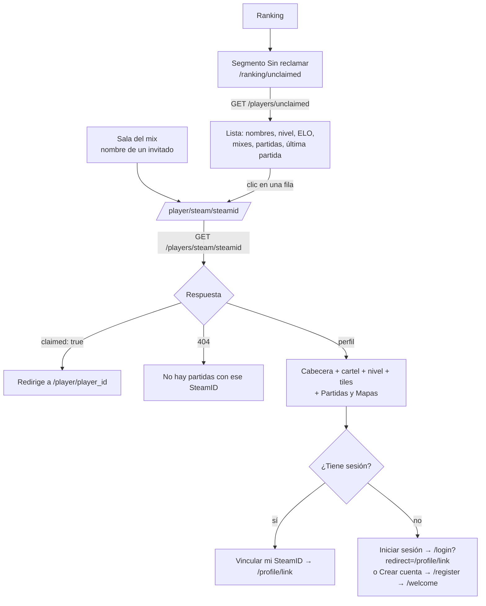

# Plan: Perfiles sin reclamar en el frontend

> Planeación original. Estado: **propuesta**, pendiente de aprobación.

Un **perfil sin reclamar** es un SteamID que jugó en el servidor y no es de ninguna ficha (contrato, sección 5b). Hoy la API lo tiene, pero el frontend no lo muestra en ningún lado: en la sala del mix, el nombre de un invitado no enlaza a nada.

Este plan suma:

- una pestaña **Sin reclamar** en Ranking, con la lista;
- la página del perfil sin reclamar, con el cartel para vincularlo desde la cuenta;
- el enlace desde la sala del mix.

## Decisiones tomadas

| Tema | Decisión | Por qué |
|---|---|---|
| Ranking | Los SteamID sin ficha **no entran en la clasificación**. Ya era así en la base: `player_ranking` y las vistas de temporada se cruzan con `players` | Decisión del 2026-10-16 ("no va al ranking"). Un SteamID puede ser una cuenta secundaria de alguien que ya está en el ranking, y al vincularlo se recalcula el ELO de todos |
| Dónde se listan | Tercer segmento en la cabecera de Ranking: **Jugadores · Equipos · Sin reclamar**, en `/ranking/unclaimed` | Se ven, y eso motiva a vincularlos, sin mezclarlos con la clasificación (propuesta aceptada por Daniel el 2026-10-25) |
| Lista sin posición | Sin columna `#`, sin podio y sin selector de temporada. Orden por defecto: **última partida** (la más reciente primero), con orden por ELO, partidas y nombre | No es una clasificación. Así arriba aparecen los que juegan ahora, que son los que pueden vincularlo |
| Ruta del perfil | `/player/steam/$steamid` | Separada de `/player/$nick`, que es de una ficha. Al tener un segmento más no choca con ningún nick |
| Cartel | "¿Este SteamID es tuyo? Vincúlalo desde tu cuenta", con un botón a Mi perfil → Vincular con el servidor (`/profile/link`). Sin sesión: "Iniciar sesión" (`/login?redirect=/profile/link`) y "Crear cuenta" (`/register`, que termina en el paso de vinculación de `/welcome`). **No explica el `!claim`**: lo explica esa pantalla | Decisión de Daniel del 2026-10-25: el `!claim` se hace solo desde la cuenta. Contrato corregido en `jugadores.md` (secciones 5 y 5b) y `decisiones.md` |
| SteamID a la vista | La página **no muestra el SteamID como texto**; solo va en la URL. Se reconoce por los nombres que usó | Igual que en las fichas. La URL no se puede evitar porque es la clave del perfil |
| Ya reclamado | Si la API responde `claimed: true`, se redirige a `/player/{player_id}` (con `replace`) | Un link viejo, por ejemplo de una partida guardada, lleva a la ficha |
| Sin gráfico de ELO | El perfil sin reclamar no tiene "Evolución de ELO" | La API no tiene `elo-history` por SteamID. Queda como pedido opcional al backend (no bloquea) |
| Pestañas | **Partidas** y **Mapas**, iguales a las del perfil público (mismos componentes) | Son los dos endpoints que la API tiene por SteamID (`/matches` y `/map-stats`). Equipos, temporadas, bio y logros no existen sin ficha |
| Backend | Sin cambios. Todo sale de `GET /players/unclaimed`, `/players/steam/{steamid}`, `/matches` y `/map-stats` | Ya paginan, filtran y ordenan en el servidor |

## 1. El flujo completo

## 2. Pestaña "Sin reclamar" (`/ranking/unclaimed`)

**Cabecera:** la misma `RankingHeader`, con el tercer segmento (`mode: "unclaimed"`, ícono de usuario con signo de pregunta). Sin el botón "Comparar".

- **Subtítulo:** "Jugadores que entraron al servidor sin vincular su SteamID a una cuenta. No cuentan para el ranking."

**Barra:** buscador (`q`: busca en los nombres que usó; la API también busca por SteamID, pero el placeholder solo dice "Buscar por nombre").

**Tabla** (`GET /api/v1/players/unclaimed`):

| Columna | Dato | Ordenable |
|---|---|---|
| Jugador | `last_nick` y, debajo, "También: {otros nombres}" (de `nicks`, sin repetir el último; hasta 3) | Sí (`last_nick`) |
| Nivel | Insignia de `level` (la misma del ranking). Sin ELO: "—" | No |
| ELO | `elo` | Sí (`elo`) |
| Mixes | `elo_matches` | No |
| Partidas | `matches` | Sí (`matches`) |
| Última partida | `last_played`, relativa ("hace 2 días") con la fecha en el `title` | Sí (`last_played`, por defecto) |

- Cada fila es un link a `/player/steam/{steam_id}` (como el `coverLink` del ranking).
- Paginación con `ListPagination` (25, 50 o 100).
- **Estado en la URL** (`unclaimedSearchSchema` en `features/ranking/search.ts`): `q`, `sort`, `order`, `page` y `per`.
- **Vacíos:** sin resultados de búsqueda, "No hay jugadores sin reclamar con ese nombre."; sin ninguno, "Todos los que jugaron ya vincularon su SteamID."
- **En celular** la tabla se desplaza de costado, como la de Jugadores.

## 3. Perfil sin reclamar (`/player/steam/$steamid`)

Reusa la estructura y los componentes del perfil público (`features/player/`), con menos partes.

**Cabecera:**

- Avatar con la inicial de `last_nick`, el nombre y una insignia "Sin reclamar" (borde punteado, como "INVITADO" en la sala).
- "También jugó como: {nicks}" si usó otros nombres.
- "Primera partida {fecha} · última {hace…}".
- Sin país, redes, equipos, "Verificado" ni "Comparar" (el comparador es entre fichas).

**Cartel de vincular**, debajo de la cabecera, dentro de la misma tarjeta (como la franja `.claim` del perfil):

| Quién mira | Texto | Botones |
|---|---|---|
| Con sesión | "¿Este SteamID es tuyo? Vincúlalo desde tu cuenta para sumar estas partidas a tu perfil." | **Vincular mi SteamID** → `/profile/link` |
| Sin sesión | "¿Este SteamID es tuyo? Crea tu cuenta o inicia sesión y vincúlalo para sumar estas partidas a tu perfil." | **Crear cuenta** (`/register`: al terminar lleva a `/welcome`, que ya tiene el paso "Vinculación") · **Iniciar sesión** (`/login?redirect=/profile/link`) |

**Nivel y tiles:**

- Tarjeta de nivel (insignia, ELO, "Máximo {peak_elo}", escalera, "Faltan… para nivel…", victorias y derrotas), la misma de `PlayerProfile.tsx`.
- Tiles: Rating, K/D, HS %, ADR, % Victorias y Partidas, desde `profile.stats`. Sin `stats`: "Todavía no hay estadísticas."
- Sin ELO: "Todavía no jugó mixes en el servidor."

**Pestañas** (`tab` en la URL, `matches` por defecto):

- **Partidas:** la tabla del perfil público con sus filtros (tipo y resultado) y su paginación, con `GET /players/steam/{steamid}/matches`. Clic → `/match/{id}`.
- **Mapas:** las tarjetas por mapa, con `GET /players/steam/{steamid}/map-stats`.

**Otros estados:**

- `claimed: true` → `navigate({ to: "/player/$nick", params: { nick: player_id }, replace: true })`.
- `404` → "No hay partidas con ese SteamID." y un botón "Ver jugadores sin reclamar".
- Un SteamID con formato inválido (la API da `400`) se trata igual que el `404`.

## 4. Enlaces desde la sala del mix

- `features/mixes/room.ts`: `RoomPlayer` suma `steamId` (el `steam_id` de la línea, solo si no tiene ficha).
- `MixRoom.tsx` (`PlayerRow`): el nombre de un invitado con `steamId` pasa a ser un link a `/player/steam/{steamId}`. Los bots y NOSTEAM (sin ficha ni SteamID) siguen como texto.
- Vale para la sala del mix terminado y la sala en vivo (las dos usan `PlayerRow`).
- El `title` de "INVITADO" pasa a: "Jugó sin vincular su SteamID. Toca su nombre para ver su perfil sin reclamar."

## 5. Archivos

| Archivo | Cambio |
|---|---|
| `src/routes/_app/ranking.unclaimed.tsx` (nuevo) | La pestaña, con `validateSearch` |
| `src/routes/_app/player.steam.$steamid.tsx` (nuevo) | El perfil sin reclamar, con `validateSearch` |
| `src/features/ranking/UnclaimedList.tsx` (nuevo) | La tabla |
| `src/features/ranking/parts.tsx` | Tercer segmento en `RankingHeader` |
| `src/features/ranking/search.ts`, `queries.ts` | Estado en la URL y consulta de la lista |
| `src/features/player/UnclaimedProfile.tsx` (nuevo) | Cabecera, cartel, nivel y tiles |
| `src/features/player/PlayerProfile.tsx`, `tabs.tsx` | Sacar a funciones compartidas la tarjeta de nivel, los tiles, Partidas y Mapas, para que reciban los datos o la consulta desde afuera |
| `src/features/player/queries.ts`, `search.ts`, `labels.ts` | Consultas por SteamID, estado de la URL y textos ("También jugó como…") |
| `src/features/mixes/room.ts`, `MixRoom.tsx` | `steamId` y el link del invitado |
| Pruebas | `labels.test.ts`, `search.test.ts`, `UnclaimedList`/`UnclaimedProfile` con MSW, `room.test.ts`, `e2e/unclaimed.spec.ts` |
| `docs/bitacora/2026-10-25-frontend-sin-reclamar/` | `DOCUMENTACION.md`, `GUIA_IMPLEMENTACION.md` y `CHANGELOG_DISCORD.txt` al terminar |

`src/api/schema.d.ts` ya tiene los cuatro endpoints, así que no hace falta `pnpm gen:api` para esto.

## 6. Pruebas

- **Unitarias:** `nicks` sin repetir el último y con tope de 3, el texto de la última partida, el estado de la URL (valores inválidos vuelven al de por defecto) y `steamId` en `RoomPlayer` (con ficha, invitado, bot).
- **De componentes, con MSW:**
  - la lista con orden, búsqueda, paginación y los dos vacíos;
  - el perfil con sesión y sin sesión (botones y destinos);
  - `claimed: true` (redirige);
  - `404`;
  - sin `stats`;
  - las pestañas Partidas y Mapas;
  - el link del invitado en la sala.
- **Punta a punta (Playwright, API local):** Ranking → Sin reclamar → primera fila → perfil → pestaña Mapas; y desde una sala de mix con un invitado hasta su perfil.
- **Capturas** en 1440 claro y 390 oscuro, fuera del repo (datos de la copia de producción).

## 7. Requisitos antes de empezar

- La API local corriendo (`web/backend`, `pnpm dev:node`) con la copia de producción, para Playwright y las capturas.
- Vite detenido antes de cambiar de rama.

## 8. Orden de implementación

1. Commit de la corrección del aviso en el perfil público (cambios sin commit de hoy), si Daniel lo pide.
2. Sacar a funciones compartidas la tarjeta de nivel, los tiles, Partidas y Mapas del perfil público, sin cambiar lo que se ve (las 21 pruebas de `PlayerProfile.test.tsx` siguen en verde).
3. Consultas, estado de la URL y textos, con sus pruebas unitarias.
4. Pestaña Sin reclamar y tercer segmento de la cabecera.
5. Perfil sin reclamar, con el cartel y la redirección.
6. Link del invitado en la sala del mix.
7. Pruebas de componentes y de punta a punta, typecheck, lint y build.
8. Capturas, documentación, guía, changelog y fila en `docs/bitacora/README.md`.

## 9. Pedido opcional al backend (no bloquea)

- `GET /api/v1/players/steam/{steamid}/elo-history`, igual que el de la ficha, para sumar el gráfico de ELO al perfil sin reclamar. Se anota en `docs/PENDIENTES.md`.
