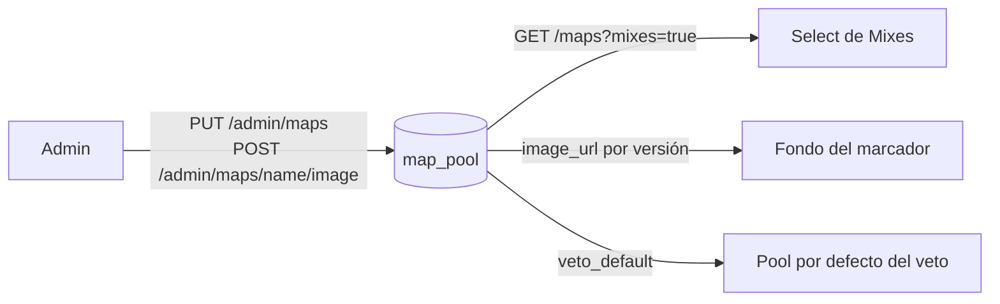

# Maestra de mapas (backend): documentación

## Qué hace

La maestra de mapas es el catálogo `map_pool`: la lista de todos los mapas, con sus versiones de servidor, si están disponibles, si salen en el select de Mixes, si están en el pool por defecto del veto y su foto. La foto es el fondo del marcador en la sala del mix. El admin la gestiona con `PUT /api/v1/admin/maps` y las rutas de la foto. Un mapa no se borra: se retira.

Todo el detalle está en la documentación del requerimiento que reemplazó el diseño de este plan: [`2026-10-25-pool-mapas-torneos-pcw/DOCUMENTACION.md`](../2026-10-25-pool-mapas-torneos-pcw/DOCUMENTACION.md).

## Lo que queda para después

**"A este servidor le faltan N mapas"** en `GET /api/v1/admin/servers`: el reporter tiene que informar los `.bsp` de `maps/` de cada servidor. Va con la etapa de los plugins (`docs/PENDIENTES.md`, sección 6).

## Dónde está cada cosa

| Qué | Archivo / ubicación |
|---|---|
| Todo | Ver [`2026-10-25-pool-mapas-torneos-pcw/DOCUMENTACION.md`](../2026-10-25-pool-mapas-torneos-pcw/DOCUMENTACION.md), sección "Dónde está cada cosa" |
