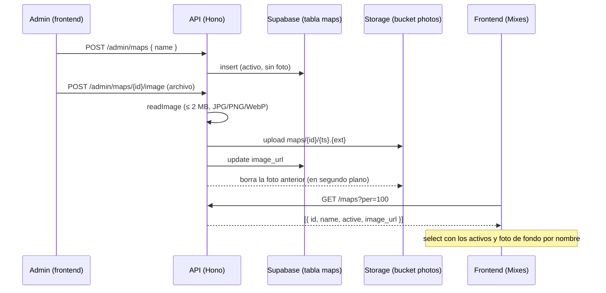

# Plan: Maestra de mapas (backend)

> Planeación original. Estado: **aprobada por Daniel el 2026-10-25**. Las decisiones marcadas como "Propuesta de Claude" no las eligió Daniel.

## El pedido

Daniel lo pidió el 2026-10-24 (`docs/PENDIENTES.md`, sección 6). El admin gestiona la lista de mapas como una maestra, con alta, edición y baja. Esa lista alimenta:
- el select "Todos los mapas" del listado de mixes;
- el fondo del marcador en la sala del mix, que es la foto de cada mapa (plan [`2026-10-24-frontend-mixes`](../2026-10-24-frontend-mixes/PLAN.md)).

Mixes sale junto con esta maestra.

Este plan cubre solo el backend: replanteo `30` y API. La advertencia "a este servidor le faltan N mapas" necesita que el plugin informe sus mapas, y queda para el final, con los plugins.

## Lo que ya existe y condiciona el diseño

| Qué | Dónde | Consecuencia |
|---|---|---|
| Las partidas guardan el mapa como texto (`matches.map`), sin clave a ninguna tabla | Esquema base | La maestra no toca `matches`. Desactivar un mapa no cambia ninguna partida |
| El frontend ya espera `{ name, active, image_url }` | `web/frontend/src/features/maps/queries.ts` (`mapsOptions`, `activeMapNames`, `mapImage`) | El tipo de la API usa esos tres campos (más `id`). El front busca la foto por nombre, sin distinguir mayúsculas |
| Fotos subidas por la API con validación por los primeros bytes (JPG, PNG o WebP) | `lib/uploads.ts` (`readImage`, `storageError`), `POST /admin/players/{id}/photo` | Se reutiliza tal cual, con un límite de 2 MB |
| Bucket `photos` público, en el que solo sube y borra el admin, sin límite de tamaño | `supabase/schema/auth_storage.sql` | Las fotos de los mapas van ahí, en la carpeta `maps/`. No hace falta crear ni configurar un bucket nuevo en producción |
| Todo listado pagina, filtra y ordena en el servidor | `lib/list.ts`, `docs/frontend/contrato/api.md` | `GET /maps` sigue esa convención (máximo 100 por página, que alcanza para todos los mapas) |
| El `mapcycle.txt` está en los servidores, no en el repo | Servidor real y RBK | La carga inicial sale de los mapas ya jugados. El resto lo da de alta el admin |

## Decisiones tomadas

| Tema | Decisión | Origen |
|---|---|---|
| Alcance | Maestra, endpoints y foto ahora. La advertencia de mapas faltantes por servidor, con el plugin, al final | Daniel, 2026-10-24 |
| Baja | **Solo se desactiva**: sin `DELETE` del mapa. Un mapa inactivo sale del select del listado de mixes, pero conserva su foto, que sigue de fondo en las salas viejas | Daniel, 2026-10-25 |
| Foto | JPG, PNG o WebP de hasta **2 MB** (capturas horizontales sin HUD, idealmente 1920×1080) | Daniel, 2026-10-25 |
| Quitar la foto | Se puede quitar sin desactivar el mapa (`DELETE /admin/maps/{id}/image`) | Propuesta de Claude |
| Bucket | El que ya existe, `photos`, en la ruta `maps/{id}/{timestamp}.{ext}`. Al reemplazar o quitar la foto, la anterior se borra en segundo plano, como con las fotos de los jugadores | Propuesta de Claude |
| Nombre | El nombre del `.bsp` sin extensión, en minúsculas, con `^[a-z0-9_]{1,64}$`. Único. Se puede corregir (renombrar), y si choca con otro responde `409` | Propuesta de Claude |
| Clave | `id` uuid, para que renombrar no rompa nada | Propuesta de Claude |
| Lectura pública | `GET /api/v1/maps` sin sesión, con los activos y los inactivos (filtro `active`), porque las salas viejas necesitan la foto de un mapa inactivo | Propuesta de Claude |
| Carga inicial | La migración da de alta, activos y sin foto, los mapas distintos de `matches.map` de partidas terminadas | Propuesta de Claude |

## 1. El flujo completo



## 2. Base de datos (replanteo `30`)

Archivo `supabase/replanteo/30_mapas_temporadas.sql`, compartido con [`2026-10-25-ranking-temporada-columnas`](../2026-10-25-ranking-temporada-columnas/PLAN.md). Cada parte va en su propio bloque. Su inversa y sus pruebas van con las de los replanteos anteriores (`docs/bitacora/2026-10-14-replanteo-modelo-datos/reversas/` y `pruebas/`), y se corren con `pruebas/correr.sh`.

```sql
create table public.maps (
  id          uuid primary key default gen_random_uuid(),
  name        text not null check (name ~ '^[a-z0-9_]{1,64}$'),
  active      boolean not null default true,
  image_url   text,
  created_at  timestamptz not null default now(),
  updated_at  timestamptz not null default now()
);
create unique index maps_name on public.maps (name);
```

- **RLS:**
  - lectura para todos (`anon` y `authenticated`);
  - alta y cambios solo con `is_admin()`;
  - sin política de borrado.
- **Carga inicial:**
  ```sql
  insert … select distinct lower(map) from matches
   where status = 'finished' and map ~* '^[a-z0-9_]{1,64}$'
  on conflict do nothing;
  ```
- **Chequeo previo:** aborta si `public.maps` ya existe.

## 3. API

Router nuevo `src/routes/maps.ts`, con esquemas en `src/schemas/maps.ts`.

| Método y ruta | Quién | Qué hace |
|---|---|---|
| `GET /api/v1/maps` | Cualquiera | Listado con `active` (opcional), `q` (busca en el nombre), `sort=name` (por defecto, ascendente), `page` y `per` (máximo 100). Ítem: `{ id, name, active, image_url }` |
| `POST /api/v1/admin/maps` | Admin | Alta: `{ name, active? }`. El nombre se pasa a minúsculas. `201`; `409 MAP_EXISTS` si ya existe |
| `PATCH /api/v1/admin/maps/{id}` | Admin | `{ name?, active? }`. Lo que no llega no cambia. `404` si no existe y `409` si el nombre nuevo choca |
| `POST /api/v1/admin/maps/{id}/image` | Admin | `multipart/form-data` con `file`. Reemplaza la foto. `413 FILE_TOO_LARGE` si pasa de 2 MB y `400 INVALID_FILE` si no es una imagen válida |
| `DELETE /api/v1/admin/maps/{id}/image` | Admin | Quita la foto (`image_url = null`) y la borra del bucket |

- **Límite de tamaño:** `MAP_IMAGE_MAX_BYTES = 2 * 1024 * 1024` en `lib/uploads.ts`, junto a `AVATAR_MAX_BYTES`.
- **Errores:** los de siempre (`errorResponses`).
- **Contrato del frontend:** sección nueva en `docs/frontend/contrato/` para la maestra de mapas.
- **Tipos:** `web/frontend/src/api/schema.d.ts` se regenera con `pnpm gen:api`.

## 4. Lo que no entra

- **Advertencia "le faltan N mapas" en `GET /admin/servers`:** necesita que el reporter informe los `.bsp` de cada servidor. Queda en `docs/PENDIENTES.md` para la etapa de los plugins.
- **Frontend:** la pantalla de la maestra en Administración y conectar `mapsOptions` van en el frontend. En `features/maps/queries.ts` solo cambia el `queryFn`.
- **Validar `matches.map` contra la maestra:** el plugin sigue mandando el nombre que quiera. La maestra no restringe lo que se juega.

## 5. Pruebas

- **SQL:**
  - la RLS: un anónimo lee pero no escribe, un usuario común no escribe y el admin sí;
  - que no se pueda borrar;
  - el `check` del nombre, el índice único y la carga inicial.
- **Unitarias:**
  - cada ruta: alta, nombre repetido, renombrar, desactivar, `404` y `403` sin admin;
  - la foto: tamaño, tipo, reemplazo con borrado de la anterior y quitarla.
- **Integración:** contra la Supabase local en Docker, con una subida real al bucket `photos`.

## 6. Requisitos antes de empezar

- La Supabase local en Docker con los replanteos `01` a `29` aplicados (ya está).
- Nada nuevo que instalar.

## 7. Orden de implementación

1. Replanteo `30`, bloque de mapas, con su inversa y sus pruebas SQL.
2. Esquemas y router `maps.ts`, montado en la app.
3. Pruebas unitarias y de integración.
4. `pnpm gen:api` y el contrato del frontend.
5. `DOCUMENTACION.md`, `GUIA_IMPLEMENTACION.md`, la fila en `docs/bitacora/README.md` y `docs/PENDIENTES.md`. En `PENDIENTES.md`: maestra hecha en local, falta el frontend, y la advertencia por servidor queda para los plugins.
