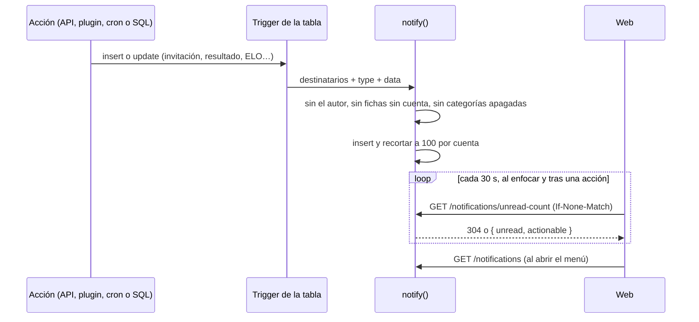

# Notificaciones (primera etapa): documentación

## Qué hace

Le da a la web nueva las notificaciones de la campana: cuando pasa algo que le importa a alguien (lo invitan a un equipo, aceptan su pedido, sale el resultado de su partida, sube de nivel, cierra la temporada…), la base crea una notificación para esa cuenta. La API la lista, la cuenta y la marca como leída. Solo en la web: ni Discord ni email.

Las crea **la base**, con triggers en las tablas. Así salen igual vengan de la API, del plugin del servidor (`!claim`, el fin de un mix), del cierre automático de la temporada o de un admin desde el SQL Editor.

## La tabla `notifications`

Una fila por destinatario, que es la **cuenta** (`user_id`), no la ficha: un jugador sin cuenta no recibe nada.

| Columna | Qué guarda |
|---|---|
| `type` y `category` | El evento (40 tipos) y su categoría (`team`, `tournament`, `pcw`, `elo`, `season`, `account`, `news`, `admin`) |
| `data` | Ids y nombres **del momento**. El frontend arma el texto: si un equipo cambia de nombre, la notificación vieja no se rompe |
| `ref`, `actionable`, `resolution` | La invitación a un equipo y el pedido para entrar se aceptan o rechazan desde la lista. `ref` (`team_invite:<id>`) permite marcar cómo terminó: `accepted`, `rejected`, `cancelled` o `expired` |
| `actor_id` | Quién la provocó (null si fue el sistema) |
| `read_at` | null = sin leer |

RLS: cada cuenta lee solo las suyas. Nadie las escribe desde afuera; solo `notify()`, que es `security definer`.

## `notify()` y las preferencias

`notify(cuentas, type, data, ref, keep_actor)`:

1. Saca a quien hizo la acción (`auth.uid()`), salvo con `keep_actor` (el cambio de contraseña lo hace el propio usuario y se avisa igual).
2. Saca los ids que no son cuentas.
3. Saca a quien apagó la categoría (`notification_wants`).
4. Inserta y borra lo que pase de 100 por cuenta.

**Preferencias:** en `user_preferences.preferences.notifications` se guarda solo lo que el usuario cambió, por ejemplo `{ "pcw": false, "news": true }`. Por defecto todas prendidas menos **`news`** ("Torneo nuevo" y "Temporada nueva", que van a todas las cuentas). **Obligatorias:** `team_invite`, `team_join_request` y `password_changed` llegan aunque su categoría esté apagada. Una categoría apagada no guarda nada: prenderla no trae las de antes.

## Los eventos

| Categoría | Dónde se crean |
|---|---|
| Equipos | Triggers en `team_invites` (invitación, pedido, respuesta y resolución, también al vencer o cancelar), `teams` (nuevo líder; equipo borrado), `team_members` (te sacaron, se fue, cambió el rol, te sumó un admin; nada en los equipos de PCW) y `team_requests` (aprobado o rechazado) |
| Torneos | `events` (fixture listo, cancelado, campeón y subcampeón al terminar; torneo nuevo en Novedades), `tournament_registrations` (alta o baja hecha por el organizador), `matches` (horario nuevo, empieza el veto, resultado o corrección) y `match_vetos` (turno, veto terminado, veto reiniciado) |
| PCW | `pcw_posts` (aceptada o cancelada) y `matches` (resultado) |
| Mixes y ELO | `player_elo` (sube o baja de nivel; no dentro de un recálculo), `match_crashes` (el admin decidió el ELO de un mix interrumpido), `mix_deletions` (mix borrado), `elo_adjustments` (ajuste del admin; no los internos `mix_kept`) y `match_clips` (la jugada ya tiene video) |
| Temporadas | `player_elo` (llegaste al mínimo de mixes), `season_standings` (cerró: puesto, medalla y ELO nuevo), `player_medals` (medalla a mano) y `seasons` (empezó una, en Novedades) |
| Cuenta | `claim_log` (`!claim` vinculó de verdad), `steam_requests` (aprobado o rechazado), `profiles` (alias cambiado por un admin, rol, contraseña) |
| Administración | `steam_requests` y `team_requests` (pedidos nuevos), `match_crashes` (mix que espera revisión), `matches` (demo que no se pudo subir) y `season_close_due` (el cierre espera por un mix en vivo; una vez cada 6 horas como mucho) |

La tabla completa con el `data` de cada tipo, el texto sugerido y el link está en el contrato: [`docs/frontend/contrato/notificaciones.md`](../../frontend/contrato/notificaciones.md).

## API

| Endpoint | Qué hace |
|---|---|
| `GET /api/v1/notifications` | Lista paginada de la vista `notification_list` (con el alias del autor). Filtros `unread`, `actionable` y `category`; orden por fecha e id |
| `GET /api/v1/notifications/unread-count` | `{ unread, actionable }` de `notifications_unread()`. El ETag incluye la última notificación: cambia si llega una nueva aunque el número sea el mismo |
| `POST /api/v1/notifications/read` | `{ ids }` o `{ all: true }` con `notifications_mark_read` (solo toca las propias) |
| `GET`/`PATCH /api/v1/me/profile` | `preferences.notifications`: el mapa completo de categorías; el `PATCH` une las enviadas con las guardadas |

## Dónde está cada cosa

| Qué | Archivo |
|---|---|
| Migración | `supabase/replanteo/28_notificaciones.sql` |
| Inversa y pruebas SQL | `docs/bitacora/2026-10-14-replanteo-modelo-datos/reversas/28_notificaciones.sql` y `pruebas/28_notificaciones.sql` |
| Rutas y esquemas | `web/backend/src/routes/notifications.ts`, `src/schemas/notifications.ts` |
| Preferencias | `web/backend/src/routes/me.ts`, `src/schemas/profile.ts` |
| Pruebas | `web/backend/test/unit/notifications-routes.test.ts`, `test/integration/notifications.test.ts` (y `me-routes`, `me.test.ts`) |
| Contrato del frontend | `docs/frontend/contrato/notificaciones.md` (sección 12), `README.md`, `cuenta.md` y `decisiones.md` |
