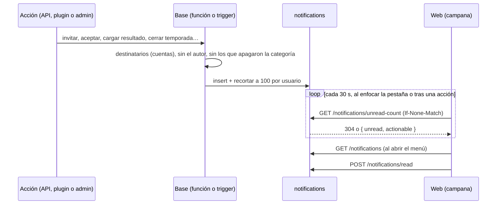
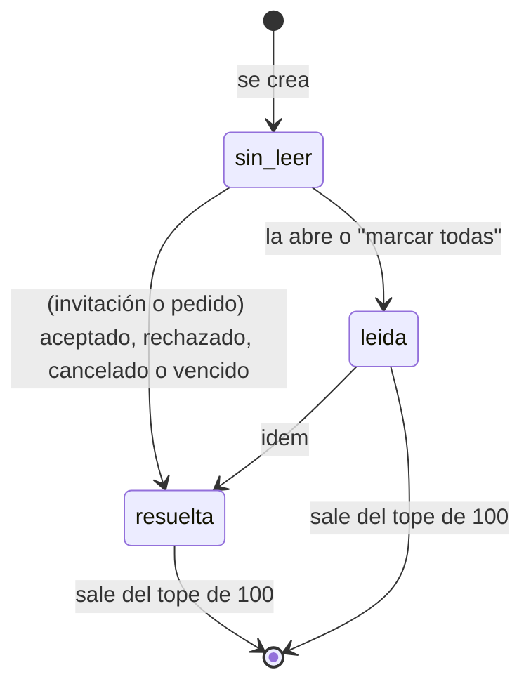

# Plan: Notificaciones (backend, primera etapa)

> Planeación original. Estado: **aprobado** el 2026-10-25.

El frontend ya tiene la campana y el menú (`web/frontend/src/features/shell/notifications/`) con datos de ejemplo: falta el backend. Este plan cubre la base, la API y el contrato. El frontend se conecta en un requerimiento aparte.

## Decisiones tomadas

| Tema | Decisión | Por qué |
|---|---|---|
| Alcance | Primera etapa: todos los eventos del mapa (sección 3) **menos** los que necesitan una tarea programada, que pasan a la segunda | Daniel, 2026-10-24 |
| Canal | Solo en la web. Ni Discord ni email | Daniel, 2026-10-24 |
| Tiempo real | **Opción B:** contador liviano con ETag cada 30 s (también al enfocar la pestaña y después de las acciones del propio usuario) y la lista al abrir el menú | Daniel, 2026-10-25. Carga poco la base; si algún día hay SSE, los endpoints siguen sirviendo |
| Preferencias | Se puede apagar cada **categoría** (Equipos, Torneos, PCW, Mixes y ELO, Temporadas, Cuenta, Novedades y, para admins, Administración) | Daniel, 2026-10-24 |
| Novedades | "Torneo nuevo" y "Temporada nueva" (van a todas las cuentas) forman la categoría **Novedades**, **apagada por defecto**: el usuario la prende si las quiere | Daniel, 2026-10-25 |
| Las que no se apagan | Invitación a un equipo, pedido para entrar a tu equipo y cambio de contraseña | Daniel, 2026-10-25: sin las dos primeras, el que invita o pide nunca recibe respuesta; la tercera es un aviso de seguridad |
| Una notificación apagada | No se guarda (se filtra al crearla). Volver a prenderla no trae las viejas | Más simple y no ocupa lugar del tope de 100 |
| Retención | Las **últimas 100** por usuario: al crear una, se borran las que sobran | Daniel, 2026-10-24 |
| Pendientes resueltos | La notificación de una invitación o un pedido queda con `resolution` (`accepted`, `rejected`, `cancelled` o `expired`), sin borrarse, se resuelva desde donde se resuelva | Daniel, 2026-10-24 |
| Destinatario | El **usuario** (la cuenta). Un jugador sin cuenta (ficha sin `user_id`) no recibe nada | Las notificaciones son de la web; la ficha sola no entra |
| Quien hace la acción | No se notifica a sí mismo (el admin que se suma a un equipo, el líder que cambia el horario) | `auth.uid()` en la base |
| Dónde se crean | En la base: una función `notify()` llamada desde las funciones existentes y desde triggers de las tablas | Las acciones vienen de la API, del plugin (`claim_with_code`, fin de un mix) y del admin por SQL: así salen siempre |
| Texto | La base guarda `type` y `data` (ids y nombres en el momento); el frontend arma el título y el cuerpo | Un solo lugar para el copy; el nombre de un equipo que cambia después no rompe la notificación vieja |

## 1. El flujo completo

## 2. Base de datos (replanteo `28_notificaciones.sql`)

Con su inversa y sus pruebas SQL, como los anteriores.

### Tabla `notifications`

| Columna | Tipo | Detalle |
|---|---|---|
| `id` | `bigint` identity | Orden y ETag |
| `user_id` | `uuid` → `auth.users` (`on delete cascade`) | Destinatario |
| `type` | `text` | Uno de la sección 3 (check) |
| `category` | `text` | `team`, `tournament`, `pcw`, `elo`, `season`, `account`, `news`, `admin` |
| `data` | `jsonb` | Ids y nombres para el texto y el link (`team`, `match_id`, `event`, `delta`…) |
| `ref` | `text` | Lo que se puede resolver (`team_invite:<id>`); null en el resto |
| `actionable` | `boolean` | Se acepta o rechaza desde la lista |
| `resolution` | `text` | `accepted`, `rejected`, `cancelled`, `expired` o null |
| `actor_id` | `uuid` | Quién la provocó (null si fue el sistema) |
| `created_at` | `timestamptz` | |
| `read_at` | `timestamptz` | null = sin leer |

Índices: `(user_id, id desc)` y `(user_id) where read_at is null`. RLS: cada usuario lee y marca solo las suyas; nadie las crea desde afuera (solo `notify()`, `security definer`).

### Funciones

- `notify(p_users uuid[], p_type text, p_data jsonb, p_ref text default null)`: saca al autor (`auth.uid()`), a los que apagaron la categoría y los duplicados; inserta y recorta a 100 por usuario.
- `notify_players(p_players uuid[], …)`: lo mismo desde fichas (busca su `user_id`).
- `notify_team(p_team uuid, …, p_who text)`: al líder (`captain_id`), al roster activo o a los dos.
- `notify_admins(…)`: a las cuentas con rol `admin`.
- `notifications_resolve(p_ref text, p_resolution text)`: marca la resolución de un pendiente.

### Preferencias

En `user_preferences.preferences.notifications`: solo lo que el usuario cambió respecto del valor por defecto, por ejemplo `{ "pcw": false, "news": true }`. Por defecto todas prendidas menos `news`. La API (`PATCH /me/profile`, `preferences.notifications`) valida las categorías y devuelve siempre el mapa completo. Las tres obligatorias se envían aunque su categoría esté apagada.

## 3. Eventos de la primera etapa

**Destinatarios:** líder = `captain_id` del equipo; roster = miembros activos con cuenta.

### Equipos (`team`)
| `type` | Quién la recibe | Dónde se crea | Acción |
|---|---|---|---|
| `team_invite` | Invitado | `team_invite` (kind `invite`) | Aceptar / Rechazar (obligatoria) |
| `team_join_request` | Líder | `team_request_join` | Aceptar / Rechazar (obligatoria) |
| `team_invite_answered` | Líder | `team_invite_answer` (aceptada o rechazada) | — |
| `team_join_answered` | Jugador | `team_invite_answer` sobre un pedido | — |
| — (resolución) | — | `team_invite_answer`, `team_invite_cancel` y `team_invites_expire` llaman a `notifications_resolve` | — |
| `team_captain` | Nuevo líder | `set_team_captain` | — |
| `team_removed` | Jugador | Trigger en `team_members` (`left_at` puesto por otro) | — |
| `team_member_left` | Líder | Trigger en `team_members` (`left_at` puesto por el propio jugador) | — |
| `team_role_changed` | Jugador | Trigger en `team_members` (cambia `role`) | — |
| `team_added` | Jugador | Trigger en `team_members` (alta hecha por un admin, sin invitación) | — |
| `team_deleted` | Roster | Antes de borrar el equipo (`teams_safe_delete`) | — |
| `team_request_answered` | El que pidió crear el equipo | Trigger en `team_requests` (aprobado o rechazado) | — |

### Torneos (`tournament`)
| `type` | Quién la recibe | Dónde se crea |
|---|---|---|
| `event_registration` | Líder del equipo | Trigger en `tournament_registrations` (alta o baja hecha por el organizador) |
| `event_fixture` | Roster inscrito | `event_generate` (con el primer rival de cada equipo) |
| `match_scheduled` | Roster de los dos equipos | Trigger en `matches` (cambia `starts_at` de una partida de torneo) |
| `veto_turn` | Líder del equipo al que le toca | `veto_act` (pasa el turno) y el inicio del veto |
| `veto_done` | Roster de los dos equipos | `veto_act` (último paso) |
| `veto_reset` | Líderes | `veto_reset` |
| `match_result` | Roster de los dos equipos | `event_set_result` (resultado, corrección o W.O.) |
| `event_progress` | Roster | `event_set_result` cuando el equipo avanza, queda eliminado o sale campeón |
| `event_cancelled` | Equipos inscritos | Trigger en `events` (pasa a `cancelled`) |

### PCW (`pcw`)
| `type` | Quién la recibe | Dónde se crea |
|---|---|---|
| `pcw_accepted` | Quien publicó (o el líder del equipo) | `accept_pcw` |
| `pcw_cancelled` | El otro bando | `cancel_pcw_match` |
| `pcw_result` | Los dos rosters | `pcw_set_result` |

### Mixes y ELO (`elo`)
| `type` | Quién la recibe | Dónde se crea |
|---|---|---|
| `level_changed` | Jugador | `elo_apply_match` (sube o baja de nivel; no dentro de `elo_recompute_all`) |
| `mix_review_resolved` | Los que jugaron | `elo_crash_apply` y `elo_crash_discard` |
| `mix_deleted` | Los que jugaron | `admin_delete_mix` (con `elo_mode`) |
| `elo_adjusted` | Jugador | `elo_add_adjustment` y `elo_remove_adjustment` (no los `mix_kept`) |
| `clip_ready` | Jugador de la jugada | Trigger en `match_clips` (llega el video) |

### Temporadas (`season`)
| `type` | Quién la recibe | Dónde se crea |
|---|---|---|
| `season_ranked` | Jugador | `elo_apply_match` (llega al mínimo de mixes de la temporada activa) |
| `season_closed` | Jugadores de la foto del cierre | `season_close_run` (puesto, medalla y, si es nivel 10, el ELO nuevo) |
| `medal_granted` | Jugador | Trigger en `player_medals` (medalla dada a mano, sin `season_id`) |

### Novedades (`news`, apagada por defecto)
| `type` | Quién la recibe | Dónde se crea |
|---|---|---|
| `event_new` | Las cuentas que prendieron Novedades | Trigger en `events` (se crea uno en inscripción) |
| `season_started` | Las cuentas que prendieron Novedades | `season_start` y la apertura automática al cerrar |

### Cuenta (`account`)
| `type` | Quién la recibe | Dónde se crea |
|---|---|---|
| `steam_claimed` | Usuario | `claim_with_code` |
| `steam_request_answered` | Usuario | `approve_steam_request` y `reject_steam_request` (alta o baja) |
| `alias_changed` | Usuario | Trigger en `profiles` (cambia `tag` por un admin) |
| `role_changed` | Usuario | Trigger en `profiles` (cambia `role`) |
| `password_changed` | Usuario (obligatoria) | `on_auth_user_password_changed` |

### Administración (`admin`, solo admins)
| `type` | Dónde se crea |
|---|---|
| `admin_steam_request` | Trigger en `steam_requests` (pedido nuevo de alta o baja) |
| `admin_team_request` | Trigger en `team_requests` (pedido nuevo) |
| `admin_mix_review` | Trigger en `match_crashes` (mix interrumpido que espera revisión) |
| `admin_demo_failed` | Trigger en `matches` (`demo_status` pasa a `missing`) |
| `admin_season_delayed` | `season_check` (el cierre espera por un mix en vivo) |

### Segunda etapa (tareas programadas, no entran acá)

Partida de torneo o PCW en 1 hora, PCW vencida sin rival, temporada por terminar y partida de torneo sin resultado después de su horario.

## 4. API

| Endpoint | Qué hace |
|---|---|
| `GET /api/v1/notifications` | Lista paginada (`page`, `per` hasta 100), filtros `unread`, `category` y `actionable`, `sort` **`created_at` desc**. Cada fila: `id`, `type`, `category`, `data`, `actionable`, `resolution`, `actor` (`id`, `alias`), `created_at`, `read` |
| `GET /api/v1/notifications/unread-count` | `{ unread, actionable }` con ETag (`W/"<unread>-<último id>"`): `304` si no cambió |
| `POST /api/v1/notifications/read` | `{ ids }` o `{ all: true }`: marca como leídas. `204` |
| `PATCH /api/v1/me/profile` | `preferences.notifications`: `{ categoría: true/false }`. Responde el mapa completo (`news: false` por defecto). `400` con una categoría que no existe |

Todo con sesión (`401` sin ella). Aceptar o rechazar sigue usando los endpoints que ya existen (`/team-invites/{id}/accept`, `/join-requests/{id}/accept`…): la notificación se resuelve sola.

## 5. Contrato del frontend

Archivo nuevo `docs/frontend/contrato/notificaciones.md`: los endpoints, el sondeo (30 s, al enfocar y tras acciones), la tabla de `type` con su `data`, su categoría, el texto sugerido y el link, las obligatorias y las preferencias. Una fila en las novedades del `README.md` del contrato.

## 6. Pruebas

- **SQL** (`pruebas/28_notificaciones.sql`): `notify` saca al autor y a los que apagaron la categoría, recorta a 100, no notifica a fichas sin cuenta; cada evento crea la fila esperada; las resoluciones.
- **Unitarias** (Vitest): esquemas, ETag del contador, validación de preferencias.
- **Integración**, con cuidado de no tocar BETA ni correr `seasons.test.ts`: invitar → notificación al invitado → aceptar → notificación al líder y la invitación resuelta; contador con `304`; marcar leídas; preferencias.

## 7. Requisitos antes de empezar

- Supabase local con la copia de producción y BETA (no se toca).
- Detener Vite antes de cambiar de rama (esta rama no tiene el frontend).

## 8. Orden de implementación

1. Migración `28`: tabla, RLS, `notify` y ayudantes, con su inversa.
2. Los eventos por módulo: equipos, cuenta y administración primero; después torneos, PCW, ELO y temporadas.
3. Pruebas SQL.
4. API: rutas, esquemas y preferencias, con sus pruebas.
5. Contrato del frontend.
6. `DOCUMENTACION.md`, `GUIA_IMPLEMENTACION.md`, `docs/PENDIENTES.md` (la segunda etapa) y la fila de la bitácora.
