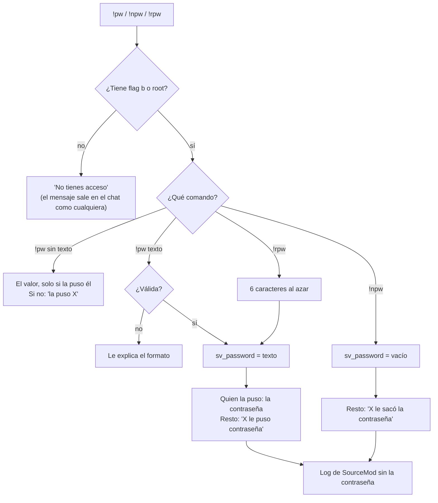
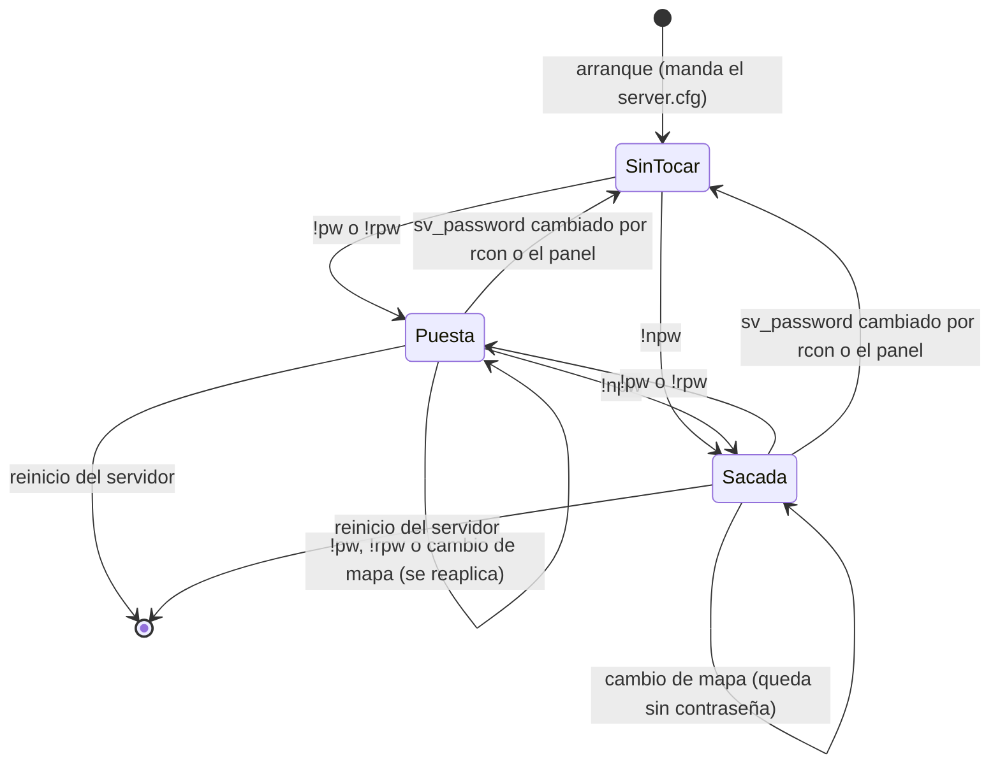

# Plugin de contraseña del servidor (`csstv_password`): documentación

## Qué hace

`csstv_password` 1.0.0 deja que los **admins y los moderadores** manejen la contraseña del servidor desde el chat, sin rcon ni panel:

| Comando | Qué hace |
|---|---|
| `!pw <contraseña>` | Pone esa contraseña. Las comillas son opcionales: `!pw abc` y `!pw "abc"` hacen lo mismo |
| `!pw` | Dice si hay contraseña y quién la puso. El valor solo se lo muestra a quien la puso |
| `!npw` | Saca la contraseña |
| `!rpw` | Pone una contraseña aleatoria de 6 caracteres |

También funcionan con `/` (`/pw abc`, sin mensaje en el chat) y desde la consola (`sm_pw`, `sm_npw`, `sm_rpw`).

**Solo quien la puso ve la contraseña** (decisión de Daniel, 2026-10-25). Compartirla es decisión suya. El resto, admins y moderadores incluidos, ve "**X** le puso contraseña al servidor". El mensaje `!pw abc` **no aparece en el chat** de nadie.

La contraseña **se mantiene en los cambios de mapa** y se pierde con un reinicio del servidor: ahí vuelve la del `server.cfg`.



## Quién puede usarlo

- Piden la **flag `b`** (`ADMFLAG_GENERIC`). La tienen el grupo `Moderador` (`bcdfj`) y los admins (`z`, root).
- Cada comando se puede restringir aparte en `configs/admin_overrides.cfg` (`sm_pw`, `sm_npw`, `sm_rpw`).
- No hubo que tocar `admin_groups.cfg` ni `admins_simple.ini`.

## Contraseñas válidas

- De 1 a 32 caracteres.
- Solo letras sin tilde, números, `-`, `_` y `.`. Sin espacios, `;`, comillas ni `ñ`.
- `!rpw` usa minúsculas y números sin los que se confunden (`0`, `o`, `1`, `l`, `i`). Por ejemplo: `5b9vjx`.

## Estados y cambios de mapa

El `server.cfg` se ejecuta en cada mapa y trae su propio `sv_password` (en el servidor real hay una contraseña de siempre; en RBK está vacío). El plugin guarda lo suyo en memoria y lo vuelve a aplicar en `OnConfigsExecuted`, después del `server.cfg`.



- **Cambio por fuera:** si alguien cambia `sv_password` por rcon o desde el panel con el mapa ya cargado, el plugin deja de tocarla. En el próximo mapa manda el `server.cfg`. Los cambios que hace el `server.cfg` mientras carga el mapa no cuentan como "por fuera".
- **`!npw` con el servidor ya sin contraseña:** responde "ya no tenía contraseña" y la deja vacía también en los próximos mapas.
- **Quién la puso** se reconoce por SteamID: si se desconecta y vuelve, `!pw` le sigue mostrando el valor.

## El chat

- `!pw abc` en el chat lo resuelve el forward `OnClientSayCommand` y lo corta con `Plugin_Stop`, así que el mensaje no le llega a nadie.
- SourceMod 1.10 igual ejecuta el trigger público (`!`) en su hook post. Esa segunda llamada a `sm_pw` se ignora: viene del chat (`SM_REPLY_TO_CHAT`) en el mismo tick (`FromHandledSay`).
- Si quien escribe `!pw abc` no tiene acceso, el plugin no corta nada: el mensaje se ve en el chat como cualquier otro y SourceMod le responde que no tiene acceso. No hay riesgo, porque esa contraseña no se aplica.
- Los mensajes llevan el prefijo `[CMLeague]` y los colores de `csstv_reporter` (`csstv_chat_tag`, `csstv_chat_colors`), como los otros plugins `csstv_*`.

## Registro

Cada cambio queda en el log de SourceMod con `LogAction`, **sin la contraseña**:

```
[csstv_password.smx] "Juan<12><STEAM_0:0:123><>" le puso contraseña al servidor
[csstv_password.smx] "Juan<12><STEAM_0:0:123><>" le sacó la contraseña al servidor
```

## Configuración

`cfg/sourcemod/csstv_password.cfg`, igual en todos los servidores:

| Cvar | Valor | Qué hace |
|---|---|---|
| `csstv_pw_enabled` | `1` | Con `0`, los comandos responden "desactivados" y el plugin deja de reaplicar la contraseña en los cambios de mapa |
| `csstv_pw_version` | `1.0.0` | Solo lectura |

El cfg se vuelve a ejecutar en cada mapa: para apagarlo de verdad hay que cambiarlo en el archivo, no solo en la consola.

## Build de depuración

`spcomp csstv_password.sp PW_DEBUG=` agrega:

- `csstv_pw_fakecmd <userid> <comando>`: un bot ejecuta un comando.
- `csstv_pw_setadmin <userid> <grupo|root|none>`: los permisos de un bot.
- `csstv_pw_state`: el estado del plugin y `sv_password`.

Además, escribe en el log cada mensaje que manda (`[respuesta a <jugador>]`) y reconoce a los bots por su nombre (todos tienen el SteamID `BOT`). **No se sube a los servidores.**

## Dónde está cada cosa

| Qué | Archivo / ubicación |
|---|---|
| Código | `server/addons/sourcemod/scripting/csstv_password.sp` |
| Plugin compilado (producción) | `server/addons/sourcemod/plugins/csstv_password.smx` |
| Configuración | `server/cfg/sourcemod/csstv_password.cfg` |
| En los servidores | `cstrike/addons/sourcemod/plugins/csstv_password.smx` y `cstrike/cfg/sourcemod/csstv_password.cfg` (servidor real y RBK) |
| Pruebas con bots | `docs/bitacora/2026-10-25-plugin-password/pruebas/password.sh` |
