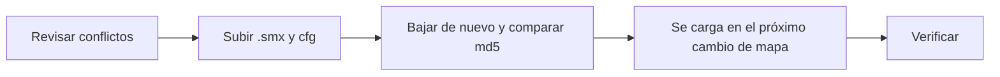

# Plugin de contraseña del servidor (`csstv_password`): guía de implementación

## Estado

Hecho, **probado con bots en el servidor local** y **subido al servidor real y a RBK el 2026-10-25** (excepción a "plugins al final", pedida por Daniel). Se carga en el próximo cambio de mapa de cada uno. Falta la verificación en los dos servidores y la prueba con un cliente real (prueba 14).

## Archivos

| Archivo | Cambio |
|---|---|
| `server/addons/sourcemod/scripting/csstv_password.sp` | Nuevo: plugin 1.0.0 |
| `server/addons/sourcemod/plugins/csstv_password.smx` | Nuevo: build de producción, sin `PW_DEBUG` (10 697 bytes, md5 `b5329c68684f643457b2e3dd503620cd`), compilado con el `spcomp` del servidor local |
| `server/cfg/sourcemod/csstv_password.cfg` | Nuevo: `csstv_pw_enabled "1"` |
| `docs/bitacora/2026-10-25-plugin-password/` | Esta bitácora, con `pruebas/password.sh` |
| `docs/bitacora/README.md`, `docs/PENDIENTES.md` | Fila, excepción y punto 1.19 |
| Servidor real y RBK | El `.smx` y el cfg (ver Despliegue) |

Compilación:

```bash
spcomp.exe csstv_password.sp -i<scripting>/include -o<salida>/csstv_password.smx
spcomp.exe csstv_password.sp PW_DEBUG= -i<scripting>/include -o<salida>/csstv_password_debug.smx
```

## Despliegue (hecho el 2026-10-25)

Sin licencia: **el mismo `.smx` va a los dos servidores**, como `csstv_calladmin` y `csstv_sell`. Todo en la misma tanda, por SFTP (`sftp` de OpenSSH, con la clave del host verificada: `SHA256:wCs9fwFD2eKPndyKDYEEgkBJcvXnL0gj2sVY8V0t8UA`, la misma en los dos).



| Servidor | Acceso | Qué se subió | Verificación |
|---|---|---|---|
| **Real** | `SFTP_CSS_*` | `addons/sourcemod/plugins/csstv_password.smx` y `cfg/sourcemod/csstv_password.cfg` | Bajados de nuevo: md5 `b5329c68684f643457b2e3dd503620cd` y cfg igual |
| **RBK** | `SERVER1_*` | Lo mismo | Igual |

Antes de subir:

- Ninguno de los dos tenía `csstv_password.smx` ni su cfg.
- Ningún plugin de los dos servidores (35 en el real, 36 en RBK) registra `sm_pw`, `sm_npw` ni `sm_rpw` ni usa `sv_password`. Se revisó el contenido de cada `.smx`.
- Los dos tienen el grupo `Moderador` con `bcdfj` y 3 entradas `@Moderador`.
- No hay overrides de esos comandos.
- El `server.cfg` del servidor real tiene una contraseña de siempre. El de RBK la tiene vacía.
- `csstv_allchat` no choca: solo escucha el `SayText2` del juego, que no llega a salir, y los mensajes del plugin van con `USERMSG_BLOCKHOOKS`.

**No se ejecutó nada en las consolas:** el plugin se carga solo en el próximo cambio de mapa. No se recarga nada con un mix en curso.

**Para verificar, después del cambio de mapa en cada servidor:**

1. `sm plugins list`: tiene que aparecer `CSSTV Password (1.0.0)`.
2. Un admin o un moderador hace `!rpw`, prueba conectarse con y sin la contraseña desde otro cliente (prueba 14) y hace `!npw`.
3. En el **servidor real**, `!npw` deja el servidor **sin** contraseña hasta el próximo reinicio, aunque el `server.cfg` tenga una. Para volver a la de siempre: `!pw <la de siempre>`, o `sv_password` por rcon (el plugin deja de tocarla).

## Pruebas

### Servidor local con bots (2026-10-25)

Build `PW_DEBUG` en el servidor local, con **`csstv_reporter` sacado de la carpeta durante las pruebas** para no enviar nada a la Supabase real. La cola estaba vacía. Script: [`pruebas/password.sh`](pruebas/password.sh) (RCON en `172.24.0.1:27016`: el servidor local escuchaba en esa interfaz y no en `192.168.1.113`).

| # | Caso | Resultado |
|---|---|---|
| 1 | Bot sin permisos: `!pw abc`, `sm_npw`, `sm_rpw` | "No tienes acceso" las 3 veces; `sv_password` sin cambios ✅ |
| 2 | Moderador: `!pw abc` | `sv_password` = `abc`. Solo él ve el valor; el otro moderador, el root y el resto ven "Orin le puso contraseña al servidor" ✅ |
| 3 | `!pw "abc2"` y `sm_pw "abc3"` | Las dos sin comillas ✅ |
| 4 | Con espacio, 33 caracteres, `a;b`, `cañon` | Las 4 rechazadas con el formato; no cambia ✅ |
| 5 | `!rpw` (root) | `5b9vjx` ✅ |
| 6 | `!pw` del que la puso y `/pw` de otro moderador | "La contraseña es 5b9vjx (la pusiste tú)" y "la puso Paul" ✅ |
| 7 | `!npw` dos veces | La saca y avisa; la segunda, "ya no tenía contraseña" ✅ |
| 8 | `server.cfg` con `base123`, `!pw plugin1` y cambio de mapa | Queda `plugin1` ✅ |
| 9 | `!npw` y cambio de mapa con `base123` en el `server.cfg` | Queda vacía ✅ |
| 10 | `!pw plugin2`, `sv_password rcon1` por rcon y cambio de mapa | El plugin lo detecta ("cambió por fuera"); en el mapa nuevo, `base123` ✅ |
| 11 | El que la puso sale y vuelve (bot renombrado igual) | Le sigue mostrando el valor; a otro moderador, "la puso Brad" ✅ |
| 12 | `csstv_pw_enabled "0"` en el cfg | "Desactivados" y en el mapa nuevo manda el `server.cfg` (`base123`) ✅ |
| 13 | Log de SourceMod | `"Paul<49><BOT><>" le puso contraseña al servidor`, sin la contraseña ✅ |
| — | Chat del motor (`cstrike/logs/`) | Solo aparece el `say "!pw abc"` del bot sin permisos. Los de admins y moderadores no ✅ |

**No probado:** la prueba 14, conectarse con un cliente real con y sin la contraseña. El chequeo lo hace el motor y no depende del plugin, pero queda para la verificación en los servidores. En la build de producción, quién la puso se reconoce por SteamID; con bots se probó por nombre.

Al terminar se dejó el servidor local como estaba: apagado, con `csstv_reporter.smx` de vuelta, sin `csstv_password` (ni el `.smx` ni el cfg), con el `server.cfg` igual al original y la cola vacía.

## En qué se apartó del plan

1. **El chat se ataja con `OnClientSayCommand`, no con un listener de `say`.** Con el listener, y también con el forward solo, `!pw` se ejecutaba **dos veces**: SourceMod 1.10 procesa el trigger público en su hook post aunque el plugin corte el mensaje. Con `!rpw` eso ponía dos contraseñas distintas, y la que veía el moderador no era la que quedaba. Se arregló ignorando la segunda llamada (`FromHandledSay`). El mensaje no sale en el chat en ningún caso.
2. **"Quién ve la contraseña":** el plan proponía mostrarla a todos los admins y moderadores, con `csstv_pw_show_all`. Daniel decidió el 2026-10-25, antes de implementar, que la vea **solo quien la puso**. El plan se actualizó antes de aprobarlo y el cvar no existe.
3. **Prueba 12:** `AutoExecConfig` vuelve a ejecutar el cfg en cada mapa, así que `csstv_pw_enabled 0` por consola dura solo hasta el cambio de mapa. La prueba se hizo con el valor en el cfg.
4. **Prueba 11:** `bot_add_ct` no acepta un nombre en v34. Se simuló renombrando con `sm_rename` un bot nuevo con el nombre del que se fue.

## Incidentes durante las pruebas

- En la primera tanda, la prueba 11 sacó a SourceTV, porque el script lo contaba como bot. Ahora se excluye.
- **Hallazgo aparte (no es de este plugin):** al revisar los plugins del servidor real, **`csstv_hud.smx` no está** en `addons/sourcemod/plugins/` ni en `disabled/`. `PENDIENTES.md` (punto 1.15) dice que la 1.1.0 se subió el 2026-10-23. Su cfg sí está, modificado el 2026-10-24 desde el panel. En RBK sí está. No se tocó. Según Daniel, lo sacó kyan.

## Cómo revertir

En cada servidor (**servidor real** por `SFTP_CSS_*` y **RBK** por `SERVER1_*`):

1. **Al instante:** `csstv_pw_enabled 0` en la consola y en `cfg/sourcemod/csstv_password.cfg`. Si había una contraseña del plugin, `sv_password "<la de siempre>"`.
2. **Sacarlo:** mover `addons/sourcemod/plugins/csstv_password.smx` a `plugins/disabled/`. En el próximo cambio de mapa ya no se carga, y la contraseña vuelve a ser la del `server.cfg`.
3. En el repo: `git revert` del commit del plugin.
