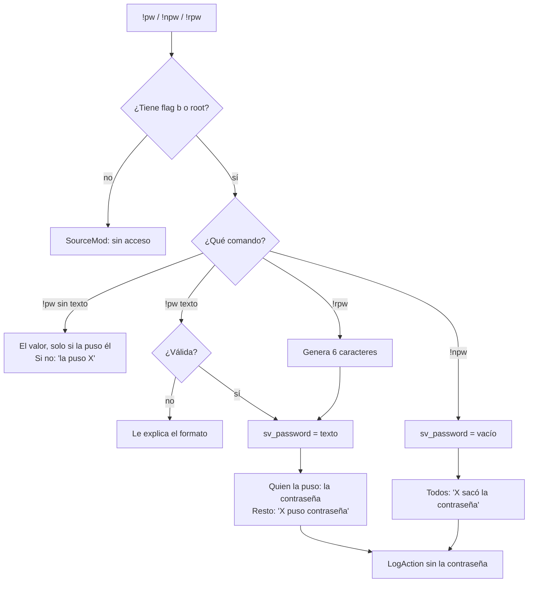
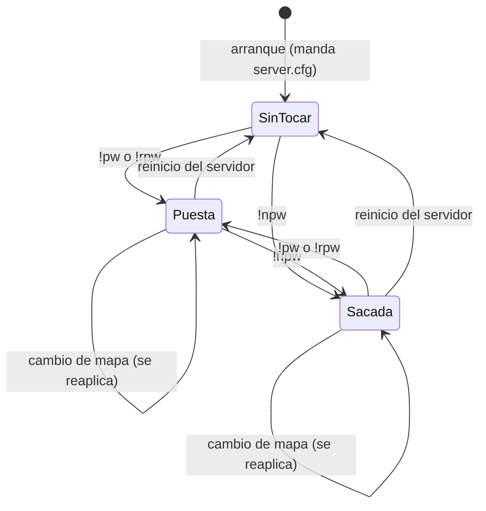

# Plan: plugin de contraseña del servidor (`csstv_password`)

> Planeación original. Estado: **propuesta**, pendiente de aprobación.

Pedido de Daniel (2026-10-25): un plugin propio para que los **admins y los moderadores** pongan, saquen o generen la contraseña del servidor desde el chat:

- `!pw <contraseña>`: pone esa contraseña.
- `!npw`: saca la contraseña.
- `!rpw`: pone una contraseña aleatoria.

Es una excepción a "plugins al final" (la misma que `!calladmin` y `!whois`): es un plugin aparte, chico, y no toca `csstv_reporter`.

## Decisiones tomadas

| Tema | Decisión | Por qué |
|---|---|---|
| Plugin | **Nuevo, `csstv_password` 1.0.0**, independiente de `csstv_reporter` y **sin licencia** (el mismo `.smx` en los dos servidores, como `csstv_calladmin`) | No hay nada que proteger con licencia, y así no se recarga el reporter |
| Quién puede | Flag **`b` (`ADMFLAG_GENERIC`)**: lo tienen los moderadores (`bcdfj`) y los admins (`z`). Se puede cambiar con `admin_overrides.cfg` | No hace falta tocar `admin_groups.cfg` ni `admins_simple.ini` |
| Comandos | `sm_pw`, `sm_npw` y `sm_rpw`. Por ser comandos de SourceMod, `!pw` y `/pw` (silencioso) funcionan en el chat, y también desde la consola | Es lo estándar de SourceMod |
| `!pw` sin texto | Dice si hay contraseña y quién la puso. **El valor solo se lo muestra a quien la puso** (se compara el SteamID). A los demás: "Hay contraseña, la puso X" | Por si el que la puso se la olvida, sin mostrársela a otros |
| Contraseñas válidas | De 1 a 32 caracteres: letras, números, `-`, `_` y `.`. Las comillas son opcionales: `!pw "abc"` y `!pw abc` hacen lo mismo. Sin espacios | Se escribe fácil en `connect ip; password abc` y en Discord |
| `!rpw` | 6 caracteres en minúscula sin los que se confunden (sin `0`, `o`, `1`, `l` ni `i`) | Fácil de dictar y de copiar |
| Quién ve la contraseña | **Solo el admin o moderador que la puso** (decisión de Daniel, 2026-10-25). Todos los demás, admins y moderadores incluidos, ven "**X** puso contraseña al servidor" (o "sacó la contraseña"), sin el valor | Compartirla es decisión de quien la puso |
| Cambio de mapa | **La contraseña se mantiene.** El plugin la vuelve a aplicar en `OnConfigsExecuted`, después del `server.cfg` (que se ejecuta en cada mapa y trae su propio `sv_password`). Lo mismo con `!npw`: queda sin contraseña aunque el `server.cfg` tenga una | Si no, el `server.cfg` la pisaría en cada mapa |
| Reinicio del servidor | Se pierde y vale la del `server.cfg` | El estado vive en memoria. Es un "volver a lo de siempre" seguro |
| Con un mix en curso | **Se puede usar** | Es justo cuando más se usa: cerrar el servidor para el mix |
| Registro | `LogAction` en el log de SourceMod: quién, con su SteamID, y qué hizo, **sin la contraseña** | Para saber quién la cambió sin dejarla escrita en los logs |
| Interruptor | `csstv_pw_enabled 1`. Con `0`, los comandos responden "desactivado" y el plugin deja de reaplicar | Para cortarlo sin descargar el plugin |

## 1. El flujo completo

## 2. El plugin

- `server/addons/sourcemod/scripting/csstv_password.sp`, con el estilo de los otros `csstv_*`: comentario de cabecera, `#pragma newdecls required` y mensajes en español con el prefijo de color de siempre.
- Comandos: `RegAdminCmd("sm_pw", …, ADMFLAG_GENERIC)`, igual `sm_npw` y `sm_rpw`.
- Toma el texto con `GetCmdArgString` y le saca las comillas de los bordes.
- Cvar en `cfg/sourcemod/csstv_password.cfg` (`AutoExecConfig`): `csstv_pw_enabled`.
- Estado en memoria: `SinTocar`, `Puesta` (con el texto, el nombre y el SteamID de quien la puso) o `Sacada`. Se reaplica en `OnConfigsExecuted`.
- Si alguien cambia `sv_password` por fuera (rcon o el panel), el plugin lo respeta: se engancha al cambio del cvar y pasa a `SinTocar` cuando no fue él.
- **Build de depuración** (`PW_DEBUG=`): agrega `csstv_pw_fakecmd <userid> <comando>` para que un bot ejecute los comandos, como en `csstv_calladmin`.

## 3. Documentación para los moderadores

- `2026-10-19-calladmin-moderadores/DOCUMENTACION.md` dice que el moderador **no puede** cambiar la contraseña. En la `DOCUMENTACION.md` nueva queda que ahora sí (con `!pw`, `!npw` y `!rpw`).
- Si Daniel quiere, se regenera la guía de comandos de moderadores en PDF (`GUIA_COMANDOS_MODERADORES.pdf`) con los tres comandos.
- `CHANGELOG_DISCORD.txt` para los jugadores.

## 4. Pruebas (servidor local)

Con los cuidados de `CLAUDE.md`: `csstv_send 0` después de cada carga del cfg y la cola vacía antes de reiniciar.

| # | Caso | Esperado |
|---|---|---|
| 1 | Bot sin permisos: `!pw abc` | Sin acceso |
| 2 | Bot moderador (`@Moderador`): `!pw abc` | `sv_password` = `abc`; solo ese bot ve el valor, otro admin conectado no |
| 3 | `!pw "abc"` con comillas | Igual que el 2 |
| 4 | `!pw con espacio`, `!pw` de 33 caracteres, `!pw a;b` | Rechazada, con el formato |
| 5 | `!rpw` | 6 caracteres del alfabeto sin confusos |
| 6 | `!pw` sin texto, del que la puso y de otro admin | Al que la puso, el valor; al otro, "la puso X" |
| 7 | `!npw` | `sv_password` vacío |
| 8 | Cambio de mapa con contraseña puesta y con `server.cfg` con otra | Queda la del plugin |
| 9 | Cambio de mapa después de `!npw`, con `server.cfg` con contraseña | Queda sin contraseña |
| 10 | `sv_password` cambiado por rcon y después un cambio de mapa | Manda el `server.cfg` (el plugin no la pisa) |
| 11 | El que la puso se desconecta y vuelve | Con `!pw` sigue viendo el valor (se reconoce por SteamID) |
| 12 | `csstv_pw_enabled 0` | "Desactivado" y no se reaplica |
| 13 | El log de SourceMod | Quién y qué, sin la contraseña |
| 14 | Un cliente real se conecta con y sin la contraseña | Entra solo con la correcta |

Los scripts quedan en `pruebas/`.

## 5. Despliegue

En **los dos servidores en la misma tanda** (regla de `CLAUDE.md`):

| Servidor | Acceso | Qué se sube |
|---|---|---|
| Nuestro servidor real | `SFTP_CSS_*` | `plugins/csstv_password.smx` (el de producción, no el de depuración) y `cfg/sourcemod/csstv_password.cfg` |
| RBK | `SERVER1_*` | Los mismos dos archivos (sin licencia, como `csstv_calladmin`) |

- Un plugin nuevo **no se carga con `sm plugins load` si hay un mix en curso**. Se carga solo en el próximo cambio de mapa.
- Después del cambio de mapa, en cada servidor: `sm plugins list` (1.0.0) y un `!pw` / `!npw` de un admin.
- Como es un plugin nuestro, no va en `docs/PLUGINS_EXTERNOS.md`: se anota en `docs/PENDIENTES.md` y pasa a ser parte de "los mismos plugins" en todos los servidores (configuración común de `CLAUDE.md`).

## 6. Requisitos antes de empezar

| Qué | Quién |
|---|---|
| Aprobación de este plan ("quién ve la contraseña": decidido el 2026-10-25, solo quien la puso) | Daniel |
| El servidor local de pruebas apagado y disponible | Daniel |
| El compilador de SourceMod 1.10 (`spcomp`) que ya se usa para los otros plugins | Ya está |

## 7. Orden de implementación

1. `csstv_password.sp` y su cfg; compilar las builds de producción y de depuración.
2. Pruebas 1 a 13 en el servidor local con bots, y la 14 con un cliente real.
3. `DOCUMENTACION.md`, `GUIA_IMPLEMENTACION.md`, `CHANGELOG_DISCORD.txt`, la fila en `docs/bitacora/README.md` y `docs/PENDIENTES.md`.
4. Despliegue al servidor real y a RBK en la misma tanda, cuando Daniel lo pida.
