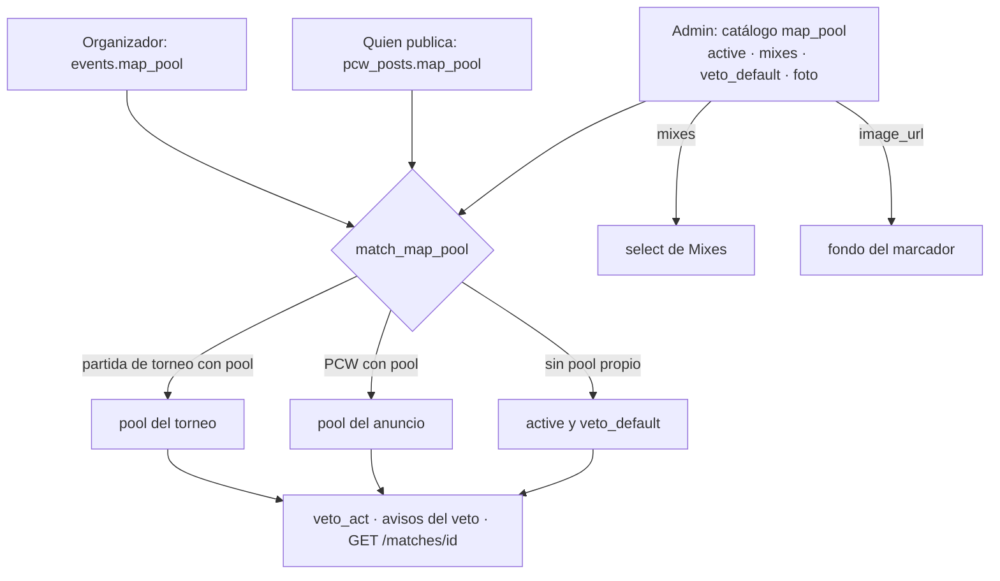

# Catálogo de mapas con pool propio por torneo y por PCW: documentación

## Qué hace

`map_pool` es la única maestra de mapas: el **catálogo** de todos los mapas que se pueden jugar. De cada mapa guarda:
- sus versiones de servidor (Inferno tiene `de_inferno` y `de_inferno_classic`);
- si está disponible;
- si sale en el select de Mixes;
- si está en el pool por defecto del veto;
- su foto, que es el fondo del marcador de la sala del mix y vale para todas sus versiones.

El veto de una partida ya no usa un pool global, sino el pool de esa partida:
- **Torneo:** el organizador elige el pool de su torneo entre los mapas disponibles. Por ejemplo, `de_russka` puede jugarse en un torneo aunque no esté en el pool por defecto.
- **PCW:** quien la publica elige su pool.
- **Sin pool propio:** se usa el pool por defecto.

Un mapa no se borra: se retira.

## Las marcas de un mapa

| Columna | Significa | Regla |
|---|---|---|
| `active` | Disponible. `false` = retirado | Un retirado no entra en pools nuevos |
| `mixes` | Sale en el select de Mixes (`GET /maps?mixes=true`) | La designamos nosotros |
| `veto_default` | Pool por defecto del veto: PCW y torneos sin pool propio | `check (not veto_default or active)`. El `PUT` del admin pide al menos 2 |
| `image_url` | Foto en `photos/maps/{name}/` | JPG, PNG o WebP de hasta 2 MB |

La migración dejó los mapas activos de hoy con `mixes` y `veto_default`, así que el veto no cambió.

## Pool de un torneo o de una PCW

`events.map_pool` y `pcw_posts.map_pool` son `text[]` con nombres del catálogo. `null` significa el pool por defecto.

Los triggers `events_map_pool` y `pcw_posts_map_pool` los validan con `map_pool_check`:
- **Disponibles:** los mapas tienen que estar disponibles. Si uno se retiró después de guardar el pool, se conserva; uno retirado nuevo no entra (`El mapa X no está disponible`).
- **Sin repetidos.**
- **Cantidad:** entre el BO más alto y 20 mapas.
  - En un torneo es `event_max_bo(config)`, que busca todas las claves `bo*`, también dentro de `playoffs`.
  - En una PCW es su `best_of`.
  - Como `events_map_pool` corre después de `events_guard`, la `config` ya llega completa con sus valores por defecto. Por ejemplo, la eliminación simple trae BO3 en todas las fases.
- **Torneo:** el pool no cambia después del primer veto de cualquier partida del torneo. Subir el BO por encima de la cantidad de mapas también se rechaza.

## Pool del veto de una partida

`match_map_pool(p_match)` devuelve filas de `map_pool` ordenadas por `position`. Elige así:
1. el pool del torneo, si la partida es de un torneo con pool;
2. si no, el del anuncio, si es una PCW con pool (por `pcw_posts.match_id`);
3. si no, los mapas `active and veto_default`.

Lo usan:
- `veto_act`, para la cantidad de mapas de la secuencia (`veto_sequence`) y para validar el mapa (`Ese mapa no está en el pool`);
- `tg_notify_matches` y `tg_notify_match_vetos`, para la acción del aviso de turno;
- el detalle de la partida (`veto.pool`).

## API

| Ruta | Qué hace |
|---|---|
| `GET /api/v1/maps` | Catálogo. Cada ítem trae `name`, `versions`, `active`, `position`, `mixes`, `veto_default` e `image_url`. Filtros: `q`, `include_inactive`, `mixes` y `veto_default`. Sin sesión |
| `PUT /api/v1/admin/maps` | La lista completa, en orden. No borra: si falta un mapa existente, responde `400` con los que faltan. `mixes` y `veto_default` que no vienen quedan como estaban (en un mapa nuevo, como `active`) |
| `POST /api/v1/admin/maps/{name}/image` | Foto nueva. La anterior se borra del bucket en segundo plano. Devuelve el mapa |
| `DELETE /api/v1/admin/maps/{name}/image` | Quita la foto |
| `POST /api/v1/events`, `PATCH /api/v1/events/{id}` | `map_pool` (opcional, `null` = por defecto). El detalle del torneo lo devuelve |
| `POST /api/v1/pcw/posts` | `map_pool` (opcional). Los anuncios lo devuelven (`pcw_post_list.map_pool`) |
| `GET /api/v1/matches/{id}` | `veto.pool` sale de `match_map_pool` |

## Dónde está cada cosa

| Qué | Archivo / ubicación |
|---|---|
| Migración (bloques 1 a 3) | `supabase/replanteo/30_mapas_temporadas.sql` |
| Inversa y pruebas SQL | `docs/bitacora/2026-10-14-replanteo-modelo-datos/reversas/30_mapas_temporadas.sql` y `pruebas/30_mapas_temporadas.sql` |
| Catálogo, `PUT`, foto y publicar PCW | `web/backend/src/routes/pcw-play.ts` |
| Esquemas | `web/backend/src/schemas/pcw.ts` (`MapItem`, `MapPoolItem`, `MapPoolNames`, `MapImageUpload`) y `schemas/events.ts` |
| Torneos | `web/backend/src/routes/events.ts` |
| Pool del veto en el detalle | `web/backend/src/routes/matches.ts` |
| Límite de la foto | `web/backend/src/lib/uploads.ts` (`MAP_IMAGE_MAX_BYTES`) |
| Contrato | `docs/frontend/contrato/admin.md`, `partidas.md`, `torneos.md`, `api.md` y `README.md` |
