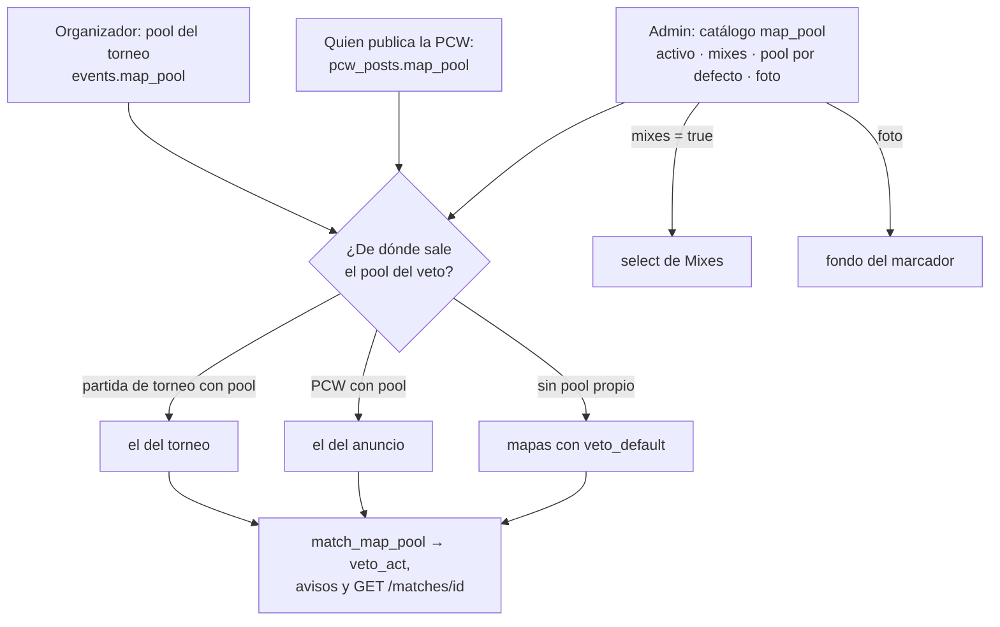

# Plan: Catálogo de mapas con pool propio por torneo y por PCW

> Planeación original. Estado: **aprobada por Daniel el 2026-10-25**. Las decisiones marcadas como "Propuesta de Claude" no las eligió Daniel.

## El pedido

Al implementar la [maestra de mapas](../2026-10-25-maestra-mapas/PLAN.md) apareció un problema: **ya existía una maestra**, el pool del veto del replanteo `10`:
- la tabla `map_pool`, con `name`, `versions`, `position` y `active`;
- `GET /api/v1/maps` y `PUT /api/v1/admin/maps`.

La tabla `maps` nueva chocaba con esas mismas rutas (fallaron 2 pruebas de integración de torneos).

Daniel decidió el 2026-10-25:
- **Una sola maestra:** se amplía `map_pool` y se descarta la tabla `maps`.
- **Separar los usos de un mapa:** una cosa son los mapas que designamos para los mixes y otra todos los mapas disponibles. Por ejemplo, `de_russka` puede jugarse solo en algunos torneos.
- **Torneos:** el organizador elige el pool de su torneo entre los mapas disponibles. Entra en esta tanda.
- **PCW:** quien publica la PCW elige el pool entre los mapas disponibles.

Este plan reemplaza las secciones 2 y 3 del plan de la maestra (tabla `maps` y sus rutas). Las decisiones de ese plan que siguen valiendo:
- la foto de hasta 2 MB en el bucket `photos`;
- un mapa no se borra, se desactiva;
- la advertencia de mapas faltantes por servidor queda para los plugins.

## Lo que ya existe y condiciona el diseño

| Qué | Dónde | Consecuencia |
|---|---|---|
| `map_pool(name pk, versions text[], position, active)`: `versions` son los `.bsp` del servidor, el primero es el nombre (Inferno tiene `de_inferno` y `de_inferno_classic`) | Replanteo `10` | Es la maestra. Una foto por mapa sirve para todas sus versiones |
| El veto usa **un solo pool global**, los `active`. Lo usan: • `veto_act`, para la secuencia y para validar el mapa; • `tg_notify_matches` y `tg_notify_match_vetos`, para la secuencia del aviso; • `GET /matches/{id}`, para la lista de mapas | Replanteos `10` y `28`, `routes/matches.ts` | Una función `match_map_pool(partida)` reemplaza esas cinco lecturas |
| `veto_sequence(bo, cantidad)` arma la secuencia con la cantidad de mapas del pool. Con menos mapas que el BO, la serie no se puede armar | Replanteo `10` | Cada pool tiene que tener al menos tantos mapas como el BO más alto que se juegue con él |
| El BO de un torneo está en `events.config` (`bo`, `bo_semi`, `bo_final`, `bo_group`, …) | `schemas/events.ts` | El mínimo del pool de un torneo es el BO más alto de su `config` |
| Una PCW se publica con `create_pcw_post` y su BO. Al aceptarla, `accept_pcw` crea la partida y `pcw_posts.match_id` la vincula. `pcw_posts.maps` es un texto libre de 120 caracteres | Replanteo `10` | El pool va en el anuncio (`pcw_posts.map_pool`), y la partida lo encuentra por `match_id`. El texto libre se deja como está |
| `PUT /admin/maps` reemplaza la lista completa y **borra** los mapas que no vienen | `routes/pcw-play.ts` | Pasa a no borrar nada (sección 4) |
| El frontend de Mixes busca la foto por el nombre del mapa del mix (`mapImage`) | `features/maps/queries.ts` | Con las versiones, `de_inferno_classic` tiene que encontrar la foto de `de_inferno`. Se ajusta en el frontend |

## Decisiones tomadas

| Tema | Decisión | Origen |
|---|---|---|
| Una sola maestra | `map_pool` amplía sus columnas. Se borra la tabla `maps` del replanteo `30` local, que nunca salió | Daniel |
| Qué significa cada marca | `active` = **disponible**: inactivo es un mapa retirado, que no se elige para nada nuevo. Columnas nuevas: • `mixes`: lo designamos para el select de Mixes; • `veto_default`: pool por defecto | Daniel (mixes aparte de los disponibles); propuesta de Claude (nombres y pool por defecto) |
| Migración | Los `active` de hoy quedan `active`, `mixes` y `veto_default`. El veto actual no cambia. Los inactivos de hoy quedan inactivos y sin marcas | Propuesta de Claude |
| Pool del torneo | `events.map_pool text[]`, elegido por el organizador entre los disponibles. `null` usa el pool por defecto | Daniel (elige el organizador); propuesta de Claude (`null`) |
| Pool de la PCW | `pcw_posts.map_pool text[]`, elegido por quien publica entre los disponibles. `null` usa el pool por defecto | Daniel |
| Mínimo de mapas | Pool del torneo: al menos el BO más alto de su `config`. Pool de la PCW: al menos su BO. Máximo 20 mapas, sin repetidos | Propuesta de Claude |
| Cambiar el pool de un torneo | Se puede hasta que empieza el primer veto de alguna partida del torneo | Propuesta de Claude |
| Un mapa retirado que está en un pool | El torneo o la PCW lo conservan: el pool guardado no cambia a mitad de camino. Solo deja de poder elegirse para pools nuevos | Propuesta de Claude |
| Baja | Solo se desactiva. `PUT /admin/maps` no borra: si falta un mapa existente en la lista, responde `400` | Daniel (solo desactivar); propuesta de Claude (cómo se aplica al `PUT`) |
| Foto | `image_url` en `map_pool`. `POST` y `DELETE /api/v1/admin/maps/{name}/image`, con JPG, PNG o WebP de hasta 2 MB en `photos/maps/{name}/` | Daniel (2 MB); propuesta de Claude (rutas) |

## 1. El flujo completo

## 2. Base de datos (replanteo `30_mapas_temporadas.sql`, bloque de mapas)

El bloque de mapas se reescribe. El de temporadas ya está hecho y no cambia.

- **`map_pool`:**
  - suma `image_url text`, `mixes boolean not null default false` y `veto_default boolean not null default false`;
  - la migración copia `active` en `mixes` y en `veto_default`;
  - `check (not veto_default or active)`: un mapa retirado no queda en el pool por defecto.
- **`events.map_pool text[]` y `pcw_posts.map_pool text[]`** (nullable). Un trigger los valida:
  - los mapas existen y están activos (los que ya estaban guardados se aceptan aunque se hayan retirado);
  - sin repetidos;
  - al menos el BO más alto (de la `config` del torneo o del anuncio) y como mucho 20.
- **Trigger de `events`:** rechaza el cambio de `map_pool` si alguna partida del torneo ya tiene veto.
- **`match_map_pool(p_match uuid) returns setof map_pool`**, ordenada por `position`:
  - el pool del torneo, si la partida es de un torneo y el torneo tiene pool;
  - si no, el del anuncio, si es una PCW con pool;
  - si no, los `active and veto_default`.
- **Las cinco lecturas del pool** pasan a `match_map_pool`, con `pg_temp.reemplazar`: `veto_act` (cantidad y validación del mapa), `tg_notify_matches` y `tg_notify_match_vetos`.
- **`create_pcw_post`:** suma `p_map_pool text[] default null`. Cambia la firma, así que se recrea con sus permisos.
- **Inversa:** deja todo como estaba después de la `29`.

## 3. API

| Ruta | Cambio |
|---|---|
| `GET /api/v1/maps` | Cada ítem suma `image_url`, `mixes` y `veto_default`. Filtros nuevos: `mixes=true` (el select de Mixes) y `veto_default=true`. Por defecto siguen saliendo solo los activos (`include_inactive=true` para el admin y para las salas viejas) |
| `PUT /api/v1/admin/maps` | Cada ítem acepta `mixes` y `veto_default`. Ya **no borra**: un mapa existente que no viene en la lista da `400`. Se mantiene el mínimo de 2 activos, y se pide además al menos 1 mapa en el pool por defecto |
| `POST /api/v1/admin/maps/{name}/image` | Foto nueva (multipart, `file`, hasta 2 MB). La anterior se borra en segundo plano |
| `DELETE /api/v1/admin/maps/{name}/image` | Quita la foto |
| `POST` y `PATCH` de torneos (`EventCreate` y `EventPatch`) | `map_pool: string[] \| null` |
| Detalle del torneo | Devuelve `map_pool` (null = el pool por defecto) |
| Publicar una PCW | `map_pool: string[]` opcional. Los listados y el detalle del anuncio lo devuelven |
| `GET /api/v1/matches/{id}` | La lista de mapas del veto sale de `match_map_pool` |

- Se borran `src/routes/maps.ts` y `src/schemas/maps.ts`, y las pruebas de la tabla `maps`.
- `MAP_IMAGE_MAX_BYTES` se queda.
- Contrato del frontend: `admin.md` (catálogo), `partidas.md` (veto y PCW) y torneos. Después, `pnpm gen:api`.

## 4. Frontend (no entra en esta tanda, se anota)

- **Mixes:** `mapsOptions` lee `GET /maps?mixes=true&include_inactive=true` para tener las fotos. `mapImage` busca el nombre entre las `versions`.
- **Administración:** el catálogo con las marcas y la foto.
- **Torneos y PCW:** el selector del pool.

Queda en `docs/PENDIENTES.md`.

## 5. Pruebas

- **SQL:**
  - la migración de las marcas;
  - `match_map_pool` en sus tres casos;
  - el veto de un torneo con pool propio: acepta un mapa del pool que no está en el pool por defecto y rechaza uno de afuera;
  - la secuencia con la cantidad del pool;
  - los mínimos, los repetidos y los mapas retirados;
  - el bloqueo del pool del torneo después del primer veto;
  - la PCW con pool;
  - los avisos de turno con la secuencia nueva.
- **Unitarias:** el `PUT` sin borrado, los filtros nuevos y las rutas de la foto.
- **Integración:**
  - las de torneos y PCW que ya existen, en verde;
  - un torneo y una PCW con pool propio;
  - la foto real en el bucket.

## 6. Requisitos antes de empezar

Ninguno nuevo.

## 7. Orden de implementación

1. Reescribir el bloque de mapas del replanteo `30` y su inversa y sus pruebas SQL.
2. Backend:
   - borrar `routes/maps.ts` y `schemas/maps.ts`;
   - ampliar `pcw-play.ts` (catálogo, `PUT` y foto), `events.ts`, la publicación de PCW y `matches.ts`.
3. Pruebas unitarias y de integración, todas en verde.
4. `pnpm gen:api` y el contrato.
5. Documentación de las dos bitácoras (esta y la de la maestra), la fila en `docs/bitacora/README.md` y `docs/PENDIENTES.md`.
