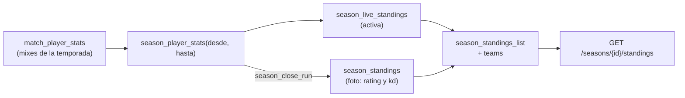

# Columnas del Histórico en el ranking de una temporada: documentación

## Qué hace

La tabla de una temporada (`GET /api/v1/seasons/{id}/standings`) tiene las mismas columnas que el Histórico (`GET /api/v1/ranking/players`). Cada fila suma:
- `teams`: los equipos oficiales actuales;
- `rating` y `kd`: calculados solo con los mixes de la temporada.

Además acepta los filtros `level` y `team` y se puede ordenar por `rating` y `kd`.

En la temporada activa, el rating y el K/D se calculan al leer. En una temporada cerrada salen de la foto del cierre (`season_standings`): se guardan al cerrarla y no cambian después, aunque llegue un mix tarde o se recalcule el ELO. Los equipos son siempre los de hoy, también en las temporadas cerradas, igual que en el Histórico.

## Qué mixes cuentan

`season_player_stats(p_from, p_until)` usa los mismos mixes que `season_rank`, es decir, los mismos con los que se cuentan el ELO y la cantidad de mixes de la tabla:
- mixes terminados con ELO aplicado (`elo_after` no null);
- con fecha dentro del período (`> inicio` y `<= fin`);
- juntando todos los SteamID de la ficha (`player_steam_all`).

Las fórmulas son las de `player_stats`:
- **Rating:** `csstv_rating(kills, deaths, rounds, k1…k5)`.
- **K/D:** `kills / greatest(deaths, 1)`, con 2 decimales.

Una ficha sin mixes en la temporada tiene `rating` y `kd` en `null`.

## Datos

| Objeto | Cambio |
|---|---|
| `season_player_stats(timestamptz, timestamptz)` | Nueva. `player_id`, `rating` y `kd` por ficha |
| `season_standings` | Suma `rating numeric(4,2)` y `kd numeric(6,2)`, nullable. La migración llena las temporadas ya cerradas con su inicio y su cierre |
| `season_close_run` | Guarda `rating` y `kd` en la foto |
| `season_live_standings` | Suma `rating` y `kd` al final |
| `season_standings_list` | Une la foto y la activa, con `rating`, `kd` y `teams` (jsonb `[{ id, name, tag }]`, la misma expresión que `player_overview`) |

## API

| Parámetro o campo | Detalle |
|---|---|
| `level` | `10`, `7-9` o `1-6`, sobre el `elo` de la tabla (en una cerrada, el ELO al cierre). Los rangos salen de `levelBounds` (`lib/db.ts`), compartida con el Histórico |
| `team` | uuid de un equipo oficial (`contains` sobre `teams`) |
| `sort` | Suma `rating` y `kd` a `rank`, `elo`, `matches` y `alias` |
| `teams`, `rating`, `kd` | Campos nuevos de cada fila (`SeasonStanding`). El historial de un jugador (`/players/{id}/seasons`) no los trae |

## Dónde está cada cosa

| Qué | Archivo / ubicación |
|---|---|
| Migración (bloque 4) | `supabase/replanteo/30_mapas_temporadas.sql` |
| Inversa y pruebas SQL | `docs/bitacora/2026-10-14-replanteo-modelo-datos/reversas/30_mapas_temporadas.sql` y `pruebas/30_mapas_temporadas.sql` |
| Ruta | `web/backend/src/routes/seasons.ts` (`standings`) |
| Esquemas | `web/backend/src/schemas/seasons.ts` (`Standing`, `StandingQuery`, `PlayerSeason`) |
| Rangos de nivel | `web/backend/src/lib/db.ts` (`levelBounds`) |
| Contrato | `docs/frontend/contrato/temporadas.md` y `api.md` |
