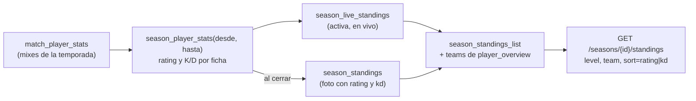

# Plan: Columnas del Histórico en el ranking de una temporada

> Planeación original. Estado: **aprobada por Daniel el 2026-10-25**. Las decisiones marcadas como "Propuesta de Claude" no las eligió Daniel.

## El pedido

El frontend de Ranking (bitácora [`2026-10-24-frontend-ranking`](../2026-10-24-frontend-ranking/GUIA_IMPLEMENTACION.md)) dejó un pedido opcional: que `GET /api/v1/seasons/{id}/standings` traiga `teams`, `rating`, `kd` y el filtro `level`. Así la tabla de una temporada tiene las mismas columnas que el Histórico (`GET /ranking/players`). Daniel lo sumó a esta tanda el 2026-10-25.

## Lo que ya existe y condiciona el diseño

| Qué | Dónde | Consecuencia |
|---|---|---|
| `season_standings_list` une la foto de las temporadas cerradas (`season_standings`) con el ranking en vivo de la activa (`season_live_standings`, que llama a `season_rank`) | Replanteo `24` | Las columnas nuevas tienen que estar en las dos partes |
| La foto del cierre no cambia aunque después se recalcule el ELO | `season_standings`, `season_close_run` | El rating y el K/D de una temporada cerrada se guardan en la foto al cerrar, no se calculan al leer |
| Los mixes de la temporada se cuentan con `player_steam_all` (todos los SteamID de la ficha), entre `starts_at` y el cierre (o `now()`) | `season_rank` | El rating y el K/D usan el mismo conjunto de mixes que el ELO y la cantidad de mixes de la tabla |
| Rating de CM League: `csstv_rating(kills, deaths, rounds, k1…k5)`; K/D: `kills / greatest(deaths, 1)` con 2 decimales | `player_overview`, `steam_profile_stats` | Mismas fórmulas |
| `teams` del Histórico: los equipos oficiales actuales de la ficha (jsonb `[{ id, name, tag }]`) | `player_overview.teams`, replanteo `09` | Los equipos no son de la temporada: son los de hoy, también en las cerradas |
| El nivel se calcula en TypeScript (`levelOf`), y el filtro del Histórico lo traduce a un rango de ELO (`10`, `7-9`, `1-6`) | `lib/db.ts`, `routes/ranking.ts` | Se reutiliza igual, sobre el `elo` de la tabla de la temporada |
| En producción todavía no hay temporadas: la primera (BETA) se abre en el corte | `docs/PENDIENTES.md`, punto 1.5 | La migración llena la foto de las cerradas que haya (en local, si las hay) con la misma cuenta. No hay datos reales que respetar |

## Decisiones tomadas

| Tema | Decisión | Origen |
|---|---|---|
| Rating y K/D | **Solo de los mixes de la temporada**, coherentes con el ELO y los mixes de la tabla | Daniel, 2026-10-25 |
| Temporadas cerradas | `rating` y `kd` se guardan en `season_standings` al cerrar. La migración llena las cerradas que haya | Propuesta de Claude (respeta la regla de la foto del cierre) |
| Equipos | Los equipos oficiales actuales, también en las cerradas, igual que en el Histórico | Propuesta de Claude |
| Filtro `level` | Mismos valores que el Histórico (`10`, `7-9`, `1-6`), sobre el `elo` de la temporada (el de la foto, en las cerradas) | Propuesta de Claude |
| Filtro `team` y órdenes | Se suma `team` como en el Histórico, y los órdenes `rating` y `kd` | Propuesta de Claude |
| Sin mixes en la temporada | `rating` y `kd` en `null` (el frontend muestra "—") | Propuesta de Claude |

## 1. El flujo completo

## 2. Base de datos (replanteo `30_mapas_temporadas.sql`, bloque de temporadas)

- **Función nueva** `season_player_stats(p_from, p_until)`:
  - devuelve `player_id`, `rating` y `kd` por ficha;
  - usa los mixes terminados con ELO aplicado (`elo_after` no null) del período y todos los SteamID de cada ficha (`player_steam_all`), con el mismo filtro que `season_rank`.
- **`season_standings`:** suma `rating numeric(4,2)` y `kd numeric(6,2)`, los dos nullable.
- **`season_close_run`:**
  - guarda `rating` y `kd` en la foto, con `season_player_stats(starts_at, cierre)`;
  - se modifica con `pg_temp.reemplazar`, como en los replanteos anteriores.
- **Temporadas ya cerradas:** la migración las llena con su `starts_at` y su `closed_at`.
- **`season_live_standings` y `season_standings_list`:**
  - se recrean con `rating`, `kd` y `teams`;
  - `teams` sale de un `left join player_overview`;
  - se recrean también las vistas que dependen de ellas.
- **Inversa:** deja las vistas y la función de cierre como en la `24` y borra las columnas y la función nueva.

## 3. API

- **`StandingQuery`:**
  - suma `level` (`10`, `7-9`, `1-6`) y `team` (uuid);
  - suma `rating` y `kd` a los órdenes.
- **Ítem de `StandingList`:** suma `teams` (`TeamRef[]`), `rating` (número o null) y `kd` (número o null). El nivel (`level`) ya viene.
- **Filtros:**
  - `level` usa los mismos rangos de `LEVEL_FLOORS` que `routes/ranking.ts`, extraídos a una función común para no duplicarlos;
  - `team` usa `contains('teams', …)` como el Histórico.
- **Vista previa del cierre** (`GET /admin/seasons/preview`): no cambia.
- **Tipos y contrato:** `pnpm gen:api` y el contrato de temporadas actualizado.

## 4. Pruebas

- **SQL:**
  - el rating y el K/D de la activa salen solo de los mixes del período;
  - al cerrar quedan en la foto y no cambian con un mix posterior;
  - una ficha sin mixes en la temporada da `null`.
- **Unitarias:** los filtros `level` y `team`, los órdenes nuevos y la forma del ítem.
- **Integración:** contra la Supabase local, con la temporada BETA local.

## 5. Requisitos antes de empezar

Ninguno.

## 6. Orden de implementación

1. Bloque de temporadas del replanteo `30`, con su inversa y sus pruebas SQL.
2. Esquemas y la ruta `standings`, con la función común de niveles.
3. Pruebas unitarias y de integración.
4. `pnpm gen:api` y el contrato.
5. `DOCUMENTACION.md`, `GUIA_IMPLEMENTACION.md`, la fila en `docs/bitacora/README.md` y `docs/PENDIENTES.md`. En `PENDIENTES.md`: hecho en local, falta mostrar las columnas en la tabla de la temporada.
