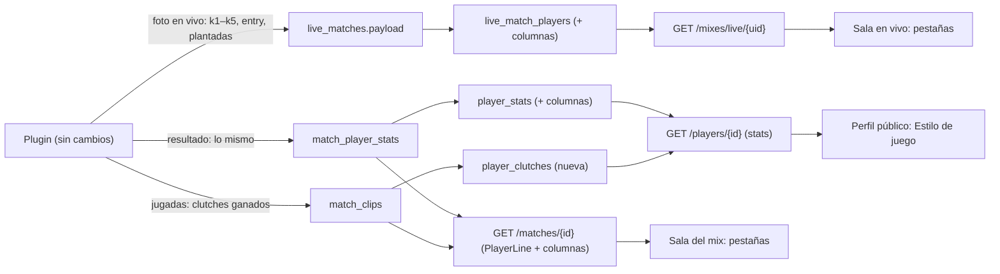

# Plan: Estadísticas de partida estilo HLTV, primera parte (sin tocar el plugin)

> Planeación original. Estado: **aprobado** el 2026-10-25.

Origen: `stats-partida-hltv-style.md` (en la raíz, sin versionar): las 5 pestañas de estadísticas de HLTV (General, Avanzado, Entrada, Intercambio y Clutch). Ese documento describe la web vieja. Este plan lo baja a la web nueva y a lo que ya guarda la base.

**Alcance:** solo lo que se puede armar **con los datos que ya manda el plugin**. Lo que necesitaría más trabajo del plugin (disparos, trades, rondas sobrevividas, clutches perdidos, KAST, RWS) queda **en pausa**: Daniel no quiere sumarle carga al plugin por el riesgo de lag en el servidor (2026-10-25). Ver la sección 7.

## Decisiones tomadas

| Tema | Decisión | Por qué |
|---|---|---|
| Dónde se ve | **Sala del mix** (`/match/{id}`, terminado o cancelado) y **sala en vivo** (`/mixes/live/{uid}`): la tabla de cada bando con pestañas. **Perfil público** (`/player/{nick}`): una tarjeta con los totales nuevos. **Mi perfil** (`/profile`) no cambia: es la configuración de la cuenta | El md habla del detalle de una partida; los totales del jugador van en su perfil público |
| Pestañas | **General · Avanzado · Entrada · Clutch**. "Intercambio" no se pone | Daniel, 2026-10-25: no hay ningún dato para llenarla |
| General | K, D, A, +/−, K/R, ADR, HS, HS %, 2k, 3k, 4k, 5k, Rating y Δ ELO | Todo sale de `match_player_stats`. **Sin** A/M, MVPs ni Swing (no hay datos: sección 7) |
| Avanzado (parcial) | MK, MK %, RP, plantadas y defuses | Lo que hay; KAST, RWS, precisión y RS son de la segunda parte |
| Entrada | Intentos, eliminaciones, muertes, diferencia, % de intentos y % de éxito | Sale de `first_kills`, `first_deaths` y las rondas |
| Clutch | Ganados por tipo (1v1 a 1v5) y el total | Sale de `match_clips` (`clutch_vs`), que guarda **todos** los clutches ganados que manda el servidor (los topes de los clips se aplican al listarlos, no al guardarlos). **Sin** perdidos ni % de éxito (segunda parte) |
| Partidas sin datos de clutch | Los mixes anteriores a los clips (reporter 2.5.0, 2026-10-23) no tienen `match_clips`: la pestaña Clutch muestra "Sin datos de Clutches disponibles." en lugar de ceros | Daniel, 2026-10-25. Un 0 sería mentira; la API manda `clutch_data` |
| Sala en vivo | Las mismas pestañas con la foto parcial, salvo Clutch (los clips llegan con el resultado) y Δ ELO ("—", como hoy) | El plugin ya manda `k1`–`k5`, entry, plantadas y defuses en cada foto: falta leerlos en la vista `live_match_players` |
| Partidas de torneo y PCW | Cada mapa jugado es un mix con su propia sala: las pestañas salen ahí sin trabajo extra | Ya es así |
| Mejor valor | El mejor valor de cada columna (entre los dos bandos) va resaltado, como en HLTV | Daniel, 2026-10-25 |
| Cálculos | La API manda los **totales**; los porcentajes y cocientes los calcula el frontend (K/R, HS %, MK %, % de entry) | Una sola fórmula en `labels.ts`, probada; la API no repite números derivados |
| Perfil público | Tarjeta "Estilo de juego" en Resumen: multi-kills por partida, entries (intentos por ronda y % de éxito), clutches ganados por tipo, plantadas y defuses | Los totales salen de la vista `player_stats` (con todos los SteamID de la ficha) |

## 1. El flujo completo

## 2. Base de datos (replanteo `29_stats_partida.sql`)

Con su inversa y sus pruebas, como los anteriores. Solo vistas: no cambia ninguna tabla.

| Objeto | Cambio |
|---|---|
| `live_match_players` | Suma `k2`, `k3`, `k4`, `k5`, `first_kills`, `first_deaths`, `plants` y `defuses` (con `csstv_jint`, como las otras) al final de la vista |
| `player_stats` | Suma las mismas sumas por ficha (`k2`…`defuses`) al final, con todos sus SteamID |
| `player_clutches` (nueva) | `player_id`, `vs` (1 a 5) y `won`: clutches ganados por ficha desde `match_clips` (`steam_owner(player_steamid)`), solo de mixes terminados |

## 3. API

| Endpoint | Cambio |
|---|---|
| `GET /api/v1/matches/{id}` | Cada `PlayerLine` suma `k2`, `k3`, `k4`, `k5`, `first_kills`, `first_deaths`, `plants`, `defuses` y `clutches` (`{ "1": n, …, "5": n }`, desde `match_clips` de esa partida). La partida suma `clutch_data` (true si tiene filas en `match_clips` o se jugó desde el 2026-10-23) |
| `GET /api/v1/mixes/live/{uid}` | Cada `LivePlayerLine` suma `k2`…`defuses` (sin `clutches`) |
| `GET /api/v1/players/{id}` | `stats` suma `k2`…`defuses` y `clutches` (`{ "1": n, …, "5": n }`, desde `player_clutches`) |

Los campos son nuevos y opcionales para quien no los use: no rompe nada. Con pruebas unitarias e integración, `pnpm db:types` y el contrato al día (`partidas.md` 8 y 8d, `jugadores.md` 5, novedades del `README.md`).

## 4. Frontend (guía)

Se implementa en `feat/frontend-fase-1` después de fusionar el backend y correr `pnpm gen:api`.

### 4.1 Pestañas en la tabla de cada bando

En `src/features/mixes/MixRoom.tsx` hoy hay una tabla por bando (`MixSideTable`). Se agrega un selector de pestañas **por encima de las dos tablas** (uno solo, que cambia las dos a la vez), con el estilo del segmentado de Ranking: General · Avanzado · Entrada · Clutch.

- **Estado en la URL:** `stats` (`general` por defecto, `advanced`, `entry`, `clutch`), con `validateSearch` en `match.$id.tsx` y `mixes.live.$uid.tsx`.
- **La primera columna** (nivel, nick, chip MVP e INVITADO) queda **fija** al desplazar de lado (`sticky left-0` con fondo `card`), y es igual en todas las pestañas.
- **La fila del usuario** sigue con `primary` al 6 %.
- **Orden:** como hoy (por rating desc). Clic en una cabecera ordena **en el navegador** (son hasta 7 filas por bando); otro clic invierte; un tercero vuelve al orden por rating. Se guarda en el estado del componente, no en la URL.
- **El mejor valor de cada columna** (entre los dos bandos) va en `font-semibold` y `text-foreground`; el resto, en peso normal. En las columnas donde menos es mejor (D, muertes de entry) se marca el menor. Con empate, se marcan todos.
- **Cada cabecera** lleva un `Tooltip` con la explicación (sección 4.5). Abreviaturas en Geist Mono, como hoy.
- **Móvil (390 px):** la tabla se desplaza de lado dentro de su tarjeta; el selector de pestañas se desplaza si no entra.

### 4.2 Columnas y fórmulas

Todas en `src/features/mixes/stats.ts` (funciones puras, con pruebas). `r` = rondas del jugador; un divisor 0 da "—".

**General**
| Columna | Fórmula | Formato |
|---|---|---|
| K / D / A | `kills`, `deaths`, `assists` | entero |
| +/− | `kills − deaths` | con signo, `win` / `destructive` (como hoy) |
| K/R | `kills / r` | 2 decimales |
| ADR | `damage / r` | entero (como hoy) |
| HS | `headshots` | entero |
| HS % | `headshots / kills × 100` | entero + "%" |
| 2k · 3k · 4k · 5k | `k2` … `k5` | entero; 0 en `muted-foreground` |
| Rating | `rating` | 2 decimales (como hoy) |
| Δ ELO | `elo_delta` | con signo; "—" en vivo y cancelados (como hoy) |

**Avanzado**
| Columna | Fórmula | Formato |
|---|---|---|
| MK | `k2 + k3 + k4 + k5` (rondas con 2 o más kills) | entero |
| MK % | `MK / r × 100` | entero + "%" |
| RP | `r` (rondas jugadas) | entero |
| Plantadas | `plants` | entero |
| Defuses | `defuses` | entero |

**Entrada**
| Columna | Fórmula | Formato |
|---|---|---|
| Intentos | `first_kills + first_deaths` | entero |
| Elim. | `first_kills` | entero |
| Muertes | `first_deaths` | entero |
| Dif. | `first_kills − first_deaths` | con signo, `win` / `destructive` |
| % intentos | `Intentos / r × 100` | entero + "%" |
| % éxito | `first_kills / Intentos × 100` | entero + "%"; "—" sin intentos |

**Clutch**
| Columna | Fórmula | Formato |
|---|---|---|
| 1v1 · 1v2 · 1v3 · 1v4 · 1v5 | `clutches["1"]` … `clutches["5"]` | entero; 0 en `muted-foreground` |
| Total | suma | entero, en `font-semibold` |

- Con `clutch_data: false`: en lugar de la tabla, "Sin datos de Clutches disponibles." (`muted-foreground`, centrado).
- En la sala en vivo la pestaña Clutch muestra "Los clutches se cuentan al terminar el mix."
- Debajo de la tabla: "Solo clutches ganados."

### 4.3 Sala en vivo

Mismas pestañas y columnas con la foto parcial (`LivePlayerLine`), salvo Δ ELO ("—") y Clutch (aviso de 4.2). El refresco cada 20 s con ETag no cambia; la pestaña elegida se mantiene entre refrescos.

### 4.4 Perfil público: tarjeta "Estilo de juego"

En `src/features/player/tabs.tsx` (pestaña Resumen), debajo de Logros y Ajustes de ELO. Una tarjeta con tres bloques, todos desde `stats` de `GET /players/{nick}`:

- **Multi-kills:** "{2k} · {3k} · {4k} · {5k}" con la etiqueta de cada uno, y "{MK por partida} por partida" (`(k2+k3+k4+k5) / maps`, 1 decimal).
- **Entradas:** "% de éxito {first_kills / (first_kills + first_deaths)}" y "{intentos por ronda} entradas por ronda" (2 decimales).
- **Clutches ganados:** cinco cuadros 1v1 … 1v5 con su número (el 1v4 y el 1v5 en `primary` si son mayores que 0) y el total.
- **Objetivos:** "{plants} plantadas · {defuses} defuses".
- Sin partidas: "Todavía no jugó partidas en el servidor."

### 4.5 Textos de las ayudas (tooltips)

| Columna | Texto |
|---|---|
| K/R | Kills por ronda |
| ADR | Daño promedio por ronda |
| HS % | Porcentaje de kills con headshot |
| 2k–5k | Rondas en las que hizo 2, 3, 4 o 5 kills (5k = ace) |
| MK / MK % | Rondas con 2 kills o más, y qué porcentaje de sus rondas son |
| RP | Rondas jugadas |
| Intentos (Entrada) | Veces que fue el primero de su equipo en pelear un duelo en la ronda |
| % éxito | De esos duelos, cuántos ganó |
| % intentos | En qué porcentaje de sus rondas abrió la pelea |
| 1vX | Rondas que ganó quedando solo contra X rivales |

### 4.6 Archivos del frontend

| Archivo | Qué |
|---|---|
| `src/features/mixes/stats.ts` (+ prueba) | Fórmulas, mejor valor por columna y orden |
| `src/features/mixes/StatsTabs.tsx` | Selector de pestañas y definición de columnas por pestaña |
| `src/features/mixes/MixRoom.tsx`, `room.ts` | La tabla de cada bando usa las columnas de la pestaña; `room.ts` pasa los campos nuevos |
| `src/routes/_app/match.$id.tsx`, `mixes.live.$uid.tsx` | `stats` en `validateSearch` |
| `src/features/player/tabs.tsx` | Tarjeta "Estilo de juego" |
| `e2e/mixes.spec.ts`, `e2e/player.spec.ts` | Cambiar de pestaña en la sala; la tarjeta en el perfil |

### 4.7 Pruebas del frontend

- **Unitarias:** cada fórmula con divisor 0, el mejor valor (con empates y columnas donde menos es mejor) y el orden.
- **Componentes (MSW):** las cuatro pestañas; Clutch con y sin `clutch_data`; en vivo sin Δ ELO ni clutches; la tarjeta del perfil vacía y con datos.
- **Playwright:** un mix real de la copia: cambiar de pestaña (queda en la URL) y ordenar por K/R.
- **Capturas:** 1440 y 390 px, claro y oscuro.

## 5. Pruebas del backend

- **SQL** (`pruebas/29_stats_partida.sql`): las columnas nuevas de las dos vistas y `player_clutches` con dos SteamID de la misma ficha.
- **Unitarias:** el armado de `clutches` y `clutch_data`.
- **Integración:** el detalle de un mix con clips y sin clips, la foto en vivo y la ficha.

## 6. Orden de implementación

1. **Backend** (`feat/backend-api-fase-1`): replanteo `29` con su inversa y pruebas, la API, los tipos, las pruebas y el contrato. Commit y push.
2. **Frontend** (`feat/frontend-fase-1`): fusionar el backend y `pnpm gen:api`; `stats.ts`; pestañas en la sala del mix y en la sala en vivo; tarjeta del perfil; pruebas y capturas.
3. `DOCUMENTACION.md`, `GUIA_IMPLEMENTACION.md`, `CHANGELOG_DISCORD.txt`, `docs/PENDIENTES.md` (la segunda parte, en pausa) y la fila de la bitácora.

## 7. Segunda parte (con el plugin): en pausa

No se planifica por ahora: registrar más eventos por ronda le suma trabajo al plugin y Daniel prefiere no arriesgar lag en el servidor (2026-10-25). Si se retoma, medir antes el costo con `csstv_perf`. Para referencia, lo que haría falta:

| Métrica | Qué tiene que registrar el plugin |
|---|---|
| Precisión y "precisión visible", disparos e impactos (Avanzado) | Disparos (`weapon_fire`) e impactos (`player_hurt`) por jugador. "Visible" es difícil en CS:S: definir antes si vale la pena |
| RS (rondas sobrevividas) y **KAST** (Avanzado) | Por ronda: si sobrevivió, si tuvo kill o asistencia y si su muerte fue vengada |
| **RWS** (Avanzado) | El daño de cada uno en las rondas que ganó su equipo |
| Intercambio (toda la pestaña) | Trades: una muerte vengada por un compañero dentro de unos segundos (definir la ventana: 3 a 5 s) |
| Clutches perdidos y % de éxito | Cada situación 1vX, ganada o perdida |
| A/M (kills por minuto) | El tiempo jugado de cada uno |
| MVPs por ronda y Swing | CS:S v34 no tiene MVP por ronda; definir un criterio propio. Swing necesita la probabilidad de ganar ronda a ronda |
