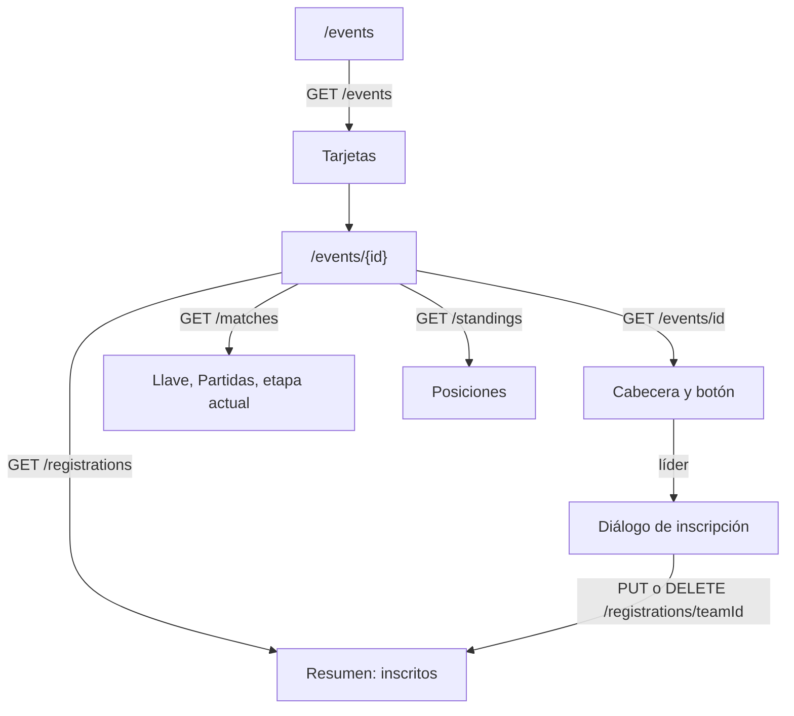
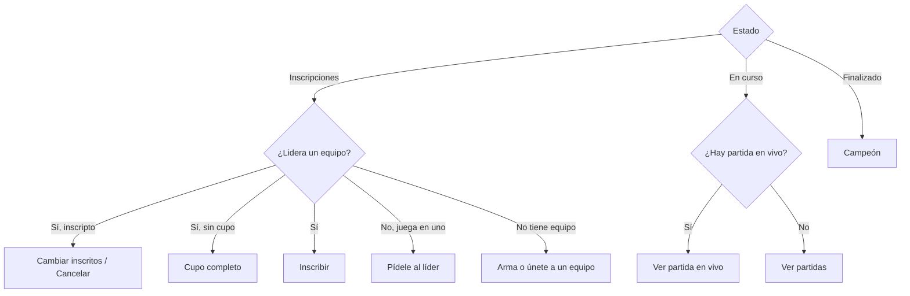

# Torneos (listado y detalle): documentación

## Qué hace

La sección **Torneos** de la web tiene dos vistas:

- **Listado** (`/events`): todos los torneos, ordenados Inscripciones → En curso → Finalizado (los cancelados al final), con un filtro por estado.
- **Detalle** (`/events/{id}`): la cabecera del torneo con un botón que cambia según el estado y el rol de quien mira, y cuatro pestañas: Resumen, Llave, Posiciones y Partidas.

Todo sale de la API real de torneos (`/api/v1/events…`). Lo que el backend no tiene (banner, fecha de cierre de inscripciones, partida en vivo con el mapa) no se muestra o se deduce de las partidas.

## Listado

- **Filtro:** Todos, Inscripciones, En curso y Finalizados. Va en la URL (`/events?status=registration|in_progress|finished`) y se aplica en el cliente sobre los primeros 100 torneos.
- **Tarjeta:** banner (patrón rayado), chip de estado, nombre, "{formato} · BO{n} · Final BO{n}", fechas y premio. El pie cambia según el estado:

| Estado | Pie | Barra |
|---|---|---|
| Inscripciones | "Cupo" y "{inscritos}/{máximo}" | % del cupo |
| En curso | "Etapa actual" y el `label` de la partida en vivo o de la próxima | Partidas terminadas sobre el total |
| Finalizado | "Campeón" y el equipo | Llena |
| Cancelado | "Estado: Cancelado" | Vacía |

- **BO y etapa actual:** el listado no los trae, así que cada tarjeta pide el detalle del torneo y, si está en curso, sus partidas. Son las mismas consultas que usa el detalle, así que abrir un torneo desde el listado no vuelve a pedirlas. Cuando el backend sume esos datos a `GET /events`, se quitan.

## Detalle: cabecera y botón

| Estado | Quién mira | Botón | Nota |
|---|---|---|---|
| Inscripciones | Líder sin inscribir | "Inscribir a {equipo}" (o "Inscribir equipo" si lidera varios) | "Elige de {min} a {max} inscritos del roster · {n} cupos libres" |
| Inscripciones | Líder sin cupo | "Cupo completo" (deshabilitado) | "No quedan cupos libres" |
| Inscripciones | Líder ya inscripto | "Cambiar inscritos" y "Cancelar inscripción" | "{equipo} inscripto · puedes cancelar hasta que se arme el fixture" |
| Inscripciones | Jugador sin liderazgo | "Pídele al líder que inscriba" (deshabilitado), o "{equipo} inscripto" | "Solo el líder de {equipo} puede inscribirlo" |
| Inscripciones | Sin equipo | "Arma o únete a un equipo" → `/myteam` | "Necesitas un equipo para inscribirte" |
| En curso | Todos, con una partida en vivo | "Ver partida en vivo" → `/match/{id}` | "{etapa} · BO{n}" |
| En curso | Todos, sin partida en vivo | "Ver partidas" → pestaña Partidas | "Próxima: {etapa}" |
| Finalizado | Todos | "Campeón: {equipo}" → `/teams/{id}` | "Finalizado el {fecha}" |
| Cancelado | Todos | Ninguno | — |

Los equipos del usuario salen de Mi perfil (`teams` con `is_captain` e `is_member`). Que el equipo esté inscripto se deduce de los inscritos del torneo.

## Inscripción

- **Diálogo:** si el líder lidera varios equipos, primero elige cuál. Después, el roster del equipo:
  - los **Activos** con SteamID vienen marcados (hasta `players_max`);
  - los **Suplentes** se suman a mano;
  - el **coach** ("no cuenta como inscrito") y los que **no tienen SteamID** no se pueden marcar;
  - el contador pide entre `players_min` y `players_max`.
- **Enviar:** `PUT /events/{id}/registrations/{teamId}` con los ids de los jugadores en el orden del roster. El backend valida el resto (inscripciones abiertas, cupo, jugador inscrito con otro equipo) y su mensaje se muestra en el diálogo.
- **Cancelar:** confirmación y `DELETE /events/{id}/registrations/{teamId}`.
- Toasts: "{equipo} quedó inscripto en {torneo}", "Inscritos actualizados" e "Inscripción cancelada".

## Pestañas

- **Resumen:**
  - Información: inscritos por equipo, formato (con grupos y clasificados, o fases suizas), BO, estado, fechas, premio, cupo, organizador y sorteo (si lo hubo).
  - Reglas: el texto `rules` del torneo, un ítem por línea; si está vacío, las reglas de la liga del prototipo. Lo que va entre comillas invertidas (`!match`) se muestra en mono.
  - Equipos inscriptos con su siembra, link a la vista pública del equipo y hasta 4 "Cupo libre".
- **Llave:**
  - Sirve para las cinco plantillas. Las partidas de las etapas de llave (`upper`, `lower`, `ko`, `third`, `grand`) se agrupan en secciones (una por etapa, y por grupo en los grupos de doble eliminación), con columnas por `round` y filas por `pos`. El título de cada columna es el `label` del backend.
  - Las etapas previas van apiladas a la izquierda; la final (o la gran final) con la columna "Campeón", a la derecha, y el 3.er puesto debajo.
  - La fase de grupos y el suizo no son llaves: van en Posiciones.
  - Pasar el cursor sobre un equipo resalta su camino (su fila al 14 % de `primary`, el borde en `primary` y el resto al 45 %). Partida en vivo: borde rojo y chip "VIVO". Clic → `/match/{id}`.
  - Zoom de 50 a 150 % en pasos de 10 y "Ajustar" (85 %). Usa la propiedad `zoom`, no `transform`, para que el scroll siga el tamaño real. El lienzo se arrastra con el mouse; un arrastre de más de 3px no abre la partida donde se suelta.
  - Sin partidas: "La llave se arma cuando se cierran las inscripciones." o "Los playoffs se arman cuando termina la fase de grupos / el suizo."
- **Posiciones:**
  - Una tabla por grupo (o por fase suiza), ordenada por `place`.
  - Columnas: grupos con PJ, G, P, Rondas y Pts (sin E: no hay empates en el sistema); suizo con récord, diferencia, Buchholz y estado; grupos de doble eliminación con G, P, rondas y estado.
  - "Clasifica" (fondo y marca `primary`): `state = qualified`, o en grupos `place ≤ advance`. Chip "Empate" en las filas con `tied` y un aviso si hay `tie_pending`.
  - Sin tablas: "Este torneo no tiene fase de grupos." o "Los grupos se sortean al cerrar las inscripciones."
- **Partidas:** en el orden de la llave, con etapa, fecha ("Sin fecha" si no tiene), equipos, marcador ("– : –" si no se jugó) y chip EN VIVO / PRÓXIMA / FINAL / CANCELADA. Clic → `/match/{id}`.

## Dónde está cada cosa

Todo dentro de `web/frontend/`.

| Qué | Archivo |
|---|---|
| Consultas, mutaciones y tipos corregidos | `src/features/events/queries.ts` |
| Lógica pura (formato, BO, llave, posiciones, botón, reglas) | `src/features/events/model.ts` (+ `model.test.ts`) |
| Listado | `src/features/events/EventList.tsx` |
| Detalle, cabecera y botón | `src/features/events/EventView.tsx` |
| Pestañas | `SummaryTab.tsx`, `BracketTab.tsx`, `StandingsTab.tsx`, `MatchesTab.tsx` |
| Diálogos de inscripción y baja | `src/features/events/RegisterDialog.tsx` |
| Chip, banner, sigla, tarjeta, recuadro vacío | `src/features/events/ui.tsx` |
| Rutas | `src/routes/_app/events.index.tsx` (`?status`), `events.$id.tsx` (`?tab`) |
| Breadcrumb | `src/features/shell/queries.ts` (usa `eventDetailOptions`) |
| e2e | `e2e/events.spec.ts`, `e2e/event-fixtures.ts` |
| Torneos de prueba para la base local | `docs/bitacora/2026-10-25-torneos/pruebas/` |
