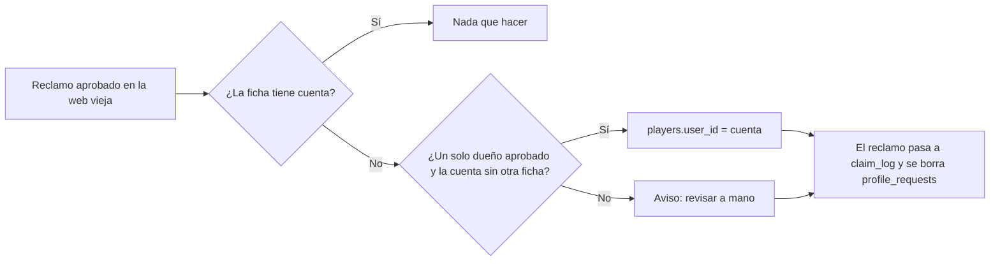

# Plan: fichas que perdieron el vínculo con su cuenta

> Planeación original, aprobada por Daniel el 2026-10-25 en la conversación (después del diagnóstico).

## Decisiones tomadas

| Tema | Decisión | Por qué |
|---|---|---|
| Dónde se arregla para el corte | En la sección 10 de `supabase/replanteo/15_claim.sql`, antes de borrar `profile_requests` | Es el último momento en que existe la solicitud aprobada que dice de quién es cada ficha. Después del corte todo tiene que quedar vinculado en la estructura nueva (pedido de Daniel) |
| Qué se vincula | La ficha de un reclamo aprobado, si sigue sin cuenta, nadie más la tiene aprobada y la cuenta no tiene otra ficha | No pisar vínculos que existen ni elegir entre dos dueños posibles |
| Lo que no se pueda vincular | Aviso (`raise notice`) con la cantidad, para revisarlo a mano | No frenar el corte por un caso raro |
| Base local | Vincular a mano las mismas fichas (ya tiene aplicada la `15`) | Para seguir probando la web nueva con las cuentas reales |
| Panel de admin viejo (`index.html`) | Limpiar el buscador de cuentas al editar y pedir confirmación antes de desvincular | Es la causa probable y sigue en producción hasta el corte |
| Producción | No se toca sin un OK aparte | Escribe en la base real |

## 1. El flujo completo

## 2. Migración `15`

Un `update` de `players.user_id` desde `profile_requests` aprobados, con las condiciones de arriba, y un bloque que avisa cuántos quedan sin vincular.

## 3. Base local

El mismo `update`, pero desde `claim_log` (en local `profile_requests` ya no existe).

## 4. `index.html`

- `selSet(select, valor)`: borra el filtro del buscador y después pone el valor. Lo usan "Editar" y `resetP`.
- Al guardar una ficha que tenía cuenta con el selector en "Sin cuenta vinculada", `confirm` antes de seguir.

## 5. Requisitos antes de empezar

Acceso de solo lectura a producción (`PG_*` del `.env`) para el diagnóstico y para probar la consulta.

## 6. Orden de implementación

1. Vincular en la base local.
2. Corregir `index.html`.
3. Agregar el paso a la migración `15` y probarlo.
4. Documentar y anotar en `docs/PENDIENTES.md` lo que falta en producción.
