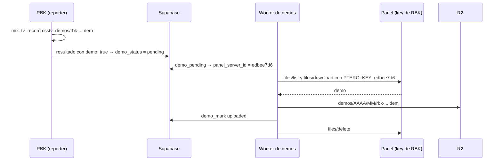

# Demos de RBK a Cloudflare R2: documentación

## Qué hace

Desde el 2026-10-26, los mixes de **RBK** (`CMLeague #2`) graban su demo y el Worker de demos la sube a R2, igual que en nuestro servidor. La demo se descarga desde la partida (`/demo/<match_uid>`) y queda 90 días.

Los dos servidores están en el mismo panel (`panel.extremehost.com.ar`), pero en cuentas distintas. El Worker usa **una API key del panel por servidor**: la de nuestra cuenta para el nuestro y la que nos dio RBK para el suyo.

## Cómo elige la key

`panelKey(env, server)` en `cloudflare/demo-worker/src/index.js`:

| Servidor (`panel_server_id`) | Key |
|---|---|
| Tiene secreto `PTERO_KEY_<id>` | Esa. RBK: `PTERO_KEY_edbee7d6` |
| No lo tiene | `PTERO_PANEL_API_KEY`, la de nuestra cuenta. Es el caso de nuestro servidor (`55f80fed`) |

**Para sumar otro servidor de otra cuenta:** cargar su `panel_server_id` en `game_servers` y el secreto `PTERO_KEY_<id>` en el Worker. El código no cambia. Si estuviera en otro panel, habría que agregar también una URL por servidor.

## Datos de cada servidor

| | Nuestro servidor | RBK |
|---|---|---|
| `game_servers.panel_server_id` | `55f80fed` | `edbee7d6` |
| Key del Worker | `PTERO_PANEL_API_KEY` | `PTERO_KEY_edbee7d6` (en el `.env`: `SERVER1_PANEL_API_KEY`) |
| Permisos de la key | Dueño | Subusuario: `file.read`, `file.read-content`, `file.delete` y otros. No ve nuestro servidor |
| SourceTV | `+tv_enable 1` en el arranque | `+tv_enable 1 +tv_port 27063` en el arranque del panel |
| `csstv_demo` | `"1"` | `"1"` (antes `"0"`) |
| Borrar después de subir | Sí (`DELETE_AFTER_UPLOAD`) | Sí |

## Dónde está cada cosa

| Qué | Archivo / ubicación |
|---|---|
| Elección de la key | `cloudflare/demo-worker/src/index.js` (`panelKey`) |
| Secretos para `wrangler dev` | `cloudflare/demo-worker/scripts/dev-vars.py` |
| Secreto en producción | `PTERO_KEY_edbee7d6` en el Worker `v34frag-demos` |
| Id del panel de RBK | `game_servers.panel_server_id` en Supabase |
| Grabación en RBK | `cstrike/cfg/sourcemod/csstv_reporter.cfg` (`csstv_demo "1"`) |
| El Worker en general | [`2026-10-12-demos-r2-worker`](../2026-10-12-demos-r2-worker/) |
