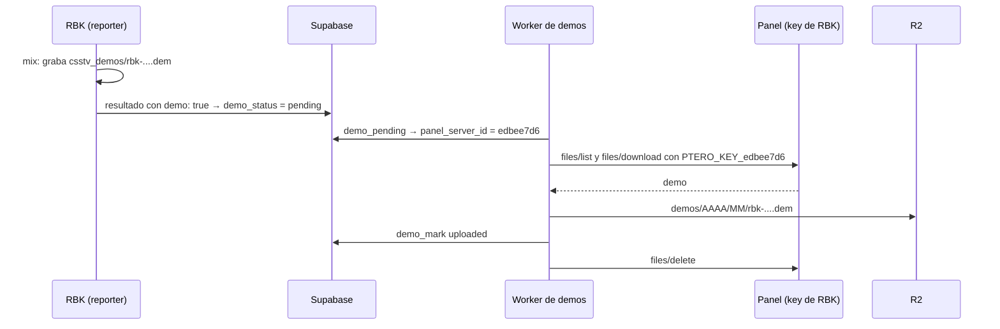

# Plan: demos de RBK a Cloudflare R2

> Planeación original. Estado: **propuesta**, pendiente de aprobación. Pedido de Daniel el 2026-10-26.

Hoy RBK no graba demos (`csstv_demo "0"`). Cuando se armó el servidor (bitácora [`2026-10-13-servidor-rbk`](../2026-10-13-servidor-rbk/PLAN.md)) se decidió así porque el Worker baja las demos por la API del panel con **la key de nuestra cuenta**, y esa key no ve el servidor de RBK. Daniel consiguió una API key del panel para RBK (`SERVER1_PANEL_API_KEY` en el `.env`).

## Lo que ya está (revisado el 2026-10-26)

| Pieza | Estado |
|---|---|
| Key de RBK | Funciona. Ve **solo** el servidor de RBK: identificador `edbee7d6`, puertos 27055 (juego) y 27063 (SourceTV). Es un subusuario con `file.read`, `file.read-content` y `file.delete`, que es lo que usa el Worker |
| SourceTV en RBK | **Ya está activo.** La línea de arranque del panel tiene `+tv_enable 1 +tv_port 27063`. Lo que dice `2026-10-13-servidor-rbk` ("no tiene `+tv_enable 1`") miraba el `start.sh` de la raíz, que el panel no usa |
| Base | `demo_pending` ya devuelve el `panel_server_id` de cada partida y solo toma servidores que lo tienen. En producción, RBK (`RBK SERVER -> SV V34frag #2`) lo tiene **vacío**. Sus 4 mixes de los últimos 30 días tienen `demo_status = 'none'` |
| Worker | Ya baja cada demo del servidor de su partida (`panel_server_id`) y arma un listado por servidor. Lo único fijo es la key: siempre usa `PTERO_PANEL_API_KEY` |
| Plugin | No cambia. Con `csstv_demo "1"` el reporter graba `cstrike/csstv_demos/<match_uid>.dem` y manda `demo: true`, como en el servidor real |

## Decisiones tomadas

| Tema | Decisión | Por qué |
|---|---|---|
| Key por servidor | Secreto **`PTERO_KEY_<panel_server_id>`** (`PTERO_KEY_edbee7d6`). Si un servidor no tiene el suyo, se usa `PTERO_PANEL_API_KEY`, como hoy | Nuestro servidor no cambia. Un servidor nuevo se suma con un secreto, sin tocar código |
| Dónde se guarda el id | `game_servers.panel_server_id = 'edbee7d6'` para RBK en producción, con un `update` puntual | Es la columna que ya usa `demo_pending`. Las migraciones del replanteo no la cambian |
| Mismo panel | `PTERO_PANEL_URL` sigue siendo uno solo: los dos servidores están en `panel.extremehost.com.ar` | Si algún día hay otro panel, se agrega una URL por servidor |
| Borrar después de subir | Igual que en el real (`DELETE_AFTER_UPLOAD = "true"`) | No llena el disco de RBK |
| Retención | La misma: 90 días en R2 | — |
| Clips | Sin cambios: con la demo en R2, los clips de RBK también pueden tener video | — |
| Las 4 partidas viejas de RBK | Se quedan sin demo (`none`) | No se grabaron |

## 1. El flujo



## 2. Worker (`cloudflare/demo-worker`)

- `src/index.js`: `ptero()` toma la key con `env[`PTERO_KEY_${server}`] || env.PTERO_PANEL_API_KEY`. Nada más cambia.
- `scripts/dev-vars.py`: agrega `PTERO_KEY_edbee7d6` desde `SERVER1_PANEL_API_KEY` del `.env`.
- `wrangler.toml`: en el comentario de secretos, el nuevo.
- Producción: `pnpm exec wrangler secret put PTERO_KEY_edbee7d6` y `pnpm exec wrangler deploy`.

## 3. Base de producción

```sql
update game_servers set panel_server_id = 'edbee7d6'
 where name = 'RBK SERVER -> SV V34frag #2' and panel_server_id is null;
```

Una fila. Con eso `demo_pending` empieza a incluir las partidas de RBK que tengan `demo_status = 'pending'` (por ahora ninguna). En el corte, el replanteo conserva la columna.

## 4. RBK

- `cfg/sourcemod/csstv_reporter.cfg`: `csstv_demo "1"`, con el comentario actualizado. Copia previa `csstv_reporter.cfg.bak_20261026`.
- No hace falta reiniciar: el cfg se vuelve a ejecutar en cada cambio de mapa y el mix siguiente ya graba.
- Solo cambia `csstv_demo`, que está en la lista de lo propio de cada servidor (`CLAUDE.md`). El servidor real no se toca.

## 5. Pruebas

| # | Qué | Cómo |
|---|---|---|
| 1 | La key de RBK lista y genera la descarga | `files/list` de `/cstrike` y `files/download` de un archivo chico con la key de RBK (solo lectura) |
| 2 | El Worker con las dos keys | `wrangler dev --remote` y `/run`: con la cola vacía no hace nada. Se revisa que la key se elija por servidor (una prueba de la función) |
| 3 | De punta a punta | El primer mix de RBK después del cambio: `Grabando demo` en su log, `demo_status` pasa a `uploaded`, la demo baja desde `/demo/<uid>` y desaparece de `csstv_demos/` en RBK |
| 4 | Nuestro servidor sigue igual | El siguiente mix del real sube su demo como siempre |

## 6. Requisitos antes de empezar

| Qué | Quién |
|---|---|
| Aprobación de este plan | Daniel |
| `SERVER1_PANEL_API_KEY` en el `.env` | Hecho (Daniel, 2026-10-26) |
| Sesión de `wrangler` con la cuenta del bucket `csstv-demos` (para `secret put` y `deploy`) | Revisar; si no está, Daniel hace `wrangler login` |
| OK para el `update` en producción y para el cfg de RBK | Daniel |

## 7. Orden de implementación

1. Worker: la key por servidor, `dev-vars.py` y el comentario de `wrangler.toml`. Pruebas 1 y 2.
2. Secreto `PTERO_KEY_edbee7d6` y `deploy` del Worker.
3. `update` de `game_servers` en producción.
4. `csstv_demo "1"` en RBK.
5. Prueba 3 con el primer mix de RBK y la 4 con el siguiente del real.
6. `DOCUMENTACION.md`, `GUIA_IMPLEMENTACION.md`, la fila en el README, `PENDIENTES.md`, y la corrección de `+tv_enable 1` en `2026-10-13-servidor-rbk`.
