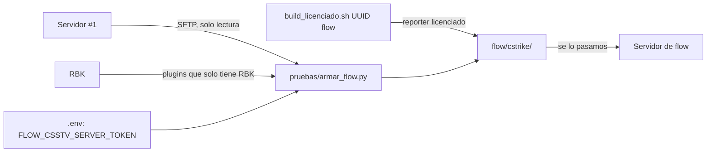

# Servidor de flow (CMLeague #3): documentación

## Qué hace

flow es el tercer servidor de la liga (CMLeague #3) y el segundo de terceros, después de RBK. A diferencia de RBK, **no tenemos acceso a su panel ni a su SFTP**: le pasamos un paquete con todo lo que tiene que tener y flow lo instala.

El paquete es la carpeta `flow/` de la raíz del repo (fuera de git, porque lleva el token y el webhook de Discord). Adentro, `cstrike/` tiene la misma estructura que la carpeta del juego, y `LEEME.txt` explica qué completar y cómo verificar.

## Qué lleva

| Parte | De dónde | Notas |
|---|---|---|
| Metamod, SourceMod 1.10 y Stripper:Source | #1 | Completos, solo los binarios de Linux. Stripper sin `dumps/` |
| Plugins y extensiones | Unión de los del #1 y RBK | Ver la lista de abajo |
| `csstv_reporter.smx` | `server/licencias/flow/` | Build licenciado con el UUID de flow, nunca el genérico |
| `configs/` de SourceMod | #1 | Con nuestros admins y el grupo `Moderador`. `core.cfg` sin la `MinidumpUrl` de Accelerator |
| `cfg/csstv/`, `game.cfg`, cfgs de los plugins, `mapcycle.txt`, `maplist.txt`, `motd.txt` | #1 | Iguales |
| `csstv_hud.cfg` | RBK | Apagado, sin host ni clave |

**Plugins:** los base de SourceMod, `clientmod`, `clientmod_deathnotice`, `CM_PickupWeapon`, `grenadedrop`, `kigen-ac_redux_legacy`, `csstv_allchat`, `csstv_calladmin`, `csstv_password`, `csstv_perf`, `csstv_sell`, `csstv_hud` y el reporter, más los que hoy solo tiene RBK: `Anti_Wallhack_Lite`, `SendFileExploitFixV3.3`, `clientmod_emulator`, `convar_detector`, `soft_detector` (con su extensión) y `spectatorswitch`.

## Lo que se deja afuera (a propósito)

| Qué | Por qué |
|---|---|
| Accelerator | Pedido de Daniel |
| `extreme_host.smx` y `extremehost.smx` (y su carga en `autoexec.cfg`) | Son del hosting Extreme Host. `csstv_perf` sostiene `fps_max 600` |
| La marca de Extreme Host en `server.cfg` (`sv_contact`, `gamedesc_override`, `sm_matchmod_gamedescription`) | Es del hosting del #1 |
| `disabled/`, `scripting/`, `logs/`, `data/csstv/`, respaldos, `adminlist_settings.ini`, `grenade_sound_replacer`, `deadchat` | Restos o datos propios del #1 |
| `watchdog.sh` | Solo va en el #1 |
| Mapas | Pedido de Daniel. flow tiene que tener los del `mapcycle.txt` que no vienen con el juego: `$2000$`, `de_cache`, `de_dust2_ob`, `de_inferno_classic`, `de_mirage_rc1`, `de_nuke_old_blue_ep`, `de_season`, `de_tuscan` y `de_strike_mirage` |

## Lo propio de flow

| Qué | Valor en el paquete |
|---|---|
| `csstv_server_token` | El de flow (`.env`: `FLOW_CSSTV_SERVER_TOKEN`) |
| `csstv_server_tag` | `flow` |
| `csstv_demo` | `0`: sin panel, el Worker no puede bajar las demos |
| `hostname` / `tv_title` | `CMLeague #3` / `CMLeague SourceTV #3` |
| `csstv_calladmin_server` | `CMLeague #3` |
| `csstv_calladmin_address`, `rcon_password`, `sv_password`, `sv_downloadurl` | Vacíos: los completa flow |

## Diferencia encontrada entre el #1 y RBK

Al armar el paquete (2026-10-27), el #1 ya no tenía `Anti_Wallhack_Lite`, `soft_detector` (y su extensión), `SendFileExploitFixV3.3`, `clientmod_emulator`, `convar_detector`, `spectatorswitch` ni `csstv_hud`. No están en `plugins/disabled/` y no hay registro de quién los sacó. RBK sí los tiene. flow lleva la unión, por decisión de Daniel. Queda anotado en `PENDIENTES.md` para resolverlo en el #1.

## Dónde está cada cosa

| Qué | Archivo |
|---|---|
| Script que arma el paquete | [`pruebas/armar_flow.py`](pruebas/armar_flow.py) |
| Paquete | `flow/` (raíz del repo, en `.gitignore`) |
| Instrucciones para flow | `flow/LEEME.txt` |
| Reporter licenciado | `server/licencias/flow/csstv_reporter.smx` |
