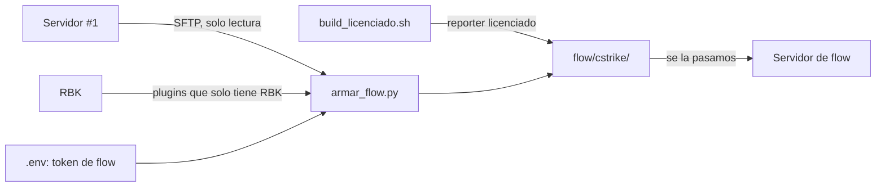

# Plan: paquete de instalación para el servidor de flow (CMLeague #3)

> Planeación original. Estado: **aprobado** por Daniel el 2026-10-27 (carpeta `flow/` en la raíz, unión de los plugins del #1 y RBK, sin Accelerator ni los plugins de Extreme Host).

## Decisiones tomadas

| Tema | Decisión | Por qué |
|---|---|---|
| Cómo llega al servidor | Una carpeta `flow/` en la raíz del repo, con la misma estructura que `cstrike/`, que se le pasa a flow para que la copie | No tenemos acceso al panel ni al SFTP de ese servidor |
| Versionado | `flow/` va al `.gitignore` | Lleva el token del servidor, el webhook de Discord y binarios de terceros |
| Qué plugins | La unión de lo que hoy está en `plugins/` del #1 y de RBK | El #1 perdió `Anti_Wallhack_Lite`, `soft_detector`, `SendFileExploitFix`, `clientmod_emulator`, `convar_detector`, `spectatorswitch` y `csstv_hud` (no están ni en `disabled/`, sin registro). RBK los tiene y la regla de `CLAUDE.md` pide `Anti_Wallhack_Lite` |
| Accelerator | No va | Pedido de Daniel. Tampoco va su `MinidumpUrl` en `core.cfg` |
| `extreme_host.smx` y `extremehost.smx` | No van, y se saca su carga del `autoexec.cfg` | Son del hosting Extreme Host. `csstv_perf` igual sostiene `fps_max 600` |
| Reporter | Build licenciado (`server/build_licenciado.sh <uuid> flow`), nunca el genérico | Regla de servidores de terceros. Hace falta el UUID de `game_servers` |
| `csstv_reporter.cfg` | El del #1 con el token de flow, `csstv_server_tag "flow"` y `csstv_demo "0"` | Sin panel, el Worker no puede bajar las demos |
| `csstv_hud` | Va apagado (`csstv_hud "0"`, sin host ni clave), como en RBK | |
| Admins | Los mismos de nuestro `admins_simple.ini`, con `admin_groups.cfg` y `admin_overrides.cfg` | Moderadores y `!calladmin` necesitan el grupo `Moderador`; el #1 y RBK tienen los mismos admins |
| `server.cfg` | El del #1 sin la marca de Extreme Host, sin contraseñas ni FastDL, `hostname "CMLeague #3"` y `tv_title "CMLeague SourceTV #3"` | Lo propio de cada servidor lo completa flow |
| Mapas | Los `.bsp` y `.nav` del `mapcycle.txt` que no vienen con el juego | Sin ellos el `mapcycle` no funciona |
| SourceMod y Metamod | Van completos (SourceMod 1.10 y Metamod del #1) | Garantiza las mismas versiones; si flow ya los tiene, los reemplaza |

## 1. El flujo completo

## 2. Contenido de `flow/cstrike/`

- `addons/metamod*`, `addons/stripper/` (sin `dumps/` ni binarios de Windows) y `addons/sourcemod/` (sin `logs/`, `scripting/`, `disabled/`, datos de nuestro servidor, respaldos, Accelerator ni restos sin uso).
- `cfg/`: `server.cfg`, `autoexec.cfg`, `game.cfg`, `cfg/csstv/` y los cfgs de `cfg/sourcemod/` de los plugins que van.
- `mapcycle.txt`, `maplist.txt`, `motd.txt` y `maps/`.
- `flow/LEEME.txt` con los pasos para flow.

## 3. Requisitos antes de empezar

- Accesos SFTP del `.env` y `paramiko` en un entorno virtual aparte.
- El token de flow (lo dio Daniel) en el `.env` como `FLOW_CSSTV_SERVER_TOKEN`.
- El UUID de flow en `game_servers`, para el build licenciado.

## 4. Orden de implementación

1. Inventario de los dos servidores por SFTP (solo lectura).
2. `pruebas/armar_flow.py` baja los archivos y escribe los cfgs de flow.
3. Build licenciado del reporter con el UUID de flow.
4. Revisión del contenido de `flow/` y `LEEME.txt`.
5. Documentación, guía, `PENDIENTES.md`, `CLAUDE.md` (servidor externo nuevo) y el índice de la bitácora.
