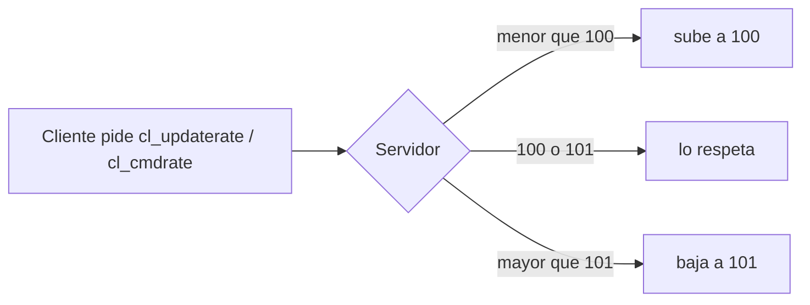

# Tasas de red coherentes en `server.cfg`: documentación

## Qué hace

Las cuatro cvars que acotan cuántos paquetes por segundo se intercambian el servidor y cada jugador quedaron con un rango válido en el servidor real y en RBK. Antes los mínimos (101) estaban por encima de los máximos (100), un rango imposible en el que el motor terminaba usando uno de los dos topes.

Ahora todos los jugadores reciben entre 100 y 101 actualizaciones por segundo y mandan entre 100 y 101 comandos por segundo (si sus FPS alcanzan). El tope coincide con el tickrate de los dos servidores (101).

## Los valores

| Cvar | Antes | Ahora | Qué acota |
|---|---|---|---|
| `sv_minupdaterate` | 101 | **100** | Mínimo de actualizaciones por segundo que el servidor le manda a cada jugador |
| `sv_maxupdaterate` | 100 | **101** | Máximo de lo mismo (igual al tickrate) |
| `sv_mincmdrate` | 101 | **100** | Mínimo de comandos por segundo que el jugador le manda al servidor |
| `sv_maxcmdrate` | 100 | **101** | Máximo de lo mismo |

- **Por qué 100 de mínimo:** todos reciben unas 100 actualizaciones por segundo y ven a los demás con la misma fluidez. Es 100 y no 101 para que el `cl_updaterate 100` de la mayoría de las configs quede dentro del rango.
- **Ancho de banda:** no cambia nada. `sv_minrate 80000` ya alcanza para 100 actualizaciones, y con el mínimo anterior en 101 el choke saliente daba ~0 en todos (diagnóstico del [2026-10-18](../2026-10-18-diagnostico-red-servidor/)).
- **Comandos:** un cliente no manda más comandos por segundo que los FPS que tiene. El mínimo en 100 no le arregla nada a quien tiene pocos FPS; está parejo con las actualizaciones.

## Cuándo se aplica

`server.cfg` se ejecuta en cada cambio de mapa. No hizo falta recargar ningún plugin ni usar RCON, así que ninguna partida se cortó. Ningún otro cfg que corre después (`autoexec.cfg`, `game.cfg`, `cfg/csstv/warmup.cfg`, `live.cfg` y `end.cfg`) fija estas cvars.

## Dónde está cada cosa

| Qué | Archivo / ubicación |
|---|---|
| Las cuatro cvars | `cstrike/cfg/server.cfg` del servidor real (`SFTP_CSS_*`) y de RBK (`SERVER1_*`) |
| Script que las revisa y las cambia | [`pruebas/tasas_coherentes.py`](pruebas/tasas_coherentes.py) |
| Lista de valores iguales en todos los servidores | `CLAUDE.md` (sección "Despliegue") y [`2026-10-22-rbk-igual-al-real/DOCUMENTACION.md`](../2026-10-22-rbk-igual-al-real/DOCUMENTACION.md) |
