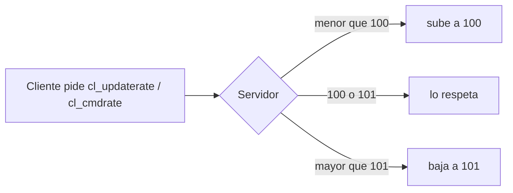

# Plan: tasas de red coherentes en `server.cfg`

> Planeación original. Estado: **aprobado** por Daniel el 2026-10-27 (mínimos en 100 y máximos en 101).

## Decisiones tomadas

| Tema | Decisión | Por qué |
|---|---|---|
| Tasas de actualización | `sv_minupdaterate 100` y `sv_maxupdaterate 101` (hoy 101 y 100) | El mínimo estaba por encima del máximo. Con 100 de mínimo todos reciben ~100 actualizaciones por segundo y se ven igual de fluidos; 100 y no 101 para no dejar afuera el `cl_updaterate 100` de la mayoría de las configs. El máximo va en 101 para igualar el tickrate |
| Ancho de banda | Sin cambios | `sv_minrate 80000` ya alcanza para 100 actualizaciones; hoy, con el mínimo en 101, el choke saliente da ~0 en todos |
| Tasas de comandos | `sv_mincmdrate 100` y `sv_maxcmdrate 101` (hoy 101 y 100) | El mismo cruce. Parejo con las de actualización; un cliente no manda más comandos que sus FPS, así que el mínimo no le cambia nada a quien tiene pocos FPS |
| Servidores | El real (`SFTP_CSS_*`) y RBK (`SERVER1_*`) en la misma tanda | Configuración obligatoria e igual en todos los servidores |
| Cuándo entra | En el próximo cambio de mapa, sin recargar nada | `server.cfg` se ejecuta en cada mapa; no se cancela ninguna partida |
| Prioridad | Baja | En el [diagnóstico de red](../2026-10-18-diagnostico-red-servidor/GUIA_IMPLEMENTACION.md) (paso 3) el choke saliente daba ~0 en todos: es para dejar el cfg prolijo, no arregla un problema medido |

Se consideró 66 de mínimo (lo que proponía el diagnóstico del 2026-10-18). Se descartó: con 100 todos ven el juego con la misma fluidez, y el ancho de banda ya está asegurado.

## 1. El flujo completo

Con los valores cruzados de hoy (mín. 101, máx. 100) no hay ningún valor válido y el motor termina usando uno de los dos topes. Con 100 a 101 el rango tiene sentido y el tope coincide con el tickrate.

## 2. Cambios

- `cfg/server.cfg` del servidor real y de RBK: las cuatro líneas, con respaldo local del original (tiene contraseñas, no se versiona). Ninguno de los dos servidores tiene una copia de `server.cfg` en el repo.
- Antes de cambiar, revisar que ningún otro cfg que se ejecute (`autoexec.cfg`, `game.cfg`, `cfg/csstv/warmup.cfg`, `live.cfg`, `end.cfg`) fije las mismas cvars.
- `CLAUDE.md` y la documentación de [`2026-10-22-rbk-igual-al-real`](../2026-10-22-rbk-igual-al-real/DOCUMENTACION.md): sumar las tasas a los valores de `server.cfg` que tienen que ser iguales en todos.

## 3. Requisitos antes de empezar

Accesos SFTP del `.env` y `paramiko` en un entorno virtual aparte.

## 4. Orden de implementación

1. `pruebas/tasas_coherentes.py inspect`: cada cvar aparece una sola vez en el `server.cfg` de los dos servidores y no aparece en los otros cfgs.
2. `apply`: reemplaza las cuatro líneas, guarda el original en el respaldo local y relee el archivo para verificarlo.
3. Documentación, guía y fila en `docs/bitacora/README.md`.
4. En el próximo mapa de cada servidor, comprobar con `sv_minupdaterate` / `sv_maxupdaterate` en la consola que los valores entraron.
