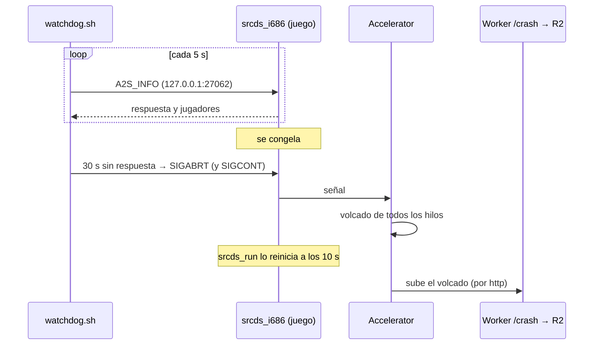
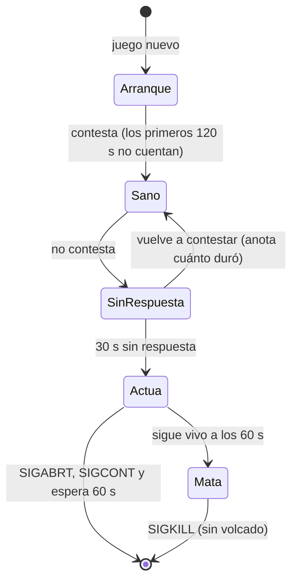

# Watchdog para tener un volcado cuando el servidor real se congela: documentación

## Qué hace

El servidor real (#1) se congela en pleno mix: pasa entre 25 s y casi 2 minutos sin procesar nada, y los jugadores se caen por timeout. Accelerator no deja nada en esos casos, porque solo escribe un volcado cuando el proceso crashea.

`watchdog.sh` corre al lado del juego, en el mismo contenedor pero afuera del proceso de `srcds`. Cada 5 s le hace al juego la consulta del navegador de servidores (`A2S_INFO`). Si pasa **30 s sin respuesta**, le manda `SIGABRT`. Con eso:
- Accelerator escribe un volcado con la pila de todos los hilos, que muestra dónde estaba trabado;
- `srcds_run` reinicia el servidor;
- Accelerator sube el volcado a R2 en el arranque siguiente.

Solo está en el #1, como Accelerator: es una excepción a "igual en todos los servidores".



## Cómo arranca

- **El panel no se toca:** ejecuta `./srcds_run ...` directo, con un comando fijo. El enganche es una línea en nuestro `srcds_run`, justo antes de `run`:

  ```bash
  # Watchdog del #1 (docs/bitacora/2026-10-27-watchdog-congelamiento)
  if test -x ./watchdog.sh; then ./watchdog.sh > /dev/null 2>&1 & fi
  ```

- **Arranca una vez por contenedor y muere con él:** es hijo directo de `srcds_run` y termina cuando `srcds_run` termina. Cuando el juego se reinicia dentro del bucle de `srcds_run`, el watchdog sigue y toma el proceso nuevo.
- **Uno solo:** un lock en `cstrike/addons/sourcemod/data/watchdog.pid` evita dos watchdogs a la vez.
- **El juego y el puerto:** encuentra el juego con `pidof -x srcds_i686 srcds_i486 srcds_amd` (en el #1 es `srcds_i686`). El puerto lo saca de `-port` en la línea de comandos del juego (27062).

## Cuándo actúa



- **La consulta:** `A2S_INFO` por `/dev/udp` de bash, con 2 s de espera. La contesta el hilo principal del motor, así que si no contesta, el juego está trabado.
- **Jugadores:** lee la respuesta (jugadores menos bots; SourceTV cuenta como bot). Con el #1 vacío da 0.
- **Ventanas que no cuentan:**
  - los primeros 120 s de cada proceso nuevo;
  - un juego que todavía no contestó nunca, por ejemplo con un puerto equivocado: no se actúa.
- **Cambio de mapa:** en las mediciones no dejó ninguna consulta sin respuesta. El umbral de 30 s tiene mucho margen.
- **Después de `SIGABRT`** manda `SIGCONT` (por si el proceso estaba detenido) y espera hasta 60 s a que termine. Si sigue vivo, `SIGKILL`: el servidor vuelve, pero sin volcado.
- **No repite sobre el mismo proceso:** espera al siguiente.

## Interruptores (por SFTP, sin reiniciar)

| Archivo en `cstrike/cfg/csstv/` | Qué hace |
|---|---|
| `watchdog_off` | No hace nada. Si había una prueba en curso, descongela el juego |
| `watchdog_dry` | Modo de prueba: anota "habría mandado SIGABRT", pero no manda señales |
| `watchdog_test` | Prueba de punta a punta, una vez (se borra solo). Si el servidor está vacío, congela el juego con `SIGSTOP` y actúa como ante un congelamiento real, también en modo de prueba. Con jugadores, la cancela y lo anota |

Sin ninguno de los tres, está en **modo normal**: así quedó desde el 2026-10-27 a las 02:31.

## Log

`cstrike/addons/sourcemod/logs/watchdog.log`, con la hora del servidor. Solo anota cambios de estado:

```
2026-10-27 02:26:25 prueba: SIGSTOP al pid 642 (servidor vacío); a los 30 s tiene que actuar, aunque esté en modo de prueba
2026-10-27 02:26:32 sin respuesta (pid 642)
2026-10-27 02:27:00 35 s sin respuesta: SIGABRT al pid 642 (Accelerator escribe el volcado) [prueba]
2026-10-27 02:27:01 terminó a los 1 s; srcds_run lo reinicia
2026-10-27 02:27:11 juego nuevo: pid 2607, puerto 27062
2026-10-27 02:27:11 el juego contesta (pid 2607, 0 jugadores)
```

Un congelamiento corto (menos de 30 s) también queda anotado: "sin respuesta" y "volvió a contestar después de N s sin respuesta".

## Leer un volcado

1. `addons/sourcemod/logs/accelerator.log` dice `Uploaded crash dump: Crash ID: <id>`.
2. Bajarlo de R2, desde `cloudflare/demo-worker`:

   ```bash
   pnpm exec wrangler r2 object get csstv-demos/crashes/<id>.dmp --remote --file <id>.dmp
   ```

3. Bajar por SFTP los binarios de la pila: `bin/engine_i686.so`, `bin/dedicated_i686.so`, `cstrike/bin/server_i486.so` y las extensiones que aparezcan.
4. Leerlo:

   ```bash
   python docs/bitacora/2026-10-14-crash-servidor-accelerator/pruebas/leer_volcado.py <id>.dmp <carpeta con los .so>
   ```

   - **La excepción:** un volcado del watchdog trae `0x6` (`SIGABRT`).
   - **La pila:** lo que importa es lo que está arriba de `RunServer`. En la prueba solo estaba `libc`, porque el juego estaba quieto; en un congelamiento real ahí aparece dónde se trabó.

## Accelerator en el #1: subida por http

El curl que trae Accelerator 2.5.0 en Linux no tiene HTTPS: `Protocol https not supported or disabled in libcurl`. Además, **Accelerator borra el volcado aunque falle la subida**. Por eso, en el #1 la `MinidumpUrl` de `cstrike/addons/sourcemod/configs/core.cfg` es `http://v34frag-demos.agusb06-ab.workers.dev/crash?key=…`. El Worker contesta igual por HTTP. La key viaja sin cifrar, pero solo sirve para subir volcados.

## Dónde está cada cosa

| Qué | Dónde |
|---|---|
| Script | `server/watchdog/watchdog.sh` (repo) y `watchdog.sh` en la raíz del #1 |
| Enganche | `srcds_run` del #1; el original en `srcds_run.bak_20261026` |
| Parche de `srcds_run` | `pruebas/parchear_srcds_run.py` (no repite la línea si ya está) |
| Despliegue | `pruebas/desplegar_watchdog.py` (`inspect` / `apply`) |
| Prueba en Docker | `pruebas/prueba_docker.sh` y `pruebas/juego_falso.pl`, con la imagen del panel `ulisesadrian/debian7-css:v34` |
| Interruptores | `cstrike/cfg/csstv/watchdog_off`, `watchdog_dry` y `watchdog_test` |
| Log | `cstrike/addons/sourcemod/logs/watchdog.log` |
| URL de Accelerator | `cstrike/addons/sourcemod/configs/core.cfg` (copia en `core.cfg.bak_20261027`) |
