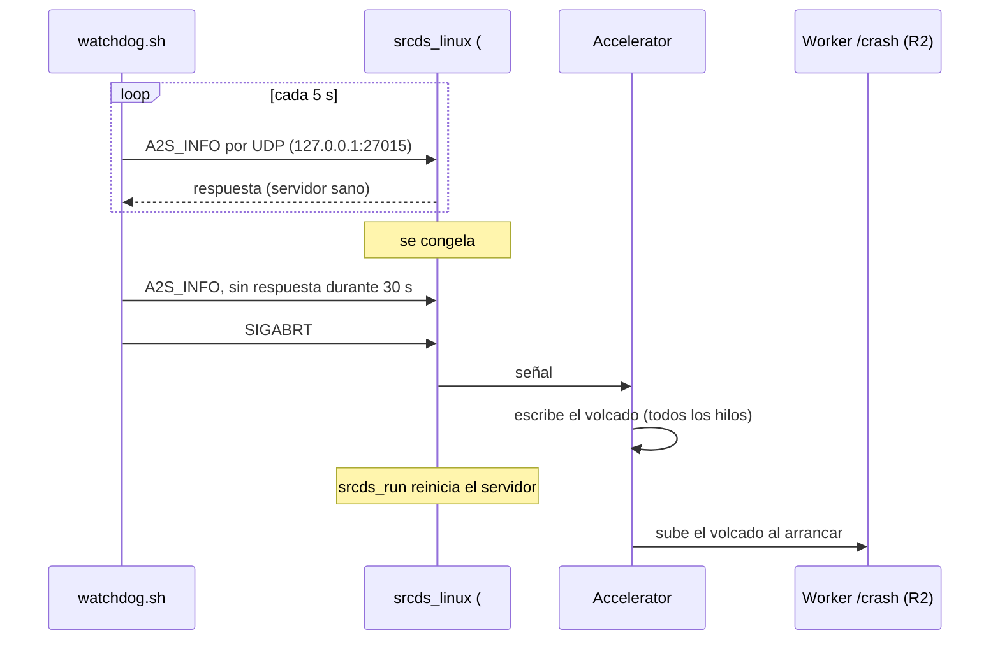

# Plan: watchdog para tener un volcado cuando el servidor real se congela

> Planeación original. Estado: **aprobado** por Daniel el 2026-10-27. Kyan no sabe cómo arranca el panel (es cliente de extremehost, como nosotros): se averiguó por la API del panel (ver la guía).

El servidor real (#1) se congela en pleno mix:
- **2026-10-26:** frames de 24,7 s, 53,5 s, 30,7 s, 58,7 s y 108,8 s;
- **2026-10-27:** un frame de 96,7 s.

Los jugadores se caen por timeout y el mix se cancela. Accelerator (reinstalado en el #1 el 2026-10-26) no deja nada, porque solo escribe un volcado cuando el proceso **crashea**, y en un congelamiento el proceso sigue vivo. Este plan suma un watchdog que, cuando el servidor lleva 30 s sin responder, fuerza el crash. Así Accelerator guarda la pila de todos los hilos, y se ve **dónde** estaba trabado.

Contexto: `docs/PENDIENTES.md`, punto 2.00.

## Decisiones tomadas

| Tema | Decisión | Por qué |
|---|---|---|
| Dónde corre | **Afuera del proceso del juego**: un script de bash que arranca junto con el servidor | No le suma carga al juego ni se traba con él. Un plugin no sirve: se congela junto con el servidor |
| Cómo detecta el congelamiento | Cada 5 s, la consulta `A2S_INFO` por UDP a `127.0.0.1:27015` (la misma del navegador de servidores) | El hilo principal del motor es el que la contesta: si no responde, el juego está trabado. No hace falta un plugin que escriba un "latido" |
| Cuándo actúa | 30 s seguidos sin respuesta | Los jugadores se caen por timeout a los ~30 s: forzar el crash no empeora el mix. Lo normal hoy es menos de 0,1 s por frame |
| Qué hace | `SIGABRT` a `srcds_linux` | Accelerator (breakpad) atrapa la señal y escribe el volcado con todos los hilos. `srcds_run` reinicia el servidor y Accelerator sube el volcado al arrancar |
| Descartado: extensión en C++ con un hilo propio | No | Hay que compilarla para Linux de 32 bits con el SDK de la v34, y correría dentro del proceso que se está investigando |
| Descartado: watchdog del motor | No existe | No hay ninguna cadena "watchdog" en `bin/engine_i686.so` ni en `dedicated_i686.so` del #1. El de SourceMod (`SlowScriptTimeout "8"`) solo mira el código de los plugins, y no anotó nada |
| Servidores | **Solo el #1**, como Accelerator | Excepción a "igual en todos los servidores", igual que Accelerator (Daniel, 2026-10-26). RBK no se congela |
| Jugadores para probarlo | **No hacen falta** | Se prueba con el servidor vacío (sección 4). El congelamiento real llega solo en los próximos mixes |

## 1. El flujo completo



## 2. El script `watchdog.sh`

Va en la raíz del servidor, al lado de `start.sh`. El panel lo lanza en segundo plano antes de `srcds_run` (sección 3).

- **Consulta:** el paquete `A2S_INFO` (`\xFF\xFF\xFF\xFFTSource Engine Query\0`) con `/dev/udp` de bash y `timeout 2`. Cualquier respuesta cuenta como "vivo". La v34 contesta sin el challenge que pide el motor nuevo.
- **Cuenta:** cada fallo suma 5 s, y una respuesta lo pone en 0. A los 30 s sin respuesta actúa.
- **Ventanas que no cuentan:**
  - los primeros 120 s después de que aparece un `srcds_linux` nuevo (arranque y primer mapa);
  - mientras el servidor no responde nunca desde que arrancó (por ejemplo, si cambió el puerto): solo lo anota y no actúa.
- **Cambio de mapa:** si en la prueba (sección 4) un cambio de mapa pasa de 30 s sin contestar, el umbral sube o se ignora ese rato. Hoy un cambio de mapa tarda unos segundos.
- **Al actuar:**
  - anota en `cstrike/addons/sourcemod/logs/watchdog.log` la hora, los segundos sin respuesta y el pid;
  - manda `kill -ABRT <pid>`;
  - espera 60 s a que el proceso termine. Si sigue vivo, manda `kill -KILL`: no hay volcado, pero el servidor vuelve.
- **Después de actuar:** no vuelve a actuar sobre el mismo pid. Espera al proceso nuevo.
- **Modo de prueba:** con `WATCHDOG_DRY=1` solo anota ("habría actuado") y no manda la señal.
- **Interruptor:** si existe `cstrike/cfg/csstv/watchdog_off`, no hace nada. Se apaga por SFTP sin tocar el panel.
- **Carga:** una consulta UDP local cada 5 s, sin escribir nada mientras el servidor está sano. El log solo crece cuando hay fallos.

## 3. Cómo se lanza

Depende de cómo arranca el panel de kyan el servidor (hay que preguntarle). Hoy `start.sh` tiene:

```bash
./srcds_run -game cstrike -debug ... +map $2000$ +sv_lan 0 &
```

- **Si el panel usa `start.sh`:** sumarle `./watchdog.sh &` antes de `srcds_run`, con un respaldo `start.sh.bak_<fecha>`.
- **Si el panel tiene su propio comando de inicio:** que kyan le sume `./watchdog.sh &` adelante, o que nos diga dónde ponerlo.
- **Herramientas del contenedor:** también hay que confirmar que tenga `bash` con `/dev/udp`, `timeout`, `pgrep` y `kill`. Si falta alguna, el script se adapta (por ejemplo, `ps` en lugar de `pgrep`).

## 4. Pruebas (sin jugadores)

1. **En local, en Docker (Linux):** el script contra un respondedor UDP de prueba. Se prueba:
   - que responda;
   - un `kill -STOP` del respondedor: tiene que actuar a los 30 s;
   - la ventana de 120 s;
   - el modo de prueba y el interruptor.
2. **En el #1, en modo de prueba (`WATCHDOG_DRY=1`), con el servidor vacío:**
   - confirmar que el servidor contesta la consulta;
   - medir cuántos segundos sin respuesta deja un cambio de mapa (`changelevel` a 3 o 4 mapas);
   - dejarlo así 1 o 2 días: con mixes reales, el log muestra si habría actuado por error y si un congelamiento real lo dispara.
3. **En el #1, prueba de punta a punta, con el servidor vacío y el OK de Daniel:**
   - congelar a mano el proceso con `kill -STOP <pid>`;
   - el watchdog manda `SIGABRT` a los 30 s;
   - `kill -CONT` para que el proceso reciba la señal y Accelerator escriba el volcado;
   - `srcds_run` reinicia el servidor;
   - `accelerator.log` dice `Uploaded crash dump`;
   - el volcado está en R2 y `leer_volcado.py` lo lee.

   Con `-STOP` el volcado no muestra la causa real, pero prueba toda la cadena.
4. **Después, en modo normal:** el próximo congelamiento real deja el volcado solo. Se lee con `docs/bitacora/2026-10-14-crash-servidor-accelerator/pruebas/leer_volcado.py` y los `.so` del #1 (que traen símbolos).

## 5. Requisitos antes de empezar

- Aprobación de este plan.
- La respuesta de kyan sobre el comando de inicio del panel y las herramientas del contenedor.
- Accelerator instalado en el #1 y con la `MinidumpUrl` correcta: está desde el 2026-10-26.

## 6. Orden de implementación

1. `watchdog.sh` y su prueba en Docker.
2. Subirlo al #1 en modo de prueba, lanzado según lo que diga kyan.
3. Medir los cambios de mapa y mirar el log 1 o 2 días.
4. La prueba de punta a punta con `kill -STOP` (servidor vacío, con el OK de Daniel).
5. Modo normal, y esperar el próximo congelamiento.
6. Leer el volcado y seguir la investigación del punto 2.00 de `docs/PENDIENTES.md`.
