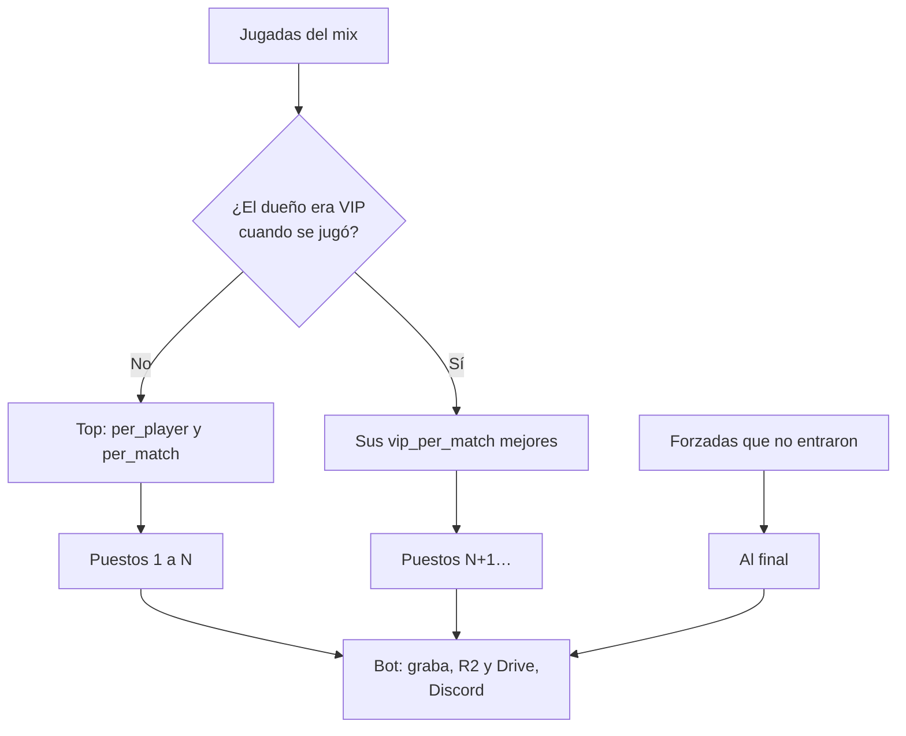
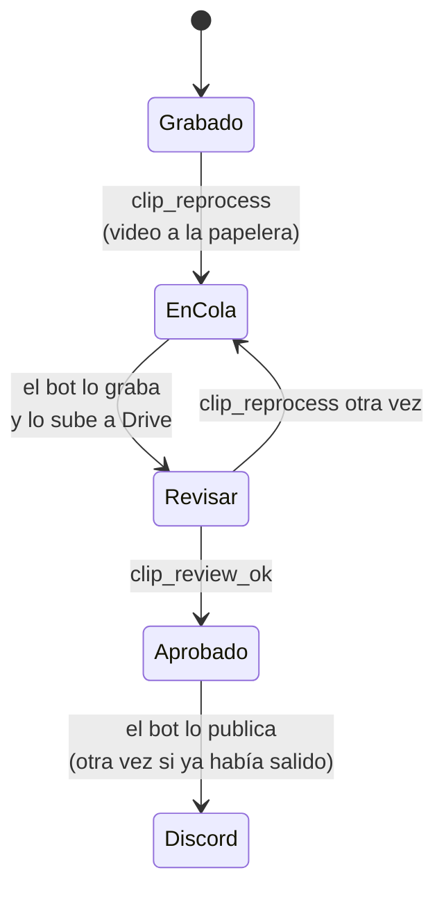

# Clips extra para los VIP y reprocesar un clip: documentación

## Qué hace

**Clips VIP.** Los VIP no cuentan en el top de jugadas de un mix:
- El top (`clip_config.per_match`, hoy 5, con `per_player` por jugador) se arma solo con las jugadas de quienes no eran VIP cuando se jugó el mix.
- Cada VIP suma aparte sus mejores jugadas (`clip_config.vip_per_match`, hoy 3), a continuación del top.
- Las jugadas forzadas por un admin van al final.
- El bot graba todo y lo publica en Discord.

**Reprocesar.** Cuando un video sale con errores, un admin lo manda a grabar de nuevo:
- El video viejo se borra de R2 y de Drive.
- El bot lo graba otra vez y lo sube a Drive con " (reproceso N)" en el nombre.
- Mientras el admin no lo marque "Bien", el clip no sale en Discord y la web lo muestra "en camino" a todos los que no son admins.
- Al aprobarlo, se publica en Discord, otra vez si ya había salido. El mensaje viejo no se borra.

## VIP cuando se jugó el mix

`vip_at(cuenta, fecha)` es verdadero si la cuenta tenía un período de `vip_memberships` vigente en esa fecha: empezado, sin vencer y sin revocar antes de esa fecha.
- La fecha del mix es `matches.played_at` (o la del clip, si falta).
- Si el VIP vence o se quita después, los clips de esos mixes no cambian.
- Los mixes jugados antes de ser VIP no suman clips.

La jugada llega a la cuenta por su ficha:
- **Hasta el corte:** `players.steam_id`.
- **Con el replanteo `26`:** `steam_owner()`. Los SteamID adicionales de un VIP también cuentan, y el tope de cada VIP es por ficha.

## `match_clip_list`

Mismas columnas que antes, más dos al final:

| Columna | Qué dice |
|---|---|
| `vip` | La jugada entró por ser de un VIP |
| `review` | `null` (nunca se reprocesó), `pending` (falta el "Bien") o `approved` |

Con `vip_per_match = 0` no hay clips VIP, y las jugadas de los VIP tampoco entran en el top.

## Reprocesar

Columnas de `match_clips`: `video_review`, `video_reprocessed_at`, `video_reprocess_count`, `video_reviewed_at` y `video_reviewed_by`.

| Función | Qué hace | Rechaza |
|---|---|---|
| `clip_reprocess(clip)` | Video a `clip_video_trash`; la jugada a la cola (`video_status` null, intentos en 0); `video_review = 'pending'`; vacía `discord_posted_at` | No es admin (con sesión); la jugada no existe o no está en la lista; la demo ya no está (`demo_status` distinto de `uploaded`); todavía no se grabó; se está grabando |
| `clip_review_ok(clip)` | `video_review = 'approved'`, con quién y cuándo | No es admin; no espera revisión; el video nuevo no está listo (`done`) |

- **Desde el SQL Editor** (sin sesión) las dos funcionan, como `clip_force`.
- **Una jugada con otros ticks** (un reenvío después de un `!rr`) vuelve a la cola sin revisión pendiente: es otra jugada.

## El bot

- **`clip_render_claim`** manda `vip`, `review` y `reprocess` en cada jugada. `render/procesar.py` sube un reprocesado a Drive como `AAAA-MM-DD mapa tipo jugador (reproceso N).mp4`.
- **`clip_discord_pending`** publica el top (`position <= p_top`), los VIP y las forzadas. No publica los que esperan el "Bien", y esos no frenan al resto del mix. Cada fila suma `vip`.

## Aviso en la web nueva

Con el replanteo `28`, el aviso `clip_ready` de un clip reprocesado sale cuando se aprueba, no cuando termina de grabarse.

## API

| Endpoint | Qué hace |
|---|---|
| `GET /api/v1/matches/{id}/clips` | Cada clip suma `vip` y `review` (`review` solo para admins). Un reprocesado sin aprobar llega a los demás con `video.status: "pending"` y sin video |
| `GET` y `PATCH /api/v1/admin/clips/config` | `vip_per_match` (0 a 10) |
| `POST /api/v1/admin/clips/{id}/reprocess` | `clip_reprocess`; responde el clip |
| `POST /api/v1/admin/clips/{id}/approve` | `clip_review_ok`; responde el clip |
| `GET /api/v1/admin/clips/review` | Los que esperan el "Bien", con su mix, del más viejo al más nuevo |

## Dónde está cada cosa

| Qué | Archivo |
|---|---|
| Migración de producción | `supabase/migrations/20261028180000_clips_vip_reprocesar.sql` |
| La vista con `steam_owner` (corte) y su inversa | `supabase/replanteo/26_clips.sql` y `docs/bitacora/2026-10-14-replanteo-modelo-datos/reversas/26_clips.sql` |
| Aviso `clip_ready` | `supabase/replanteo/28_notificaciones.sql` (`tg_notify_match_clips`) |
| API | `web/backend/src/routes/clips.ts` y `src/schemas/clips.ts` |
| Bot | `render/procesar.py` (nombre en Drive) |
| Contrato del frontend | `docs/frontend/contrato/partidas.md` (8g) y `admin.md` (Clips) |
| Pruebas | [`pruebas/`](pruebas/), `web/backend/test/unit/clips-routes.test.ts` y `test/integration/clips-vip.test.ts` |
