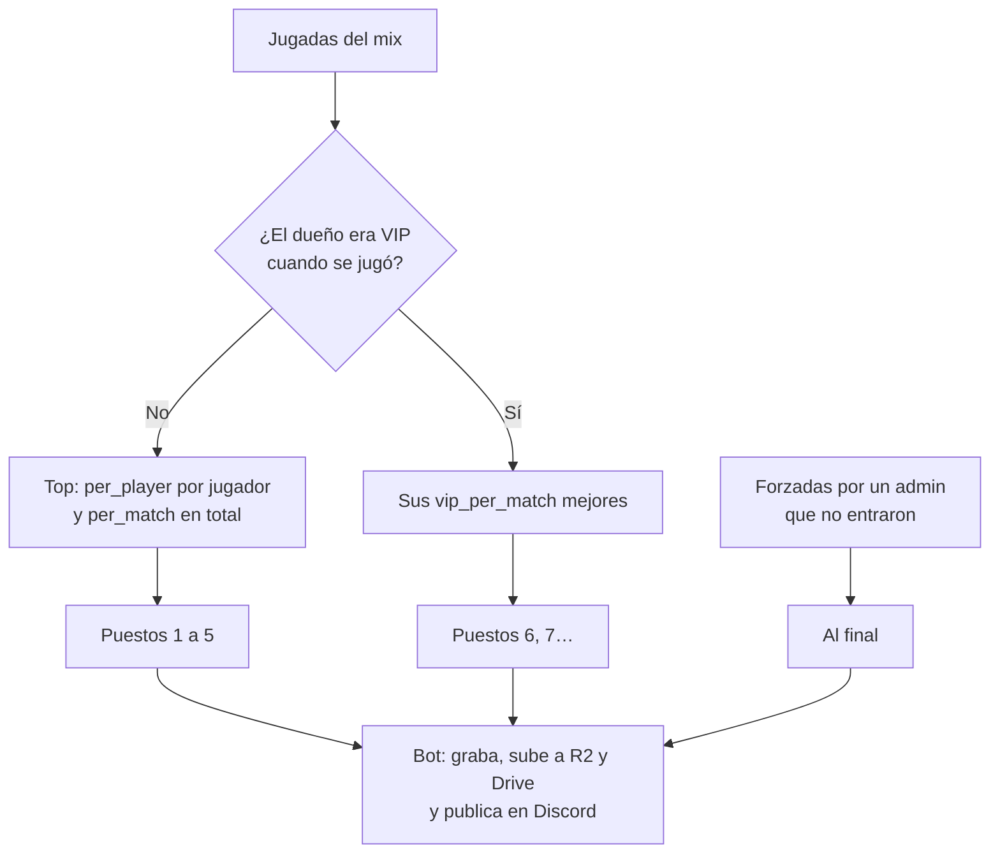
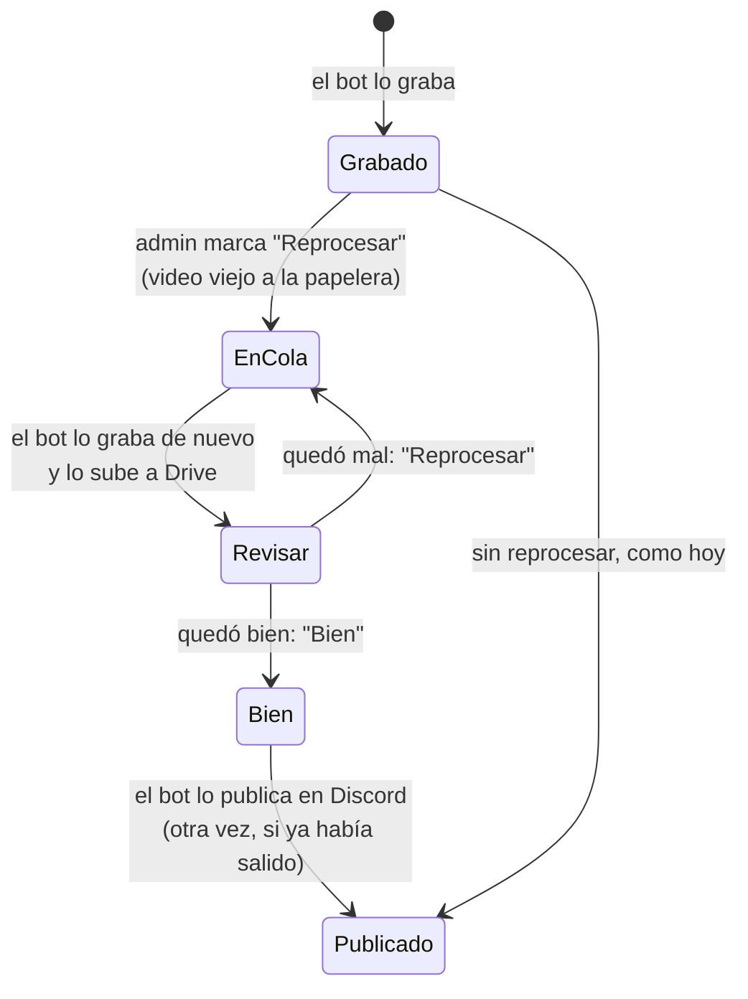

# Plan: clips extra para los VIP y reprocesar un clip

> Planeación original. Estado: **aprobado** por Daniel el 2026-10-28 (reprocesar va en la web nueva, no en la vieja: hasta entonces, desde la base).

Dos cambios en los clips automáticos (bitácoras [`2026-10-22-clips-automaticos`](../2026-10-22-clips-automaticos/), [`2026-10-23-clips-video`](../2026-10-23-clips-video/), [`2026-10-24-clips-discord`](../2026-10-24-clips-discord/) y [`2026-10-24-clips-forzados`](../2026-10-24-clips-forzados/)):

1. **Clips VIP**, el primer beneficio del VIP ([fase 0](../2026-10-28-vip-fase-0/PLAN.md)). Los VIP no cuentan dentro del top de 5 jugadas del mix: cada VIP que jugó suma aparte sus 3 mejores jugadas. Un mix tiene hasta **5 + 3 × VIP** clips.
2. **Reprocesar un clip.** A veces un video sale con errores. El admin lo marca para reprocesar, el bot lo vuelve a grabar y lo sube a Drive. El admin lo mira en Drive: si quedó mal lo reprocesa otra vez, y si quedó bien lo marca como "Bien" y recién ahí sale en Discord. Es un parche: la causa de los videos con errores queda para otro requerimiento.

Los dos van a producción ya, como migración: los clips y el bot de render ya funcionan contra la base de producción, y el VIP también.

## Decisiones tomadas

| Tema | Decisión | Por qué / quién |
|---|---|---|
| Top del mix | Se arma solo con las jugadas de quienes **no son VIP**, con los topes de hoy (`per_match`, hoy 5, y `per_player`) | Daniel, 2026-10-28: los VIP no cuentan dentro del límite |
| Clips VIP | Cada VIP suma sus **3 mejores jugadas** del mix, con la misma escala que el top. Si tiene menos, las que tenga | Daniel, 2026-10-28 |
| VIP de cuándo | El que tenía **cuando se jugó el mix** (un período vigente en `played_at`, sin revocar antes de esa fecha) | Daniel, 2026-10-28. Si el VIP vence, los clips de sus mixes no cambian; los mixes viejos de un VIP nuevo no suman clips para el bot |
| Cuántos | Configurable: `clip_config.vip_per_match`, empieza en 3 (de 0 a 10; 0 apaga los clips VIP) | Daniel, 2026-10-28 |
| Orden | Primero el top (puestos 1 a 5), después los de los VIP (6, 7…) y al final los forzados por un admin | Daniel, 2026-10-28. Los puestos del top no cambian |
| Discord | Los clips VIP también se publican, junto a los del top y los forzados | Daniel, 2026-10-28 |
| Reprocesar | Lo marca un admin (desde la web nueva o, hasta entonces, el SQL Editor). El video viejo va a la papelera (se borra de R2 y de Drive) y la jugada vuelve a la cola del bot | Daniel, 2026-10-28 |
| Revisión | Un clip reprocesado **no sale en Discord** hasta que un admin lo marca como "Bien". Si quedó mal, se reprocesa de nuevo. Los clips que nunca se reprocesaron salen como hoy, sin revisión | Daniel, 2026-10-28 |
| Ya publicado en Discord | Al marcarlo "Bien" se **publica otra vez, sin borrar** el mensaje viejo | Daniel, 2026-10-28 |
| Demo vencida | No se puede reprocesar si la demo ya no está en R2 (se borra a los 90 días): la función lo rechaza con un mensaje claro | Sin demo, el bot no puede grabar |
| Aviso `clip_ready` (web nueva) | Un clip reprocesado avisa al jugador recién cuando se marca "Bien", no al terminar de grabarse | El jugador no tiene que ver el video sin revisar |

## 1. El flujo completo

### Qué clips tiene un mix

### Reprocesar

## 2. Base de datos (migración de producción)

Una migración, `supabase/migrations/20261028180000_clips_vip_reprocesar.sql`, re-ejecutable como las demás. Necesita `20261024180000_clips_forzados.sql` y `20261028120000_vip.sql`.

### Configuración

- `clip_config.vip_per_match` (smallint, 3 por defecto, de 0 a 10).
- `clip_set_config` acepta `p_vip_per_match` (si no viene, no cambia).

### VIP en una fecha

`vip_at(p_user uuid, p_at timestamptz)`: tenía un período vigente en esa fecha (empezado, sin vencer y sin revocar antes de esa fecha). Es como `is_vip()`, pero mirando el pasado.

### `match_clip_list`

Se vuelve a definir con las mismas columnas que hoy y dos nuevas al final:

| Columna nueva | Qué dice |
|---|---|
| `vip` | La jugada entró por ser del VIP (puestos después del top) |
| `review` | `null` (nunca se reprocesó), `pending` (reprocesada, falta el "Bien") o `approved` |

Cómo arma la lista:
1. A cada jugada le busca la ficha (hoy por `players.steam_id`) y la cuenta de esa ficha, y mira `vip_at(cuenta, played_at del mix)`.
2. **Top:** las jugadas de quienes no son VIP, con `per_player` y `per_match` como hoy. Puestos 1 a N.
3. **VIP:** de cada VIP, sus `vip_per_match` mejores, con la misma escala y los mismos desempates. Puestos N+1 en adelante, ordenados con la escala.
4. **Forzadas** que no entraron en lo anterior, al final.

### Reprocesar y revisar

Columnas nuevas en `match_clips`: `video_review` (`pending` o `approved`), `video_reprocessed_at`, `video_reprocess_count`, `video_reviewed_at` y `video_reviewed_by`.

| Función | Quién | Qué hace |
|---|---|---|
| `clip_reprocess(p_clip)` | Admin, o el SQL Editor | Solo una jugada que está en la lista y cuya demo sigue en R2. Manda el video actual a la papelera (`clip_video_trash`), deja la jugada en la cola (`video_status` null, intentos en 0), `video_review = 'pending'` y vacía `discord_posted_at` (así se vuelve a publicar). Devuelve el estado |
| `clip_review_ok(p_clip)` | Admin, o el SQL Editor | Solo un reprocesado con el video listo (`done`): `video_review = 'approved'`. Desde ahí entra en Discord |

### Discord (`clip_discord_pending`)

- Publica el top (`position <= p_top`), los VIP y los forzados.
- No publica los que esperan el "Bien" (`video_review = 'pending'`).
- Un clip esperando el "Bien" no frena al resto del mix.

### El bot

- `clip_render_claim`, `clip_render_done` y la papelera no cambian: un clip reprocesado vuelve a la cola como uno nuevo.
- **Un cambio chico en `render/procesar.py`:** el claim manda `review` en cada jugada, y el video reprocesado sube a Drive con " (reproceso N)" en el nombre, para que el admin lo encuentre. Hay que actualizar la máquina de render (el portátil) para tenerlo. Sin ese cambio todo funciona igual, con el nombre de siempre.

## 3. Replanteo `33`

La `26` vuelve a definir `match_clip_list` en el corte (busca la ficha con `steam_owner()`, para los varios SteamID por ficha). Sin otro cambio, borraría la regla VIP y la revisión. La `33`:
- Define la vista con `steam_owner()`, la regla VIP y `review`.
- Cambia el aviso `clip_ready` de la `28`: un reprocesado avisa al marcarse "Bien".
- Lleva su inversa y sus pruebas.

## 4. API

| Endpoint | Qué cambia |
|---|---|
| `GET /api/v1/matches/{id}/clips` | Suma `vip` y `review` en cada clip. Para los que no son admins, un clip con `review = 'pending'` se muestra sin video |
| `GET` y `PATCH /api/v1/admin/clips/config` | Suma `vip_per_match` |
| `POST /api/v1/admin/clips/{id}/reprocess` | Nuevo. Llama a `clip_reprocess` |
| `POST /api/v1/admin/clips/{id}/approve` | Nuevo. Llama a `clip_review_ok` |
| `GET /api/v1/admin/clips/review` | Nuevo. Los que esperan el "Bien": mix, mapa, jugador, tipo, cuántas veces se reprocesó y si ya tiene el video nuevo |

El contrato del frontend se actualiza en `partidas.md` y `admin.md`.

## 5. Hasta que salga la web nueva

Las acciones se hacen en el SQL Editor, como hoy `clip_force`:
- Buscar la jugada (por mix, ronda o jugador).
- `select clip_reprocess('<id>');`
- Mirar el video en Drive.
- `select clip_review_ok('<id>');`

La guía de implementación trae las consultas listas.

## 6. Frontend (después, con la web nueva)

- **Admin › Clips:** el valor "Clips por VIP" y la cola "Para revisar", con "Reprocesar" y "Bien".
- **En la sala del mix:** los clips VIP con su marca y, para un admin, "Reprocesar" en cada clip.

## 7. Riesgos

- **Más trabajo para el bot:** hasta 3 clips más por VIP en cada mix. Con 4 VIP en un mix son 12 más que grabar.
- **Reprocesar puede dar el mismo error** si el problema es de la demo o del lector, y no de la grabación. En ese caso el reprocesado no sirve y hace falta ir a la causa.

## 8. Pruebas

- **Base:**
  - La lista con y sin VIP, y el VIP al jugarse: vencido antes del mix, empezado después y revocado después.
  - Un VIP con menos de 3 jugadas.
  - `vip_per_match = 0`.
  - Los forzados después de los VIP.
  - Reprocesar: a la papelera, a la cola, demo vencida rechazada y "Bien" solo con el video listo.
  - Discord: sin los que esperan el "Bien", con los VIP y la republicación.
  - En la `33`: lo mismo con `steam_owner()` y el aviso.
- **API:** unitarias y de integración de los endpoints nuevos y de los campos nuevos.
- **Bot:** una partida local con un clip reprocesado, de punta a punta con el portátil, si Daniel lo corre.

## 9. Requisitos antes de empezar

- Aprobación de este plan.
- La migración va a producción: Daniel la corre en el SQL Editor, como la del VIP. Primero hay que comprobar el `per_match` real (hoy 5) con `select * from clip_config;`.

## 10. Orden de implementación

1. Migración de producción con sus pruebas sobre el esquema de producción.
2. Replanteo `33` con su inversa y sus pruebas.
3. API, tipos, pruebas y contrato del frontend.
4. `render/procesar.py`: el nombre del reprocesado en Drive.
5. Guía con las consultas para el SQL Editor; Daniel aplica la migración y actualiza el portátil.
