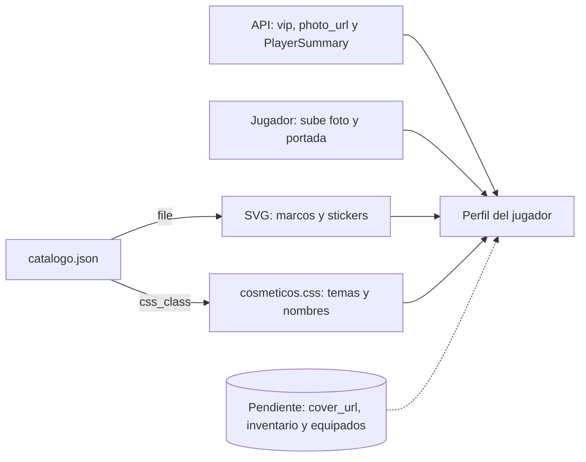

# Cosméticos del perfil: documentación

## Qué hace

`assets/perfil/` tiene los artículos para personalizar el perfil, que más adelante se van a vender en la tienda o a dar con el VIP. Hay cuatro tipos (marcos de avatar, stickers, temas y efectos de nombre), con la misma cantidad para todos que para VIP en cada uno: 20 marcos y 16 de cada uno de los otros tipos, 68 en total. Los diseños son originales y con temática de Counter-Strike: Source.

**No hay fondos.** La foto de perfil y la portada las sube cada jugador. La foto ya existe en la API (`photo_url`). La portada todavía no: hace falta un campo `cover_url` en el backend.

Los marcos y los stickers son SVG con animación SMIL dentro del archivo. Los temas y los nombres son clases CSS. Todo funciona dentro de un `` o con una clase, sin JavaScript. `catalogo.json` es la lista única de artículos.

**Lo que ya resuelve el backend** (rama `feat/backend-api-fase-1`) no se duplica acá:

- **VIP:** quién es VIP lo dice la API (`vip: boolean` en `PlayerSummary` y `PlayerDetail`, y `vip.active` en `GET /api/v1/me/profile`). Un artículo con `vip_only: true` se equipa solo si ese campo es `true`.
- **Datos del jugador:** alias, foto, ELO, nivel y stats salen de `GET /api/v1/players`. Los datos falsos de la vista previa tienen esa misma forma.

**Lo que el backend todavía no tiene:** moneda de puntos, tienda, inventario, cosméticos equipados y portada. Por eso `price` es `null`, y `cosmetics` y `cover_url` son campos propuestos en los datos falsos. Su plan es [`2026-10-29-tienda-puntos-backend`](../2026-10-29-tienda-puntos-backend/PLAN.md).



## Tipos de artículo

| `kind` | Tamaño | Cómo se usa |
|---|---|---|
| `frame` | 256 × 256 | Encima del avatar. El avatar ocupa el 75 % central (de 32 a 224). Ver `.avf` |
| `sticker` | 128 × 128 | Vitrina del perfil. La vista previa deja equipar hasta 3. Los VIP son animados |
| `theme` | — | Clase CSS sobre el contenedor del perfil. Los VIP suman un borde con brillo |
| `name` | — | Clase CSS sobre el nombre. `nombre-glitch` necesita `data-nombre` con el mismo texto |

## Temas y el frontend nuevo

Los temas redefinen los tokens de shadcn del frontend nuevo (`web/frontend/src/index.css`): `--primary`, `--primary-foreground`, `--ring`, `--card`, `--muted` y `--border`. **No tocan `--accent`**: en shadcn es el fondo del hover y no el color de marca, y cambiarlo rompería los botones y menús dentro del perfil.

## Avatar con marco

```html
<div class="avf" style="--avf:150px">
  
  
</div>
```

## Catálogo

Claves en inglés, como en la API. Cada artículo de `items` tiene:

| Campo | Qué es |
|---|---|
| `id` | Identificador estable, para guardarlo en el inventario |
| `kind` | Uno de los tipos de arriba |
| `name`, `description` | Textos de la tienda |
| `file` o `css_class` | Ruta relativa a `assets/perfil/` o clase de `cosmeticos.css` (el otro, `null`) |
| `vip_only` | `true`: se equipa solo si la API dice `vip: true` |
| `animated` | Para mostrar la etiqueta "Animado" |
| `price` | `null`: el backend no tiene moneda todavía |

## Artículos

| Tipo | Para todos | Solo VIP |
|---|---|---|
| Marcos (10 y 10) | Mira, Trazadoras, C4, Circuito, Fuego, Camuflaje, Hielo, Cinta de balas, Píxel, Grafiti | Kevlar, Neón, Oro VIP, Diamante, Plasma, Galaxia, Holográfico, Láser, Glitch, Alas |
| Stickers (8 y 8) | GG, NICE SHOT, RUSH B, 1 HP, CLUTCH, NT, ECO, AFK | ACE, MVP, HEADSHOT, ONE TAP, DEFUSED, 1v5, WALLBANG, NINJA |
| Temas (8 y 8) | Terrorista, Antiterrorista, Tóxico, Hielo, Carmesí, Camuflaje, Atardecer, Grafito | Oro VIP, Obsidiana, Diamante, Synthwave, Holográfico, Esmeralda, Rubí, Aurora |
| Nombre (8 y 8) | Brillo, Glitch, Neón, Retro, Contorno, Sombra, Hielo, Píxel | Arcoíris, Oro, Fuego, Holográfico, Galaxia, Plasma, Esmeralda, Cromo |

Las animaciones de los nombres y de los temas Holográfico y Aurora se apagan con `prefers-reduced-motion`. `nombre-glitch` y `nombre-cromo` necesitan `data-nombre` con el mismo texto.

## Datos falsos

`datos-falsos.json` tiene 8 jugadores inventados con la forma de `GET /api/v1/players` (`items`, `total`, `page`, `per`, `sort`, `order` y los campos de `PlayerSummary`), más `details` (`country`, `game_role`) de `PlayerDetail`. Cubren dos VIP, jugadores con distintos marcos, temas y nombres, y uno sin cuenta, sin ELO y sin nada equipado. `cosmetics` y `cover_url` son los únicos campos que no existen en la API. Con `photo_url` y `cover_url` en `null`, la vista previa dibuja un reemplazo con el color del jugador.

## Dónde está cada cosa

| Qué | Archivo / ubicación |
|---|---|
| Marcos | `assets/perfil/marcos/*.svg` |
| Stickers | `assets/perfil/stickers/*.svg` |
| Temas, efectos de nombre y `.avf` | `assets/perfil/cosmeticos.css` |
| Catálogo | `assets/perfil/catalogo.json` |
| Jugadores de ejemplo | `assets/perfil/datos-falsos.json` |
| Vista previa (perfil, tienda, mini perfiles y ranking) | `assets/perfil/vista-previa.html` |
| VIP (ya hecho) | Rama `feat/backend-api-fase-1`: `web/backend/src/routes/vip.ts`, `supabase/migrations/20261028120000_vip.sql` |
