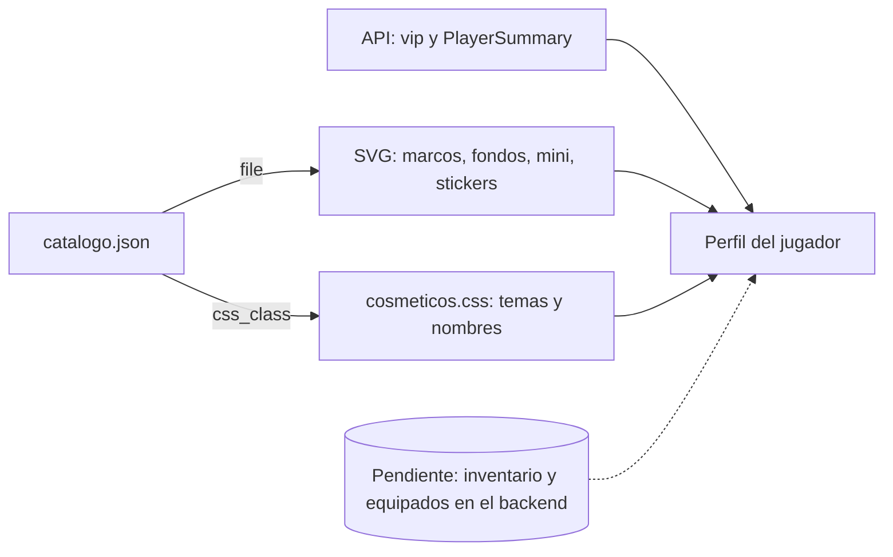

# Cosméticos del perfil: documentación

## Qué hace

`assets/perfil/` tiene los artículos para personalizar el perfil, que más adelante se van a vender en la tienda o a dar con el VIP. Siguen las categorías de la tienda de puntos de Steam (marcos de avatar, fondos, mini perfil, stickers y temas), pero los diseños son originales y con temática de Counter-Strike: Source.

Todo es SVG animado (SMIL dentro del archivo) o una clase CSS, así que funciona dentro de un `` o un `background-image` sin JavaScript. `catalogo.json` es la lista única de artículos.

**Lo que ya resuelve el backend** (rama `feat/backend-api-fase-1`) no se duplica acá:

- **VIP:** quién es VIP lo dice la API (`vip: boolean` en `PlayerSummary` y `PlayerDetail`, y `vip.active` en `GET /api/v1/me/profile`). Un artículo con `vip_only: true` se equipa solo si ese campo es `true`. Dar, extender y quitar el VIP ya están en `POST /api/v1/admin/users/{id}/vip` y `/vip/revoke`.
- **Datos del jugador:** alias, foto, ELO, nivel y stats salen de `GET /api/v1/players`. Los datos falsos de la vista previa tienen esa misma forma.

**Lo que el backend todavía no tiene:** moneda de puntos, tienda, inventario y cosméticos equipados. Por eso `price` es `null` y `cosmetics` en los datos falsos es un campo propuesto. Van con su propio plan.



## Tipos de artículo

| `kind` | Tamaño | Cómo se usa |
|---|---|---|
| `frame` | 256 × 256 | Encima del avatar. El avatar ocupa el 75 % central (de 32 a 224). Ver `.avf` |
| `background` | 1920 × 1080 | `background-image` del hero del perfil, con `background-size: cover` |
| `mini` | 600 × 220 | Fondo de la tarjeta que aparece al pasar el mouse por un jugador |
| `sticker` | 128 × 128 | Vitrina del perfil. La vista previa deja equipar hasta 3 |
| `theme` | — | Clase CSS sobre el contenedor del perfil |
| `name` | — | Clase CSS sobre el nombre. `nombre-glitch` necesita `data-nombre` con el mismo texto |

## Temas y el frontend nuevo

Los temas redefinen los tokens de shadcn del frontend nuevo (`web/frontend/src/index.css`): `--primary`, `--primary-foreground`, `--ring`, `--card`, `--muted` y `--border`. **No tocan `--accent`**: en shadcn es el fondo del hover y no el color de marca, y cambiarlo rompería los botones y menús dentro del perfil.

## Avatar con marco

```html
<div class="avf" style="--avf:150px">
  
  
</div>
```

## Catálogo

Claves en inglés, como en la API. Cada artículo de `items` tiene:

| Campo | Qué es |
|---|---|
| `id` | Identificador estable, para guardarlo en el inventario |
| `kind` | Uno de los tipos de arriba |
| `name`, `description` | Textos de la tienda |
| `file` o `css_class` | Ruta relativa a `assets/perfil/` o clase de `cosmeticos.css` (el otro, `null`) |
| `vip_only` | `true`: se equipa solo si la API dice `vip: true` |
| `animated` | Para mostrar la etiqueta "Animado" |
| `price` | `null`: el backend no tiene moneda todavía |

## Artículos

| Tipo | Para todos | Solo VIP |
|---|---|---|
| Marcos | Mira, Trazadoras, Humo, Flashbang, C4 | Neón, Oro VIP |
| Fondos | Desierto al atardecer, Casquillos, Radar | Neón nocturno |
| Mini perfil | Pulso, Humo | Aurora |
| Stickers | GG, NICE SHOT, RUSH B, 1 HP, CLUTCH, ACE | — |
| Temas | Terrorista, Antiterrorista, Tóxico | Oro VIP |
| Nombre | Brillo, Glitch | Arcoíris |

Los efectos de nombre se apagan con `prefers-reduced-motion`.

## Datos falsos

`datos-falsos.json` tiene 8 jugadores inventados con la forma de `GET /api/v1/players` (`items`, `total`, `page`, `per`, `sort`, `order` y los campos de `PlayerSummary`), más `details` (`country`, `game_role`) de `PlayerDetail`. Cubren los casos: dos VIP, jugadores sin tema o sin fondo, uno sin cuenta, sin ELO y sin nada equipado. `cosmetics` es el único campo que no existe en la API.

## Dónde está cada cosa

| Qué | Archivo / ubicación |
|---|---|
| Marcos | `assets/perfil/marcos/*.svg` |
| Fondos | `assets/perfil/fondos/*.svg` |
| Mini perfil | `assets/perfil/mini/*.svg` |
| Stickers | `assets/perfil/stickers/*.svg` |
| Temas, efectos de nombre y `.avf` | `assets/perfil/cosmeticos.css` |
| Catálogo | `assets/perfil/catalogo.json` |
| Jugadores de ejemplo | `assets/perfil/datos-falsos.json` |
| Vista previa (perfil, tienda, mini perfiles y ranking) | `assets/perfil/vista-previa.html` |
| VIP (ya hecho) | Rama `feat/backend-api-fase-1`: `web/backend/src/routes/vip.ts`, `supabase/migrations/20261028120000_vip.sql` |
