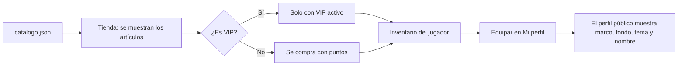

# Plan: cosméticos del perfil para la tienda y los beneficios VIP

> Planeación original. Estado: **propuesta**, pendiente de aprobación.

Kyan pidió una primera tanda de assets para personalizar el perfil, tomando como referencia las categorías de la tienda de puntos de Steam (marcos de avatar, fondos de perfil, fondos de mini perfil, stickers y temas). Los assets son **originales** y con estética de Counter-Strike: Source y de la paleta de la web (grafito, negro y rosa); no se copia ningún diseño de Steam ni de Valve.

Este plan cubre solo los assets y su catálogo. La tienda (compra, inventario, equipar) y el VIP en la base de datos y la API van con su propio plan.

## Decisiones tomadas

| Tema | Decisión | Por qué |
|---|---|---|
| Formato | SVG con animación SMIL o CSS interna | Pesan pocos KB, escalan sin perder calidad y se animan dentro de un ``, sin JavaScript |
| Ubicación | `assets/perfil/` en la raíz, junto a `index.html` | La web de esta rama es estática; el frontend nuevo puede copiar la carpeta tal cual |
| Marco de avatar | Lienzo de 256 × 256 con el avatar en el centro, de 32 a 224 (75 %) | Igual que los marcos de Steam: el marco desborda el avatar y puede tapar un poco los bordes |
| Fondos | 1920 × 1080 con `preserveAspectRatio="xMidYMid slice"` | Cubren el hero del perfil a cualquier ancho |
| Mini perfil | 600 × 220 | Tarjeta que aparece al pasar el mouse por un jugador |
| Temas y efectos de nombre | Clases CSS en `assets/perfil/cosmeticos.css` | Se aplican con una clase sobre el perfil o el nombre, sin imágenes |
| Catálogo | `assets/perfil/catalogo.json` con id, tipo, nombre, precio en puntos, si es VIP y si es animado | La tienda y la API leen la misma fuente. Los precios son provisorios hasta definir la moneda |
| Vista previa | `assets/perfil/vista-previa.html` | Para revisar todo junto en el navegador antes de integrarlo |

## 1. El flujo completo

Este plan llega hasta `catalogo.json` y los archivos; de B en adelante es el plan de la tienda.

## 2. Assets

| Tipo | Cantidad | Ejemplos |
|---|---|---|
| Marcos de avatar | 7 | Mira, C4, Neón, Oro VIP, Flashbang, Humo, Trazadoras |
| Fondos de perfil | 4 | Desierto al atardecer, Radar, Neón nocturno, Casquillos |
| Fondos de mini perfil | 3 | Aurora, Pulso, Humo |
| Stickers | 6 | ACE, CLUTCH, GG, 1 HP, RUSH B, NICE SHOT |
| Temas de perfil | 4 | Terrorista, Antiterrorista, Tóxico, Oro VIP |
| Efectos de nombre | 3 | Brillo, Arcoíris, Glitch |

## 3. Requisitos antes de empezar

Ninguno.

## 4. Orden de implementación

1. Marcos, fondos, mini perfiles y stickers en SVG.
2. `cosmeticos.css` con temas y efectos de nombre.
3. `catalogo.json`.
4. `vista-previa.html` y revisión en el navegador.
5. Documentación y fila en el índice.
