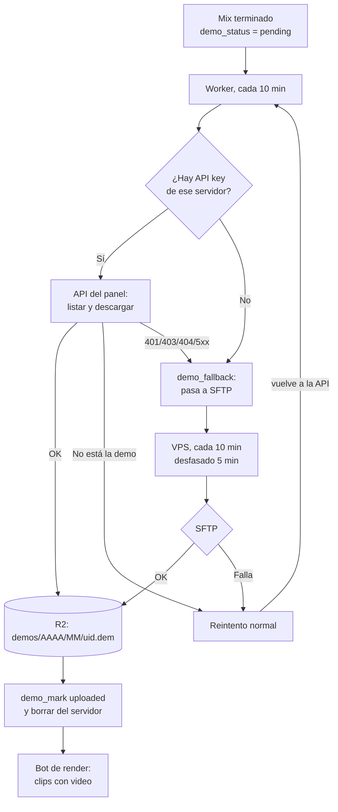

# Plan: demos y clips de los servidores externos (API key primero, SFTP después)

> Planeación original. Estado: **aprobado** por Daniel el 2026-10-28: el SFTP en el VPS, borrar las demos de RBK y flow después de subirlas y corregir el `CLAUDE.md` (hecho el mismo día). Antes de aprobar se descartó bajar por SFTP desde el Worker: no tiene un cliente SSH probado y el tiempo de CPU para descifrar la demo no está medido.

Hoy solo nuestro servidor (#1) sube demos a R2. El Worker de demos ([`2026-10-12-demos-r2-worker`](../2026-10-12-demos-r2-worker/)) las baja por la API del panel Pterodactyl con **una sola API key, la de nuestra cuenta**. RBK y flow tienen `csstv_demo "0"`, así que sus mixes no tienen demo ni video de los clips: el bot de render solo graba jugadas con `demo_status = 'uploaded'`.

## Qué se verificó (2026-10-28, todo solo lectura)

| Servidor | API key del panel | SFTP | Estado |
|---|---|---|---|
| #1 (nuestro) | `PTERO_PANEL_API_KEY`: funciona | `SFTP_CSS_*` | Demos funcionando |
| RBK | `SERVER1_PANEL_API_KEY`: **funciona** (HTTP 200 en el servidor y en `/files/list`). La nuestra no lo ve (HTTP 404) | `SERVER1_*` | `csstv_demo 0` y sin `+tv_enable 1` en el arranque |
| flow (#3) | `SERVER2_PANEL_API_KEY` **vacía**: flow no puede generarla | `SERVER2_*` (alias `FLOW_SERVER`, puerto 2022): **funciona**. Se listaron `cstrike/`, `addons/sourcemod/plugins/` y `cfg/sourcemod/` | Ya instaló el paquete: reporter de 116417 bytes, el licenciado. `csstv_demo "0"`, sin la carpeta `csstv_demos/` y sin `tv_enable` en `server.cfg` ni en `autoexec.cfg` |

En las dos cuentas, el usuario de SFTP tiene la forma `<usuario>.<id de 8 caracteres>`, y ese id es el `panel_server_id` que usa el Worker.

Así que sí: con lo que ya hay en el `.env` se pueden bajar las demos de flow, pero **por SFTP**. El Worker de Cloudflare no puede hacerlo: tiene sockets TCP, pero no un cliente SSH confiable. La parte de SFTP tiene que correr en una máquina con Node o Python.

Esto también cambia algo de la bitácora de flow: **sí tenemos acceso por SFTP**, no solo pasándole archivos. El `CLAUDE.md` y `PENDIENTES.md` dicen lo contrario y se corrigen en este requerimiento (ver la sección 6).

## Decisiones tomadas

| Tema | Decisión | Por qué |
|---|---|---|
| Orden | **Siempre primero la API key del servidor.** Si no tiene, o la API falla, la demo pasa a la cola de SFTP. Si el SFTP también falla, cuenta un intento (como hoy, a los 6 queda `missing`) y la próxima vuelta empieza de nuevo por la API | Lo pidió Daniel. La API es más directa y ya está probada; el SFTP es el respaldo |
| Cuándo se pasa a SFTP | No hay key para ese servidor; la API responde 401, 403 o 404 (key sin acceso o servidor que no ve); el panel no responde o da 5xx | Fallas de acceso. **"La demo no está en el servidor"** no pasa a SFTP: con la API andando, es que todavía no está o se perdió, y sigue el reintento de hoy |
| Keys por servidor | Secreto nuevo del Worker `PANEL_KEYS`: un JSON `{ "<panel_server_id>": "<key>" }`. `PTERO_PANEL_API_KEY` queda como la key de nuestro servidor | Cada servidor está en otra cuenta del panel. Los secretos no van a la base |
| Panel de cada servidor | Columna nueva `game_servers.panel_url` (vacía = `PTERO_PANEL_URL`, el de Extreme Host) | flow está en otro panel (`panel-….com`). Si algún día genera una key, el Worker ya sabe dónde usarla |
| Dónde corre el SFTP | **VPS de OVH**, un timer de systemd cada 10 minutos, desfasado 5 minutos del Worker | Es la única máquina propia siempre prendida. Ya corre así el cron de temporadas (`cmleague-season.timer`). El portátil de render no sirve: no está siempre prendido |
| Cómo | Un `.mjs` de Node 24, compilado desde `web/backend` como `season-tick.mjs`, con `ssh2-sftp-client` y la API S3 de R2 | Mismo build, mismo despliegue (`desplegar.sh`) y mismas reglas de pnpm |
| Credenciales SFTP | `/etc/cmleague/demos.env` (root, permisos 600), como `api.env`, con un JSON por `panel_server_id`: host, puerto, usuario y contraseña | La regla del VPS: los secretos en `/etc/cmleague/` |
| R2 desde el VPS | Un token de R2 nuevo, **solo del bucket `csstv-demos`**, con lectura y escritura | No reutilizar las claves de los clips (`CF_R2_*_CLIPS`), que son de otro bucket |
| Borrar del servidor | Sí, después de subirla y comprobar el tamaño, igual que `DELETE_AFTER_UPLOAD` en el nuestro | No llenar el disco de los externos. El plugin igual conserva solo 50 (`csstv_demo_keep`) |
| Demo que se está grabando | El SFTP mira el tamaño dos veces, con unos segundos de diferencia, y solo baja si no cambió. Si cambió, no gasta intento | La API no tiene este problema porque compara el listado con la descarga. Por SFTP hay que comprobarlo aparte |
| Sin key ni SFTP | La demo queda `pending` y se reintenta como hoy, hasta `missing` | No hay forma de bajarla |

## 1. El flujo completo

Una demo está en un solo lugar a la vez: con `demo_via` vacío la toma el Worker, y con `demo_via = 'sftp'` la toma el VPS. Así no la bajan los dos al mismo tiempo.

## 2. Base de datos (migración de producción)

`supabase/migrations/20261028200000_demos_servidores_externos.sql`, re-ejecutable. Necesita `20261012120000_demos_y_canceladas.sql`.

| Cambio | Detalle |
|---|---|
| `game_servers.panel_url` | `text`, `null` = el panel por defecto del Worker. Solo `https://…` |
| `matches.demo_via` | `text`, `null` o `'sftp'`. `demo_fallback_reason` (`text`, para ver en el SQL Editor por qué pasó a SFTP) |
| `demo_pending(p_token, p_limit, p_via)` | `p_via` es `'api'` (por defecto: `demo_via` vacío) o `'sftp'`. Devuelve además `panel_url`. Se borra la versión de 2 parámetros, porque si no quedan dos funciones y PostgREST no sabe cuál llamar |
| `demo_fallback(p_token, p_uid, p_reason)` | Nueva. Solo pasa a `'sftp'` una demo `pending` sin `demo_via`, y no gasta intento |
| `demo_mark` | Igual que hoy, y además vacía `demo_via`: `uploaded` termina, y `retry` vuelve a empezar por la API |

Los `panel_server_id` de RBK y flow se cargan con un `update` en el SQL Editor, con los ids de la guía, que salen del usuario de SFTP. Los ids no son secretos.

## 3. Worker de demos (`cloudflare/demo-worker`)

- `ptero()` recibe el servidor y usa la key de `PANEL_KEYS[panel_server_id]`; si no hay, `PTERO_PANEL_API_KEY` solo para nuestro servidor. Usa la URL de `panel_url` o `PTERO_PANEL_URL`.
- El listado se sigue haciendo una vez por servidor en cada vuelta. Si el listado falla por acceso, todas las demos de ese servidor pasan a SFTP en esa vuelta.
- Lo que hizo con cada demo se ve en `/run`: `via: "api"` o `fallback: "<motivo>"`.
- `scripts/dev-vars.py` arma `PANEL_KEYS` con las `SERVER*_PANEL_API_KEY` que no estén vacías.

## 4. Tarea de SFTP en el VPS

- **`web/backend/scripts/demos-sftp.mts`**, que se compila a `demos-sftp.mjs`:
  1. `demo_pending(..., p_via => 'sftp')`.
  2. Por cada demo: entra con las credenciales de su `panel_server_id`, busca `cstrike/csstv_demos/<uid>.dem`, mira el tamaño dos veces y la sube a R2 en stream con su `Content-Length`.
  3. Comprueba el tamaño en R2 (HEAD), llama a `demo_mark('uploaded', key, size)` y la borra del servidor.
  4. Si algo falla, `demo_mark('retry')`.
- **`deploy/vps/cmleague-demos.service` y `.timer`**: cada 10 minutos, con `Persistent=true` y el mismo endurecimiento que `cmleague-season`. `demos.env.example` con los nombres de las variables.
- **Variables:** `SUPABASE_URL`, `SUPABASE_ANON_KEY`, `DEMO_WORKER_TOKEN` (el mismo token del Worker), `R2_ACCOUNT_ID`, `R2_BUCKET`, `R2_ACCESS_KEY_ID`, `R2_SECRET_ACCESS_KEY`, `SFTP_SERVERS` (el JSON).
- **Apunta a producción**, no a staging. Es lo primero del VPS que toca la base real. Usa solo el token del Worker (las mismas funciones `demo_*`) y la clave pública, no la `service_role`.

## 5. Encender las demos en RBK y flow

Hace falta `csstv_demo "1"` en su `csstv_reporter.cfg` y SourceTV prendido (`tv_enable 1`) **desde que carga el mapa**. En el #1 eso se logra con `+tv_enable 1` en la línea de arranque del panel.

| Servidor | Cómo |
|---|---|
| RBK | `csstv_demo "1"` por SFTP. `+tv_enable 1` en el arranque: hay que ver si la API del cliente lo permite (`/startup`). Si no, se le pide a RBK |
| flow | `csstv_demo "1"` por SFTP. Para `tv_enable`, primero se prueba con `tv_enable 1` en `autoexec.cfg` (corre al arrancar, antes del primer mapa). Si no graba, se le pide a flow que agregue `+tv_enable 1` en su arranque |

- **Cómo se comprueba:** `csstv_status` (o el log del plugin) dice "grabando" y no "sin grabar (falta tv_enable 1)". Después de un mix, la demo aparece en `csstv_demos/`.
- **Es configuración propia de cada servidor** (`csstv_demo` está en la lista de lo que cambia por servidor): no obliga a tocar el #1.
- SourceTV usa un slot y algo de CPU. RBK y flow ya tienen `tv_snapshotrate`, `tv_maxrate` y `tv_delay` iguales a los del #1, porque los copiamos.
- **Nunca con un mix en curso:** el cfg se carga en el próximo cambio de mapa.

## 6. Documentación que se corrige

- `CLAUDE.md` (Despliegue): flow **sí** tiene acceso por SFTP (`SERVER2_*`). Los despliegues del plugin a flow pueden ir por SFTP como a RBK, en la misma tanda. Esto se aplica recién con la aprobación de Daniel, porque cambia una regla del proyecto.
- `docs/PENDIENTES.md` 1.22: flow ya instaló el paquete (verificado por SFTP el 2026-10-28). Falta confirmar `game_servers.last_seen_at`.
- La fila de flow en `bitacora/README.md`.

## 7. Riesgos

- **`tv_enable` en `autoexec.cfg` puede no alcanzar** en flow. Si no graba, dependemos de que flow toque su arranque.
- **Las credenciales de SFTP de un tercero quedan en el VPS.** Están en `/etc/cmleague/` con permisos 600 y el servicio corre como `cmleague`, sin shell. Si el VPS se compromete, también quedan expuestas. El SFTP de Pterodactyl da acceso a todos los archivos del servidor de juego, no solo a las demos.
- **Ancho de banda:** una demo de un mix pesa decenas de MB. Pasa por el VPS (baja y sube), dentro de lo que da OVH sin costo extra.
- **Más clips para el bot:** con demos de RBK y flow, sus mixes también tienen video, y el portátil tiene más trabajo.
- **Si flow cambia la contraseña de SFTP**, el respaldo deja de andar sin avisar. Lo único que se vería es que sus demos van a `missing`.

## 8. Pruebas

- **Base:** `demo_pending` con `'api'` y `'sftp'`; `demo_fallback` solo sobre `pending` sin `demo_via` y sin gastar intento; `demo_mark` vacía `demo_via`; la migración corrida dos veces.
- **Worker:** `wrangler dev` contra la base local con tres casos: key que funciona, servidor sin key y key rechazada (debe pasar a SFTP).
- **Tarea de SFTP:** unitarias con SFTP y R2 simulados (tamaño cambiando, falta la demo, R2 con otro tamaño). Una corrida real contra flow con una demo de prueba subida a mano a `csstv_demos/`, **a una carpeta de prueba de R2**, sin marcar nada en producción.
- **De punta a punta:** el primer mix real de flow después de encender las demos. La demo llega a R2, se borra de flow y el bot graba sus clips.

## 9. Requisitos antes de empezar

- Aprobación de este plan, con estas dudas resueltas:
  - ¿El SFTP en el VPS está bien, con las credenciales de flow guardadas ahí?
  - ¿Se borran las demos de RBK y flow después de subirlas?
  - ¿Se corrige el `CLAUDE.md` (flow con SFTP)?
- Daniel: un **token de R2** solo del bucket `csstv-demos` (lectura y escritura), en el `.env`.
- Daniel corre la migración en el SQL Editor.
- Avisarles a RBK y flow que se van a encender las demos y SourceTV.

## 10. Orden de implementación

1. Migración de producción con sus pruebas en la Supabase local.
2. Worker: keys por servidor, `panel_url`, `demo_fallback`, con `wrangler dev`.
3. Tarea de SFTP con sus pruebas, el build y las unidades de systemd.
4. Daniel aplica la migración y carga los `panel_server_id`. Se despliegan el Worker (`wrangler secret put PANEL_KEYS`) y la tarea en el VPS.
5. Se encienden las demos en RBK y flow (cfg por SFTP, sin mix en curso) y se espera un mix de cada uno.
6. `DOCUMENTACION.md`, `GUIA_IMPLEMENTACION.md`, `CHANGELOG_DISCORD.txt` y las correcciones de la sección 6.
