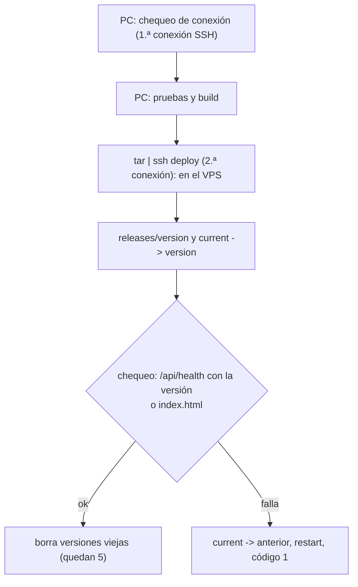

# Despliegue de la web nueva en el VPS de OVH: guía de implementación

## Estado

**En curso.** Pasos 1 y 2 del orden de implementación hechos el 2026-10-28: build de la API y del cron, `desplegar.sh` probado contra el VPS con el frontend, y el VPS preparado con `deploy/vps/preparar.sh` y reiniciado con el kernel nuevo. `api.env` y `season.env` cargados con staging y la API desplegada y respondiendo. Paso 3 hecho: esquema de staging y datos de prueba inventados. Paso 4 hecho: DNS, certificados y `https://cmleague.lat` con usuario y contraseña. Paso 5 hecho: correo por Resend probado con Gmail. Paso 6 en curso: cierre automático de temporada y UptimeRobot probados; falta que Daniel recorra la web. Falta correo, ensayo, pipeline y corte. Esta guía se completa al terminar.

## Archivos (hasta ahora)

| Archivo | Cambio |
|---|---|
| `deploy/vps/preparar.sh` | Nuevo: prepara el servidor (plan, sección 3) |
| `deploy/vps/agregar-acceso.sh` | Nuevo: suma una llave o un usuario con su llave |
| `deploy/vps/Caddyfile`, `Caddyfile.ip` | Nuevos: con dominios y por IP |
| `deploy/vps/cmleague-api.service`, `cmleague-season.service`, `cmleague-season.timer`, `cmleague-hud.service` | Nuevos |
| `deploy/vps/sudoers-deploy`, `api.env.example`, `season.env.example`, `README.md` | Nuevos |
| `deploy/vps/desplegar.sh` | Nuevo: pruebas, build, subida, cambio de versión, chequeo y vuelta atrás (plan, sección 5) |
| `web/backend/src/node.ts` | `HOST`, cierre ordenado con `SIGTERM` y sin `.dev.vars` con `APP_ENV=production` |
| `web/backend/scripts/build.mjs`, `build-check.mjs` y `package.json` | Nuevos: `pnpm build` (esbuild, `dist/server.mjs` y `dist/season-tick.mjs`), `pnpm build:check` y `pnpm start`; `esbuild` 0.28.2 |
| `web/backend/.gitignore` | `dist/` |
| `deploy/auth/configurar-auth.mjs` y `deploy/auth/plantillas/` | Nuevos: SMTP de Resend, URLs y plantillas en español del Auth de Supabase, por la Management API (plan, sección 6) |
| `.env` (no se versiona) | `VPS_CONSOLE_PASSWORD`: contraseña de emergencia de `ubuntu`, solo para la consola KVM de OVH |

## Preparación del VPS (hecha el 2026-10-28)

1. Copia de `deploy/vps/` a `/tmp` y `sudo CONSOLE_PASSWORD_HASH=… bash preparar.sh`. El hash se calculó en la PC de Daniel (`openssl passwd -6`): la contraseña no salió de ahí.
2. Con la sesión abierta, desde sesiones nuevas:
   - `ubuntu` y `deploy` entran con llave.
   - `deploy` puede `systemctl reload caddy`, y `sudo ls /root` le da "rechazado".
   - Contraseña y `root`: `Permission denied (publickey)`.
   - `http://<IP>/` responde "en construcción" y `/api/health` da 502 (la API todavía no está).
3. `sudo systemctl reboot`: pasó del kernel 7.0.0-28 al 7.0.0-42.
4. Segunda corrida de `preparar.sh` (para probar que se puede repetir): código 0 y los 11 chequeos del resumen en `[OK]`. Node v24.22.1 y Caddy v2.11.7. Swap de 2 GB activo. `apt autoremove` de los kernels viejos.

## Build de la API (paso 1, 2026-10-28)

- `pnpm typecheck`, `pnpm build` y `pnpm build:check`: `dist/server.mjs` (2,1 MB) y `dist/season-tick.mjs` (845 KB), con las dependencias adentro. `build:check` arranca `server.mjs` como en el VPS y `/api/health` responde 200 con `env: production` y la versión del build.
- La versión sale de `BUILD_SHA` (la pone `desplegar.sh`). `GIT_SHA` queda vacía en `api.env`: `deploy` no puede escribir en `/etc/cmleague/`.

## `desplegar.sh` (paso 1, 2026-10-28)

- `deploy/vps/desplegar.sh <api|web> [--sin-pruebas]`. `hud` todavía no (plan, sección 4.3).
- **Dos conexiones SSH por despliegue.** El `limit` de `ufw` corta la conexión número 7 dentro de 30 segundos, y el OpenSSH de Windows no reusa conexiones. La primera versión del script abría 8 y se cortó en el chequeo. Ahora todo lo que pasa en el VPS va en un solo script (`REMOTO`) que recibe la versión por la entrada estándar. Entre dos despliegues seguidos no hace falta esperar.
- **Se sube con `tar`**: no hay `rsync` en la PC.
- **Usa el SSH de Windows** (`C:\Windows\System32\OpenSSH\ssh.exe`): el de Git Bash recibe `Permission denied (publickey)` con la misma `~/.ssh/id_ed25519`, y el de Windows entra. Se puede cambiar con `SSH=…`.
- **Nombre de la versión:** el commit corto. Si `web/` tiene cambios sin commit, `<commit>-localMMDDHHMM`, para que `/api/health` no muestre un commit que no corresponde.
- **Frontend:** `VITE_API_URL` (por defecto `https://api.cmleague.lat`) le gana al `.env.local`. El script revisa que el build tenga esa URL y no `"http://localhost:8787"`. La cadena `localhost:8787` sola aparece en el mensaje de validación de `src/lib/env.ts`, así que se busca entre comillas.
- **Probado el 2026-10-28 con `web`:** lint, 286 pruebas, build y subida; `web/current` quedó en `32b4abbf1a80-local10281531`. Para probar la vuelta atrás, se le mandó al script del VPS una versión vacía: falló el chequeo (`Falta index.html`), volvió sola a la anterior y salió con código 1. Después se borró la versión de prueba. Caddy todavía no sirve `web/current` (`Caddyfile.ip`).
- **`api`, probado el 2026-10-28** (después de cargar las variables): typecheck, 313 pruebas, build, subida y `/api/health` con la versión `32b4abbf1a80-local10281542`.

## Variables y primer despliegue de la API (2026-10-28)

- `/etc/cmleague/api.env` y `season.env` escritos desde el `.env` de Daniel con valores de **staging** (`STAGING_SUPABASE_URL`, `_ANON_KEY` y `_SERVICE_KEY`), sin mostrarlos. Se armaron en el scratchpad, se subieron con `tar` por SSH como `ubuntu`, se instalaron con `install -m 600 -o root` y se borró la copia local.
- `DEMO_BASE_URL` y `CLIPS_BASE_URL`: los Workers de producción, los mismos de `wrangler.toml` (Daniel, 2026-10-28). En el ensayo, las demos de partidas de staging dan 404.
- `GIT_SHA` no está en `api.env`: la versión es la del build.
- Comprobado:
  - `http://<IP>/api/health` responde 200 desde afuera, a través de Caddy.
  - El 8787 no responde desde afuera: la API escucha solo en `127.0.0.1`.
  - El proceso corre como `cmleague`.
  - `systemctl restart` hace el cierre ordenado (`SIGTERM: cerrando` en el log).
- **El esquema de staging todavía no está** (paso 3). Por eso `/api/v1/seasons` da 500 y `cmleague-season.service` falla cada 10 minutos con `PGRST202` (`season_close_due` no existe). Esto se arregla solo cuando se cargue el esquema.

## Esquema de staging (paso 3, 2026-10-28)

Se cargó con `psql` desde la PC, en el mismo orden que `web/backend/scripts/db-local.sh`:

1. `supabase/schema/public.sql` y `auth_storage.sql`.
2. Las migraciones de `supabase/migrations/` posteriores a `BASE` (`20261015210000` a `20261024180000`).
3. El replanteo `01` a `30`.
4. `notify pgrst, 'reload schema'`.

- **Sin `local-overrides.sql`**: ese archivo acepta `http` en los avatares, y solo sirve para la base local.
- **Resultado:** 44 tablas, 241 funciones y 52 vistas. Los buckets `photos`, `avatars` y `proofs` y los triggers `on_auth_user_created` y `on_auth_user_password_changed` quedaron en su lugar. Ningún error. Los 8 `NOTICE` son `drop … if exists` de políticas y triggers que no existían.
- **Comprobado desde afuera:**
  - `/api/v1/seasons`, `/matches` y `/players` dan 200, y `/servers` da 401 (pide sesión).
  - `cmleague-season.service` corre sin error (no hay temporada abierta).
- **Conexión:** Session pooler de `us-east-1`. El usuario es `postgres.<ref>`: con `STAGING_PG_USER=postgres` solo, el pooler responde `ENOIDENTIFIER`. El `<ref>` sale de `STAGING_SUPABASE_URL`.
- **Datos que trae el esquema:** 8 mapas en `map_pool` y las filas de configuración, **menos la de `elo_config`**.
  - Esa fila la crea la migración `20261011230000_elo_config.sql`, que es anterior a `BASE`, y `public.sql` no trae datos.
  - Se notó el 2026-10-29: un ajuste de ELO desde Administración › Servidores › Ajustes manuales dio `500 INTERNAL` (`23502`: `null` en `player_elo.elo`, porque `start_elo` llegaba vacío). También habría fallado el ELO al terminar cada mix.
  - Daniel la cargó en staging con `insert into public.elo_config(id) values (1) on conflict (id) do nothing;` y el ajuste funcionó.
  - **En el corte a producción, verificar que la fila exista** (punto 1.5 de `docs/PENDIENTES.md`).

### Datos de prueba (2026-10-28)

Datos inventados, sin datos reales de jugadores (Daniel eligió la opción 1 el 2026-10-28). Se cargan con [`pruebas/staging_datos.sql`](pruebas/staging_datos.sql). El script aborta si la base ya tiene fichas, partidas o temporadas.

| Qué | Detalle |
|---|---|
| Servidor | `Staging Mix #1`. Su `token_hash` no corresponde a ningún token, así que ningún plugin puede mandar partidas con él |
| Fichas | 20, con SteamID falsos (`765611990000001NN`) y sin cuenta. Se reclaman en el ensayo |
| Equipos | `Los Pibes` y `Fenix`, de 5 fichas cada uno. **Sin capitán**: `captain_id` es la cuenta del capitán, no la ficha, así que se asigna desde el admin después de reclamar una ficha |
| Temporada | BETA, abierta con inicio antes del primer mix (como en el corte) |
| Mixes | 40 terminados y 1 cancelado por abandono, en las últimas dos semanas. Entran por el mismo camino que el plugin: `csstv_ingest`, `csstv_after_ingest` y `elo_apply_match`, en orden cronológico |

- **Para que el ELO tenga sentido:** cada ficha tiene un nivel oculto, que solo existe dentro del script, y los mejores ganan más seguido. `setseed`: el resultado es siempre el mismo.
- **Resultado:**
  - ELO entre 836 y 1245.
  - 8 fichas con puesto en la temporada (20 mixes o más).
  - `/api/v1/seasons`, `/players`, `/matches`, `/teams` y `/ranking/players` responden con datos a través del VPS.
- **Antes de cargarlo de verdad**, se probó entero con `rollback`.
- **Primera versión, con un error:** les puse fichas a los equipos como capitanes. Se corrigió en staging (`captain_id = null`) y en el script.

## DNS, Caddy con dominios y acceso del ensayo (paso 4, 2026-10-28)

- **DNS en Namecheap** (Advanced DNS › Host Records, Namecheap BasicDNS), cargado por Daniel:

  | Registro | Host | Valor |
  |---|---|---|
  | `A` y `AAAA` | `@`, `api` y `hud` | `148.113.148.184` y `2607:5300:205:200::eb59` |
  | `CNAME` | `www` | `cmleague.lat.` |

  Los registros por defecto de Namecheap (`www` a `parkingpage` y el `URL Redirect`) ya no estaban. Los de Resend no se tocaron. Los servidores de Namecheap y 8.8.8.8 respondieron al instante; 1.1.1.1 tardó unos minutos, porque tenía guardada la respuesta "no existe" de una consulta anterior.
- **Usuario y contraseña del ensayo:**
  - Están en el `.env` como `ENSAYO_WEB_USER` (`cmleague`) y `ENSAYO_WEB_PASSWORD` (20 caracteres al azar).
  - En el VPS va solo el hash (`caddy hash-password`), en `/etc/caddy/acceso-web.caddy` (root:caddy, 640). Se cargó **antes** que los dominios, así que el frontend nunca quedó abierto.
  - La contraseña viajó en un `tar` por SSH y se borró en el VPS apenas se calculó el hash.
- **`Caddyfile` con dominios:** se instaló con los mismos pasos que `preparar.sh --dominios` (copia, `caddy validate` y `reload`), sin volver a correr el resto del script. Let's Encrypt (`YE1`) emitió los certificados de `cmleague.lat`, `www` y `api` en segundos. Vencen el 2027-01-26 y Caddy los renueva solo. `hud` tiene DNS, pero su bloque en Caddy sigue comentado (sección 4.3).
- **Comprobado desde afuera:**
  - `https://cmleague.lat/` da 401 sin contraseña y 200 con ella. `/ranking` devuelve `index.html` (ruta de React).
  - `www` redirige con 301 a `https://cmleague.lat{uri}`, y `http://` redirige con 308 a `https://`.
  - `https://api.cmleague.lat/api/health` responde 200, sin contraseña. CORS `Access-Control-Allow-Origin: https://cmleague.lat`.
  - Cabeceras: HSTS, `X-Frame-Options`, `nosniff` y `Referrer-Policy`, y sin `Server` (Caddy).
  - Los archivos de `/assets/` llevan `immutable` de un año y van comprimidos con zstd. `index.html` va con `no-cache`.
  - La respuesta 401 del `basic_auth` sale sin las cabeceras de seguridad (Caddy corta antes del `header`). Se va con el `basic_auth` en el corte.

### Cuenta admin de prueba (2026-10-28)

- `admin.ensayo@cmleague.lat`, creada en el Auth de **staging** con la API de administración (`POST /auth/v1/admin/users`, `email_confirm: true`), así que no necesita correo. `profiles.role = 'admin'`. Alias automático: `user_a97c38`.
- Credenciales en el `.env`: `ENSAYO_ADMIN_EMAIL` y `ENSAYO_ADMIN_PASSWORD`. No existe en producción.
- Comprobado: `POST https://api.cmleague.lat/auth/login` devuelve la sesión, y `/api/v1/admin/servers` y `/admin/users` dan 200 con ese token.

## Correo (paso 5, 2026-10-28)

- Resend marca `cmleague.lat` como **Verified** (Daniel, 2026-10-28).
- `SUPABASE_ACCESS_TOKEN` en el `.env`: token personal de Daniel, con **vencimiento de 30 días**, para cubrir el ensayo y el corte. **Solo ve el proyecto de staging**: la Supabase de producción está en otra cuenta, así que en el corte hace falta un token de esa cuenta (o cargar lo mismo a mano en su panel).
- `node deploy/auth/configurar-auth.mjs STAGING_SUPABASE_URL [--aplicar]`:
  - Sin `--aplicar`, muestra la diferencia sin tocar nada. Con `--aplicar`, aplica los cambios y comprueba que hayan quedado.
  - No muestra secretos: de la clave SMTP solo dice "(cargada)", y de las plantillas, cuántos caracteres tienen.
  - Aplicado en staging:

  | Campo | Valor |
  |---|---|
  | `site_url` | `https://cmleague.lat` (antes `http://localhost:3000`) |
  | `uri_allow_list` | `https://cmleague.lat,https://cmleague.lat/**` |
  | SMTP | `smtp.resend.com:465`, usuario `resend`, clave `RESEND_SMTP_KEY`, remitente `CMLeague <no-reply@cmleague.lat>` |
  | `rate_limit_email_sent` | 30 por hora (con el correo incluido de Supabase eran 2) |
  | Plantillas | Confirmación, cambio de email y recuperación, en español (`deploy/auth/plantillas/`) |

- **La confirmación del registro** usa `{{ .ConfirmationURL }}`: Supabase verifica y vuelve a `FRONTEND_URL` con `#…&type=signup`, que el frontend ya entiende (`web/frontend/src/auth/callback.ts`). El cambio de email todavía no tiene ruta en la API, y "Olvidé mi contraseña" sigue pendiente. Sus plantillas quedan listas.

- **Prueba con Gmail (Daniel, 2026-10-28):** registro desde `https://cmleague.lat`, correo recibido, enlace de confirmación y vuelta al login: "funcionó todo". En `auth.users`, `confirmation_sent_at` 17:19:10 y `email_confirmed_at` 17:19:27 (UTC). Outlook no se probó.
- **`RESEND_API_KEY` del `.env` no sirve para la API de Resend** (`400 API key is invalid` al listar los envíos). No afecta el envío, que usa `RESEND_SMTP_KEY`. Si se necesita ver el historial desde la API, hay que generar una clave nueva con acceso completo.

## Ensayo (paso 6, 2026-10-28)

### Cierre automático de temporada

- Se dejó vencida la BETA (`ends_at = now() - 1 minute`, 17:27 UTC) y se esperó a la corrida del timer de las 17:30, sin dispararla a mano.
- `cmleague-season.service`: `season:tick: cerrada … (8 medallas, 0 reinicios); abierta …` a las 17:30:19.
- Resultado:
  - BETA quedó `closed` y se abrió sola la `Temporada 2`, que vence el 2026-11-27 a las 09:00 UTC (06:00 de Argentina).
  - 8 medallas, una por cada ficha con 20 mixes o más: Campeón, Subcampeón, Tercer puesto y 5 de Top 10. 20 filas en `season_standings`.
  - 0 reinicios, porque ninguna ficha de prueba pasa de 2001.
  - Ninguna notificación de medalla, porque las fichas no tienen cuenta.
- La API lo muestra: `/api/v1/seasons` (BETA `closed`, Temporada 2 `active`) y `/api/v1/players/{id}/seasons` (Tornado: puesto 1, Campeón, pico 1308).
- Correo de Gmail: en la bandeja de entrada, no en spam (Daniel).

### Monitoreo (UptimeRobot)

- Daniel creó la cuenta y el monitor HTTP(s) contra `https://api.cmleague.lat/api/health`, con aviso por un webhook de Discord propio (canal privado de staff, separado del de clips).
- **Primera prueba real (2026-10-28, 18:16 a 18:24 UTC):** no llegó ningún aviso. La URL del monitor terminaba en coma (`/api/health,`, se vio en `/var/log/caddy/api.log` buscando `UptimeRobot`), así que el monitor recibía 404 y ya la daba por caída antes de la prueba: no hubo cambio de estado que avisar. Daniel sacó la coma.
- **Segunda prueba real (2026-10-28):** API frenada de 19:31:57 a 19:40:03 UTC. **Llegaron los dos avisos a Discord**, el de caída y el de vuelta (Daniel). El monitor consulta con `HEAD`, y `/api/health` le responde 200.
- **Cómo detecta (log de Caddy de la segunda prueba):**
  - Chequea cada 5 minutos (19:31:26, 19:36:31).
  - Ante un 502, confirma con 3 chequeos más cada unos 15 segundos (hasta las 19:37:15) antes de avisar.
  - La vuelta la vio en el chequeo siguiente, a las 19:42:20.
  - Una caída tarda hasta unos 5 minutos en avisarse, y una de pocos segundos entre dos chequeos (por ejemplo, un `restart`) no se ve.
- El monitor de `https://cmleague.lat` se suma después del corte: durante el ensayo responde 401.

## Incidentes (paso 4)

- **`caddy hash-password` dio `EOF`:** sin terminal, lee la contraseña hasta el salto de línea, y no se le mandó ninguno. Como el script cortó con `set -e`, la carpeta temporal con la contraseña quedó en `/tmp` del VPS. Se borró en el intento siguiente y se comprobó que no quedara ninguna.
- **`reload` de Caddy falló con `opening log writer … /var/log/caddy/web.log`:** el `caddy validate` (como root) creó `web.log` y `api.log` con dueño root y permisos 600, y Caddy, que corre como `caddy`, no los pudo abrir. Caddy siguió con la configuración anterior hasta que se corrigió con `chown -R caddy:caddy /var/log/caddy`. **`preparar.sh` tenía el mismo error** con `--dominios`: ahora hace el `chown` después del `validate`.

## Incidentes (variables)

- **`STAGING_SUPABASE_URL` terminaba en `/rest/v1/`.** `supabase-js` arma las rutas a partir de la base y daba `PGRST125 Invalid path`. Se le sacó el sufijo en el `.env` y en los dos archivos del VPS. La URL tiene que ser solo `https://<ref>.supabase.co`.

## En qué se apartó del plan

- **Los archivos de variables van en `/etc/cmleague/`** (`api.env` y `season.env`, de root y con permisos 600), no en `/srv/cmleague/api/`. `deploy` es dueño de `/srv/cmleague/api/` y podría borrarlos o reemplazarlos. systemd los lee como root, así que el usuario `cmleague` ni siquiera necesita poder leerlos.
- **`Caddyfile.ip`:** hasta que el DNS apunte al VPS, Caddy responde por la IP, solo por HTTP, y deja pasar `/api/*` a la API para probarla sin dominio. `preparar.sh --dominios` instala el `Caddyfile` con los dominios.

## Incidentes

- **Resumen con dos `[!!]` falsos en SSH** (primera corrida): el chequeo usaba `grep -q`, que corta la salida de `sshd -T` apenas encuentra la línea; con `pipefail`, eso cuenta como falla. La configuración estaba bien (la línea "Efectivo" lo mostraba). Se cambió a `grep -x` sin `-q`.
- **Sin SSH unos minutos después del reinicio:** el bucle que esperaba la vuelta del servidor abrió demasiadas conexiones al puerto 22, y el `limit` de `ufw` (más de 6 en 30 segundos) las frenó. Se levanta solo después de 30 segundos sin intentos. **Al esperar un reinicio, probar cada 30 segundos o más.** No fue `fail2ban`: la única IP que bloqueó era de un bot (ya había 102 intentos de bots en la primera media hora).
