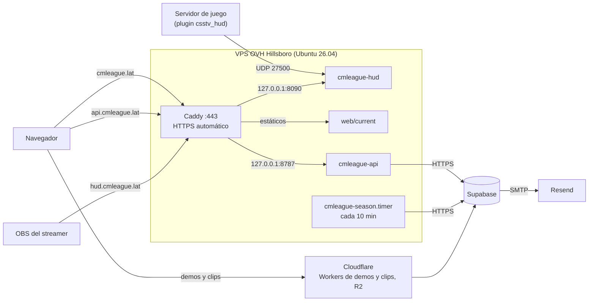
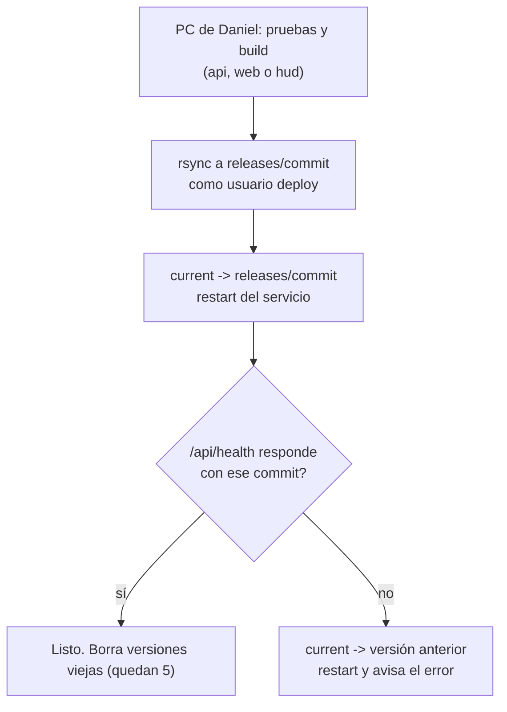

# Plan: despliegue de la web nueva en el VPS de OVH (`cmleague.lat`)

> Planeación original. Estado: **aprobado** por Daniel el 2026-10-28, con sus ajustes ya incluidos (usuario `cmleague`, bloqueo al 7.º intento y cómo sumar llaves).

Reemplaza al plan [`2026-10-16-despliegue-vps`](../2026-10-16-despliegue-vps/PLAN.md), que nunca se aprobó. Sigue su idea (Caddy, systemd, un solo archivo por servicio, sin Docker) y la pone al día con lo que ya existe: el VPS contratado, el dominio, la cuenta de Resend, el relay del HUD y el cron de temporadas.

## Estado de partida (2026-10-28)

| Qué | Estado |
|---|---|
| VPS | **OVH VPS-1 en Hillsboro, Oregón**: 2 vCPU, 3,7 GB de RAM, 38 GB de disco, IPv4 e IPv6. **Ubuntu 26.04 LTS** (imagen de OVH con cloud-init, usuario `ubuntu`) |
| Acceso | SSH con la llave ED25519 de la PC de Daniel (`ubuntu`, `sudo` sin contraseña). Probado el 2026-10-28. Variables `VPS_HOST`, `VPS_IPV6` y `VPS_USER` en el `.env` |
| Cómo está hoy | Sin tocar: solo SSH abierto (puerto 22), **acepta contraseña**, firewall apagado, sin swap, sin `fail2ban`. `sudo` es `sudo-rs` (el de Ubuntu 26.04) y SSH arranca por socket (`ssh.socket`) |
| Dominio | **`cmleague.lat`**, registrado en **Namecheap**. El DNS se queda en Namecheap |
| Correo | Cuenta de **Resend** con el dominio cargado (DKIM, dos CNAME de envío y DMARC). `RESEND_API_KEY` en el `.env` |
| Supabase de staging | Proyecto vacío creado en **`us-east-1`** (Virginia). Variables `STAGING_*` en el `.env`. Cada consulta desde el VPS tarda unos 70 ms más que contra producción (`us-west-2`): en el ensayo la API se va a sentir más lenta que después del corte, y eso no es un problema del VPS |
| GitHub | Daniel **todavía no es admin** de `mchssj/v34frag`: el pipeline queda para después |

## Decisiones tomadas

| Tema | Decisión | Por qué |
|---|---|---|
| Contenedores | **Sin Docker.** Cada servicio es un archivo de Node 24 y una unidad de systemd | La API y el cron se compilan a un solo `.mjs` con sus dependencias: en el servidor solo hace falta Node. Docker sumaría un registro de imágenes, más disco y una trampa conocida (los puertos de los contenedores se saltean `ufw`) sin dar nada a cambio |
| Qué corre en el VPS | **API, frontend (estáticos), cron de temporadas y relay del HUD.** Más adelante, las tareas programadas de las notificaciones | Todo lo que necesita un servidor siempre prendido con IP pública. El VPS no guarda datos: si se rompe, se rehace con el script y las variables |
| Qué no corre en el VPS | Supabase (base, Auth y Storage), los Workers de demos y de clips y R2 (Cloudflare), el render de clips (portátil, necesita abrir el juego) y el watchdog (servidor de juego) | Ya funcionan donde están |
| Subdominios | `cmleague.lat` (frontend), `www.cmleague.lat` (redirige al dominio sin `www`), `api.cmleague.lat` (API) y `hud.cmleague.lat` (HUD del relay) | Cada uno se despliega y se reinicia aparte |
| HTTPS | **Caddy**, con certificados de Let's Encrypt automáticos y HTTP/3 | Configuración corta y renueva solo |
| Nombres internos | `cmleague` (usuario de los servicios, carpetas y servicios de systemd) | Daniel (2026-10-28). El repo sigue llamándose `v34frag` |
| Usuarios del sistema | `ubuntu` (Daniel, con `sudo`), `deploy` (sube versiones, `sudo` solo para reiniciar los servicios) y `cmleague` (corre los servicios, sin shell) | Si se filtra la llave de `deploy`, no da control del servidor. Si alguien rompe la API, no puede tocar nada fuera de su carpeta |
| Despliegue al principio | **A mano desde la PC de Daniel** con `deploy/vps/desplegar.sh`, como usuario `deploy` | Daniel todavía no es admin del repo. El script es el mismo que va a usar el pipeline |
| Pipeline | GitHub Actions como en el plan anterior (pruebas, build, subida, chequeo de salud y **vuelta atrás automática**), **cuando Daniel sea admin** | No cambia nada del diseño, solo la fecha |
| Ensayo | Hasta el corte, `cmleague.lat` funciona contra **Supabase de staging**, con **usuario y contraseña de Caddy** delante del frontend | Se prueba todo de punta a punta, con correo real, sin que entre nadie de afuera y sin tocar producción |
| Correo de Auth | **SMTP de Resend** en Supabase Auth, desde `no-reply@cmleague.lat`, con una clave de Resend **solo de envío** | El correo incluido de Supabase manda muy pocos por hora. La clave que ya está en el `.env` sirve para la API de Resend, no hace falta darle más permisos a Supabase |
| Reinicios por actualizaciones | Actualizaciones de seguridad automáticas y, si piden reiniciar, **reinicio a las 10:00 UTC** (07:00 de Argentina) | Horario sin mixes. El plugin le manda los resultados directo a Supabase, así que un minuto sin API no pierde partidas. A las 09:00 UTC cierra la temporada; a las 10:00 ya pasó |
| Proxy de Cloudflare delante | **No, por ahora.** DNS de Namecheap directo al VPS | Menos piezas. Si se agrega, `CLIENT_IP_HEADER` pasa a `cf-connecting-ip` (ya soportado) |
| Monitoreo | UptimeRobot (gratis) contra `/api/health`, con aviso por correo o Discord. Logs en `journald` | Enterarse de una caída sin entrar al servidor |
| Backups | El backup diario de OVH (guarda 7) | El VPS no tiene datos propios; el backup solo ahorra rehacerlo |

## 1. Cómo queda



```
/srv/cmleague/
├── api/
│   ├── releases/<commit>/   server.mjs y season-tick.mjs
│   ├── current -> releases/<commit>
│   ├── api.env              (600, dueño cmleague)
│   └── season.env           (600, dueño cmleague; la única con la clave de servicio)
├── web/
│   ├── releases/<commit>/   build de Vite
│   └── current -> releases/<commit>
└── hud/
    ├── releases/<commit>/   relay.mjs y public/
    ├── current -> releases/<commit>
    └── relay.json           (600, dueño cmleague; la clave del HUD)
```

Se guardan las últimas 5 versiones de cada parte. Volver atrás es mover el enlace `current` y reiniciar.

## 2. DNS en Namecheap

| Tipo | Host | Valor | Para qué |
|---|---|---|---|
| `A` | `@` | IPv4 del VPS | `cmleague.lat` |
| `AAAA` | `@` | IPv6 del VPS | Ídem por IPv6 |
| `CNAME` | `www` | `cmleague.lat.` | Caddy lo redirige al dominio sin `www` |
| `A` y `AAAA` | `api` | IPv4 e IPv6 del VPS | La API |
| `A` y `AAAA` | `hud` | IPv4 e IPv6 del VPS | El HUD del relay |
| `TXT` | `resend._domainkey` | De Resend | DKIM (ya cargado) |
| `CNAME` | `send` y `rsend` | De Resend | Envío (ya cargado) |
| `TXT` | `_dmarc` | `v=DMARC1; p=none;` | DMARC (ya cargado) |

- Hay que **borrar los registros que Namecheap trae por defecto** (el `CNAME` de `www` a `parkingpage.namecheap.com` y el `URL Redirect` de `@`).
- Los registros del VPS se cargan **recién en el paso 4 del orden de implementación**: Caddy pide los certificados apenas el DNS apunta al servidor.

## 3. `deploy/vps/preparar.sh`: qué hace cada paso

Se corre **una vez** en el VPS con `sudo`, pero se puede volver a correr sin romper nada (cada paso revisa si ya está hecho). Funciona en Ubuntu 26.04 y 24.04. No toca secretos ni despliega la aplicación: deja el servidor listo para recibirla. Al final imprime un resumen con cada chequeo.

### 3.1 Comprobaciones previas

- Que corra como root (con `sudo`) y en Ubuntu 24.04 o 26.04. Si no, se detiene sin tocar nada.
- Que exista al menos una llave en `/home/ubuntu/.ssh/authorized_keys`. **Sin llave no sigue**, porque el paso 3.5 apaga la entrada con contraseña y quedaríamos afuera.

### 3.2 Actualizar el sistema

- `apt update` y `apt full-upgrade`: trae los parches que salieron desde que OVH armó la imagen.
- Instala lo que el resto del script necesita: `curl`, `gnupg`, `ufw`, `fail2ban`, `unattended-upgrades` y `rsync`.
- Si la actualización pide reiniciar (por ejemplo, un kernel nuevo), lo avisa al final. **No reinicia solo**: se reinicia a mano después de revisar el resumen.

### 3.3 Memoria de intercambio (swap) de 2 GB

- Crea `/swapfile` de 2 GB y lo deja activo en cada arranque (`/etc/fstab`).
- `vm.swappiness=10`: solo usa el disco cuando la RAM se está acabando de verdad.
- **Por qué:** hoy no hay swap. Con 3,7 GB sobra para el uso normal, pero si algo se dispara (una actualización grande, un pico de la API), sin swap Linux mata procesos al azar. Con swap, en el peor caso, se pone lento unos segundos.

### 3.4 Usuarios

- **`cmleague`:** usuario de sistema **sin shell y sin poder entrar por SSH**. Es el dueño de los servicios. Si alguien encontrara una falla en la API, quedaría encerrado en ese usuario, sin permisos para tocar el resto del servidor.
- **`deploy`:** puede entrar por SSH **solo con llave** (al principio la de la PC de Daniel; después, además, la del pipeline). Puede escribir en las carpetas `releases/` y mover los enlaces `current`, y nada más.
- **`ubuntu`:** el de Daniel, que ya existe. Sigue siendo el único con `sudo` completo.
- **Pueden entrar** los usuarios del grupo `cmleague-ssh` (`ubuntu` y `deploy` desde el principio). Para sumar a otra persona, ver 3.5.

### 3.5 SSH: solo llaves

Agrega `/etc/ssh/sshd_config.d/00-cmleague.conf` con:

| Opción | Valor | Qué hace |
|---|---|---|
| `PasswordAuthentication` | `no` | **No se puede entrar con contraseña.** Hoy sí se puede: es lo más importante de todo el script |
| `KbdInteractiveAuthentication` | `no` | Cierra la otra vía de contraseñas |
| `PermitRootLogin` | `no` | Nadie entra directo como root |
| `AllowGroups` | `cmleague-ssh` | Solo entran los usuarios de ese grupo. Sumar a alguien es agregarlo al grupo, sin tocar la configuración de SSH |
| `MaxAuthTries` | `3` | Corta rápido a quien prueba llaves al azar |

- El archivo empieza con `00-` a propósito: SSH se queda con el **primer** valor que lee, y la imagen de OVH trae `50-cloud-init.conf`, que prende las contraseñas. Con `00-` gana el nuestro.
- Antes de aplicar, `sshd -t` valida la configuración. Si hay un error, no reinicia SSH y avisa.
- **Al correrlo, la sesión actual queda abierta** y se prueba entrar desde una sesión nueva antes de cerrarla. Si algo saliera mal, la consola KVM del panel de OVH permite entrar igual.
- El puerto sigue siendo el 22: cambiarlo no suma seguridad real y complica el pipeline.

**Contraseña de emergencia (solo por consola):** el script le pone a `ubuntu` una contraseña larga al azar y la guarda en el `.env` de Daniel como `VPS_CONSOLE_PASSWORD`. **No sirve por SSH**, solo en la consola KVM del panel de OVH, que es como tener un teclado conectado al servidor. Es la salida si se pierden todas las llaves.

**Agregar otra llave o a otra persona** (pedido de Daniel, 2026-10-28):

| Caso | Cómo |
|---|---|
| Daniel desde otra PC | En esa PC, `ssh-keygen -t ed25519`. La parte pública (`id_ed25519.pub`) se agrega como una línea más en `/home/ubuntu/.ssh/authorized_keys` desde una PC que ya entra |
| Otra persona (por ejemplo kyan) | Se le crea **su propio usuario** con su llave y se lo suma a `cmleague-ssh`. Con `sudo` o sin `sudo`, según lo que tenga que hacer. Así cada uno se puede quitar por separado y los logs dicen quién hizo qué |
| Quitar un acceso | Borrar la línea de su llave, o sacar al usuario del grupo `cmleague-ssh` |

`deploy/vps/agregar-acceso.sh <usuario> <archivo.pub> [--sudo]` hace el segundo caso de una vez. La llave pública se puede mandar por chat sin problema: sin la parte privada no sirve para entrar.

**Por qué no se deja entrar con contraseña:** la IP del VPS recibe intentos de bots las 24 horas. Una contraseña se puede adivinar, filtrar o reutilizar en otro lado; una llave no. Con `fail2ban` y una contraseña fuerte el riesgo sería bajo, pero no cero, y no hace falta asumirlo: la contraseña de consola cubre el caso de quedarse sin llaves.

### 3.6 Firewall (`ufw`)

- Por defecto, **bloquea todo lo que entra** y deja salir todo.
- Abre solo:

| Puerto | Para qué |
|---|---|
| `22/tcp` | SSH, con `limit`: corta a una IP que abre más de 6 conexiones en 30 segundos |
| `80/tcp` | HTTP: Caddy lo usa para pedir los certificados y redirigir a HTTPS |
| `443/tcp` y `443/udp` | HTTPS (el UDP es HTTP/3, más rápido en conexiones móviles) |
| `27500/udp` | El relay del HUD. Se abre recién cuando el relay se mude al VPS (sección 4.3) |

- Vale para IPv4 e IPv6.
- La API, el relay por HTTP y todo lo demás escuchan **solo en `127.0.0.1`**: no se pueden alcanzar desde afuera aunque el firewall fallara. Desde afuera solo se llega pasando por Caddy.
- La salida queda libre: la API necesita salir por UDP hacia los servidores de juego (consultas A2S y cambio de contraseña).

### 3.7 `fail2ban`

- Lee los intentos fallidos de SSH en `journald` y **bloquea por una hora** a una IP que falla **7 veces** en 10 minutos (`maxretry = 7`, pedido de Daniel el 2026-10-28). Los tres números se cambian en `/etc/fail2ban/jail.d/cmleague.conf`.
- Aparte, el `limit` de `ufw` (3.6) frena por 30 segundos a una IP que abre más de 6 conexiones en ese lapso. No es un bloqueo: alcanza con esperar.
- Con las contraseñas apagadas nadie puede adivinar nada, pero los bots igual prueban miles de veces por día. `fail2ban` los saca y mantiene los logs limpios.

### 3.8 Actualizaciones automáticas de seguridad

- `unattended-upgrades` instala **solo los parches de seguridad** de Ubuntu (no versiones nuevas de programas), todos los días.
- Si un parche necesita reiniciar, reinicia a las **10:00 UTC** (07:00 de Argentina), sin mixes y después del cierre de temporada de las 09:00 UTC.
- También actualiza Node y Caddy cuando sus repositorios publican parches de la misma versión.

### 3.9 Node 24

- Agrega el repositorio oficial de **NodeSource** (`nodistro`, el que no depende de la versión de Ubuntu) con su llave de firma.
- Lo **fija con prioridad** para que nunca se instale el Node 22 que trae Ubuntu 26.04.
- No instala pnpm: en el servidor no se compila nada, todo llega compilado.

### 3.10 Caddy

- Agrega el repositorio oficial de Caddy con su llave de firma e instala el paquete, que trae su propio servicio de systemd.
- Copia `deploy/vps/Caddyfile` a `/etc/caddy/Caddyfile`, lo valida con `caddy validate` y lo recarga. Si no valida, deja el anterior.
- Hasta que el DNS apunte al VPS, Caddy responde por HTTP a la IP con una página de "en construcción". Los dominios se activan en el paso 4 del orden de implementación.

### 3.11 Carpetas y archivos de variables

- Crea la estructura de `/srv/cmleague/` de la sección 1, con dueños y permisos:
  - `releases/`: escribe `deploy`, lee `cmleague`.
  - `api.env`, `season.env` y `relay.json`: **solo los lee `cmleague`** (permisos 600). Se crean vacíos, a partir de los `.example` del repo. Los valores los cargo yo después desde el `.env`, sin mostrarlos.

### 3.12 Servicios de systemd

| Unidad | Qué hace |
|---|---|
| `cmleague-api.service` | Corre `node api/current/server.mjs` como `cmleague`, con `api.env`. Se reinicia solo si se cae. Espera hasta 20 segundos a que terminen los pedidos en curso al reiniciar |
| `cmleague-season.service` y `.timer` | Cada 10 minutos corre `season-tick.mjs` con `season.env`. `Persistent=true`: si el VPS estaba apagado a la hora, corre apenas arranca |
| `cmleague-hud.service` | Corre el relay del HUD con `relay.json`. Se instala **apagado** hasta la sección 4.3 |

- Todos con **endurecimiento de systemd**:
  - `NoNewPrivileges`: no pueden ganar permisos.
  - `ProtectSystem=strict` y `ProtectHome`: el sistema y las carpetas de usuarios son de solo lectura o invisibles.
  - `PrivateTmp`: cada servicio tiene su propia carpeta temporal.
  - `ReadOnlyPaths=/srv/cmleague`: ni siquiera pueden modificar su propio código.
  - Un tope de memoria por servicio (`MemoryMax`), para que uno no ahogue a los demás.
- Quedan habilitados, pero con `ConditionPathExists`: **no arrancan hasta que exista la primera versión** en `current`. Así el script se puede correr antes del primer despliegue sin errores.

### 3.13 Permisos de `deploy`

- `/etc/sudoers.d/cmleague-deploy` le permite **solo** `systemctl restart cmleague-api`, `systemctl restart cmleague-hud` y `systemctl reload caddy`, sin contraseña. Cualquier otra cosa con `sudo` le da "no permitido".
- Se valida con `visudo -c` antes de dejarlo. Un `sudoers` roto podría trabar `sudo` para todos.

### 3.14 Logs

- `journald` guarda los logs en disco (sobreviven a un reinicio) y con un **tope de 500 MB**, para que nunca llenen el disco.
- Se ven con `journalctl -u cmleague-api -f`.

### 3.15 Resumen final

Imprime una tabla con cada chequeo: SSH sin contraseñas, firewall activo con sus puertos, `fail2ban` corriendo, swap activo, versiones de Node y Caddy, servicios instalados y si hace falta reiniciar.

### Lo que el script no hace

- No carga secretos: los archivos de variables quedan vacíos.
- No despliega la API, el frontend ni el relay: eso es `desplegar.sh`.
- No toca el DNS ni Supabase.
- No reinicia el servidor.

## 4. Servicios

### 4.1 API

- `web/backend`: script `build` con esbuild. Genera `dist/server.mjs` desde `src/node.ts` y `dist/season-tick.mjs` desde `scripts/season-tick.mts`, con las dependencias adentro y los source maps.
- `src/node.ts`:
  - Escucha en `HOST` (`127.0.0.1` en producción).
  - Al recibir `SIGTERM` termina los pedidos en curso antes de salir.
  - No busca `.dev.vars` cuando `APP_ENV=production`.
- **Un solo proceso.** El límite de intentos de login está en memoria y solo es exacto con un proceso.

`api.env`:

| Variable | Valor |
|---|---|
| `APP_ENV` | `production` |
| `HOST`, `PORT` | `127.0.0.1`, `8787` |
| `SUPABASE_URL`, `SUPABASE_ANON_KEY` | De staging hasta el corte; de producción después |
| `FRONTEND_URL` | `https://cmleague.lat` |
| `CORS_ORIGINS` | `https://cmleague.lat` |
| `CLIENT_IP_HEADER` | `x-forwarded-for` (Caddy lo reemplaza con la IP real) |
| `DEMO_BASE_URL`, `CLIPS_BASE_URL` | Los de los Workers de Cloudflare |
| `GIT_SHA` | El commit, lo pone `desplegar.sh` |

`season.env`: `SUPABASE_URL` y `SUPABASE_SERVICE_KEY`. Es aparte para que la API siga sin la clave de servicio.

### 4.2 Frontend

- `pnpm build` en `web/frontend` con `VITE_API_URL=https://api.cmleague.lat`. Sube `dist/` a `web/releases/<commit>/`.
- Caddy:
  - Sirve los archivos y, si una ruta no existe, devuelve `index.html` (las rutas las resuelve React).
  - Caché de un año para los archivos con hash en el nombre y sin caché para `index.html`, así cada despliegue se ve al instante.
  - Comprime con gzip y zstd.
  - Cabeceras de seguridad, entre ellas HSTS.
- **Hasta el corte:** usuario y contraseña de Caddy (`basic_auth`) delante de `cmleague.lat`. La API no lleva contraseña, porque el navegador no la mandaría en los pedidos a otro dominio, y sin el frontend no sirve de mucho.

### 4.3 Relay del HUD

- Hoy corre en la PC del streamer, con un túnel de playit.gg porque la conexión de Daniel tiene CGNAT. En el VPS no hace falta túnel: el plugin le manda los paquetes directo a `cmleague.lat:27500`.
- Cambios en `hud/relay`:
  - `udpHost` en `relay.json`: hoy el UDP escucha solo en `127.0.0.1` (lo alcanzaba el túnel). En el VPS escucha en todas las interfaces, y el firewall deja pasar solo el 27500.
  - Un build de Node para Linux (`relay.mjs` y `public/`), además del `relay.exe`.
  - Sin `gameDir` en el VPS: los íconos del feed tienen que venir dentro de `public/`. Hay que revisarlo al implementar.
- Caddy publica el HTTP del relay en `https://hud.cmleague.lat`.
- **Esto toca la configuración del plugin** (`csstv_hud_host` y `csstv_hud_port`, sin recompilar), **en el real, en RBK y en flow en la misma tanda**. Por la regla de "web primero, plugins al final" queda para **el final del plan**, y solo si Daniel lo confirma. Además, el HUD de hoy no tiene token por streamer en la URL: antes de dejarlo público en `hud.cmleague.lat`, se agrega (plan [`2026-10-22-hud-observer`](../2026-10-22-hud-observer/PLAN.md)) o se protege con usuario y contraseña de Caddy.

## 5. Despliegue



- **`deploy/vps/desplegar.sh <api|web|hud>`**, desde la PC de Daniel:
  - Corre las pruebas y el build.
  - Sube la versión con `rsync` por SSH como `deploy`.
  - Cambia el enlace, reinicia y chequea la salud.
  - **Si el chequeo falla, vuelve solo a la versión anterior.**
- **Cuando Daniel sea admin del repo:** `.github/workflows/ci.yml` (pruebas en cada PR) y `deploy.yml` (al hacer merge a `main`). Llaman al mismo script, con una llave de `deploy` propia del pipeline y la huella del servidor fija en los secretos.

## 6. Correo

1. En Resend, una **clave nueva solo de envío** (*Sending access*) limitada a `cmleague.lat`. Se guarda en el `.env` como `RESEND_SMTP_KEY`.
2. Supabase Auth (primero staging, en el corte producción), en *Authentication › Emails › SMTP Settings*:
   - Host `smtp.resend.com`, puerto `465`, usuario `resend`, contraseña `RESEND_SMTP_KEY`.
   - Remitente `CMLeague <no-reply@cmleague.lat>`.
3. `Site URL` y `Redirect URLs` con `https://cmleague.lat`.
4. Plantillas en español: confirmación del registro y cambio de email.
5. Prueba: registro con un correo real (Gmail y Outlook) y revisar que no caiga en spam.

Con el correo funcionando se destraba "Olvidé mi contraseña" (pendiente del backend, `PENDIENTES.md` sección 6).

## 7. Ensayo y corte

- **Ensayo:**
  - Supabase de staging con el esquema de producción, **todas las migraciones del replanteo** y datos de prueba, sin datos reales de jugadores.
  - El VPS completo apunta ahí: registro, login, correo, perfil, ranking, mixes y el cierre de temporada (forzando una temporada vencida).
- **Corte:** sigue la checklist del plan anterior (sección 7) y la de `PENDIENTES.md` punto 1.5. Lo nuevo en el VPS:
  - `api.env` y `season.env` pasan a producción, y Supabase Auth de producción recibe el SMTP y las URLs.
  - Se saca el usuario y contraseña de Caddy.
  - El plugin va al real, a RBK y a flow en la misma tanda.

## 8. Cambios en el repo

| Qué | Detalle |
|---|---|
| `web/backend/package.json` | Scripts `build` (esbuild) y `start` |
| `web/backend/src/node.ts` | `HOST`, cierre ordenado con `SIGTERM` y sin `.dev.vars` en producción |
| Prueba del build | Arrancar `dist/server.mjs` y pedir `/api/health` |
| `hud/relay` | `udpHost` y build para Linux (sección 4.3, al final) |
| `deploy/vps/` | `preparar.sh`, `desplegar.sh`, `agregar-acceso.sh`, `Caddyfile`, las unidades de systemd, `sudoers-deploy`, `api.env.example`, `season.env.example` y `README.md` |
| `.github/workflows/` | `ci.yml` y `deploy.yml`, cuando Daniel sea admin |

## 9. Lo que no cubre

- Varios procesos o varios servidores: con uno alcanza. Si algún día hace falta, el límite de intentos pasa a la base o a Redis.
- Las tareas programadas de las notificaciones (segunda etapa): cuando existan, se suman como otro timer de systemd igual al de las temporadas.
- Cambiar los Workers de Cloudflare, R2 o el plan de Supabase.

## 10. Requisitos

| Qué | Estado |
|---|---|
| VPS con Ubuntu 26.04 y acceso SSH con llave | Listo (2026-10-28) |
| Dominio `cmleague.lat` | Listo |
| Resend con el dominio verificado | Registros cargados; falta que Resend lo marque como verificado |
| Clave de Resend solo de envío (`RESEND_SMTP_KEY`) | En el `.env` |
| Supabase de staging | Creado en `us-east-1` |
| Usuario y contraseña para el ensayo (`basic_auth`) | Los genero yo y van al `.env` |
| Cuenta de UptimeRobot | Falta (Daniel) |
| Admin en `mchssj/v34frag` | Falta. No bloquea: se despliega a mano |

## 11. Orden de implementación

1. **Repo:** build de la API y del cron, cambios en `node.ts`, prueba del build y `deploy/vps/` (sin el relay).
2. **VPS:** Daniel revisa `preparar.sh`; lo corro con la sesión abierta y pruebo entrar de nuevo antes de cerrarla. Reinicio si lo pide.
3. **Staging:** esquema, migraciones del replanteo y datos de prueba.
4. **DNS** del VPS en Namecheap. Caddy saca los certificados. Despliegue de la API y del frontend contra staging, con usuario y contraseña.
5. **Correo:** SMTP de Resend en Supabase Auth de staging y registro con un correo real.
6. **Ensayo completo** y monitoreo con UptimeRobot.
7. **Pipeline de GitHub**, cuando Daniel sea admin (puede ir antes o después del corte).
8. **Corte**, con la checklist de la sección 7.
9. **Relay del HUD** en el VPS, si Daniel lo confirma, con los tres servidores de juego en la misma tanda.
10. `DOCUMENTACION.md`, `GUIA_IMPLEMENTACION.md`, `PENDIENTES.md` y el índice.
