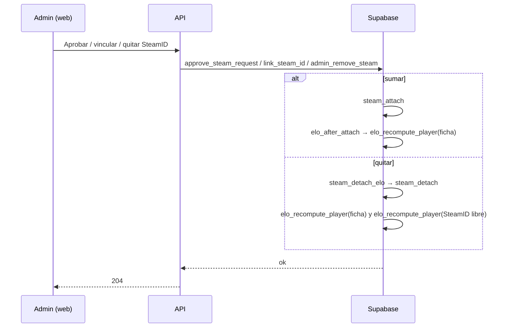
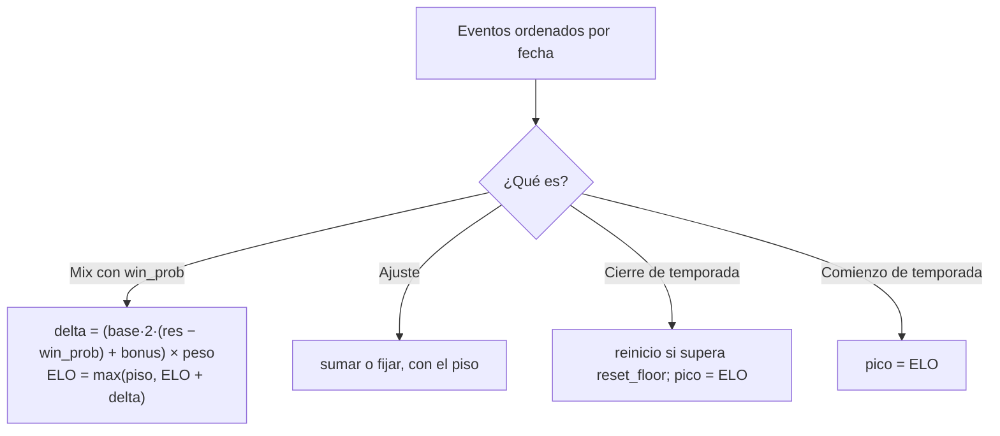

# Al sumar o quitar un SteamID, recalcular solo el ELO de esa ficha: documentación

## Qué hace

Antes, aprobar un SteamID adicional o quitar uno de una ficha con varios llamaba a `elo_recompute_all()`. Esa función borra todo `player_elo` y reproduce la historia completa, así que movía unos puntos el ELO de jugadores que no tenían nada que ver.

Ahora se rehace **solo la línea de tiempo de esa ficha** y, al quitar, también la del SteamID que queda libre. Ningún otro jugador cambia: ni su ELO ni su pico, ni las filas de sus mixes.

## Cómo se rehace una ficha

`elo_recompute_player(p_key, p_from)` recibe una clave de ELO, que es el SteamID principal de una ficha o un SteamID sin ficha.

1. Junta los SteamID de la clave: todos los de la ficha, o el SteamID solo.
2. Guarda el μ y σ de la fila con más mixes, entre las filas de esos SteamID y las de `p_from`. Después borra esas filas y los `elo_before`, `elo_after` y `elo_delta` de sus mixes.
3. Recorre los eventos en el mismo orden que `elo_recompute_all`. La fila de `player_elo` nace con el primer mix o ajuste, así que las temporadas anteriores no la tocan.

| Regla | Detalle |
|---|---|
| Qué mixes entran | Los terminados en los que algún SteamID de la ficha tiene `win_prob` |
| Probabilidad | La guardada en `win_prob` de esa fila, no se recalcula. Por eso nadie más cambia |
| Fórmula | La de `elo_apply_match` con la configuración actual: base, bonus por rating con tope, peso por participación, mínimo de ±1 al ganar o perder y piso |
| Dos SteamID de la ficha en el mismo mix | Solo pasa si un admin los vinculó a mano. Cuenta el de más rondas y el otro queda sin ELO en ese mix |
| Ajustes | `elo_apply_adjustment_row`: suma o fija, en su fecha |
| Temporadas | `elo_season_event_key`: el cierre y el pico de `elo_season_event`, solo sobre esa clave |
| Notificaciones | Ninguna: corre con `v34.elo_recompute = on`, como `elo_recompute_all` |
| Sin mixes ni ajustes | No deja fila: el jugador queda como uno nuevo |

### μ y σ

No se pueden reproducir sin la fuerza de cada mix, que no se guarda.

- **Al sumar:** se quedan los de la identidad con más mixes; si empatan, los de la ficha.
- **Al quitar:** la ficha conserva los suyos, aunque cambie de principal. El SteamID libre arranca como un jugador nuevo, con los valores por defecto de `player_elo`.

## La imprecisión

Los mixes viejos de la persona quedan calculados con la probabilidad de entonces, como si hubieran sido dos jugadores distintos. Eso afecta solo a esa ficha.

En el ensayo sobre la copia de producción (8 casos), la ficha quedó entre 0 y 6 puntos del cálculo exacto. Con el recálculo general, en cambio, se movían hasta 33 jugadores más, hasta 6 puntos cada uno.

`elo_recompute_all` sigue existiendo y sigue siendo el cálculo exacto. Lo usan el mix que llega tarde a una temporada cerrada y deshacer un "fijar". Cuando corre, deja todo exacto y ahí sí puede mover un poco a otros.

## Qué no cambió

- **Cambiar el principal** (`steam_make_primary`): mueve la fila de `player_elo` a la clave nueva, como antes.
- **API:** sin endpoints nuevos ni cambios en las respuestas. Solo cambian las descripciones.

## Dónde está cada cosa

| Qué | Archivo |
|---|---|
| Migración | `supabase/replanteo/34_elo_por_ficha.sql` |
| Inversa | `docs/bitacora/2026-10-14-replanteo-modelo-datos/reversas/34_elo_por_ficha.sql` |
| Pruebas SQL | `docs/bitacora/2026-10-14-replanteo-modelo-datos/pruebas/34_elo_por_ficha.sql` |
| Funciones nuevas | `elo_recompute_player`, `elo_season_event_key`, `elo_after_attach` y `steam_detach_elo`, todas internas, sin `execute` para `anon` ni `authenticated` |
| Funciones cambiadas | `approve_steam_request`, `link_steam_id` y `admin_remove_steam` |
| Descripciones de la API | `web/backend/src/routes/claim.ts` y `admin-players.ts` |
| Contrato | `docs/frontend/contrato/admin.md`, sección "SteamID y `!claim` (admin)" |
| Textos del frontend | `web/frontend/src/features/admin/players/SteamTabs.tsx` y `FichasTab.tsx` |
