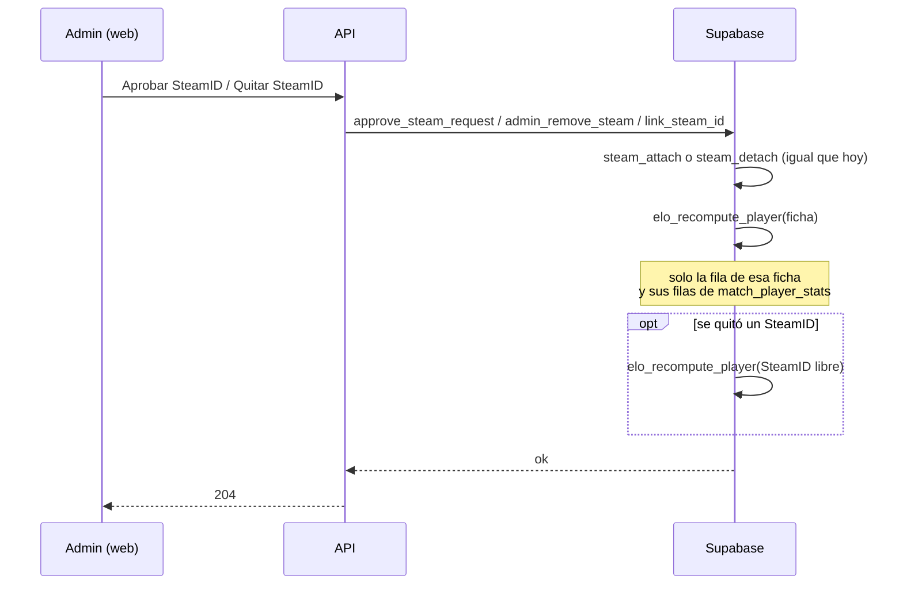

# Plan: al sumar o quitar un SteamID, recalcular solo el ELO de esa ficha

> Planeación original. Estado: **aprobado** por Daniel el 2026-10-28 ("apruebo el plan del ELO, impleméntalo"). Pedido de Daniel el 2026-10-28.

Hoy, aprobar un SteamID adicional o quitar uno de una ficha que tiene varios llama a `elo_recompute_all()`, que borra `player_elo` y reproduce **todos** los mixes de la historia. Eso mueve un poco el ELO de jugadores que no tienen nada que ver con el cambio. Daniel pidió que solo cambie el ELO de la ficha a la que se le modificó la lista de SteamID.

## Por qué hoy se recalcula a todos

El ELO es tipo TrueSkill (`elo_apply_match`, migración `20261014120000_elo_participacion.sql`):

```
p1   := csstv_ncdf((mu1 - mu2) / c);           -- probabilidad de que gane el equipo 1
base := round(2 * cfg.base * (res - p_team));  -- lo que gana o pierde cada uno
```

Lo que gana o pierde **cada** jugador depende del μ y σ de los diez. Mientras un SteamID adicional no es de la ficha, cuenta como otro jugador, con su propio rating. Al juntarlos cambia el rating de esa persona en cada mix, y con él la probabilidad de su equipo y el ELO de sus compañeros y rivales, que arrastran el cambio a sus mixes siguientes. `elo_recompute_all()` reproduce todo para que el resultado sea exacto.

La base no guarda el μ, el σ ni la `c` de cada jugador en cada mix, solo `elo_before`, `elo_after`, `elo_delta` y `win_prob` (la probabilidad de su equipo). Por eso un recálculo exacto de una sola persona no es posible. Lo que sí se puede hacer es **rehacer solo la línea de tiempo de esa ficha con la probabilidad de cada mix tal como quedó guardada**.

## Decisiones tomadas

| Tema | Decisión | Por qué |
|---|---|---|
| Qué se recalcula | Solo la fila de `player_elo` de la ficha y sus filas de `match_player_stats` (`elo_before`, `elo_after`, `elo_delta`). Al quitar un SteamID, también la del SteamID que queda libre | Pedido de Daniel: los demás jugadores no cambian |
| Probabilidad de cada mix | La guardada (`win_prob` de la fila de esa persona), sin recalcularla | Es lo que permite no tocar a los demás. Sus mixes viejos quedan calculados "como si hubieran sido dos jugadores": una imprecisión chica y solo en el historial de esa persona |
| Fórmula | La misma de `elo_apply_match` con la configuración actual: `base` por `(resultado − win_prob)`, bonus por rating con su tope, peso por participación y el ELO mínimo | Igual que hace `elo_recompute_all`, que también usa la configuración actual |
| Mixes que entran | Los terminados en los que algún SteamID de la ficha tiene `win_prob` (recibió ELO). Si dos SteamID de la ficha están en el mismo mix (solo posible si un admin los vinculó a mano), cuenta la fila con más rondas | Sin `win_prob` no hay probabilidad para reproducir |
| Otros eventos | En orden de fecha, como `elo_recompute_all`: ajustes manuales (sumar o fijar), cierre de temporada (reinicio de los que superan el piso) y comienzo de temporada (el pico arranca en el ELO) | La ficha tiene que terminar igual que si su historia se hubiera jugado así |
| μ y σ | **Al sumar:** los de la identidad que más mixes con ELO tiene (la ficha o el SteamID nuevo). **Al quitar:** la ficha conserva los suyos y el SteamID libre arranca con los de un jugador nuevo (25 y 25/3) | No se pueden reproducir sin la `c` de cada mix. Es la aproximación más simple y predecible |
| Notificaciones | Sin avisos de nivel ni de puesto en la temporada durante el recálculo (`v34.elo_recompute = on`, como `elo_recompute_all`) | Un recálculo no es una novedad para el jugador |
| `elo_recompute_all` | No se borra. Lo siguen usando el mix que llega tarde a una temporada cerrada y deshacer un "fijar". Si corre después, deja todo exacto y **ahí sí** puede mover un poco a otros | Es el único cálculo exacto. Se avisa en el contrato |
| Cambiar el principal | Sin cambios: ya no recalcula (`steam_make_primary` solo mueve la clave) | — |

## 1. El flujo completo



```mermaid
flowchart TD
  E[Eventos de la ficha ordenados por fecha] --> M{¿Qué es?}
  M -->|Mix con win_prob| X[delta = base·(res − win_prob) + bonus, por el peso<br/>ELO = max(piso, ELO + delta)]
  M -->|Ajuste| Y[sumar delta o fijar set_elo, con el piso]
  M -->|Cierre de temporada| Z[season_reset_elo si supera reset_floor; pico = ELO]
  M -->|Comienzo de temporada| W[pico = ELO]
  X --> N[siguiente evento]
  Y --> N
  Z --> N
  W --> N
```

## 2. Base de datos: replanteo `34_elo_por_ficha.sql`

Va después de la `33`. Corre en una transacción y verifica antes que existan `elo_key`, `steam_attach`, `steam_detach`, `elo_apply_set`, `season_reset_elo` y `seasons`.

### `elo_recompute_player(p_key text)` (interna)

`p_key` es una clave de ELO: el SteamID principal de una ficha, o un SteamID sin ficha.

1. `lock table player_elo in exclusive mode` y `set_config('v34.elo_recompute', 'on', true)`, como `elo_recompute_all`.
2. Los SteamID de la clave: todos los de la ficha (`player_steam_all`) o el SteamID solo.
3. Borra las filas de `player_elo` de esos SteamID y crea la de la clave con `start_elo`, y el μ y σ que dice la tabla de decisiones.
4. Recorre en orden (`at`, tipo, id) la misma unión que `elo_recompute_all`, filtrada a esa clave: mixes con `win_prob`, `elo_adjustments` de esos SteamID y las temporadas.
5. Para cada mix: calcula `delta` con `win_prob`, `rating`, `rounds` y el total de rondas del mix (como `elo_apply_match`), aplica el piso, suma a `matches` y actualiza `peak_elo`, `elo_before`, `elo_after` y `elo_delta` de esa fila. No toca `win_prob` ni ninguna otra fila.
6. Ajustes con `elo_apply_adjustment` y `elo_apply_set`. Temporadas: el reinicio y el pico de `elo_season_event`, pero solo sobre esa clave (función nueva `elo_season_event_key`).
7. Vuelve `v34.elo_recompute` a `off`.

### Funciones que cambian

En cada una, `perform elo_recompute_all()` pasa a `elo_recompute_player(...)`:

| Función | Archivo actual | Recalcula |
|---|---|---|
| `approve_steam_request` (sumar y quitar) | `21_steam_desvincular.sql` | La ficha; al quitar, también el SteamID libre |
| `link_steam_id` (sumar o quitar desde el admin) | `21_steam_desvincular.sql` | Igual |
| `admin_remove_steam` | `21_steam_desvincular.sql` | Igual |

`steam_attach` y `steam_detach` siguen devolviendo si hay que recalcular. `steam_detach` pasa a devolver también la clave nueva de la ficha, porque si se quitó el principal cambia.

### Inversa y pruebas

- **Inversa** (`docs/bitacora/2026-10-14-replanteo-modelo-datos/reversas/34_elo_por_ficha.sql`): vuelve a poner `elo_recompute_all()` en las tres funciones y borra las dos nuevas.
- **Pruebas** (`…/pruebas/34_elo_por_ficha.sql`):
  - Al aprobar un SteamID adicional, el ELO, el pico y las filas de todos los demás jugadores quedan exactamente igual.
  - El ELO de la ficha es el de reproducir a mano sus `win_prob`.
  - Quitar el SteamID deja la ficha y el SteamID libre como estaban antes de sumarlo, salvo μ y σ.
  - Con un "fijar", un ajuste y un cierre de temporada en el medio, quedan aplicados en su lugar.
  - No se crean notificaciones.
  - Una ficha sin mixes con ELO queda en `start_elo`.

## 3. API y contrato

- Sin endpoints nuevos ni cambios en las respuestas.
- Las descripciones de `POST /api/v1/admin/steam-requests/{id}/approve`, `POST /api/v1/admin/steam/link` y `DELETE /api/v1/admin/steam/{steamid}` dicen que recalculan solo la ficha.
- `docs/frontend/contrato/admin.md`, en "SteamID y `!claim` (admin)": cambiar "recalcula el ELO de todos" por "recalcula el ELO de esa ficha (los demás no cambian)" y sumar la nota de que un recálculo general posterior lo deja exacto.

## 4. Frontend

Los textos de Administración › Jugadores que hoy dicen "recalcula el ELO de todos" (pedidos de SteamID, quitar un SteamID, sumar uno sin vincular) pasan a decir "recalcula el ELO de esta ficha; los demás no cambian".

## 5. Requisitos antes de empezar

- La base local con el replanteo hasta la `33` (`pnpm db:reset` en `web/backend`).
- Nada en producción: el replanteo se aplica en el corte.

## 6. Orden de implementación

1. `34_elo_por_ficha.sql` con `elo_recompute_player` y `elo_season_event_key`, y las tres funciones cambiadas.
2. La inversa y las pruebas SQL. Correrlas sobre la base local con datos de prueba y sobre la copia de producción.
3. Comparar, sobre la copia de producción, una aprobación con el recálculo general: que los demás no cambien y cuánto se aparta la ficha del valor exacto.
4. Descripciones de la API, `pnpm test` y `pnpm test:int` en `web/backend`.
5. Contrato del frontend y textos de Administración › Jugadores.
6. `DOCUMENTACION.md`, `GUIA_IMPLEMENTACION.md`, la fila del índice y `supabase/replanteo/README.md`.
