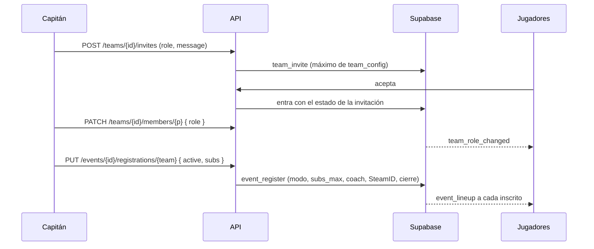
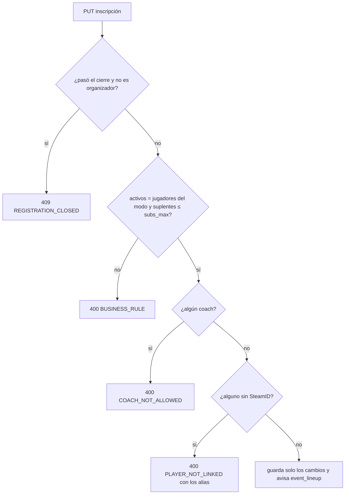

# Equipo y Torneos en la API: documentación

## Qué hace

Completa lo que las vistas de Equipo (`/myteam`, `/teams/{id}`) y Torneos (`/events`, `/events/{id}`) del frontend tenían deshabilitado o resuelto con rodeos.

**Equipos:**
- El capitán cambia el estado de cada miembro (activo, suplente o coach) e invita con un estado y un mensaje.
- El equipo tiene logo, dice qué busca y tiene fecha de fundación.
- Hay un historial de los torneos que jugó.
- El tamaño del plantel deja de ser un 10 fijo y lo configura el admin.

**Torneos:**
- Cada uno elige un modo de juego (`5v5`, `2v2`…). Sus activos son los jugadores por equipo del modo, y suman de 0 a 4 suplentes que fija el organizador.
- El coach nunca se inscribe.
- El torneo tiene banner y cierre de inscripciones.
- El listado ya trae los BO, la fase actual y el progreso, y el detalle trae la partida en vivo con el mapa.
- Cada jugador inscrito recibe un aviso cuando lo suman, lo cambian o lo sacan.

Los puestos de juego (IGL, AWPer…) no son del equipo: son el `game_role` que cada jugador elige en su perfil, y el roster los devuelve.

## Plantel

- **Máximo de miembros:** `team_config.max_members`, 10 por defecto, de 2 a 30. Lo cambia el admin con `set_team_config` (`GET`/`PUT /admin/teams/config`). Lo aplican `team_members_rules` (al entrar) y `team_can_join` (al invitar o pedir), con el error `V3402` → `409 ROSTER_FULL`. Si un equipo ya tiene más que el máximo nuevo, nadie sale: solo no entra gente nueva.
- **Sin topes por estado:** el capitán reparte activos (`player`), suplentes (`sub`) y coach como quiera.
- **Estado en las invitaciones:** `team_invites.role` y `message` (hasta 200 caracteres).
  - `team_invite(p_team, p_player, p_alias, p_role, p_message)`. Al aceptar, el jugador entra con ese estado.
  - Un pedido (`team_request_join(p_team, p_message)`) entra como `player`.
- **Cambiar el estado:** `team_set_member_role` (capitán o admin). Si el jugador no está en el plantel da `V3401` → `404 NOT_A_MEMBER`. El aviso `team_role_changed` sale del trigger de la `28`, y solo si el estado cambió.
- **Qué busca:** `teams.looking_for` (subconjunto de `player`, `sub`, `coach`), con `team_update`. `team_overview` lo devuelve vacío si el plantel está lleno.
- **Logo:** `teams.logo_url`, con `team_set_logo`, que exige una URL del bucket `photos`.
  - En la solicitud de equipo nuevo va en `team_requests.logo_url`, y `approve_team_request` lo pasa al equipo junto con `founded_at = now()`.
- **Fundación:** `teams.founded_at`. En los equipos anteriores se llenó con el ingreso más antiguo del plantel.
- **Puestos de juego:** `team_members_view.game_role`, leído de `profile_details` con su RLS. Es null si el perfil es privado.

## Modos de juego y torneos

- **`game_modes`:** `code`, `name`, `players_per_team`, `active` y `sort`. Arranca con `1v1`, `2v2`, `3v3` y `5v5`, todos habilitados.
  - El admin los cambia con `set_game_mode_active`, y tiene que quedar al menos uno.
  - Un torneo que ya usa un modo deshabilitado lo conserva.
- **En `events`:** `game_mode` (`5v5` por defecto), `subs_max` (0 a 4), `banner_url` y `registration_closes_at`. Se borraron `players_min` y `players_max`.
  - Los torneos anteriores quedaron en `5v5`, con `subs_max = players_max − 5` si daba entre 0 y 4.
- **`events_guard`:**
  - Un torneo nuevo o un cambio de modo exigen un modo habilitado.
  - El formato (incluidos el modo y `subs_max`) solo cambia antes del fixture.
  - No se puede cambiar el modo ni bajar `subs_max` si deja afuera a un equipo ya inscrito.
- **`event_register(p_event, p_team, p_active, p_subs, p_start_stage)`:**
  - Los activos tienen que ser exactamente `players_per_team`, y los suplentes, como máximo `subs_max`.
  - El coach no se inscribe (`V3403` → `400 COACH_NOT_ALLOWED`).
  - Los que no tienen SteamID salen todos juntos (`V3405` → `400 PLAYER_NOT_LINKED`, con los alias en `details.aliases`).
  - Pasado `registration_closes_at`, el capitán recibe `V3404` → `409 REGISTRATION_CLOSED`, y el organizador o el admin siguen pudiendo.
  - Solo cambia lo que cambió (borra a los que salen, suma a los nuevos y actualiza el `role` de los que cambian), así los avisos son los reales.
- **`tournament_registration_players.role`:** `active` o `sub`.
- **`event_unregister`:** aplica el mismo cierre.
- **`event_generate`:** exige que cada equipo tenga sus activos completos.
- **`csstv_match_lookup`:** manda al plugin los activos del modo como `min_roster`.

## Listados

| Vista o función | Suma |
|---|---|
| `team_ref()` | `logo_url` (lo usan los avisos) |
| `team_overview` | `logo_url`, `founded_at`, `max_members`, `has_space`, `looking_for` (efectivo) y `events_played` |
| `team_members_view` | `game_role` y `team_logo_url` |
| `event_registrations_view`, `team_ranking` | `logo_url` |
| `match_list` | `team1_logo_url` y `team2_logo_url` |
| `event_list` | `champion_logo_url`, `game_mode`, `players_per_team`, `subs_max`, `banner_url`, `registration_closes_at`, `bo`, `bo_final`, `progress_played`, `progress_total` y `current_match_id` (la partida en vivo o la próxima) |
| `team_event_history(team)` | Torneos del equipo, sin los cancelados, con `result`, `place`, `played`, `won` y `lost` |

La API arma con esas columnas:
- `current_stage`: el nombre de la fase de `current_match_id`, con `stageLabel`.
- `live_match`: la primera partida en vivo; el mapa es el del mix vinculado en vivo, y `map_index` son los mapas ya jugados + 1.

El `result` del historial sale de la última eliminación del equipo:

| Caso | `result` | `place` |
|---|---|---|
| Inscripciones abiertas | `registered` | null |
| Campeón | `champion` | 1 |
| Perdió la final o la gran final | `runner_up` | 2 |
| Perdió una semifinal, el 3.er puesto o la final del lower | `semifinal` | 3 (4 si perdió el 3.er puesto) |
| Perdió cuartos | `quarterfinal` | 5 |
| Otra eliminación en una llave | `eliminated` | null |
| No pasó de grupos o del suizo | `groups` | null |
| Sigue en carrera | `in_progress` | null |

## Imágenes

- El frontend recorta. La API valida en `lib/uploads.ts`:
  - Tipo, por el contenido.
  - Peso: logo 2 MB, banner 4 MB.
  - Forma y medidas, con `imageSize`, que lee la cabecera de PNG, JPG y WebP sin librerías:
    - Logo: cuadrado, de 128 a 1024 px.
    - Banner: 4:1, de 800×200 a 2400×600.
- Las imágenes se guardan en el bucket `photos` con un nombre nuevo en cada subida (`services/photos.ts`), y la anterior se borra en segundo plano.
- Las políticas de Storage del `33` dejan escribir:
  - Al capitán en `teams/<equipo>/`.
  - A quien pide un equipo en `team-requests/<su id>/`.
  - Al organizador en `events/<torneo>/`.
  - (El admin ya podía en todo el bucket.)
  - Las subconsultas usan `objects.name`, porque `name` a secas sería el de `teams` o `events`.

## Avisos

`event_lineup` (categoría `tournament`) lo genera el trigger `notify_registration_players`:
- Le llega al jugador cuando lo inscriben (`registered: true`, `role`), cuando cambia de activo a suplente o al revés, y cuando lo sacan (`registered: false`).
- No le llega al capitán, que ya recibe `event_registration`.
- No sale si el torneo terminó, se canceló o se borró.

## Dónde está cada cosa

| Qué | Archivo / ubicación |
|---|---|
| Migración | `supabase/replanteo/33_equipo_torneos.sql` |
| Inversa y pruebas SQL | `docs/bitacora/2026-10-14-replanteo-modelo-datos/reversas/33_equipo_torneos.sql` y `pruebas/33_equipo_torneos.sql` |
| Errores con código propio | `web/backend/src/lib/errors.ts` (`V3401` a `V3405`) |
| Medidas de imagen | `web/backend/src/lib/uploads.ts` |
| Subir y borrar fotos | `web/backend/src/services/photos.ts` |
| Equipos, logo, historial y mis equipos | `web/backend/src/routes/teams.ts` |
| Plantel e invitaciones | `web/backend/src/routes/roster.ts` |
| Solicitud con logo | `web/backend/src/routes/account.ts` |
| Máximo de miembros | `web/backend/src/routes/admin-teams.ts` |
| Torneos, banner y modos | `web/backend/src/routes/events.ts` |
| Logos en partidas | `web/backend/src/services/matches.ts` |
| Esquemas | `web/backend/src/schemas/teams.ts`, `events.ts` y `players.ts` (`TeamRef`) |
| Pruebas | `web/backend/test/integration/equipo-torneos.test.ts`, `test/unit/uploads.test.ts` y `errors.test.ts` |
| Contrato para el frontend | `contrato-frontend-equipo-torneos.md` (raíz) |
