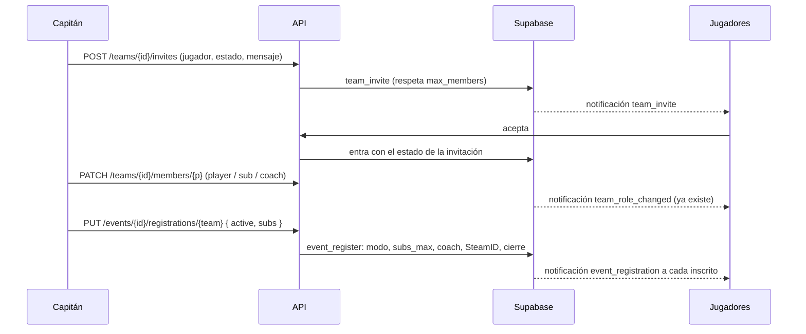

# Plan: lo que piden las vistas de Equipo y Torneos a la API

> Planeación original. Estado: **aprobado** por Daniel el 2026-10-28 (base y API en esta tanda).

El frontend (rama `feat/frontend-fase-1`) ya tiene armadas las vistas de Equipo (`/myteam`, `/teams/{id}`) y Torneos (`/events`, `/events/{id}`) con lo que la API da hoy. Lo que falta aparece deshabilitado con "Próximamente" o se resuelve con un rodeo (hasta 40 pedidos al abrir el listado de torneos). Los pedidos están en [`contrato-backend-equipo-torneos.md`](../../../contrato-backend-equipo-torneos.md) (E1 a E8 y T1 a T4). Este plan los resuelve con las decisiones de Daniel, que en varios puntos cambian lo que se pidió.

## Decisiones tomadas

| Tema | Decisión | Por qué / quién |
|---|---|---|
| Dónde | Backend: replanteo `33` y `web/backend`, en `feat/backend-api-fase-1` | Daniel, 2026-10-28 |
| Tamaño del plantel | Sin topes por estado (`player`, `sub`, `coach`). Solo un máximo de miembros: **10 por defecto, configurable por el admin** | Daniel, 2026-10-28. El tope de 5 activos es de los torneos, no del equipo |
| Estado en el roster (E1) | Lo cambia el capitán o un admin. Una invitación lleva el estado con el que entra el jugador | Contrato E1 |
| Roles de juego (E2) | **No hay tabla nueva.** Son el `game_role` del perfil de cada jugador (`AWPer`, `Rifler`, `IGL`, `Support`, `Entry fragger`, `Lurker`, `Otro`) y se pueden repetir dentro de un equipo. La API lo devuelve en el roster | Daniel, 2026-10-28. Es algo del jugador, no del equipo, y cómo se reparten los puestos lo decide el capitán |
| Modos de juego | Catálogo nuevo `game_modes` (`1v1`, `2v2`, `3v3`, `5v5`, con `players_per_team`) que el admin habilita o deshabilita. Cada torneo elige uno (`5v5` por defecto) | Daniel, 2026-10-28. El catálogo viejo (`matchmaking_modes`) se borró en el replanteo `03` con el matchmaking |
| Inscripción a torneos | **Activos = `players_per_team` del modo, exactos.** Suplentes: entre 0 y `subs_max`, que el organizador fija entre 0 y 4 sin importar el modo. Se van `players_min` y `players_max` | Daniel, 2026-10-28 |
| Quién es activo | El capitán elige libremente entre los miembros del roster (un `sub` del equipo puede ser activo en un torneo) | Daniel, 2026-10-28 |
| Coach | **Nunca se inscribe**, ni como activo ni como suplente: si el capitán lo incluye, se rechaza. Si el organizador lo deja jugar en una partida porque falta uno, es decisión suya fuera de la plataforma | Daniel, 2026-10-28 |
| Imágenes (logo y banner) | El **frontend recorta** (logo cuadrado, banner 4:1). La API valida tipo, peso y medidas, y guarda una sola versión en el bucket `photos` | Daniel, 2026-10-28. Recortar en el Worker pide una librería nueva |
| Códigos de error | Se suman `NOT_A_MEMBER`, `ROSTER_FULL`, `COACH_NOT_ALLOWED`, `REGISTRATION_CLOSED` y `PLAYER_NOT_LINKED` (con los alias en `details`). Las imágenes siguen con `INVALID_FILE` (400) y `FILE_TOO_LARGE` (413), como el avatar, y no con `FILE_BAD_TYPE` | Daniel, 2026-10-28. Un solo código por error en toda la API |
| Aviso a los inscritos | Cada jugador recibe una notificación cuando su equipo lo inscribe en un torneo, lo saca o da de baja la inscripción | Daniel, 2026-10-28. Hoy solo le llega al capitán |
| Mensaje en invitaciones y pedidos | Opcional, de hasta 200 caracteres | Daniel, 2026-10-28 |
| Fuera de esta tanda | Modo de juego en las PCW y los mixes. Frontend | El frontend lo toma cuando estén los endpoints |

## 1. El flujo completo

## 2. Base de datos (replanteo `33_equipo_torneos.sql`)

### 2.1 Configuración del plantel

- Tabla `team_config` (una sola fila, como `ranking_config`) con `max_members int not null default 10` (entre 2 y 30), y la función `set_team_config(p_max_members)`, solo para admins.
- Las dos funciones que hoy tienen el `10` fijo (`team_members_rules` y `team_can_join`, de la `09`) pasan a leer `team_config`. Si un equipo ya tiene más miembros que el nuevo máximo, no se toca a nadie: solo no entra gente nueva.
- Error: el mensaje del `raise` lo traduce la API a `409 ROSTER_FULL`.

### 2.2 Estado en el roster e invitaciones (E1, E8)

- `team_invites` suma `role text not null default 'player'` (`player`, `sub`, `coach`), `invited_by uuid` (la ficha de quien invitó, null en los pedidos de entrar) y `message text` (hasta 200 caracteres).
- Al aceptar, el jugador entra con el `role` de la invitación. Un pedido de entrar entra como `player` y el capitán lo cambia después.
- Función `team_set_member_role(p_team, p_player, p_role)`: capitán o admin. Si el jugador no está en el roster, `NOT_A_MEMBER`. El aviso al jugador ya sale con el trigger `notify_team_members` (`team_role_changed`).

### 2.3 Equipos (E3, E4, E6)

- `teams` suma:
  - `logo_path text`: ruta en el bucket `photos` (`teams/{id}/logo.<ext>`).
  - `looking_for text[] not null default '{}'`: subconjunto de `player`, `sub`, `coach`, sin repetidos.
  - `founded_at timestamptz`: la fecha de aprobación de la solicitud. En los equipos ya existentes se llena con `created_at`.
- `team_requests` suma `logo_path` (`team-requests/{user_id}/logo.<ext>`). Al aprobar, el logo pasa al equipo nuevo (la API mueve el archivo).
- `team_ref()` suma `logo_url`, y lo mismo las vistas que arman equipos para el ranking, las inscripciones y los lados de una partida.
- Función `team_update(p_team, p_looking_for)` para el capitán o un admin.
- Si el equipo está lleno (`members >= max_members`), las vistas devuelven `looking_for = '{}'` aunque esté guardado.

### 2.4 Modos de juego

- Tabla `game_modes`: `code text primary key` (`1v1`, `2v2`, `3v3`, `5v5`), `name`, `players_per_team int`, `active boolean`, `sort int`. Lectura pública. La función `set_game_mode_active(p_code, p_active)` es solo para admins.
- No se pueden deshabilitar todos. Un torneo existente conserva su modo aunque después se deshabilite.

### 2.5 Torneos (T1, T2, T3, T4)

- `events` suma:
  - `game_mode text not null default '5v5' references game_modes(code)`, que solo se cambia antes de generar el fixture.
  - `subs_max int not null default 0`, entre 0 y 4.
  - `banner_path text` (`events/{id}/banner.<ext>`).
  - `registration_closes_at timestamptz`.
- Se borran `players_min` y `players_max`. A los torneos existentes se les asigna `5v5` y `subs_max = players_max − 5` si eso da entre 0 y 4. Si no, queda en 0, y la migración lista esos torneos con `raise notice`.
- `tournament_registration_players` suma `role text not null default 'active'` (`active`, `sub`).
- `event_register(p_event, p_team, p_active uuid[], p_subs uuid[], p_start_stage)` reemplaza a la firma actual:
  - Los activos tienen que ser exactamente `players_per_team`, y los suplentes, como máximo `subs_max`. No puede haber repetidos entre las dos listas.
  - Un miembro con `role = 'coach'` en el equipo no se puede inscribir (`COACH_NOT_ALLOWED`).
  - Siguen las reglas de hoy: tiene que ser miembro, tener SteamID (`PLAYER_NOT_LINKED`, ahora con todos los alias que fallan juntos, no solo el primero) y no estar inscrito en el mismo torneo con otro equipo.
  - Pasado `registration_closes_at`, solo el organizador o un admin inscriben o cambian (`REGISTRATION_CLOSED`). `event_unregister` aplica la misma regla. Con `null` sigue como hoy: hasta que se genera el fixture.
- Para el listado y el detalle (vista o función `event_overview`):
  - `bo`: el de las partidas comunes según la plantilla (`bo`, `bo_group` o `bo` del suizo).
  - `bo_final`: `bo_final`, `bo_grand_final` o `playoffs.bo_final`.
  - `current_stage`: el `label` de la partida en vivo o de la próxima. Es null si el torneo no está en curso.
  - `progress`: `{ played, total }`, sin contar las libres. Es null antes del fixture.
  - `live_match`: la primera partida en vivo, con `label`, el mapa, `map_index` (los mapas ya jugados de la serie más 1) y `maps_total` (el BO).

### 2.6 Historial de torneos del equipo (E5)

- Función `team_events(p_team)`: los torneos en los que el equipo está o estuvo inscrito, sin los cancelados, del más reciente al más viejo. Para cada uno devuelve `result`, `place`, `played`, `won` y `lost` (sin contar las libres).
- `result` sale de la última partida del equipo y de su `label`:

  | Caso | `result` |
  |---|---|
  | Inscripciones abiertas | `registered` |
  | En curso y sigue vivo | `in_progress` |
  | Campeón | `champion` (place 1) |
  | Perdió la final | `runner_up` (place 2) |
  | Perdió una semifinal | `semifinal` (place 3, o 3 y 4 según el tercer puesto) |
  | Perdió cuartos | `quarterfinal` |
  | No pasó de grupos o del suizo | `groups` |
  | Otra eliminación | `eliminated` (place null) |

- `TeamDetail.record` suma `events_played` (los torneos terminados o en curso).

### 2.7 Notificaciones

- Trigger nuevo sobre `tournament_registration_players`: cuando entra un jugador, `event_registration` con `registered: true` y su `role`. Cuando sale (lo sacan o se da de baja la inscripción), con `registered: false`.
- El aviso al capitán (`notify_registrations`) sigue igual. El capitán no recibe dos avisos: si también es inscrito, el trigger nuevo lo omite.

### 2.8 Inversa y pruebas

- `33_equipo_torneos_inversa.sql` deshace todo y vuelve a crear `players_min` y `players_max` (5 y 5 + `subs_max`).
- Pruebas SQL de cada regla: `max_members`, el estado al aceptar, el capitán cambiando estados, `game_mode` y `subs_max` en la inscripción, el coach rechazado, el cierre de inscripciones, `team_events` en las cuatro plantillas y los avisos a los inscritos.

## 3. API (`web/backend`)

### 3.1 Equipos

| Endpoint | Quién | Qué hace |
|---|---|---|
| `GET /teams`, `GET /teams/{id}` | Público | Suma `logo_url`, `looking_for`, `founded_at` y `record.events_played`. Filtro `?looking_for=player,sub` (cualquiera de los indicados) |
| `GET /teams/{id}/members` | Público | `RosterEntry` suma `game_role` (null si el perfil es privado, igual que en el perfil público) |
| `PATCH /teams/{id}` | Capitán o admin | `{ looking_for }` |
| `PATCH /teams/{id}/members/{playerId}` | Capitán o admin | `{ role }` → `200` con el `RosterEntry`. Errores: `NOT_A_MEMBER` (404), `FORBIDDEN` (403) |
| `PUT /teams/{id}/logo` | Capitán o admin | Multipart `logo` |
| `DELETE /teams/{id}/logo` | Capitán o admin | Vuelve a la sigla |
| `GET /teams/{id}/events` | Público | Paginado `{ items, total, page, per }` (sección 2.6) |
| `GET /me/teams` | Usuario | `[{ id, name, tag, logo_url, my_role }]`, con `my_role` igual a `leader`, `player`, `sub` o `coach` |
| `PUT /me/team-request` | Usuario | Acepta `multipart/form-data` con `name`, `tag` y `logo` opcional. Sigue aceptando JSON |
| `POST /teams/{id}/invites` | Capitán o admin | `InviteBody` suma `role` (por defecto `player`) y `message` |
| `POST /teams/{id}/join-requests` | Usuario | Suma `message` |
| `GET /me/team-invites`, `GET /teams/{id}/pending` | — | `Invite` suma `role`, `message` e `invited_by: { player_id, alias } \| null`, más `level` y `elo` dentro de `player` |
| `GET` y `PUT /admin/teams/config` | Admin | `{ max_members }` |

### 3.2 Torneos

| Endpoint | Quién | Qué hace |
|---|---|---|
| `GET /events`, `GET /events/{id}` | Público | Suman `game_mode`, `subs_max`, `bo`, `bo_final`, `current_stage`, `progress`, `banner_url` y `registration_closes_at`. El detalle suma `live_match` |
| `POST` y `PATCH /events` | Organizador o admin | Aceptan `game_mode`, `subs_max` y `registration_closes_at`. Se van `players_min` y `players_max` |
| `PUT /events/{id}/registrations/{teamId}` | Capitán, organizador o admin | Body `{ active: uuid[], subs: uuid[], start_stage? }` |
| `GET /events/{id}/registrations` | Público | Cada jugador inscrito suma `role` (`active` o `sub`) |
| `PUT` y `DELETE /events/{id}/banner` | Organizador o admin | Multipart `banner` |
| `GET /game-modes` | Público | Los modos habilitados |
| `GET` y `PUT /admin/game-modes` | Admin | Todos los modos, y habilitar o deshabilitar uno |

### 3.3 Imágenes

- `lib/uploads.ts` suma `imageSize(bytes, type)`, que lee el ancho y el alto de la cabecera del PNG, JPG o WebP sin librerías.
- **Logo:** hasta 2 MB, cuadrado (con una tolerancia del 2 %), entre 128 y 1024 px de lado.
- **Banner:** hasta 4 MB, proporción 4:1 (con una tolerancia del 5 %), entre 800×200 y 2400×600.
- Si no se cumple, `400 INVALID_FILE` con el motivo en el mensaje.
- Se guarda en `photos` con `upsert`, y al cambiar de extensión se borra el archivo anterior. La URL lleva `?v=<updated_at>` para que el navegador no muestre la imagen vieja.

### 3.4 Errores

- `errors.ts` suma `NOT_A_MEMBER`, `ROSTER_FULL`, `COACH_NOT_ALLOWED`, `REGISTRATION_CLOSED` y `PLAYER_NOT_LINKED`.
- Las funciones SQL los marcan con un prefijo en el mensaje del `raise`, con `errcode` propio y `detail` con los alias. La API los traduce al código y al HTTP que corresponden, en lugar de `BUSINESS_RULE`.

### 3.5 Pruebas

Unitarias de los esquemas y de `imageSize`, y de integración de cada endpoint nuevo o cambiado contra la base local.

## 4. Documentación

- `docs/frontend/contrato/equipos.md`, `torneos.md`, `admin.md`, `notificaciones.md` y `decisiones.md`, más las novedades del índice. Ahí se avisa al frontend:
  - La tarjeta "Roles de equipo" se arma con `game_role`. No hay `/roles`.
  - El frontend recorta el logo y el banner.
  - Cambia el body de la inscripción, y los errores de imagen son `INVALID_FILE` y `FILE_TOO_LARGE`.
- Respuesta corta en `contrato-backend-equipo-torneos.md` (una sección "Respuesta del backend" al final).
- `DOCUMENTACION.md`, `GUIA_IMPLEMENTACION.md` y `CHANGELOG_DISCORD.txt` al terminar, y `PENDIENTES.md` y la fila del índice.

## 5. Requisitos antes de empezar

- Supabase local levantada con los replanteos hasta el `32`.
- Nada que instalar: las medidas de las imágenes se leen sin librerías.
- No toca el plugin ni los servidores de juego, así que no hay despliegue al servidor real, a RBK ni a flow.

## 6. Orden de implementación

1. Replanteo `33`, su inversa y las pruebas SQL, con equipos, modos, torneos, historial y notificaciones.
2. Regenerar `db/types.ts`.
3. Errores nuevos y `imageSize`.
4. Rutas y esquemas de equipos (sección 3.1).
5. Rutas y esquemas de torneos y modos (sección 3.2).
6. Pruebas unitarias y de integración, y OpenAPI.
7. Contrato del frontend y respuesta al pedido.
8. `DOCUMENTACION.md`, `GUIA_IMPLEMENTACION.md`, `CHANGELOG_DISCORD.txt`, `PENDIENTES.md` y el índice.
