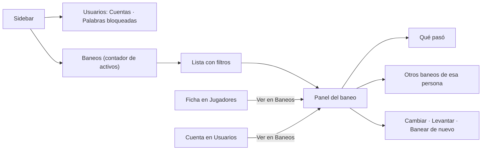

# Administración › Baneos como sección propia: documentación

## Qué hace

Los baneos dejaron de ser una subpestaña de Usuarios. Son una sección propia de Administración, **Baneos** (`/admin/bans`), con el número de baneos activos en el sidebar. La otra sección pasó a llamarse **Usuarios** y quedó con Cuentas y Palabras bloqueadas.

## Quién entra

| Rol | Usuarios | Baneos |
|---|---|---|
| Admin | Sí | Sí, también los permanentes |
| Moderador | No | Sí: banea, cambia y levanta los que no son permanentes. Es su sección de inicio |
| Organizador y usuario | No | No |

El nombre "Moderación" que veía el moderador ya no existe: la sección se llama Baneos para todos.

## La pantalla

- **Pestañas por estado:** Activos, Vencidos, Levantados y Todos, con su total. Cada total es una consulta a `GET /api/v1/bans` con `per=1` y los mismos filtros; "Todos" es la suma.
- **Filtros:** búsqueda (nick, motivo o SteamID), origen (web, `!ban` del juego o importado), servidor y orden ("más recientes" o "vencen antes", con los permanentes al final). Van todos en la URL, junto con la página y el baneo elegido (`?ban=`).
- **Servidores del filtro:** salen de `GET /api/v1/servers/status`, que es pública, porque `/admin/servers` es solo de admin.
- **Panel del baneo:**
  - motivo, vencimiento, fecha, origen y quién lo puso;
  - **Qué pasó:** cuándo se puso y cómo terminó (vencido, levantado con su motivo, o reemplazado, con un botón al baneo nuevo), o cuándo termina;
  - las acciones: cambiar el motivo o el vencimiento y levantar uno activo; **Banear de nuevo** en uno vencido o levantado, si la persona no tiene otro activo;
  - **Otros baneos** de esa persona: `GET /api/v1/players/{id}/bans` si tiene ficha, o la búsqueda por SteamID si no.
- **Banear** (botón del encabezado): el mismo diálogo de antes. Al terminar, abre el baneo nuevo.

## Cómo se encuentra el baneo elegido

La API no tiene `GET /api/v1/bans/{id}`. El panel busca el baneo de `?ban=` en la lista que se ve, después en el historial de esa persona y, por último, en el que se abrió con un clic.

Por eso los links "Ver en Baneos" (desde la ficha en Jugadores y desde una cuenta en Usuarios) llevan también `?q=<alias>`: así el baneo aparece en la lista.

## Lo que la API no tiene

Si hacen falta, son pedidos para el backend:

- estadísticas (por ejemplo, cuántos son permanentes o vencen esta semana);
- un filtro "solo permanentes";
- el historial de cambios de un baneo, como un vencimiento que se extendió;
- `GET /api/v1/bans/{id}`.

## Dónde está cada cosa

| Qué | Archivo |
|---|---|
| Página, filtros y lista | `web/frontend/src/features/admin/bans/AdminBansPage.tsx` |
| Panel del baneo | `…/bans/BanPanel.tsx` |
| Diálogo de banear y cambiar | `…/bans/BanDialog.tsx` |
| Reglas puras (origen, "Qué pasó", quién puede cambiar) | `…/bans/bans.ts` |
| Consultas y mutaciones | `…/bans/queries.ts` |
| Ruta | `web/frontend/src/routes/_app/admin.bans.tsx` |
| Permisos | `web/frontend/src/auth/permissions.ts` (sección `bans`) |
