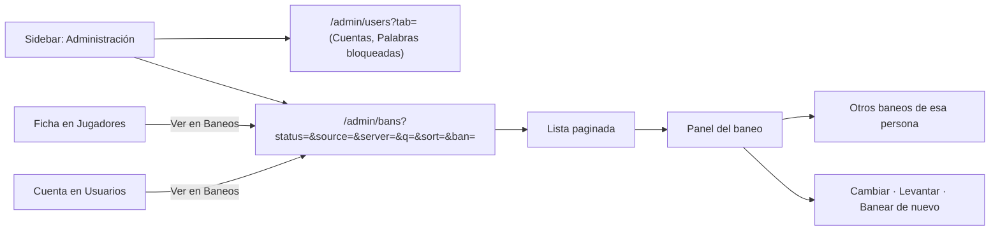

# Plan: Administración › Baneos como sección propia

> Planeación original. Estado: **aprobado** por Daniel el 2026-10-28 ("apruebo el diseño de baneos, impleméntalo"). Pedido de Daniel el 2026-10-28.

Hoy los baneos son una subpestaña de Administración › Usuarios y moderación. Daniel pidió sacarlos a una sección propia, **Baneos**, más alineada con lo que entrega el backend (plan [`2026-10-25-baneos-web`](../2026-10-25-baneos-web/PLAN.md)), y que la otra sección pase a llamarse **Usuarios**.

## Decisiones tomadas

| Tema | Decisión | Por qué / quién |
|---|---|---|
| Fuente del diseño | El artboard "Baneos (propuesta)" del canvas "Admin · Servidores y ELO" | Aprobado por Daniel el 2026-10-28 |
| Ruta | `/admin/bans`, sección `bans` de Administración | Las demás secciones también tienen la ruta en inglés |
| Usuarios | `/admin/users` se llama "Usuarios" y queda con Cuentas y Palabras bloqueadas. El botón "Banear" de cada cuenta sigue ahí | Las palabras bloqueadas son solo del admin |
| Moderador | Entra solo a Baneos, que se llama igual para todos. Desaparece el nombre "Moderación" | Ya no hace falta un nombre distinto por rol |
| Filtros | Estado (pestañas con su total), búsqueda, origen, servidor y orden ("más recientes" o "vencen antes"), todos en la URL | Son los filtros de `GET /api/v1/bans` |
| Totales de las pestañas | Una consulta por estado con `per=1` y los mismos filtros; "Todos" es la suma | La API no tiene un endpoint de estadísticas |
| Lista de servidores del filtro | `GET /api/v1/servers/status`, que es pública | `/admin/servers` es solo de admin y el moderador también filtra |
| Detalle | Panel a la derecha con motivo, vencimiento, origen, quién lo puso, "Qué pasó" (puesto, y cómo terminó) y los otros baneos de esa persona | Diseño aprobado |
| Otros baneos | Ficha: `GET /api/v1/players/{id}/bans`. SteamID sin ficha: `GET /api/v1/bans?q=<SteamID>` | Es lo que la API ofrece para cada caso |
| Baneo elegido | En la URL (`?ban=`), para que "Ver en Baneos" (desde la ficha y desde una cuenta) abra el panel. El link además busca por el alias | La API no tiene `GET /bans/{id}`: el baneo tiene que estar en la lista o en el historial |
| Acciones | Cambiar y levantar en uno activo (el moderador, solo si no es permanente). "Banear de nuevo" en uno vencido o levantado si no tiene otro activo | Diseño aprobado |
| Contador del sidebar | Baneos activos al lado de "Baneos" | Diseño aprobado |
| Lo que la API no tiene | Sin tarjetas de estadísticas, sin filtro "solo permanentes" y sin historial de cambios de un baneo | Se anota como posible pedido al backend |

## 1. El flujo completo

## 2. Archivos

| Archivo | Cambio |
|---|---|
| `src/auth/permissions.ts` | Sección `bans`; el moderador entra solo a `bans` y es su sección de inicio |
| `src/auth/guards.ts` | El moderador va a `/admin/bans` |
| `src/features/shell/nav.ts` | Ítem "Baneos" con contador; "Usuarios" sin el nombre por rol |
| `src/features/shell/queries.ts`, `AppSidebar.tsx`, `CommandMenu.tsx` | Contador de baneos activos; sin `navLabel` |
| `src/routes/_app/admin.bans.tsx` | Ruta nueva con los filtros en la URL |
| `src/features/admin/bans/` | `AdminBansPage`, `BanPanel`, `BanDialog` (se mueve desde `users/`), `queries.ts` y `bans.ts` (reglas puras) |
| `src/features/admin/users/` | Sin la subpestaña Baneos ni el botón del encabezado; "Ver en Baneos" a la sección nueva |
| `src/features/admin/players/FichasTab.tsx` | "Ver en Baneos" a la sección nueva |
| Pruebas | `guards.test.ts`, `nav.test.ts`, `rules.test.ts` y pruebas nuevas de `bans.ts` |

## 3. Requisitos

- Nada en el backend: usa los endpoints del replanteo `31`, ya en local.
