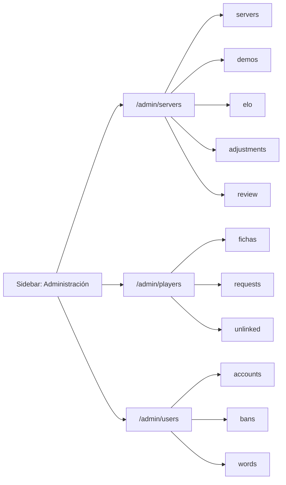

# Frontend de Administración › Servidores y ELO, Jugadores y Usuarios y moderación: documentación

## Qué hace

Reemplaza los tres `Placeholder` de Administración por las pantallas del diseño aprobado por Daniel el 2026-10-28.

- **Servidores y ELO** (`/admin/servers`): servidores de juego con su licencia, token e IP permitida; demos y Worker; reglas del ELO con vista previa; ajustes manuales; mixes interrumpidos y en vivo sin señal.
- **Jugadores** (`/admin/players`): las **fichas** del juego (datos, foto, cuenta vinculada, SteamID y medallas), los pedidos de SteamID de `!claim` y los SteamID que jugaron sin ficha.
- **Usuarios y moderación** (`/admin/users`): las **cuentas** de la web (alias, rol y VIP), los baneos y las palabras bloqueadas.

Cada sección tiene subpestañas en la URL (`?tab=`). Todo sale de la API (`docs/frontend/contrato/admin.md`), sin datos fijos.

## Ficha y cuenta

| | Jugadores (ficha) | Usuarios y moderación (cuenta) |
|---|---|---|
| Qué es | El jugador del juego, por su SteamID. Tiene stats, ELO y partidas | Quien inicia sesión en la web con email |
| Existe sola | Sí: alguien que jugó y nunca se registró | Sí: alguien registrado que todavía no vinculó su Steam |
| Nombre | Si tiene cuenta, manda el alias de la cuenta (el nick no se edita) | El alias, que también es el nombre de su ficha |

## Permisos

| Rol | Qué ve en Administración |
|---|---|
| `admin` | Todo |
| `organizer` | Torneos |
| `moderator` | Solo `/admin/users`, que para él se llama "Moderación" (sidebar, título y breadcrumb) y muestra solo Baneos. No ve "Permanente" ni puede cambiar o levantar un baneo permanente |

Las reglas están en `src/auth/permissions.ts`: `canSeeAdmin`, `canAccessAdminSection`, `homeAdminSection`, `canModerate`, `canBanPermanent` y `canManageAccounts`. `requireAdminSection` manda a cada rol a su sección.

## Servidores y ELO

- **Resumen:** cuatro tarjetas (servidores en línea, licencias por vencer, demos y mixes por revisar) que llevan a su subpestaña.
- **Servidores:**
  - Se piden todos (`per=100`) y los filtros (Todos, En línea, Con avisos, Revocados) se aplican en el navegador.
  - "Con avisos" junta: sin señal, licencia por vencer o vencida, y plugin más viejo que la versión más alta entre los servidores.
  - El panel edita los campos del alta. Un campo vacío manda `null`. La fecha de la licencia se guarda al final del día.
  - Al crear o generar un token nuevo se muestra el `cfg` y el `build_command` **una sola vez**, con "Copiar".
  - Revocar y Reactivar usan `PATCH active`. Borrar solo se puede sin partidas.
- **Demos:**
  - Avisos de Worker detenido, demos perdidas y pendiente de más de una hora.
  - Listado paginado con "Reintentar" (solo con `can_retry`), espacio en R2 y el Worker.
  - El token nuevo del Worker pide escribir «estoy seguro».
- **Reglas del ELO:**
  - Los siete valores con los rangos del contrato. El bonus admite coma decimal y hay que respetar `start_elo ≥ elo_floor` y `full_pct ≥ min_pct`.
  - La vista previa sale de `POST /api/v1/admin/elo/preview`, con 400 ms de retardo, y muestra al lado el valor antes del cambio.
  - Avisa que no recalcula el historial.
- **Ajustes manuales:**
  - Hasta 10 fichas con SteamID. "Sumar o restar" va de −500 a +500, sin 0; "Fijar en" va de 0 a 10000.
  - "Así quedan" se calcula en el navegador con el ELO mínimo.
  - El historial tiene "Deshacer", que pide «estoy seguro».
- **Mixes por revisar:**
  - Los interrumpidos (`review=pending`) muestran sus rondas, el mínimo del 35 % y quién gana.
  - "Aplicar ELO" pide «estoy seguro» y "Descartar" lleva una confirmación simple.
  - Los mixes en vivo sin señal tienen "Cerrar como interrumpido".

## Jugadores

- **Fichas:**
  - Filtros Todas, Con cuenta, Sin cuenta y Sin SteamID, con paginado.
  - El panel tiene foto (el mismo `AvatarPicker` del perfil), nick, privacidad, biografía y logros.
  - Si el nick choca con una palabra bloqueada, se ofrece "Guardar igual".
  - Cuenta vinculada: se puede desvincular o buscar una cuenta sin ficha.
  - SteamID: principal, "Hacer principal" y "Quitar".
  - También tiene medallas y "Borrar" (solo sin partidas).
- **Pedidos de SteamID:**
  - "SteamID adicional" o "Quiere desvincular", con la nota del jugador.
  - Aprobar no aparece si comparte partidas o si es el único SteamID.
  - Rechazar lleva un motivo opcional, que ve el jugador.
  - Al costado se elige el tope de SteamID por ficha (de 1 a 4).
- **SteamID sin vincular:** cada uno se puede sumar a una ficha, eligiéndola en un diálogo, o servir para crear una ficha nueva con su último nick.

## Usuarios y moderación

- **Cuentas:**
  - Filtros por rol y "Sin ficha".
  - Alias, con "Guardar igual" si choca con una palabra bloqueada.
  - Rol: Usuario, Organizador o Moderador. El admin no se cambia desde acá.
  - VIP: 1, 3, 6 o 12 meses, hasta una fecha o de por vida. Se puede extender o quitar, con motivo obligatorio.
  - Un botón para banear a su ficha.
- **Baneos:**
  - Filtros por estado y origen, y búsqueda.
  - "Cambiar" y "Levantar". Levantar pide un motivo obligatorio.
  - El diálogo de "Banear" busca una ficha o acepta un SteamID64, avisa si reemplaza un baneo activo y explica `!syncbans`.
- **Palabras bloqueadas:** se agregan y se desbloquean, y al lado están los nombres actuales que las contienen, con un atajo a la cuenta, la ficha o el equipo.

## Errores

- Se decide por `error.code`.
- "Palabra bloqueada" se reconoce como `BUSINESS_RULE` con el campo (`nick` o `alias`) en `details` (`src/features/admin/errors.ts`).
- Los demás errores muestran `errorMessage()`.

## Dónde está cada cosa

| Qué | Archivo |
|---|---|
| Piezas comunes (cabecera, subpestañas, chips, tarjetas, panel, paginado) | `src/features/admin/ui.tsx` |
| Confirmaciones (simple, «estoy seguro», con motivo) y token que se ve una vez | `src/features/admin/dialogs.tsx` |
| Fechas, bytes, versiones, licencia | `src/features/admin/format.ts` |
| Servidores y ELO | `src/features/admin/servers/` |
| Jugadores | `src/features/admin/players/` |
| Usuarios y moderación | `src/features/admin/users/` |
| Rutas | `src/routes/_app/admin.servers.tsx`, `admin.players.tsx` y `admin.users.tsx` |
| Permisos | `src/auth/permissions.ts`, `src/auth/guards.ts`, `src/features/shell/nav.ts` |
| Pruebas | `src/features/admin/format.test.ts`, `src/features/admin/rules.test.ts`, `src/auth/guards.test.ts` y `src/features/shell/nav.test.ts` |
