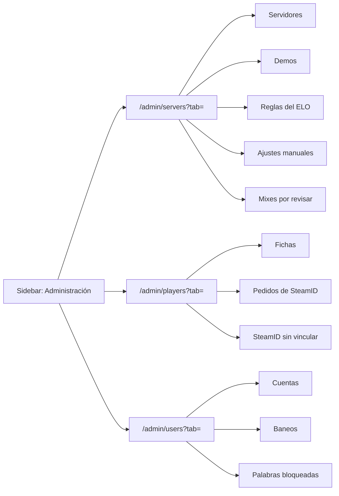

# Plan: frontend de Administración › Servidores y ELO, Jugadores y Usuarios y moderación

> Planeación original. Estado: **aprobado** por Daniel el 2026-10-28 ("me gustaron los diseños", con autorización para implementar los tres módulos).

Las tres secciones de Administración son hoy un `Placeholder`. No hay handoff de Admin. Los diseños se hicieron en un canvas de Claude a partir del estilo de los handoffs (tokens de `src/index.css`, Inter y Geist Mono), con los datos que la API ya expone según `docs/frontend/contrato/admin.md`. Daniel los aprobó el 2026-10-28.

## Decisiones tomadas

| Tema | Decisión | Por qué / quién |
|---|---|---|
| Fuente del diseño | El canvas "Admin · Servidores y ELO" (tres artboards: `Main`, `Players` y `Users`) | Aprobado por Daniel el 2026-10-28 |
| Subpestañas | En la URL (`?tab=`), con botones `role="tab"` bajo el título | Se puede compartir el link a una subpestaña y el botón Atrás funciona |
| Servidores y ELO | Subpestañas Servidores, Demos, Reglas del ELO, Ajustes manuales y Mixes por revisar. Arriba, cuatro tarjetas de resumen que llevan a su subpestaña | Diseño aprobado |
| Jugadores | Subpestañas Fichas, Pedidos de SteamID y SteamID sin vincular | Diseño aprobado |
| Usuarios y moderación | Subpestañas Cuentas (alias, rol y VIP), Baneos y Palabras bloqueadas | Diseño aprobado |
| Moderadores | Entran a `/admin/users`, que para ellos se llama "Moderación" y muestra solo Baneos, sin la opción "Permanente" ni acciones sobre los permanentes. El resto de Administración sigue siendo solo para admins | El contrato (`api.md`) da los baneos a `moderator` y `admin`; propuesta del diseño, aprobada con él |
| Vista previa del ELO | `POST /api/v1/admin/elo/preview` con 400 ms de retardo entre teclas, no la fórmula copiada en el navegador | El contrato lo pide así y el cálculo queda en un solo lugar |
| "Así quedan" de los ajustes | Calculado en el navegador con el ELO actual y el mínimo de `GET /api/v1/elo/config` | Lo pide el contrato |
| Versión del plugin | La más alta entre los servidores es la "última"; un servidor con una menor se marca | La API no expone la última versión; no se fija a mano |
| Filtros que la API no tiene | "Con avisos" en Servidores se filtra en el navegador (son pocos servidores, se piden todos) | Evita pedirle un filtro nuevo al backend |
| Dobles confirmaciones | Escribir `estoy seguro` en: deshacer un ajuste, aplicar el ELO de un mix interrumpido y el token nuevo del Worker | Obligatorio según el contrato |
| Textos del ELO al sumar o quitar un SteamID | Por ahora dicen que se recalcula el ELO de todos, como hace hoy el backend. Cambian con el plan [`2026-10-28-elo-por-ficha`](../2026-10-28-elo-por-ficha/PLAN.md) | Que el texto diga lo que pasa de verdad |
| `schema.d.ts` | Se regenera desde la API actual: faltaban baneos y VIP | Regla del frontend: no se edita a mano |

## 1. El flujo completo



Cada subpestaña consulta su lista con TanStack Query y cada acción es una mutación que invalida las consultas afectadas y muestra un toast.

## 2. Archivos

```
src/features/admin/
  ui.tsx            cabecera, subpestañas, chips, tarjetas, panel de detalle, estados vacíos
  dialogs.tsx       confirmación simple, con "estoy seguro" y con motivo; token que se ve una vez
  format.ts         fechas, bytes, versiones, licencia (con pruebas)
  servers/          queries.ts y una vista por subpestaña
  players/          queries.ts y una vista por subpestaña
  users/            queries.ts y una vista por subpestaña
src/routes/_app/admin.servers.tsx · admin.players.tsx · admin.users.tsx
```

## 3. Permisos

- `canSeeAdmin` suma a `moderator`. `canAccessAdminSection(moderator, "users")` es `true` y nada más.
- `requireAdminSection` manda al moderador a `/admin/users` cuando pide otra sección.
- En el sidebar, el ítem se llama "Moderación" para el moderador.
- Las pruebas de `permissions` y `guards` cubren al moderador.

## 4. Pruebas

- Unitarias de `format.ts` y de los permisos.
- `pnpm lint`, `pnpm typecheck`, `pnpm test` y `pnpm build` en verde.
- A mano contra la API local, si está levantada.

## 5. Requisitos antes de empezar

Ninguno: los endpoints ya existen.

## 6. Orden de implementación

1. Regenerar `schema.d.ts` y arreglar lo que rompa.
2. Componentes compartidos, `format.ts` y permisos.
3. Servidores y ELO.
4. Jugadores.
5. Usuarios y moderación.
6. Pruebas, lint, typecheck y build.
7. `DOCUMENTACION.md`, `GUIA_IMPLEMENTACION.md` y la fila del índice.
