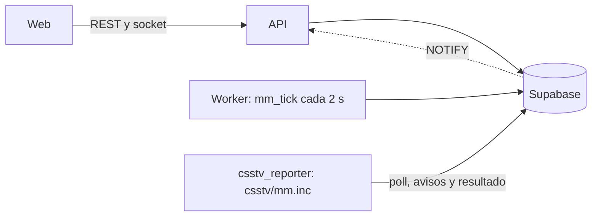

# Documentación: matchmaking

Cola en la web, sala con confirmación y veto, y servidor automático. El estado vive en la base (`mm_*`); la API lo expone, el worker vence los plazos y el plugin juega la partida como un mix vinculado.

## Equipos y veto

- `mm_best_split` prueba todas las divisiones, descarta las que separan un dúo y elige la de menor diferencia de ELO. No hay capitanes que elijan jugadores.
- Capitán: el de más ELO de cada equipo. Empieza a banear el equipo más débil, 15 s por baneo.
- Cada equipo se llama `team_<alias del capitán>`. En torneos, el nombre del equipo.
- Grupo de dos: hasta 500 de ELO de diferencia.

## ELO

El 5v5 da el ELO de los mixes: el resultado entra como un mix y se enlaza a la sala. Las reglas de abandono solo actúan si hubo un abandono confirmado.

**Cuándo hay abandono:** no vuelve en 3 minutos (`reconnect_minutes`), o la partida termina con el jugador todavía desconectado.

| Quién | Cambio de ELO | En partida pareja |
|---|---|---|
| Quien abandona | Derrota completa, sin ajuste por participación ni bonus, más el fijo. Además, un escalón de sanción | −35 |
| Su equipo, si sigue | Normal × (1 ± parte con uno menos × 50%): gana más o pierde menos | 15 de 30 rondas: +38 / −23 |
| El rival | Normal × (1 ∓ lo mismo): gana menos o pierde más | +23 / −38 |
| Su equipo, si hace `!gg` | La mitad de lo normal | −15 |
| 2 o más abandonos en un equipo | Ese equipo pierde aunque vaya ganando. Quienes se quedaron y el rival, ELO normal | |
| 2 o más en cada equipo | Partida anulada, sin ELO. Las sanciones quedan | |

**Decisiones que no estaban definidas (a confirmar con Daniel):**

- **Un abandono por equipo:** ELO normal sin ajuste, porque los dos quedan con uno menos. Quienes abandonan, −35.
- **"Se van los dos equipos":** se interpretó como 2 o más en cada uno.
- **El rival de un `!gg` tras un abandono:** se ajusta con la misma proporción.
- **`!gg` tras un abandono:** ese equipo se puede rendir yendo abajo por cualquier diferencia, no solo por `csstv_gg_min_diff`.

**Configuración** (`mm_config`): `abandon_extra_elo` (5), `abandon_adjust_pct` (50) y `abandon_gg_pct` (50). Cambiarla afecta también a los recálculos de partidas viejas.

El cálculo está en `mm_elo_delta` y sale de datos guardados, así que `elo_recompute_all` y `elo_recompute_player` dan lo mismo.

**Límite conocido:** si un equipo pierde por abandonos antes de terminar la primera ronda, el resultado se rechaza por falta de jugadores con rondas. La sala se cancela sola a los 5 minutos.

**Sin hacer:** 2v2 y 1v1 siguen dando ELO si se prenden, porque el motor no mira `affects_elo`. Quedan apagados.

## Plugin (`csstv/mm.inc`)

| Situación | Qué hace |
|---|---|
| Libre | Consulta `csstv_mm_poll` cada 5 s |
| Toma una sala | Avisa `taken`, guarda `mm.txt`, pone la contraseña, activa el vínculo de `!match` y cambia al mapa |
| Conectando | Avisa `connected`. Arranca con `!ready`. `!match`, `!rtv` y `!pw` quedan bloqueados |
| En vivo | Avisa `live`, `left` y `back`. Consulta cada 10 s: derrota automática, anulación y abandonos |
| Al terminar | Pone una contraseña al azar antes de avisar nada y queda esperando que la base cierre la sala; a los 5 minutos la cancela |
| Se reinicia | Retoma la sala. Si figuraba en vivo, la cancela |

Con `csstv_mm 0` nada de esto corre, y con `csstv_send 0` no consulta la web.

## Web

- `/play`: cola, grupo, sala, veto y resumen. La i de "jugadores activos" muestra la cola al pasar el ratón y quiénes buscan al hacer clic.
- `ReconnectBanner`: el aviso con cuenta regresiva, en toda la web.
- `/admin/matchmaking`: configuración, salas, servidores y contraseñas, reportes, sonidos y métricas.

## Datos que todavía no llegan

Marcador por mitad, cosméticos en las tarjetas, misiones, jugada de la semana y el aviso de "tu amigo está buscando".
