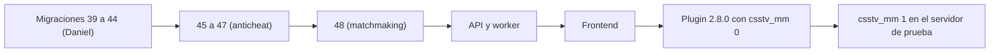

# Guía de implementación: matchmaking

> Plan: [PLAN.md](PLAN.md). Estado 2026-11-01: **probado en local, sin desplegar**.

## Orden de despliegue



La migración va **antes** que la API: sin ella, el chat de las partidas da error 500, porque la API lee `match_chat.side`.

| Paso | Dónde | Detalle |
|---|---|---|
| Base de pruebas | Staging (`.env`) | Primero las 39 a 44 de Daniel; después 45, 46, 47 y 48 |
| Plugin de prueba | v34aura (servidor #1, nuestro servidor real) | `.smx` genérico. Se carga en el próximo cambio de mapa, nunca con partida en curso |
| Otros servidores | flow | Build licenciado (`server/build_licenciado.sh <uuid> flow`), con `csstv_mm 0`. RBK no se usa desde el 2026-10-29: no se le despliega nada |

`csstv_password` pasa a 1.1.0 y va en la misma tanda.

## Lo que configura Daniel en el VPS

1. Crear el rol, con una contraseña nueva. No tiene permisos sobre ninguna tabla: solo se conecta y hace `LISTEN`.

   ```sql
   create role mm_listener login password '<contraseña>' noinherit;
   ```

2. En el `api.env`, la conexión directa a Postgres (si queda vacía, no hay socket y la web sigue con polling):

   ```
   MM_LISTEN_URL=postgres://mm_listener:<contraseña>@<host>:5432/postgres
   ```

3. Instalar y prender el worker. `deploy/vps/preparar.sh` ya copia la unidad y `desplegar.sh` ya la reinicia:

   ```bash
   sudo systemctl enable --now cmleague-mm
   sudo systemctl restart cmleague-api
   ```

4. Comprobar:
   - `journalctl -u cmleague-api` no muestra `mm: no se pudo escuchar`.
   - `journalctl -u cmleague-mm` no muestra errores.
   - Con una cuenta en `/play`, la pestaña de red tiene un WebSocket abierto a `/api/v1/mm/ws`.

**Sin probar todavía:** el `LISTEN` y el socket desde el VPS. En local funcionan.

## Cómo probarlo

| Prueba | Cómo |
|---|---|
| Base | `pruebas/48_matchmaking.sql` de `docs/bitacora/2026-10-14-replanteo-modelo-datos/`, se deshace sola |
| Web con situaciones simuladas | [`pruebas/simular.py`](pruebas/simular.py), con la API en `:8788` y el worker. Solo base local |
| Plugin | Build con `CSSTV_DEBUG=`, en `cssds` apuntando a la base local y con `csstv_mm 1` |

Cuidado con `cssds`: apunta a la Supabase real. Antes de arrancarlo con el reporter, cambiá `csstv_api_url` y, al terminar, borrá lo que quede en `data/csstv/{live,queue,sent,failed}`: una foto en `live/` se envía al reiniciar.

## Cómo revertir

`docs/bitacora/2026-10-14-replanteo-modelo-datos/reversas/48_matchmaking.sql`. Borra salas y partidas `mm` y devuelve el motor de ELO a como estaba. No borra el bucket `sounds` ni el rol `mm_listener`. En los servidores, `csstv_mm 0`.

## Probado en local (2026-11-01)

- 10 bots: sala completa, resultado enlazado y ELO; cambio de mapa; recarga del plugin; 2 abandonos en el equipo que va ganando; abandono de los dos equipos; cancelación y rotación de contraseña.
- Un admin real: `!pw` y `!match` bloqueados; irse y volver, conservando el score.
- Web contra el backend: cola, partida encontrada, veto, sala y resumen.

## Sin probar

- Partida con 10 personas con SteamID real. Con `sv_lan 1`, la build de pruebas identifica por nombre.
- Prueba de carga y socket en el VPS.
- Grupos de dos dentro de la sala, sonidos, reportes y Administración, contra la API real.
- La rendición con `!gg` tras un abandono: la regla se probó en la base, no jugando.

## Cambios respecto del plan

- **Números de migración:** anticheat pasó a 45, 46 y 47, y matchmaking a 48, porque Daniel ya usó hasta la 44.
- **Si no se conectan a tiempo:** cancela la base, no el plugin, porque es quien sanciona.
- **Contraseña al terminar:** va por una cola propia (`data/csstv/mm_pw.txt`), no por la de resultados.
- **`csstv_password`:** lee `csstv_mm` directamente; no hay `csstv_mm_active`.
- **Sin evento `surrender`:** la base lo deduce de `end_reason` y de las rondas.
- **Abandono:** las reglas son las de Daniel del 2026-11-01, que reemplazan la sección 10.

## Incidentes en staging

### 2026-11-01: Administración › Matchmaking daba 500

Al usar el panel contra staging (API `4079c8a22757`), guardar General y cargar Servidores, Salas, Mapas, Reportes, Baneos y Métricas respondían 500. Eran tres errores de la `48`, que no se veían en local:

| Función | Error | Corrección |
|---|---|---|
| `mm_set_config` | `update mm_config set …` sin `WHERE`. Supabase carga `pg_safeupdate` para PostgREST (`session_preload_libraries` del rol `authenticator`), que rechaza los `UPDATE` sin `WHERE` | `where id = 1` |
| `mm_set_config` | Sin `penalty_ladder` en el cuerpo, `array(...)` da `{}` (no `null`), así que el `coalesce` no la conservaba y chocaba con `mm_config_penalty_ladder_check` | Solo se reemplaza si llega un array |
| `mm_admin_lists` | La rama `stats` usaba `l.created_at` sin agrupar en una subconsulta (`subquery uses ungrouped column`). Como la función es un solo `CASE`, el error rompía todas las listas | Agrupa en una subconsulta y cuenta los abandonos afuera |

- Corregido en `supabase/replanteo/48_matchmaking.sql`.
- **Aplicado en staging el 2026-11-01** con `CREATE OR REPLACE FUNCTION` (SQL en `docs/bitacora/2026-11-01-frontend-matchmaking/pruebas/fix_mm_admin_staging.sql` de `feat/frontend-fase-1`). Antes se probó como admin en una transacción con `ROLLBACK`: las seis listas responden y `mm_set_config` guarda con el cuerpo del formulario.
- **Sin prueba automática:** `pg_safeupdate` no se puede cargar desde `psql` en Supabase (`access to library "safeupdate" is not allowed`). Las pruebas de la base no pasan por PostgREST, así que no lo detectan.
