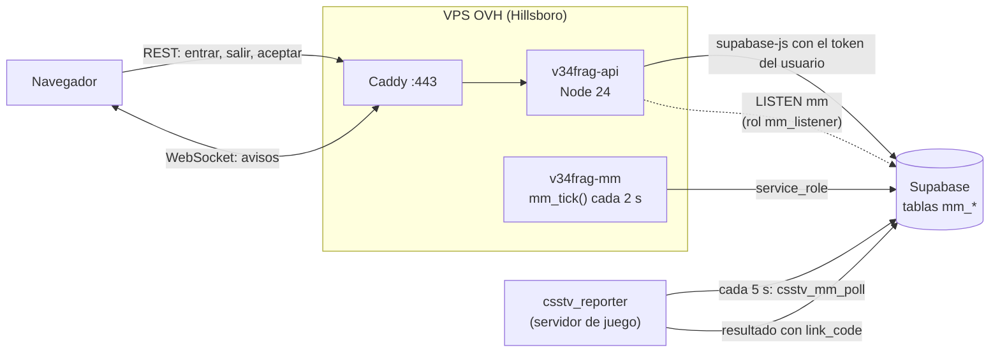
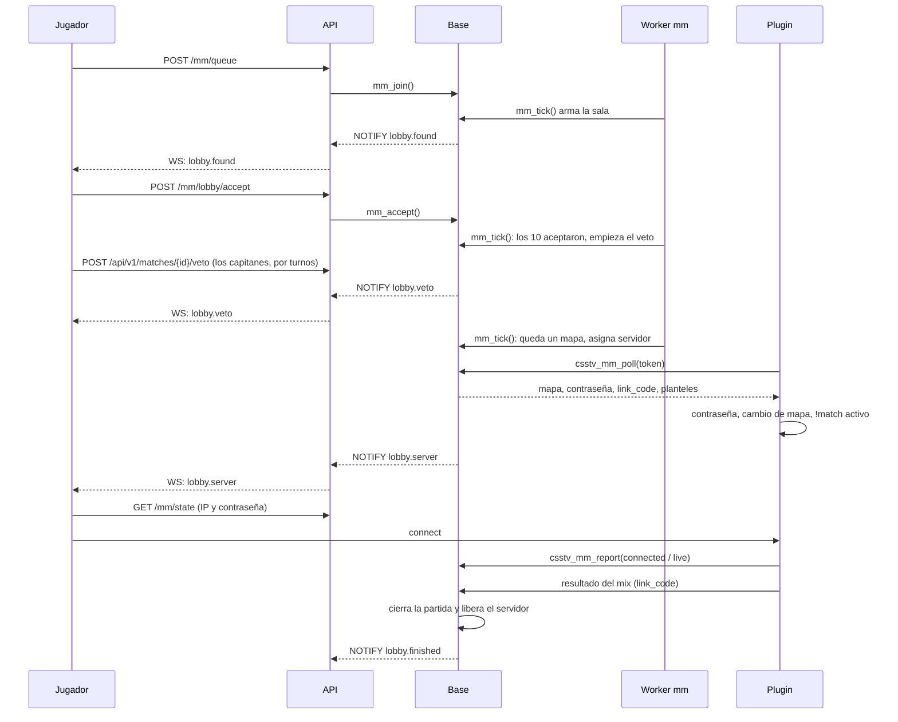
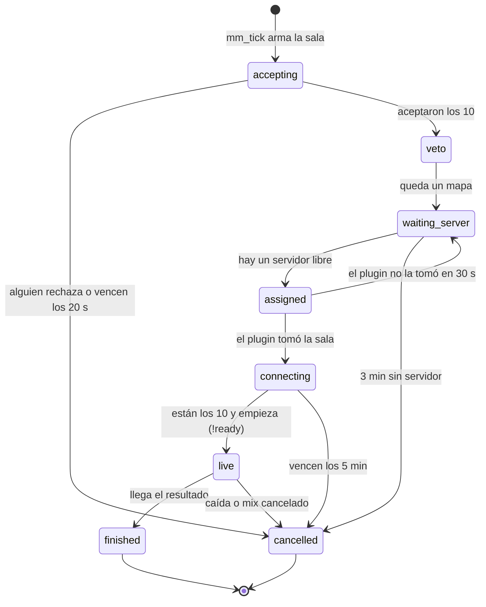
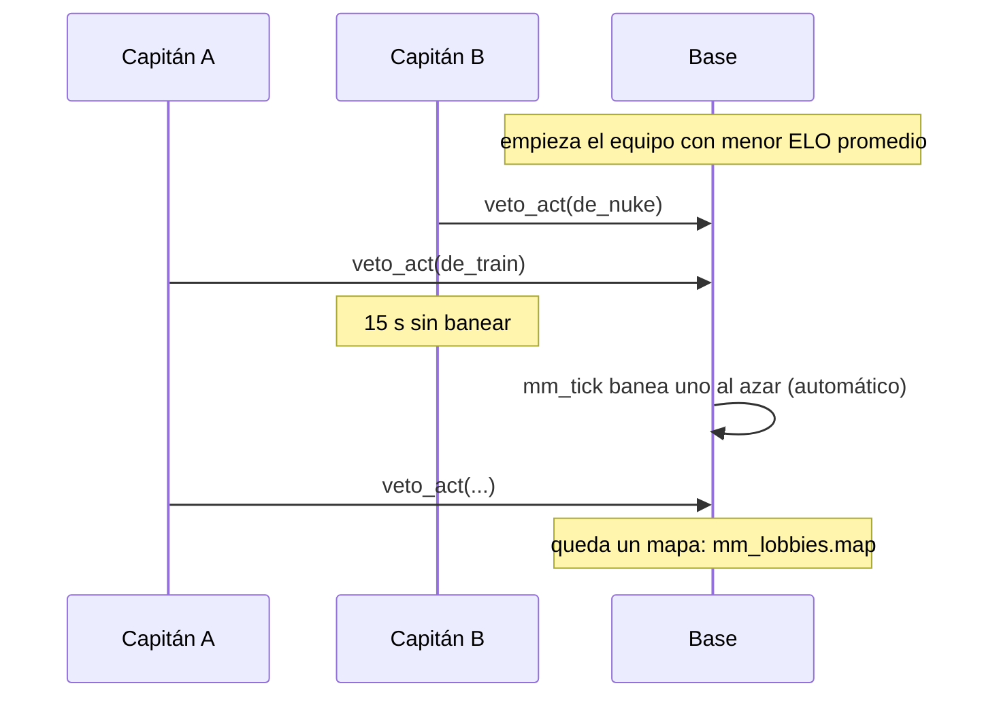
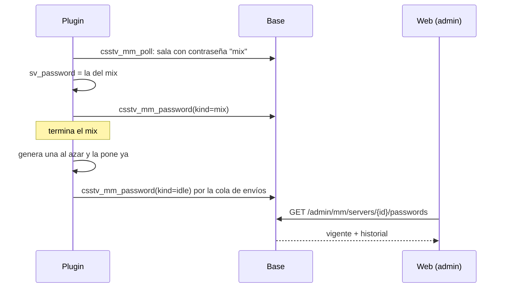

# Plan: matchmaking con cola en la web y servidor automático

> Planeación original. Estado: **propuesta**, pendiente de aprobación.

El matchmaking viejo (`feat/matchmaking-5v5`) se borró en el replanteo (`03_matchmaking.sql`) porque era inestable, y Daniel decidió que, si se volvía a hacer, fuera desde cero y con su propio plan (ver la guía del [replanteo](../2026-10-14-replanteo-modelo-datos/GUIA_IMPLEMENTACION.md), sección "Matchmaking: se borra en vez de coordinar"). Este es ese plan.

Se apoya en lo que ya existe en las ramas `feat/backend-api-fase-1` y `feat/frontend-fase-1`:

- La API en Hono.
- El replanteo `01` a `30`.
- El `!match` del plugin, que fija los planteles, obliga a cada jugador a su lado y vincula el resultado con una partida de la web.
- La licencia y el token de cada servidor.
- El plan de despliegue en el VPS de OVH ([`2026-10-16-despliegue-vps`](../2026-10-16-despliegue-vps/PLAN.md)).

Este plan se escribió en `kyan/pruebas`, que todavía no tiene esas ramas.

## Análisis previo: WebSockets o polling

Antes de este plan se revisó si el VPS alcanza para WebSockets.

- **Capacidad:** sobra. Son 2 vCPU y 4 GB de RAM, y una conexión WebSocket sin actividad ocupa unos KB en Node. Miles de conexiones abiertas entran sin problema; la comunidad va a tener, como mucho, unos cientos a la vez.
- **Caddy:** su `reverse_proxy` ya deja pasar WebSockets.
- **El límite no es el hardware, es la arquitectura:**
  1. La API no se entera de los cambios que hacen otros: el plugin, los admins y las funciones de la base.
  2. Cada despliegue reinicia el único proceso y corta todas las conexiones.
  3. Los WebSockets en Workers necesitan Durable Objects.
- **Por qué no alcanza el polling:** la confirmación de partida dura unos 20 segundos. Con un polling cada 8 s, el aviso puede llegar cuando ya pasó casi la mitad del tiempo. Bajar a 2 s multiplica el tráfico contra Supabase.

Este plan resuelve esos tres puntos.

## Lo que ya hace el backend y se reusa

Revisado en `origin/feat/backend-api-fase-1` el 2026-10-28 (último commit `6b770cc`). El matchmaking **no duplica nada de esto**: lo usa tal como está y, cuando hace falta, le suma una columna o un caso. Así no se rompe lo que ya funciona.

| Qué | Ya existe | Cómo lo usa el matchmaking |
|---|---|---|
| Número de la migración | El replanteo llega hasta `33_equipo_torneos.sql` (`31_baneos`, `32_vip`, `33_equipo_torneos`) | La migración del matchmaking es la **`34_matchmaking.sql`** y va después de la `33` |
| Modos de juego | `game_modes` (replanteo `33`: `1v1`, `2v2`, `3v3` y `5v5`, con `players_per_team`; `GET /api/v1/game-modes` y `PUT /api/v1/admin/game-modes`), hoy para torneos | El matchmaking **referencia `game_modes(code)`** y solo guarda lo suyo (`mm_mode_settings`: habilitado en el matchmaking y si da ELO). El nombre y los jugadores por equipo salen del catálogo; `game_modes.active` sigue siendo de los torneos |
| Partida, estadísticas, demo y clips | `matches` con `kind`, `lineup1`/`lineup2`, `link_code`, `match_list`; `GET /api/v1/matches/{id}` (con las líneas de cada jugador, rating, `elo_delta`, multikills, primeras kills y clutches); `GET /api/v1/matches/{id}/clips`; el pipeline de demos del Worker | La partida `mm` es una fila de `matches` más (`kind = 'mm'`). La sala postpartido sale de `GET /api/v1/matches/{id}` con el mismo `roomFromMatch` del frontend de Mixes, y los clips y la demo de sus rutas. Nada nuevo para eso |
| Mix en vivo | `live_match_list`, `GET /api/v1/mixes/live` y `/mixes/live/{uid}` (las fotos que manda el plugin por ronda) | El marcador en vivo de la sala sale de ahí |
| Veto | `POST /api/v1/matches/{id}/veto` (`veto_act`, con `match_map_pool` y versiones de mapa) y `match_vetos` | **Se reusa**: la partida `mm` se crea cuando empieza el veto (estado `upcoming`) y los capitanes banean con esa ruta. `veto_act` suma el caso `kind = 'mm'`: el capitán sale de `mm_lobby_players`, el pool de `mm_mode_maps` y solo hay baneos hasta que queda uno. El baneo automático lo hace `mm_tick()` con la misma función |
| Chat | `match_chat` con `GET`/`POST /api/v1/matches/{id}/chat` (paginado por cursor, un mensaje cada 2 s) y `DELETE /api/v1/chat/{id}` | **Se reusa** sobre la partida `mm`. Se suma `match_chat.side` (null = a todos; 1 o 2 = solo ese equipo) y la regla: en una `mm` escriben y leen solo los 10 y los admins. Nada de `mm_lobby_chat` |
| Servidores | `game_servers` con `region`, `mode`, `connect_address`, `tv_port`, licencia y token; `PATCH /api/v1/admin/servers/{id}`; `GET /api/v1/servers` y `/servers/status` (A2S) | `mm_enabled` es **un campo más de `PATCH /api/v1/admin/servers/{id}`** (`ServerPatch`) y de `admin_server_list`. La región de la cola es la `region` que ya tienen |
| Catálogo de mapas | `map_pool` con `GET /api/v1/maps`, `PUT /api/v1/admin/maps` y `POST`/`DELETE /api/v1/admin/maps/{name}/image` | Se suman `display_name` y `background_url` al mismo `PUT` y a `MapItem`, y solo las rutas del fondo son nuevas |
| Baneos | `bans` (replanteo `31`), `ban_create`, `ban_list`, `POST /api/v1/admin/bans`, rol `moderator` (`is_moderator()`) | `mm_join()` **rechaza a quien tenga un baneo activo**. Desde un reporte, además de excluir del matchmaking, se puede **banear del servidor** con `POST /api/v1/admin/bans`. Los reportes los resuelven moderadores y admins |
| Notificaciones | `notifications`, `notify()` (replanteo `28`) y `GET /api/v1/notifications` | Se suma la categoría `mm` al `check` de `notifications.category` y a las preferencias de notificaciones |
| Preferencias | `user_preferences` y `PATCH /api/v1/me/profile` (`preferences`, que une claves sin pisar otras) | "Privado o Público" es la clave **`preferences.mm_invites`** de esa misma ruta (se suma al esquema `PreferencesPatch`). Sin ruta nueva |
| Buscar jugadores | `GET /api/v1/players?q=` (alias y equipos, sin tildes) con foto, nivel y ELO | La búsqueda para invitar al grupo usa esa ruta; `mm_party_invite` valida si se lo puede invitar. Sin ruta nueva |
| Temporadas | `seasons`, `GET /api/v1/seasons/current` (`ends_at`) y el cierre que espera un mix en vivo | El aviso de cierre de Jugar sale de `/seasons/current`; `mm_tick()` cierra la cola con `seasons.ends_at` |
| Jugadores | `player_overview`, `player_matches`, `GET /api/v1/players/{id}` (foto, país, nivel, ELO) y `elo_trend` (últimos 30 ELO) en el ranking | La tarjeta de la sala usa esos datos; lo único nuevo es la vista `player_recent_stats` (promedios de las últimas 30 partidas) |
| Contraseña del servidor | Plugin `csstv_password` (`!pw`, `!npw`, `!rpw`) | Ya contemplado en la sección 6 |
| Límite de intentos, errores y OpenAPI | `rateLimit`, `AppError`, `errorResponses` y los esquemas de `src/schemas/` | Todas las rutas nuevas los usan igual que las demás |

## Decisiones tomadas

| Tema | Decisión | Por qué |
|---|---|---|
| Alcance de la primera versión | **Modos 5v5, 2v2 y 1v1**, cada uno con su cola. Un admin habilita cada modo; arranca solo con **5v5**. Grupos de hasta 2 (dúo, `mm_config.max_party_size`), y un admin puede cambiar ese tope entre 1 y 5 | 5v5 es lo que se juega. 2v2 y 1v1 ya los soporta el `!match` (planteles de 1 a 5) y sirven para practicar. El dúo es lo más pedido y todavía deja balancear bien |
| Modos | Salen del catálogo `game_modes` que ya existe (replanteo `33`: `1v1`, `2v2`, `3v3` y `5v5`). El matchmaking guarda aparte cuáles habilita y si dan ELO (`mm_mode_settings`). El jugador elige el modo antes de buscar; el grupo no puede ser más grande que un equipo del modo (en 1v1, sin grupo) | No duplicar el catálogo de los torneos |
| Región | El jugador elige una región de las de los servidores con matchmaking (`game_servers.region`, replanteo `20`) o "Cualquiera". La región no separa la cola: decide el servidor (el libre de la región que eligieron más jugadores de la sala; si no hay, cualquiera libre) | Con pocos jugadores, separar la cola por región la vacía. El ping al servidor no se puede medir desde el navegador (es UDP): no se muestra |
| Invitaciones | Cada jugador elige **Privado** (nadie lo puede invitar) o **Público** (cualquiera lo puede invitar). Se guarda en sus preferencias (`user_preferences.preferences.mm_invites`, replanteo `18`); por defecto, Público | Que nadie reciba invitaciones que no quiere |
| Al recibir una invitación | **Popup** (diálogo) con quién invita, su nivel y ELO, y Aceptar o Rechazar con la cuenta regresiva, más un **sonido** de notificación. Con la pestaña en segundo plano, también notificación del navegador | Pedido de Daniel. Que la invitación no pase desapercibida |
| Dúo (duoQ) | Un jugador invita a otro desde Jugar, buscándolo por nick. La invitación dura 60 s. El que invita es el líder y entra a la cola por los dos. **Los dos van siempre al mismo equipo.** El grupo sigue armado después de la partida, hasta que uno sale | Como en FACEIT. Que la pareja no tenga que volver a armarse entre partidas |
| Grupo: salir, expulsar y líder | Cualquiera **sale del grupo**; el líder además **saca a alguien** o **le pasa el liderazgo**. Las tres cosas desde el menú "⋯" de cada tarjeta de Mi grupo, y salir también con un botón abajo; salir y sacar piden confirmación. Si el grupo estaba en cola, sale de la cola. Si el líder sale, el liderazgo pasa al que está hace más tiempo; si queda uno solo, el grupo se borra. **Durante una sala no se puede cambiar el grupo.** A los demás les llega un aviso ("X salió del grupo", "Ahora sos el líder", "El líder te sacó") por el socket y como notificación de la web | Que nadie quede atado a un grupo y que el líder pueda ordenarlo |
| Límites del dúo | Diferencia de ELO entre los dos de hasta **500** (`mm_config.party_max_elo_gap`), para que no se use para subir una cuenta. Para buscar, el dúo cuenta con el promedio de los dos y con la espera del que entró primero. Si uno de los dos no acepta la partida, salen los dos de la cola, pero la sanción es solo para el que no aceptó | Evitar el *boosting*. Que un dúo no quede a medias en la cola |
| Dónde vive el estado | **En Postgres (Supabase)**: la cola, las salas, las confirmaciones y las sanciones. La API y el worker no guardan nada que se pierda al reiniciar | Un reinicio por despliegue o una caída no pierde la cola. El VPS sigue sin estado, como pide el plan del VPS |
| Quién arma las partidas | Una función de la base, `mm_tick()`. La llama **cada 2 s** un proceso aparte, `v34frag-mm.service` (Node, con la `service_role` en su propio `mm.env`). Un *advisory lock* impide que corran dos a la vez | Mismo esquema que el cierre de temporadas (`season.env` separado de `api.env`): la API sigue sin la clave de servicio. Un proceso que corre todo el tiempo responde en 2 s; un timer de systemd no baja de 1 minuto sin trucos |
| Aviso a los navegadores | **WebSocket** en la API (`@hono/node-ws`), solo en Node | Decisión tomada en el análisis previo. Con el veto de capitanes y el dúo hay más eventos en vivo, y queda la puerta abierta a un chat en la sala |
| De dónde salen los eventos | **Postgres `LISTEN/NOTIFY`.** Los triggers de las tablas `mm_*` hacen `pg_notify('mm', …)` y la API escucha con una conexión directa, con un rol `mm_listener` sin permisos sobre las tablas | Avisa de cualquier cambio, venga de la API, del worker, del plugin o de un admin. No suma servicios ni depende de los límites de Supabase Realtime |
| Qué lleva un evento | **Solo el tipo y los ids** (sala y cuentas afectadas), nunca datos. El navegador vuelve a pedir el estado por REST | El WebSocket no tiene estado propio. Si se corta, el polling de respaldo hace lo mismo. La contraseña del servidor nunca viaja en un `NOTIFY` |
| Acciones del jugador | **Por REST** (`/api/v1/mm/...`): entrar, salir, aceptar, rechazar, invitar al dúo y banear en el veto | Ya tienen validación, OpenAPI, límite de intentos y pruebas. El WebSocket solo avisa |
| Respaldo sin WebSocket | Si el socket no conecta o se cae, el frontend pasa a **polling cada 5 s** sobre `GET /api/v1/mm/state` mientras está en cola o en una sala, y vuelve al socket cuando reconecta | Redes que cortan WebSockets, reinicios y caídas de la API |
| Autenticación del socket | El navegador abre `wss://api.tudominio/api/v1/mm/ws` y manda el JWT de Supabase **en el primer mensaje**, no en la URL. Sin `auth` válido en 5 s, se cierra | Los tokens no quedan en los logs de Caddy. La API ya valida el JWT en los pedidos REST |
| Workers | La ruta del socket existe solo en `src/node.ts`. En Workers, `/api/v1/mm/ws` responde 501 y el frontend usa el polling | El despliegue decidido es el VPS. No vale la pena sumar Durable Objects |
| Confirmación de partida | **20 s** para aceptar (`mm_config.accept_seconds`). Si alguien no acepta, la sala se cancela: los que aceptaron vuelven a la cola **con su lugar original** y los que no, salen con sanción | Como en FACEIT. Evita servidores esperando a jugadores ausentes |
| Balance de equipos | Se elige a los 10 que más esperaron y entran en la ventana de ELO, contando cada dúo como una unidad. Se prueban todas las divisiones 5 contra 5 (126 combinaciones), **se descartan las que separan un dúo** y se queda la de menor diferencia de ELO promedio. Una sala tiene como máximo 4 dúos, porque cada equipo necesita al menos un jugador solo para llegar a 5 | Con 10 jugadores probar todas las combinaciones es instantáneo y da el mejor resultado posible |
| Ventana de ELO | Empieza en ±150 y se abre 50 cada 30 s hasta ±600; después de 5 minutos, sin límite (valores en `mm_config`) | Partidas parejas cuando hay gente, y que nadie espere para siempre cuando hay poca |
| ELO | **5v5 da el mismo ELO de los mixes** (uno por ficha, con `elo_key`). La partida entra como cualquier mix y la vincula el `!match` | No hay un ELO aparte que mantener. El ranking y las temporadas ya lo usan |
| ELO en 2v2 y 1v1 | **No dan ELO** (`mm_mode_settings.affects_elo`: `true` en 5v5, `false` en 2v2 y 1v1; un admin lo puede cambiar). Esas partidas no cuentan para el ELO, el ranking, las temporadas ni las estadísticas del perfil; se ven en el historial con la etiqueta del modo | Un 1v1 no mide lo mismo que un 5v5. Si movieran el mismo ELO, el ranking dejaría de ser comparable |
| Partida en la web | Una fila de `matches` con `kind = 'mm'`, `lineup1`, `lineup2` y `link_code`. El juego del servidor se vincula con el mismo mecanismo del `!match` (`csstv_link_game`) | Reusa el cierre, el marcador, la página de partida, las notificaciones y las estadísticas |
| Mapa | **Veto de capitanes** después de la confirmación, sobre **los mapas de su modo** (`mm_mode_maps`: cada modo tiene su lista y su orden, aparte de los de Mixes). Se eligen en Administración › Matchmaking › Mapas. Los capitanes banean por turnos hasta que queda uno (BO1). Detalle en la sección 2 | Pedido de Daniel. Es como se elige el mapa en FACEIT |
| Mapas del 5v5 | Arranca con los **9 más jugados**: Dust2, Inferno, Tuscan, Nuke, Season, Cbble, Cache, Train y Mirage (`de_dust2`, `de_inferno`, `de_tuscan`, `de_nuke`, `de_season`, `de_cbble`, `de_cache`, `de_train` y `de_mirage`). Con 9 mapas son 8 baneos, 4 por capitán. Los que falten en el catálogo se agregan en la migración | Pedido de Daniel: son los que la comunidad juega |
| Catálogo de mapas | Un admin **agrega, edita y retira mapas** del catálogo (`map_pool`): nombre del servidor, **nombre visible** ("Dust2"), versiones del servidor (`de_inferno`, `de_inferno_classic`) y disponible o retirado. Un mapa no se borra, se retira, porque las partidas viejas lo nombran. El catálogo es uno solo para Mixes, PCW, torneos y matchmaking | La API del catálogo ya existe (`PUT /api/v1/admin/maps`, replanteo `30`) y no tenía pantalla |
| Imagen y fondo de cada mapa | Cada mapa tiene dos imágenes: la **imagen** (`image_url`, la que ya existe: tarjeta del veto y fondo del marcador de la sala de Mixes; JPEG, PNG o WebP de hasta 2 MB, idealmente 4:3) y un **fondo** nuevo (`background_url`: fondo grande de la sala de matchmaking cuando ya se sabe el mapa; hasta 4 MB, idealmente 1920 × 1080). Sin fondo se usa la imagen; sin imagen, un color liso. Se suben desde el admin, con vista previa | Que el veto y la sala se vean como el resto de la web, y que cada mapa se reconozca de un vistazo |
| Capitanes | El jugador con **más ELO de cada equipo** (si empatan, el que más esperó). **Empieza a banear el equipo con menor ELO promedio** | Sin votaciones ni pasos de más. Empezar a banear es una pequeña ventaja, y se la lleva el equipo más débil |
| Tiempo del veto | **15 s por baneo** (`mm_config.veto_seconds`). Si el capitán no banea a tiempo, se banea un mapa al azar y queda marcado como automático | Un capitán ausente no traba la sala: con los 9 mapas del 5v5, el veto dura 2 minutos como máximo |
| Lados | Los decide la **ronda de cuchillo** que el plugin ya hace con `!ready` | El veto no suma nada para los lados |
| Servidores | Los que tienen `game_servers.mm_enabled`, licencia vigente (`game_servers_public`) y están en línea, sin un mix en vivo ni otra sala asignada. Se elige el que hace más tiempo que no se usa | Hoy son dos (el nuestro y RBK). La lista se maneja desde el admin |
| Pocos servidores | **El servidor se reserva cuando empieza el veto** (la sala ya tiene `server_id`; el plugin la recibe recién con el mapa decidido). **`mm_tick()` no arma una sala si no hay un servidor libre sin reservar**: los jugadores siguen en cola y Jugar muestra "Servidores: 0 de 2 libres. La partida se arma cuando se libere uno" | Con 1 o 2 servidores, armar salas sin dónde jugarlas solo genera esperas y cancelaciones. Así `waiting_server` queda para cuando un servidor se cae |
| Servidor de juego | **Sigue con polling** (cada 5 s, solo mientras está libre o esperando). El código va en **`csstv_reporter`** como un módulo nuevo (`csstv/mm.inc`), no en un plugin aparte | El reporter ya tiene el token, el HTTP, la cola de envíos, la licencia y el `!match`. SourceMod no maneja bien WebSockets y no hay RCON. 5 s no se notan para cargar un mapa |
| **Plugin congelado (requisito)** | El plan de servidores del 2026-10-19 da a `csstv_reporter` por **congelado**. **Antes de empezar, Daniel confirma que se puede tocar.** Si no: el matchmaking va en un plugin aparte (`csstv_mm.smx`) que pone la contraseña, cambia el mapa, traba los lados y pasa a espectador al que no es del plantel; y **la base vincula el resultado sola**: cuando llega un mix del servidor que tiene una sala `live` y sus SteamID son los del plantel, la ingesta llama a `csstv_link_game` con el `link_code` de la sala, sin que el reporter cambie | Que el plan no dependa de algo que todavía no está permitido |
| 2v2 y 1v1 en el plugin | El `!match` admite planteles de 1 a 5, pero `!ready`, la ronda de cuchillo, el medio tiempo y el resumen se probaron solo en 5v5. Se prueban con bots en 1v1 y 2v2 antes de habilitar esos modos (sección 8). Si algo no anda, el modo queda apagado hasta corregirlo | Que habilitar un modo desde el admin no rompa una partida |
| Contraseña para el mix | Una nueva por sala (6 caracteres sin los que se confunden, como `!rpw`), generada por la base. La ven solo los 10 de la sala por REST, y el plugin la pone al tomar la sala | Que no entre nadie más que los 10 |
| Contraseña al terminar | **Apenas termina un mix** (con resultado, cancelado o por `abort`), el plugin pone **una contraseña al azar** y la manda a la base por su cola de envíos. Queda en un historial (`mm_server_passwords`) que **solo ven los admins** en la web. Detalle en la sección 6 | El servidor queda cerrado al instante, sin depender de que la web responda. La cola de envíos sobrevive a una caída, así que la web termina sabiéndola aunque falle la red |
| `csstv_password` | En los servidores con `csstv_mm 1`, la contraseña la maneja el reporter: `!pw`, `!npw` y `!rpw` responden "la contraseña la maneja la web" | Que un `!pw` no deje una contraseña que la web no conoce |
| Si no se conectan | **5 minutos** para que estén los 10 (`mm_config.connect_minutes`). Si no, el plugin avisa, la sala se cancela, los que faltan se sancionan y el servidor queda libre | No dejar el servidor bloqueado |
| Desconexión durante la partida | El plugin avisa `left` cuando un jugador del plantel se va y `back` si vuelve. Tiene **3 minutos para volver** (`mm_config.reconnect_minutes`); en Jugar se ve "X se desconectó · 2:41 para volver" | Un corte de internet no es un abandono |
| Abandono | Si no vuelve a tiempo, es un **abandono**: sube un escalón de sanción (la misma escala) y **pierde ELO como derrota completa aunque su equipo gane**, sin el ajuste por rondas jugadas. Su equipo puede rendirse con `!gg` (ya existe): la partida se cierra **sin ELO para los que quedaron**; el rival gana el ELO normal. Si no se rinden, siguen jugando con uno menos y el ELO es el de siempre | Que irse no salga gratis y que el equipo que quedó no pague por el que se fue |
| Sanciones | Escalonadas por cuenta: 5 min, 15 min, 1 h y 24 h; el contador baja uno cada 7 días sin faltas | Desalienta aceptar y no venir, sin castigar de más un corte de luz |
| Quién puede jugar | Cuenta con ficha vinculada, SteamID principal y correo confirmado; sin sanción vigente; sin otra sala ni un mix en vivo; no excluida del matchmaking (`mm_bans`); y **sin un baneo activo** (`bans`, replanteo `31`) | Que el servidor reconozca a cada uno por su SteamID |
| Cuentas nuevas | Para entrar a la cola hacen falta **5 mixes jugados** en nuestros servidores (`mm_config.min_mixes`) y **7 días de cuenta** (`min_account_days`); en 0 no se exige. Jugar dice cuánto falta ("Te faltan 2 mixes para jugar matchmaking"). Sin ELO de colocación: los mixes previos ya ubican al jugador | Frenar las cuentas nuevas para hacer *smurf* y que nadie entre con un ELO inicial que no es el suyo |
| Chat de sala | Desde que empieza el veto hasta que termina la partida, con el **chat de partida que ya existe** (`match_chat`, `/api/v1/matches/{id}/chat`): **a todos** o **solo al equipo** (columna nueva `side`). Hasta 300 caracteres y uno cada 2 s, como hoy. Llega por el socket (`lobby.chat`, desde un trigger en `match_chat` para las `mm`) | Reusar el chat de torneos y PCW en vez de hacer otro |
| Reportes | Desde la sala (y hasta 24 h después de terminada), cualquiera de los 10 puede reportar a otro: AFK, tóxico, sospecha de trampa, abandono u otro, con una nota opcional. Uno por jugador y sala. **Moderadores y admins** (`is_moderator()`, replanteo `31`) los ven en Administración › Matchmaking › Reportes y los resuelven: descartar, advertir, **excluir del matchmaking** por unos días (`mm_bans`) o **banear del servidor** con el baneo que ya existe (`POST /api/v1/admin/bans`) | Tener con qué actuar ante un mal jugador, con las herramientas de moderación que ya hay |
| Cierre de temporada | La cola **se cierra sola 15 minutos antes** del fin de la temporada (`mm_config.season_queue_close_minutes`) y vuelve a abrir cuando empieza la siguiente. Las salas ya armadas siguen (el cierre ya espera un mix en vivo hasta 6 h). Jugar avisa desde 1 hora antes | Que no queden partidas a mitad de camino entre dos temporadas |
| Avisos fuera de la pestaña | Sonido y notificación del navegador (`Notification`, con permiso) cuando se encuentra la partida | Que no se pierda la confirmación con la pestaña en segundo plano |
| Sonido bloqueado | Los navegadores no dejan sonar audio hasta que la persona toca la página. Jugar usa **un solo `AudioContext`** que se activa con el primer clic o tecla; mientras no está activo, arriba se ve "Activar sonido". Se prueba en Chrome, Firefox, Edge y Chrome de Android | Si no, la invitación y la partida encontrada no suenan justo cuando más importa |
| Sala de la partida | Una sola pantalla desde el veto hasta después del resultado. **Las estadísticas son postpartido**: la pestaña se habilita cuando la partida termina, con el diseño de las capturas de Daniel del 2026-10-28 (sección 7, "Sala de la partida"). Es la misma en Jugar (mientras dura la sala) y en `/match/$id` (después) | Que el jugador no cambie de pantalla entre el veto, la partida y las estadísticas |
| Datos que la sala no muestra | **Swing, KAST, duelos, utilidad, intercambios, estadísticas por lado (T y CT) y visitas de los clips**: el plugin no los manda y la sala no los inventa. Lo que sí: K, D, A, ADR, HS, 2k a 5k, primeras kills y muertes, bombas, clutches, MVP, rating, Δ ELO y los clips. El marcador por mitad sale del resultado si lo trae; si no, el plugin lo suma (`halves`, sección 6) | Mostrar solo números que existen |
| Celular | Debajo de 640 px, la tarjeta propia va arriba y grande, y los demás lugares en una fila de tarjetas chicas; la barra de abajo se apila. Se prueba en 390 y 1440 px, como el resto del frontend | Mucha gente mira la cola desde el celular mientras espera |
| Métricas | Cada entrada y salida de la cola queda en `mm_queue_log` (modo, cuándo entró, cuándo salió y cómo: partida, salió, sala cancelada). La vista `mm_stats_daily` da por día y modo: salas armadas, jugadas y canceladas (por motivo), espera promedio y p90, diferencia de ELO promedio entre equipos y abandonos. Se ven en Administración › Matchmaking › Métricas | Sin números, ajustar la ventana de ELO o los tiempos es a ciegas |

## 1. El flujo completo





1. El jugador entra a la cola por REST.
2. Cada 2 s, el worker corre `mm_tick()`: arma salas, vence confirmaciones, banea un mapa al azar si un capitán no llegó a tiempo, asigna servidores y vence las conexiones.
3. Cada cambio en `mm_*` emite un `NOTIFY`. La API lo recibe y avisa por el socket a las cuentas afectadas. El navegador vuelve a pedir el estado.
4. El plugin de un servidor libre consulta cada 5 s. Cuando tiene una sala, prepara el servidor y activa el `!match` con los planteles. Desde ahí todo sigue como un mix vinculado.
5. Cuando llega el resultado del mix con el `link_code`, la base cierra la partida `mm`, la sala y libera el servidor.

## 2. Estados de una sala



### Veto



- Con los 9 mapas del 5v5 son 8 baneos, 4 por capitán. Con cualquier otra cantidad se alterna igual, hasta que queda uno.
- Los otros 8 ven el veto en vivo, pero no pueden banear. El capitán ve qué mapas le quedan y cuánto tiempo tiene.
- Si el capitán se va de la página, el veto sigue con baneos automáticos.
- La partida `mm` se crea **al empezar el veto** (estado `upcoming`), así el veto (`match_vetos`) y el chat (`match_chat`) son los de siempre y la página de la partida los muestra igual que en un torneo.

### Dúo en la sala

- En la confirmación, si un integrante del dúo rechaza o no acepta a tiempo, el dúo entero sale de la cola. El que sí aceptó no recibe sanción y sigue en el grupo.
- Si alguien sale del grupo mientras están en cola, el grupo sale de la cola.
- En la sala, los dos del dúo se muestran juntos.

- Cuando una sala se cancela en `accepting`, los que aceptaron vuelven a la cola con su `joined_at` original. Con más tarde, nadie vuelve solo: se avisa y cada uno decide si entra de nuevo.
- Un servidor de `assigned` que no toma la sala en 30 s queda marcado como no disponible por 10 minutos, y la sala vuelve a `waiting_server` para buscar otro.
- `live → cancelled` sigue el flujo de caídas que ya existe (`match_crashes`): el admin decide si da ELO, como en cualquier mix.

## 3. Base de datos: `supabase/replanteo/34_matchmaking.sql`

Va en el replanteo después de la `33` porque necesita `game_modes` (`33`), `bans` (`31`), `kind`, `lineup1`/`lineup2`, `link_code`, `map_pool.mixes` y `game_servers_public` del replanteo. **Sale con el corte o después**, nunca antes. Sigue el formato del replanteo: una transacción, verifica el estado de la base antes de empezar y tiene su inversa en `reversas/` y sus pruebas en `pruebas/`.

### Tablas

| Tabla | Columnas principales | Notas |
|---|---|---|
| `mm_mode_settings` | `mode` (PK, referencia `game_modes(code)`), `enabled`, `affects_elo`, `position` | Una fila por modo del catálogo; arranca solo con `5v5` habilitado y `affects_elo` solo en `5v5` |
| `mm_mode_maps` | `mode`, `map`, `position` | Los mapas del veto de cada modo. Mínimo 2 por modo habilitado |
| `mm_config` | `open`, `accept_seconds` (20), `connect_minutes` (5), `elo_window_start` (150), `elo_window_step` (50), `elo_window_every_s` (30), `elo_window_max` (600), `elo_unlimited_after_s` (300), `server_wait_minutes` (3), `penalty_ladder` (`{5,15,60,1440}` minutos) | Una sola fila. La cambia un admin con `mm_set_config` |
| `mm_parties` | `id`, `leader_id`, `created_at` | Un grupo por cuenta como máximo |
| `mm_party_members` | `party_id`, `user_id` (único), `joined_at` | Hasta `max_party_size` integrantes |
| `mm_party_invites` | `id`, `party_id`, `from_user`, `to_user`, `created_at`, `expires_at`, `status` (`pending`, `accepted`, `declined` o `expired`) | Una sola invitación pendiente por pareja |
| `mm_queue` | `user_id` (PK), `player_id`, `party_id`, `elo` (foto al entrar), `joined_at` | Una fila por cuenta en cola. Los del dúo comparten `party_id` y `joined_at` |
| `mm_lobbies` | `id`, `status`, `match_id`, `server_id`, `map`, `password`, `accept_deadline`, `veto_turn` (1 o 2), `veto_deadline`, `connect_deadline`, `created_at`, `ended_at`, `end_reason` | `password` no se lee con RLS: solo la devuelve `mm_my_state()` a los de la sala |
| `mm_lobby_players` | `lobby_id`, `user_id`, `player_id`, `party_id`, `team` (1 o 2), `is_captain`, `elo`, `joined_at`, `accepted_at`, `declined_at`, `connected_at`, `left_at`, `abandoned` | `left_at` con valor = desconectado; vuelve a null con `back` |
| `mm_reports` | `id`, `lobby_id`, `reporter_id`, `reported_id`, `reason` (`afk`, `toxic`, `cheat`, `abandon`, `other`), `note`, `created_at`, `status` (`pending`, `dismissed`, `warned`, `banned`), `resolved_by`, `resolved_at` | Único por sala, quien reporta y reportado |
| `mm_bans` | `user_id`, `until`, `reason`, `report_id`, `created_by`, `created_at` | Exclusión solo del matchmaking |
| `mm_queue_log` | `id`, `user_id`, `mode`, `joined_at`, `left_at`, `outcome` (`matched`, `left`, `cancelled`, `closed`) | Para las métricas. Se borra lo de más de 180 días |
| `mm_penalties` | `user_id`, `level`, `until`, `last_offense_at` | El nivel baja uno cada 7 días sin faltas |
| `mm_server_state` | `server_id`, `last_poll_at`, `unavailable_until`, `plugin_version` | El "en línea" del matchmaking sale de `last_poll_at` (menos de 30 s) |
| `mm_server_passwords` | `id`, `server_id`, `password`, `kind` (`mix` o `idle`), `lobby_id`, `set_by` (`plugin`, `system` o el id del admin), `created_at`, `applied_at` | Historial de contraseñas de cada servidor; la vigente es la última con `applied_at`. RLS: **solo admin** lee; nadie escribe directo (solo por funciones). Se guardan las últimas 50 por servidor |

Cambios en tablas que ya existen:

- `matches.kind` suma `'mm'` (check). La fila se crea al empezar el veto.
- `match_chat` suma `side smallint` (null = a todos; 1 o 2 = solo ese equipo), con su RLS; en una `mm` solo escriben y leen los 10 y los admins.
- `veto_act` suma el caso `kind = 'mm'` (capitán de `mm_lobby_players`, pool de `mm_mode_maps`, solo baneos hasta que queda uno).
- `notifications.category` suma `'mm'`.
- `game_servers.mm_enabled` también va en `ServerPatch` y `admin_server_list`.
- `mm_config` suma `max_party_size` (2), `party_max_elo_gap` (500), `veto_seconds` (15), `reconnect_minutes` (3), `min_mixes` (5), `min_account_days` (7) y `season_queue_close_minutes` (15).
- `mm_queue` y `mm_lobbies` suman `mode`; `mm_queue` suma `region` (null = cualquiera).
- `mm_mode_maps` arranca con los 9 mapas de la decisión "Mapas del 5v5" en `5v5`, y con los que hoy tienen la marca `mixes` en los otros modos de `game_modes` (`1v1`, `2v2` y `3v3`). `mm_set_mode_maps` no deja menos de 2 en un modo habilitado.
- `map_pool` suma `display_name text` (nombre visible; null = se arma del nombre, `de_dust2` → "Dust2") y `background_url text`. Los dos van también en la respuesta de `GET /api/v1/maps` (`MapItem`).
- Si falta alguno de los 9 mapas del 5v5 en `map_pool`, la migración lo agrega como disponible, sin imagen.
- La ingesta del resultado aplica el abandono: el que abandonó pierde como derrota completa; si su equipo se rindió con `!gg` después del abandono, sus compañeros quedan sin ELO.
- `game_servers.mm_enabled boolean not null default false`, también en `admin_server_list`.

### Funciones

| Función | Quién la llama | Qué hace |
|---|---|---|
| `mm_join(p_mode, p_region)` | API (usuario) | Si tiene grupo, solo lo llama el líder. Valida los requisitos de la sección de decisiones para cada integrante y los pone en `mm_queue` |
| `mm_party_invite(p_player)` | API (usuario) | Invita a la cuenta de esa ficha y crea el grupo si no existía. Valida que el invitado acepte invitaciones (Público), que cumpla los requisitos y la diferencia de ELO |
| `mm_party_respond(p_invite, p_accept)` | API (usuario) | Acepta o rechaza la invitación. Al aceptar, el invitado sale de su grupo anterior y de la cola |
| `mm_party_leave()` | API (usuario) | Sale del grupo, y el grupo sale de la cola. Si era el líder, lo pasa al que está hace más tiempo. Si queda uno solo, el grupo se borra. No durante una sala |
| `mm_party_kick(p_player)` | API (usuario) | Solo el líder y no durante una sala. Saca a ese jugador y el grupo sale de la cola. Avisa al que sacaron con `notify()` |
| `mm_party_promote(p_player)` | API (usuario) | Solo el líder: el liderazgo pasa a ese integrante |
| `mm_leave()` | API (usuario) | Lo saca de la cola, junto con su grupo. En `accepting` cuenta como rechazo |
| `mm_accept()` / `mm_decline()` | API (usuario) | Marca la confirmación de la sala |
| `mm_my_state()` | API (usuario) | Estado de la cuenta: su ficha (nick, país, foto, ELO, nivel y los últimos 5 resultados), modos habilitados, regiones, su preferencia de invitaciones, cola (posición, espera y ventana actual), sala (jugadores, confirmaciones, plazo, servidor, mapa y, desde `assigned`, IP y contraseña) y sanción vigente |
| `mm_queue_summary()` | API (público) | Cuántos hay en cola y si está abierta, para la portada |
| `mm_tick()` | Worker (`service_role`) | Con `pg_try_advisory_xact_lock`: cierra o abre la cola según la temporada, arma salas solo si hay un servidor libre sin reservar, marca los abandonos cuando vence `reconnect_minutes`, vence confirmaciones e invitaciones, banea un mapa al azar cuando vence el turno del veto, crea la partida al terminar el veto, asigna servidores, devuelve salas de servidores que no respondieron, vence conexiones y cierra salas en `waiting_server` |
| `csstv_mm_poll(p_token)` | Plugin | Valida el token con `csstv_auth`, registra `last_poll_at` y devuelve la sala asignada en texto `clave=valor` (como `csstv_match_lookup`): id, mapa, contraseña, `link_code`, planteles en `STEAM_0:X:Y`, nombres de los bandos y plazo |
| `csstv_mm_report(p_token, p_lobby, p_event, p_data)` | Plugin | `taken`, `connected` (SteamID), `live`, `abort` (con los SteamID que faltan), `left` y `back` (SteamID) y `surrender` (equipo que hizo `!gg` después de un abandono) |
| `csstv_mm_password(p_token, p_uid, p_password, p_kind, p_lobby)` | Plugin (por la cola de envíos) | Guarda la contraseña que el plugin ya puso (`applied_at = now()`). `p_uid` evita duplicados si la cola reenvía. Recorta el historial a 50 |
| `mm_admin_rotate_password(p_server)` | API (admin) | Pide una contraseña nueva: guarda una fila `idle` sin `applied_at` y el plugin la aplica en el próximo poll. Solo con el servidor libre |
| `mm_admin_cancel(p_lobby, p_reason)` | API (admin) | Cancela una sala trabada y libera el servidor |
| `mm_set_config(...)`, `mm_set_open(p_open)` | API (admin) | Configuración y apertura de la cola |
| `mm_set_modes(p_modes jsonb)` | API (admin) | Habilita o apaga modos. Al apagar uno, los que estaban en esa cola salen con un aviso |
| `mm_set_mode_maps(p_mode, p_maps text[])` | API (admin) | Mapas del veto de ese modo, en orden. Mínimo 2, todos disponibles en el catálogo |
| `mm_report(p_lobby, p_player, p_reason, p_note)` | API (usuario) | Solo entre los 10 de esa sala y hasta 24 h después. Avisa a los admins con `notify()` |
| `mm_admin_resolve_report(p_report, p_action, p_days)` | API (moderador o admin) | `dismiss`, `warn` (notificación al reportado), `mm_ban` (fila en `mm_bans` por `p_days`) o `server_ban` (llama a `ban_create` del replanteo `31`) |
| `mm_admin_unban(p_user)` | API (admin) | Levanta una exclusión antes de tiempo |

La partida `mm` se cierra con un cambio chico en la ingesta del resultado: si el juego se vinculó a una partida `kind = 'mm'`, se cierra la sala (`finished`). Lo demás ya lo hace `csstv_link_game`.

### Eventos (`pg_notify('mm', json)`)

Triggers `after insert or update` en `mm_queue`, `mm_lobbies`, `mm_lobby_players`, `mm_party_members` y `mm_party_invites`, y `after insert` en `match_vetos` y `match_chat` cuando la partida es `mm`, y `after update` de `mm_config`. El contenido es siempre `{"t": tipo, "lobby": id, "users": [uuid…]}` y queda lejos del límite de 8000 bytes de `NOTIFY`.

| Tipo | Cuándo | A quién |
|---|---|---|
| `queue.changed` | Alguien entra o sale | A todos los conectados (solo el contador; `users` vacío = todos) |
| `lobby.found` | Se arma una sala | A los 10 |
| `lobby.accept` | Alguien acepta | A los 10 |
| `lobby.veto` | Un baneo (del capitán o automático) | A los 10 |
| `lobby.chat` | Un mensaje nuevo | A los 10, o al equipo si es solo de equipo |
| `lobby.player` | Alguien se desconecta, vuelve o abandona | A los 10 |
| `lobby.server` | Hay servidor asignado | A los 10 |
| `party.invite` | Llega una invitación al dúo | Al invitado |
| `party.changed` | Alguien entra o sale del grupo, o se rechaza la invitación | A los del grupo y a quien invitó |
| `lobby.update` | Cambia `connected_at` o el estado (`live`) | A los 10 |
| `lobby.cancelled` / `lobby.finished` | La sala termina | A los 10 |
| `mm.config` | Se abre o se cierra la cola | A todos |

### Rol `mm_listener`

```sql
create role mm_listener login password '…' noinherit;
-- Sin grants sobre ningún esquema: solo puede conectarse y hacer LISTEN.
```

La contraseña vive en el `api.env` del VPS (`MM_LISTEN_URL`). Si se filtra, solo deja escuchar ids.

## 4. Worker: `v34frag-mm.service`

- `scripts/mm-worker.mts`, compilado con esbuild a `dist/mm-worker.mjs`, como `season-tick`.
- Corre todo el tiempo: llama `mm_tick()` cada 2 s con `supabase-js` y la `service_role`. Si una llamada falla, espera de forma progresiva (de 2 s hasta 30 s) y lo anota en `journald`.
- `mm.env`: `SUPABASE_URL` y `SUPABASE_SERVICE_KEY`, con permisos 600 y dueño `v34frag`.
- systemd: `Restart=always`, el mismo endurecimiento que la API y `User=v34frag`.
- Con la cola cerrada y sin salas abiertas, `mm_tick()` sale enseguida. Son unas 43 000 llamadas por día, una consulta corta cada una.

## 5. API (`web/backend`)

### Rutas REST (Node y Workers)

| Ruta | Qué hace |
|---|---|
| `GET /api/v1/mm/summary` | Público: cola abierta y cuántos hay |
| `GET /api/v1/mm/state` | `mm_my_state()`. También es la ruta del polling de respaldo |
| `POST /api/v1/mm/queue` | `mm_join(mode, region)`. Límite: 10 por minuto por cuenta |
| `PATCH /api/v1/me/profile` | **Ya existe.** `preferences.mm_invites` (`private` o `public`) se suma a `PreferencesPatch` |
| `DELETE /api/v1/mm/queue` | `mm_leave()` |
| `POST /api/v1/mm/lobby/accept` y `/decline` | `mm_accept()` y `mm_decline()` |
| `POST /api/v1/matches/{id}/veto` | **Ya existe.** El veto de la sala, con el caso `mm` en `veto_act` |
| `GET /api/v1/players?q=` | **Ya existe.** La búsqueda para invitar al grupo |
| `POST /api/v1/mm/party/invites` | `mm_party_invite(player_id)` |
| `POST /api/v1/mm/party/invites/{id}/accept` y `/decline` | `mm_party_respond()` |
| `DELETE /api/v1/mm/party` | `mm_party_leave()` |
| `DELETE /api/v1/mm/party/members/{player_id}` | `mm_party_kick()` |
| `POST /api/v1/mm/party/leader` | `mm_party_promote(player_id)` |
| `GET /api/v1/admin/mm`, `PATCH /api/v1/admin/mm/config`, `POST /api/v1/admin/mm/lobbies/{id}/cancel` | Admin: salas activas, configuración, apertura y cancelación |
| `PUT /api/v1/admin/mm/modes` y `PUT /api/v1/admin/mm/maps/{mode}` | Admin: modos (habilitado y si da ELO) y mapas de cada modo |
| `PUT /api/v1/admin/maps` | **Ya existe.** Suma `display_name` en cada mapa |
| `POST /api/v1/admin/maps/{name}/image` | **Ya existe.** La imagen del mapa (2 MB) |
| `POST` y `DELETE /api/v1/admin/maps/{name}/background` | **Nuevas** (las únicas de mapas): el fondo, de hasta 4 MB, con el mismo bucket y el mismo control de tipo que la imagen. El `DELETE` de la imagen ya existe |
| `GET` y `POST /api/v1/matches/{id}/chat` | **Ya existe.** El chat de la sala; `POST` suma `side` (solo al equipo) |
| `POST /api/v1/mm/reports` | `mm_report()` |
| `GET /api/v1/admin/mm/reports` y `POST /api/v1/admin/mm/reports/{id}/resolve` | Moderador o admin: reportes (filtro por estado) y resolverlos. El baneo del servidor usa `ban_create`, como `POST /api/v1/admin/bans` |
| `GET /api/v1/admin/mm/bans` y `DELETE /api/v1/admin/mm/bans/{user}` | Admin: exclusiones vigentes y levantarlas |
| `GET /api/v1/admin/mm/stats?days=7` | Admin: `mm_stats_daily` del período |
| `PATCH /api/v1/admin/servers/{id}` | **Ya existe.** Suma `mm_enabled` |

Todas con el esquema de OpenAPI, los errores y las pruebas de siempre.

### Socket (`src/mm/socket.ts`, solo en `src/node.ts`)

- `@hono/node-ws` en `/api/v1/mm/ws`.
- Protocolo:
  - El cliente manda `{"t":"auth","token":"<jwt>"}` y recibe `{"t":"ready"}`.
  - Después solo recibe eventos `{"t":"lobby.found","lobby":"…"}`.
  - `ping`/`pong` de WebSocket cada 25 s. Si no responde, se cierra.
- Se valida el JWT con la misma función que usan las rutas REST. El token vence: el cliente manda un `auth` nuevo cuando Supabase lo renueva, y si no lo hace, la API cierra con el código `4001`.
- En memoria: `Map<userId, Set<WebSocket>>`, que es solo el índice de quién está conectado. Si se pierde, no se pierde nada.
- `src/mm/listener.ts`: una conexión `postgres` (paquete nuevo, `postgres` de porsager) con `MM_LISTEN_URL`. Hace `LISTEN mm` y reconecta sola. Si se reconecta, manda `{"t":"resync"}` a todos, porque pudo perderse algún evento.
- Topes: 5 sockets por cuenta, 2000 en total y mensajes del cliente de hasta 4 KB.
- Al recibir `SIGTERM` (despliegue), cierra todos los sockets con el código `1012` (*service restart*). El cliente reconecta con espera aleatoria de 1 a 5 s para que no vuelvan todos juntos.

### Cambios del despliegue que suma este plan

| Dónde | Cambio |
|---|---|
| `Caddyfile` (`api.tudominio`) | `reverse_proxy` con `stream_close_delay 5m`, para que un `caddy reload` no corte los sockets |
| `v34frag-api.service` | `LimitNOFILE=65535` (el límite de 1024 no alcanza con miles de sockets) |
| `api.env` | `MM_LISTEN_URL` (conexión directa a Postgres con `mm_listener`) |
| `deploy/vps/` | `v34frag-mm.service` y `mm.env.example`. `preparar.sh` y `desplegar.sh` los instalan y reinician |
| Pipeline | El build compila también `mm-worker.mjs`. El chequeo después del despliegue suma que el socket responda `ready` con un token de prueba |
| `/api/health` | Suma `mm: { listener: "ok" \| "down", sockets: n }` |

**Conexión a Postgres para `LISTEN`:** necesita una conexión que dure, con estado de sesión. El *transaction pooler* (puerto 6543) no sirve. Se prueban, en este orden:
1. La conexión directa (`db.<ref>.supabase.co:5432`), que es solo IPv6. El VPS de OVH tiene IPv6.
2. El *session pooler* (puerto 5432 del pooler).

Lo primero que se hace en la implementación es verificar que funcione desde el VPS (o desde staging).

## 6. Plugin: `csstv_reporter` con `csstv/mm.inc`

- Cvars:
  - `csstv_mm` (0/1, apagado por defecto).
  - `csstv_mm_poll` (5 s).
  - Sin cvar de contraseña fija: con `csstv_mm 1` la contraseña siempre es la del mix o una al azar (sección "Contraseñas").
- **Libre:** cada 5 s llama a `csstv_mm_poll`, solo si no hay un mix ni un `!match` en curso.
- **Al tomar una sala:**
  1. Avisa `taken`.
  2. Guarda la sala en `data/csstv/mm.txt`, para que la retome si se recarga el mapa.
  3. Pone la contraseña.
  4. Activa el `!match` con los planteles y nombres que devolvió el poll, sin que nadie escriba el código (`Link_Active` directo, con `g_iLinkMaxStandins = 0`).
  5. Cambia al mapa.
- **Conectando:**
  - Al entrar cada jugador del plantel, avisa `connected`.
  - Al que no es del plantel lo pasa a espectador; no lo expulsa, para que el admin pueda mirar.
  - El inicio es el de siempre (`!ready` con ronda de cuchillo).
  - Si vencen los 5 minutos, avisa `abort` con los que faltan, desvincula y vuelve a libre.
- **En vivo:** no cambia nada. El resultado sale con `link_code` como cualquier `!match`.
- **Al terminar** (con resultado, cancelado, `abort` o `!gg`): ver "Contraseñas" más abajo. Después borra `mm.txt` y vuelve a libre.
- **Si se recarga con una sala tomada:** la retoma de `mm.txt`. Si la sala ya no está activa (`csstv_mm_poll` no la devuelve), la borra.
- **Veto:** el plugin no participa. Recibe la sala recién cuando el mapa ya está decidido.
- **Marcador por mitad:** si el resultado todavía no lo trae, el plugin suma `halves` (rondas de cada equipo en cada mitad y en la prórroga).
- **Desconexiones:** con la sala `live`, avisa `left` cuando un jugador del plantel se va y `back` si vuelve. Si el equipo de un jugador que abandonó hace `!gg`, avisa `surrender`.

### Contraseñas



- **Para el mix:** la genera la base al asignar la sala y viaja en `csstv_mm_poll`. Al ponerla, el plugin avisa con `csstv_mm_password(kind = 'mix')`.
- **Al terminar:**
  1. El plugin genera una al azar (8 caracteres, del mismo alfabeto que `!rpw`) y la pone **antes** de avisar nada, así el servidor queda cerrado aunque la web no responda.
  2. La guarda en `data/csstv/mm_pw.txt`.
  3. La manda con `csstv_mm_password(kind = 'idle')` por la **cola de envíos** (`data/csstv/queue/`), que reintenta y sobrevive a reinicios.
- **Reaplicarla:** el `server.cfg` trae su propio `sv_password` en cada mapa, así que en `OnConfigsExecuted` el plugin vuelve a poner la vigente (la del mix si hay sala; si no, la de `mm_pw.txt`). Mismo patrón que `csstv_password`.
- **Rotación pedida por un admin:** si `csstv_mm_poll` devuelve `idle_password` con un `id` que no es el aplicado, el plugin la pone y confirma con `csstv_mm_password` (mismo `id` como `p_uid`).
- **Primer arranque sin nada guardado:** genera una al azar y la manda, igual que al terminar un mix.
- **Mixes que no vienen del matchmaking:** en un servidor con `csstv_mm 1`, cualquier mix que termina también rota la contraseña.
- La contraseña nunca va en el log del servidor, ni en un `NOTIFY`, ni en el chat.

**En la web (solo admins):**
- `GET /api/v1/admin/mm/servers`: cada servidor con su estado (libre, en sala o en vivo) y la **contraseña vigente**.
- `GET /api/v1/admin/mm/servers/{id}/passwords`: el historial (fecha, tipo, sala y quién la puso).
- `POST /api/v1/admin/mm/servers/{id}/password`: rotar ahora (solo con el servidor libre).
- En Administración › Matchmaking, la contraseña se muestra oculta y se revela o se copia con un clic.

- **`csstv_password`:** con `csstv_mm 1`, `!pw`, `!npw` y `!rpw` responden "la contraseña la maneja la web". El reporter lo publica con una cvar de solo lectura (`csstv_mm_active`) que el otro plugin lee. Va una versión nueva de `csstv_password` al servidor real y a RBK en la misma tanda que el reporter.
- **Despliegue (regla del `CLAUDE.md`):** la versión nueva va **al servidor real y a RBK en la misma tanda**: el `.smx` genérico al nuestro y el build licenciado (`server/build_licenciado.sh`) a RBK. En RBK queda `csstv_mm 0` hasta que Daniel decida si entra al grupo de servidores del matchmaking.
- Se carga en el próximo cambio de mapa. No se recarga con una partida en curso.

## 7. Frontend (`web/frontend`)

> **Ejemplo hecho antes del plan:** en la rama `kyan/ejemplo-matchmaking` (sale de `feat/frontend-fase-1`, sin commit) está la feature `src/features/matchmaking/` con una simulación en memoria: "Mi grupo" con el diseño de la captura (tarjetas, ELO, modo, región, invitaciones y Buscar partida), popup con sonido al recibir una invitación, cola, confirmación, veto de capitanes, servidor con la contraseña y Administración › Matchmaking completa (General, Mapas, Servidores y Salas). Se ve en `pnpm dev` en `/demo/matchmaking`, sin API ni sesión. Los tipos de `types.ts` son el contrato provisorio de este plan: cuando la API exista, salen de `pnpm gen:api`.

- Ruta nueva **`/play`** (Jugar) en el menú principal. Diseño pedido por Daniel (captura del 2026-10-28):
  - **Arriba:** las pestañas "Mi grupo" y "Partidas en vivo" (con la cantidad; lleva a Mixes en vivo) y, a la derecha, el ELO con el nivel, la barra de los 10 niveles y cuánto falta para el siguiente.
  - **Centro:** una tarjeta por lugar del equipo (5 en 5v5). En el medio, la tarjeta del jugador: foto, bandera, nick y ELO con su nivel. Al lado, los compañeros del grupo. Los lugares que el grupo todavía puede llenar se pueden tocar para invitar; los que no, quedan punteados: "Se completa con la cola".
  - **Abajo, en cuatro columnas:** Modo de juego (5v5, 2v2, 1v1; los apagados no se ven) con los últimos 5 resultados (G o P); Servidor (región); Invitaciones (Privado o Público y las pendientes); y la cantidad de jugadores activos con el botón **Buscar partida**.
  - Lo que sigue (cola, confirmación, veto y sala) es lo que ya describe este plan:
  - El estado de la cola: en cola, el tiempo de espera, la ventana de ELO y cuántos hay.
  - El botón para entrar o salir. Con dúo, solo lo ve el líder; el otro ve "El líder entra a la cola por los dos".
  - **Dúo:** el compañero con su nivel y ELO, invitar buscando por nick, las invitaciones recibidas (aceptar o rechazar antes de que venzan) y el menú "⋯" de cada tarjeta: salir del grupo, y para el líder, sacar a alguien o pasarle el liderazgo (decisión "Grupo: salir, expulsar y líder").
  - La sanción vigente o la exclusión del matchmaking, si hay, y por qué no puede jugar una cuenta nueva ("Te faltan 2 mixes").
  - Los servidores libres ("Servidores: 1 de 2 libres") y, si no hay ninguno, que la partida se arma cuando se libere uno.
  - El aviso del cierre de temporada desde 1 hora antes.
  - En el selector de modo, los que no dan ELO dicen "sin ELO".
  - "Activar sonido" arriba mientras el navegador no deja sonar (decisión "Sonido bloqueado").
  - En celular, el diseño de la decisión "Celular".
- **Sala:**
  - Diálogo de confirmación con la cuenta regresiva, los 10 jugadores y quién ya aceptó.
  - **Veto:** los mapas del pool con su imagen y su nombre visible; los ya baneados, con el equipo que los baneó y si fue automático; de quién es el turno y cuánto le queda; y los capitanes marcados. Solo el capitán del turno puede hacer clic.
  - Después de la confirmación, la **sala de la partida** (abajo).
- **Sala de la partida** (`features/matchmaking/room/`), con el diseño de las capturas:
  - **Barra de arriba:** "Sala de la partida", las pestañas **Descripción general** y **Estadísticas** (esta, **solo postpartido**: se habilita cuando la partida termina; en vivo se ve el marcador en la cabecera), y a la derecha el chat, compartir y cerrar (vuelve a Jugar).
  - **Cabecera** con el **fondo del mapa**: "Matchmaking / región / modo", el mapa y la fecha; a cada lado el ELO promedio del equipo, el nombre (`team_<capitán>`, como en el veto), la foto del capitán y el marcador en el medio, con "GANADOR" sobre el que ganó. Debajo de cada nombre, el promedio del equipo en sus últimas 30 partidas: % de victorias, rating, K/D, K/R y ADR.
  - **Descripción general**, en tres columnas:
    - **Izquierda y derecha:** una tarjeta por jugador con foto, bandera, nick, nivel y ELO, la flecha del último cambio de ELO, capitán, dúo, conectado o desconectado, reportar y, abajo, sus últimas 30 partidas (partidas, % de victorias, rating, K/D/A promedio, K/D, K/R y ADR).
    - **Centro:** durante el veto, el veto; después, **Servidor** (región con su bandera, nombre, IP, contraseña, Conectar y copiar `connect` mientras la partida no terminó), **Mapa** (imagen y nombre, con "Veto" para ver los baneos), quién se conectó y el plazo, **Ver demo** cuando está, y **Volver a Jugar**.
  - **Estadísticas:**
    - Una fila con todos los jugadores (foto y nick), para ir a su línea de la tabla.
    - **MVP**: tarjeta grande con el fondo del mapa, la foto, el nick, el nivel y ELO, rating, Δ ELO, K/D/A, ADR y % de HS.
    - **Destacados**: más kills, más daño, más primeras kills y más clutches.
    - **Tabla**: General, Avanzado, Entrada y Clutch (las de la sala de Mixes); ordenar **por equipo** (una tabla por equipo, con su marcador, ELO promedio y marcador por mitad) o **por jugadores** (una sola, ordenada por rating). Columnas: jugador, rango (nivel y ELO), rating con barra, Δ ELO y las de la pestaña; cada cabecera ordena.
    - **Lo más destacado de la partida**: los clips (`GET /api/v1/matches/{id}/clips`), con el mejor grande y su título ("Dust2 · 3K", "Clutch 1v3"), el jugador y compartir; abajo, los demás en una fila que se desplaza. Mientras el video se graba, "Grabando".
  - **Chat de sala** en un panel lateral que abre el ícono de la barra, con "Todos" y "Equipo".
  - **Reportar** desde la tarjeta de cada jugador (menos uno mismo): motivo y nota.
  - Quién se desconectó y cuánto le queda para volver, en su tarjeta.
- **`features/matchmaking/useMmSocket.ts`:**
  - Abre el socket con la sesión y hace el `auth`.
  - Cada evento invalida la consulta `['mm','state']` de TanStack Query, que se vuelve a pedir por REST.
  - Si el socket no conecta, `refetchInterval: 5000` mientras está en cola o en sala, y nada fuera de eso.
  - Reconecta con espera progresiva y aleatoria.
- **Aviso de partida encontrada:** sonido y `Notification` del navegador. El permiso se pide al entrar a la cola por primera vez.
- **Invitación recibida:** popup con sonido (sección de decisiones). Se cierra al aceptar, rechazar o cuando vence.
- **Administración › Matchmaking** (`/admin/matchmaking`, sección `matchmaking` en `auth/permissions.ts`, solo admin). Todo lo del matchmaking se cambia desde acá, en seis pestañas:
  - **General:** cola abierta o cerrada, modos habilitados y si dan ELO, requisitos de cuentas nuevas (mixes y días), minutos para reconectarse, cierre de la cola antes de la temporada, tamaño máximo del grupo y diferencia de ELO del grupo, tiempos (confirmación, baneo, conexión y espera de servidor), ventana de ELO (inicio, paso, cada cuántos segundos, tope y sin límite después de) y escala de sanciones.
  - **Mapas**, en dos partes:
    - **Catálogo:** todos los mapas con su imagen, fondo, nombre visible, versiones y si está disponible. Agregar un mapa, editarlo, retirarlo o volver a habilitarlo, y subir o sacar la imagen y el fondo con vista previa. Avisa que el catálogo también lo usan Mixes, PCW y torneos. Cuando exista Administración › Mapas, esta parte se mueve ahí.
    - **Veto por modo:** un selector de modo y, para ese modo, los mapas del catálogo con la marca "En el veto" y su orden. Mínimo 2.
  - **Servidores:** `mm_enabled` y la región de cada servidor, y **la contraseña vigente** (oculta, con revelar, copiar, historial y "Rotar ahora").
  - **Salas:** las salas activas con su estado y cancelar.
  - **Reportes:** pendientes y resueltos, con la sala, quién reportó, el motivo y la nota; descartar, advertir o excluir por N días. Abajo, las exclusiones vigentes con "Levantar".
  - **Métricas:** 7 o 30 días, por modo: salas armadas, jugadas y canceladas por motivo, espera promedio y p90, diferencia de ELO entre equipos y abandonos.
- La página de la partida (`/match/$id`) muestra las `mm` con la **sala de la partida** de arriba, ya terminada.
- **API para la sala:** `mm_my_state()` y `GET /api/v1/matches/{id}` (las `mm`) suman, por jugador, foto, país, último cambio de ELO y sus últimas 30 partidas (vista nueva `player_recent_stats`, sobre `player_matches`); por partida, el marcador por mitad y la región. Las estadísticas de la partida son las de `live_match_players` y `match_list` que ya usa Mixes.
- Notificaciones de la web (replanteo `28`): `lobby.cancelled` por falta de otro jugador y la sanción propia generan una notificación de la categoría `mm`.

## 8. Pruebas

| Qué | Cómo |
|---|---|
| Base | `pruebas/34_matchmaking.sql` en PostgreSQL local con el replanteo: armado y balance con 10, 11 y 23 jugadores; ventana de ELO con el tiempo; rechazo y vencimiento, con el lugar original para los que aceptaron; dúos (siempre juntos, nunca más de 4 por sala, la diferencia de ELO y que el dúo salga entero si uno rechaza); veto (turnos, baneo automático, capitán que no es el del turno, mapa fuera del pool y copia a `match_vetos`); sanciones y su baja; asignación de servidor y servidor que no responde; `abort`; cierre por resultado vinculado; dos `mm_tick()` a la vez; la RLS de la contraseña; no armar salas sin servidor libre y la reserva en el veto; abandono (ELO de derrota completa y `!gg` sin ELO para los que quedaron); `affects_elo` en 2v2 y 1v1; cuentas nuevas; chat por equipo (RLS) y `blocked_words`; reportes y exclusiones; cierre y apertura por temporada; `mm_stats_daily` |
| API | Unitarias de rutas y del socket (`auth`, vencimiento del token, topes, cierre `1012`). De integración con la Supabase local en Docker: `LISTEN/NOTIFY` de punta a punta (entrar, armar, aceptar, eventos recibidos) |
| Carga | Script con 2000 sockets autenticados contra staging, más 200 entradas y salidas de la cola por minuto: memoria y CPU del proceso, tiempo del evento hasta el navegador. **Objetivo: menos de 1 s del `mm_tick()` al socket** |
| Plugin | Servidor local con la build de depuración, **apuntado a la Supabase local** (no a la real), con bots y `csstv_debug_fakecmd`: tomar la sala, cambio de mapa, `!match` automático, espectador para el que no es del plantel, `abort` por tiempo, recarga con la sala tomada y resultado vinculado; `left`, `back` y `surrender`; **1v1 y 2v2 completos** (`!ready`, cuchillo, medio tiempo y resumen); contraseña del mix al tomar la sala, una al azar al terminar, reaplicada después de un cambio de mapa y que llega a la base después de cortar la red y volver |
| Frontend | Vitest de los componentes y de `useMmSocket` con un socket falso. Playwright con dos navegadores: armar un dúo, entrar, confirmar, vetar, chatear y ver la sala; en 390 y 1440 px. A mano: el sonido en Chrome, Firefox, Edge y Chrome de Android |
| Real | Una partida de prueba con 10 personas en el servidor real, con la cola abierta solo para admins (`mm_config.open` y una lista de cuentas de prueba) |

## 9. Requisitos antes de empezar

- **Que Daniel confirme si se puede tocar `csstv_reporter`** (decisión "Plugin congelado"). Cambia dónde va el código del servidor.
- **Haber hecho el corte** con el replanteo hasta la `33` (replanteo en producción, API y frontend nuevos en el VPS) o, al menos, tener staging con el replanteo para probar.
- El VPS de OVH contratado y preparado (plan `2026-10-16-despliegue-vps`).
- Acceso para crear el rol `mm_listener` en Supabase (SQL Editor o `psql` con el usuario `postgres`).
- Dependencias nuevas en `web/backend`: `@hono/node-ws` y `postgres`. Se agregan con `pnpm add` (respetando la antigüedad mínima de 7 días). `postgres` no corre scripts de instalación, así que no hace falta tocar `allowBuilds`.
- La `service_role` para `mm.env`, la misma que ya usa `season.env`.
- 10 cuentas reales para la prueba final.

## 10. Preguntas para Daniel

1. ¿RBK entra en el grupo de servidores del matchmaking o queda solo el nuestro? El plugin va a los dos igual (regla de despliegue); lo que cambia es `mm_enabled` y `csstv_mm`.
2. ¿El 5v5 da el mismo ELO que un mix? ¿Está bien que 2v2 y 1v1 no den ELO?
3. ¿Los tiempos (20 s, 5 min) y la escala de sanciones están bien?
4. ¿Está bien una diferencia de ELO máxima de 500 para el dúo?
5. ¿Capitán es el de más ELO de cada equipo, y empieza a banear el equipo más débil? ¿Alcanzan 15 s por baneo?
6. La captura tiene "Buscador de grupos". Este plan no lo incluye: ¿se planea aparte?
7. ¿Se puede tocar `csstv_reporter`, o va el plan B con un plugin aparte?
8. Abandono: ¿3 minutos para volver, derrota completa para el que se va y `!gg` sin ELO para su equipo?
9. Cuentas nuevas: ¿5 mixes y 7 días?

## 11. Orden de implementación

1. Confirmar con Daniel si se puede tocar `csstv_reporter` y las preguntas de la sección 10.
2. Verificar `LISTEN` desde el VPS o desde staging (conexión directa por IPv6 o *session pooler*) con un rol sin permisos.
3. `34_matchmaking.sql` con su inversa y `pruebas/34_matchmaking.sql`, en local.
4. API: rutas REST y pruebas.
5. Worker `mm-worker.mts` y su service.
6. Socket y listener en `src/node.ts`, con sus pruebas de integración.
7. Frontend: `/play`, el dúo, la sala con el veto, `useMmSocket` con el respaldo y el admin.
8. Plugin: `csstv/mm.inc`, la versión nueva del reporter y el ajuste de `csstv_password`. Pruebas con bots contra la Supabase local.
9. `deploy/vps/`: Caddy, `LimitNOFILE`, `v34frag-mm.service`, `mm.env.example` y el pipeline.
10. Prueba de carga en staging.
11. **Prueba completa con bots, cuando esté todo**: servidor local apuntado a la Supabase local, con bots en las 10 plazas (y en 1v1 y 2v2), recorriendo cola, dúo, confirmación, veto, conexión, partida, desconexión, abandono, `!gg`, resultado y contraseña al terminar.
12. Despliegue: migración, API, worker y frontend. El plugin va **al servidor real y a RBK en la misma tanda**, con `csstv_mm 0` en los dos.
13. Prueba con 10 personas con la cola abierta solo para las cuentas de prueba. Después, `csstv_mm 1` en los servidores elegidos y la cola abierta para todos.
14. `DOCUMENTACION.md`, `GUIA_IMPLEMENTACION.md`, `CHANGELOG_DISCORD.txt` y `docs/PENDIENTES.md`.
