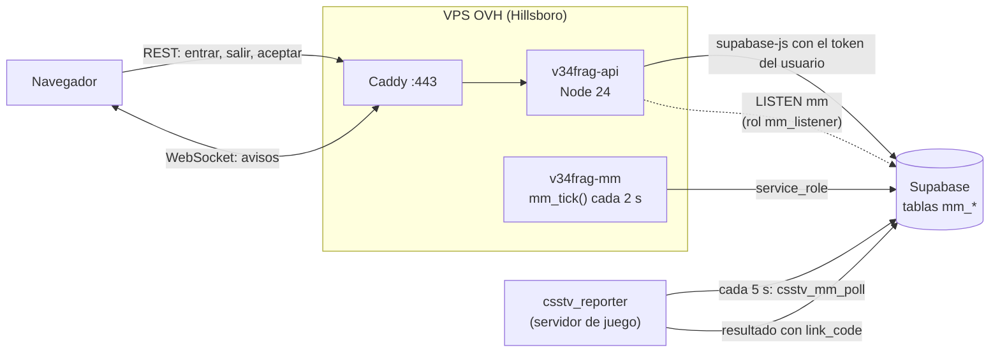
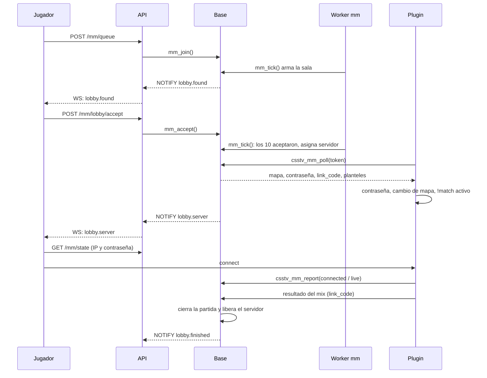
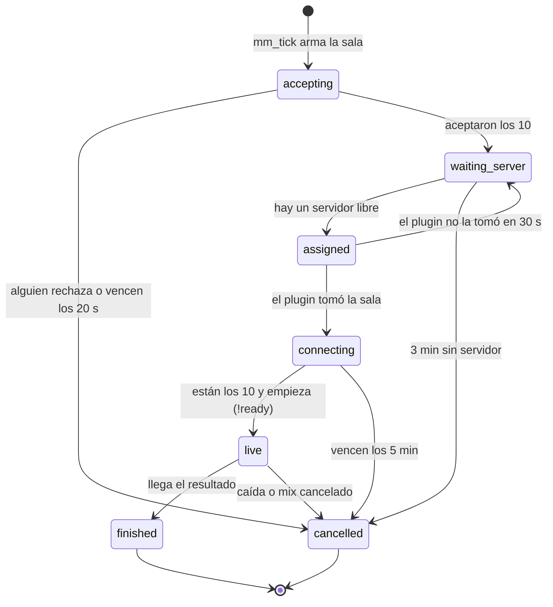

# Plan: matchmaking con cola en la web y servidor automático

> Planeación original. Estado: **propuesta**, pendiente de aprobación.

El matchmaking viejo (`feat/matchmaking-5v5`) se borró en el replanteo (`03_matchmaking.sql`) porque era inestable, y Daniel decidió que, si se volvía a hacer, fuera desde cero y con su propio plan (ver la guía del [replanteo](../2026-10-14-replanteo-modelo-datos/GUIA_IMPLEMENTACION.md), sección "Matchmaking: se borra en vez de coordinar"). Este es ese plan.

Se apoya en lo que ya existe en las ramas `feat/backend-api-fase-1` y `feat/frontend-fase-1`:

- La API en Hono.
- El replanteo `01` a `30`.
- El `!match` del plugin, que fija los planteles, obliga a cada jugador a su lado y vincula el resultado con una partida de la web.
- La licencia y el token de cada servidor.
- El plan de despliegue en el VPS de OVH ([`2026-10-16-despliegue-vps`](../2026-10-16-despliegue-vps/PLAN.md)).

Este plan se escribió en `kyan/pruebas`, que todavía no tiene esas ramas.

## Análisis previo: WebSockets o polling

Antes de este plan se revisó si el VPS alcanza para WebSockets.

- **Capacidad:** sobra. Son 2 vCPU y 4 GB de RAM, y una conexión WebSocket sin actividad ocupa unos KB en Node. Miles de conexiones abiertas entran sin problema; la comunidad va a tener, como mucho, unos cientos a la vez.
- **Caddy:** su `reverse_proxy` ya deja pasar WebSockets.
- **El límite no es el hardware, es la arquitectura:**
  1. La API no se entera de los cambios que hacen otros: el plugin, los admins y las funciones de la base.
  2. Cada despliegue reinicia el único proceso y corta todas las conexiones.
  3. Los WebSockets en Workers necesitan Durable Objects.
- **Por qué no alcanza el polling:** la confirmación de partida dura unos 20 segundos. Con un polling cada 8 s, el aviso puede llegar cuando ya pasó casi la mitad del tiempo. Bajar a 2 s multiplica el tráfico contra Supabase.

Este plan resuelve esos tres puntos.

## Decisiones tomadas

| Tema | Decisión | Por qué |
|---|---|---|
| Alcance de la primera versión | **Cola individual 5v5.** El tamaño de equipo es un parámetro (`mm_config.players_per_team`), pero solo se habilita 5v5. Sin grupos (*parties*) | Lo que se juega en el servidor es 5v5. Los grupos complican el balance y se dejan para una segunda etapa |
| Dónde vive el estado | **En Postgres (Supabase)**: la cola, las salas, las confirmaciones y las sanciones. La API y el worker no guardan nada que se pierda al reiniciar | Un reinicio por despliegue o una caída no pierde la cola. El VPS sigue sin estado, como pide el plan del VPS |
| Quién arma las partidas | Una función de la base, `mm_tick()`. La llama **cada 2 s** un proceso aparte, `v34frag-mm.service` (Node, con la `service_role` en su propio `mm.env`). Un *advisory lock* impide que corran dos a la vez | Mismo esquema que el cierre de temporadas (`season.env` separado de `api.env`): la API sigue sin la clave de servicio. Un proceso que corre todo el tiempo responde en 2 s; un timer de systemd no baja de 1 minuto sin trucos |
| Aviso a los navegadores | **WebSocket** en la API (`@hono/node-ws`), solo en Node | Decisión tomada en el análisis previo. Deja la puerta abierta a un chat o un veto en la sala más adelante |
| De dónde salen los eventos | **Postgres `LISTEN/NOTIFY`.** Los triggers de las tablas `mm_*` hacen `pg_notify('mm', …)` y la API escucha con una conexión directa, con un rol `mm_listener` sin permisos sobre las tablas | Avisa de cualquier cambio, venga de la API, del worker, del plugin o de un admin. No suma servicios ni depende de los límites de Supabase Realtime |
| Qué lleva un evento | **Solo el tipo y los ids** (sala y cuentas afectadas), nunca datos. El navegador vuelve a pedir el estado por REST | El WebSocket no tiene estado propio. Si se corta, el polling de respaldo hace lo mismo. La contraseña del servidor nunca viaja en un `NOTIFY` |
| Acciones del jugador | **Por REST** (`/api/v1/mm/...`): entrar, salir, aceptar y rechazar | Ya tienen validación, OpenAPI, límite de intentos y pruebas. El WebSocket solo avisa |
| Respaldo sin WebSocket | Si el socket no conecta o se cae, el frontend pasa a **polling cada 5 s** sobre `GET /api/v1/mm/state` mientras está en cola o en una sala, y vuelve al socket cuando reconecta | Redes que cortan WebSockets, reinicios y caídas de la API |
| Autenticación del socket | El navegador abre `wss://api.tudominio/api/v1/mm/ws` y manda el JWT de Supabase **en el primer mensaje**, no en la URL. Sin `auth` válido en 5 s, se cierra | Los tokens no quedan en los logs de Caddy. La API ya valida el JWT en los pedidos REST |
| Workers | La ruta del socket existe solo en `src/node.ts`. En Workers, `/api/v1/mm/ws` responde 501 y el frontend usa el polling | El despliegue decidido es el VPS. No vale la pena sumar Durable Objects |
| Confirmación de partida | **20 s** para aceptar (`mm_config.accept_seconds`). Si alguien no acepta, la sala se cancela: los que aceptaron vuelven a la cola **con su lugar original** y los que no, salen con sanción | Como en FACEIT. Evita servidores esperando a jugadores ausentes |
| Balance de equipos | Se elige a los 10 que más esperaron y entran en la ventana de ELO. Se prueban todas las divisiones 5 contra 5 (126 combinaciones) y se queda la de menor diferencia de ELO promedio | Con 10 jugadores probar todas las combinaciones es instantáneo y da el mejor resultado posible |
| Ventana de ELO | Empieza en ±150 y se abre 50 cada 30 s hasta ±600; después de 5 minutos, sin límite (valores en `mm_config`) | Partidas parejas cuando hay gente, y que nadie espere para siempre cuando hay poca |
| ELO | **El mismo ELO de los mixes** (uno por ficha, con `elo_key`). La partida del servidor entra como cualquier mix y la vincula el `!match` | No hay un ELO aparte que mantener. El ranking y las temporadas ya lo usan |
| Partida en la web | Una fila de `matches` con `kind = 'mm'`, `lineup1`, `lineup2` y `link_code`. El juego del servidor se vincula con el mismo mecanismo del `!match` (`csstv_link_game`) | Reusa el cierre, el marcador, la página de partida, las notificaciones y las estadísticas |
| Mapa | Al azar entre los mapas con la marca `mixes` de `map_pool` (replanteo `30`), sin repetir el último que jugó cada uno de los 10 si se puede | Simple. El veto en la sala es de la segunda etapa |
| Servidores | Los que tienen `game_servers.mm_enabled`, licencia vigente (`game_servers_public`) y están en línea, sin un mix en vivo ni otra sala asignada. Se elige el que hace más tiempo que no se usa | Hoy son dos (el nuestro y RBK). La lista se maneja desde el admin |
| Servidor de juego | **Sigue con polling** (cada 5 s, solo mientras está libre o esperando). El código va en **`csstv_reporter`** como un módulo nuevo (`csstv/mm.inc`), no en un plugin aparte | El reporter ya tiene el token, el HTTP, la cola de envíos, la licencia y el `!match`. SourceMod no maneja bien WebSockets y no hay RCON. 5 s no se notan para cargar un mapa |
| Contraseña del servidor | Una nueva por sala (6 caracteres sin los que se confunden, como `!rpw`). La ven solo los 10 de la sala por REST, y el plugin la pone y la saca | Que no entre nadie más. Convive con `csstv_password`: mientras haya una sala asignada, `!pw` no la cambia |
| Si no se conectan | **5 minutos** para que estén los 10 (`mm_config.connect_minutes`). Si no, el plugin avisa, la sala se cancela, los que faltan se sancionan y el servidor queda libre | No dejar el servidor bloqueado |
| Sanciones | Escalonadas por cuenta: 5 min, 15 min, 1 h y 24 h; el contador baja uno cada 7 días sin faltas | Desalienta aceptar y no venir, sin castigar de más un corte de luz |
| Quién puede jugar | Cuenta con ficha vinculada, SteamID principal y correo confirmado; sin sanción vigente; sin otra sala ni un mix en vivo; y no baneado si ya existe la lista de baneos (plan [`2026-10-25-baneos-web`](../2026-10-25-baneos-web/), sin aprobar) | Que el servidor reconozca a cada uno por su SteamID |
| Avisos fuera de la pestaña | Sonido y notificación del navegador (`Notification`, con permiso) cuando se encuentra la partida | Que no se pierda la confirmación con la pestaña en segundo plano |

## 1. El flujo completo





1. El jugador entra a la cola por REST.
2. Cada 2 s, el worker corre `mm_tick()`: arma salas, vence confirmaciones, asigna servidores y vence las conexiones.
3. Cada cambio en `mm_*` emite un `NOTIFY`. La API lo recibe y avisa por el socket a las cuentas afectadas. El navegador vuelve a pedir el estado.
4. El plugin de un servidor libre consulta cada 5 s. Cuando tiene una sala, prepara el servidor y activa el `!match` con los planteles. Desde ahí todo sigue como un mix vinculado.
5. Cuando llega el resultado del mix con el `link_code`, la base cierra la partida `mm`, la sala y libera el servidor.

## 2. Estados de una sala



- Cuando una sala se cancela en `accepting`, los que aceptaron vuelven a la cola con su `joined_at` original. Con más tarde, nadie vuelve solo: se avisa y cada uno decide si entra de nuevo.
- Un servidor de `assigned` que no toma la sala en 30 s queda marcado como no disponible por 10 minutos, y la sala vuelve a `waiting_server` para buscar otro.
- `live → cancelled` sigue el flujo de caídas que ya existe (`match_crashes`): el admin decide si da ELO, como en cualquier mix.

## 3. Base de datos: `supabase/replanteo/31_matchmaking.sql`

Va en el replanteo porque necesita `kind`, `lineup1`/`lineup2`, `link_code`, `map_pool.mixes` y `game_servers_public` del replanteo. **Sale con el corte o después**, nunca antes. Sigue el formato del replanteo: una transacción, verifica el estado de la base antes de empezar y tiene su inversa en `reversas/` y sus pruebas en `pruebas/`.

### Tablas

| Tabla | Columnas principales | Notas |
|---|---|---|
| `mm_config` | `open`, `players_per_team` (5), `accept_seconds` (20), `connect_minutes` (5), `elo_window_start` (150), `elo_window_step` (50), `elo_window_every_s` (30), `elo_window_max` (600), `elo_unlimited_after_s` (300), `server_wait_minutes` (3), `penalty_ladder` (`{5,15,60,1440}` minutos) | Una sola fila. La cambia un admin con `mm_set_config` |
| `mm_queue` | `user_id` (PK), `player_id`, `elo` (foto al entrar), `joined_at` | Una fila por cuenta en cola |
| `mm_lobbies` | `id`, `status`, `match_id`, `server_id`, `map`, `password`, `accept_deadline`, `connect_deadline`, `created_at`, `ended_at`, `end_reason` | `password` no se lee con RLS: solo la devuelve `mm_my_state()` a los de la sala |
| `mm_lobby_players` | `lobby_id`, `user_id`, `player_id`, `team` (1 o 2), `elo`, `joined_at`, `accepted_at`, `declined_at`, `connected_at` | |
| `mm_penalties` | `user_id`, `level`, `until`, `last_offense_at` | El nivel baja uno cada 7 días sin faltas |
| `mm_server_state` | `server_id`, `last_poll_at`, `unavailable_until`, `plugin_version` | El "en línea" del matchmaking sale de `last_poll_at` (menos de 30 s) |

Cambios en tablas que ya existen:

- `matches.kind` suma `'mm'` (check).
- `game_servers.mm_enabled boolean not null default false`, también en `admin_server_list`.

### Funciones

| Función | Quién la llama | Qué hace |
|---|---|---|
| `mm_join()` | API (usuario) | Valida los requisitos de la sección de decisiones y lo pone en `mm_queue` |
| `mm_leave()` | API (usuario) | Lo saca de la cola. En `accepting` cuenta como rechazo |
| `mm_accept()` / `mm_decline()` | API (usuario) | Marca la confirmación de la sala |
| `mm_my_state()` | API (usuario) | Estado de la cuenta: cola (posición, espera y ventana actual), sala (jugadores, confirmaciones, plazo, servidor, mapa y, desde `assigned`, IP y contraseña) y sanción vigente |
| `mm_queue_summary()` | API (público) | Cuántos hay en cola y si está abierta, para la portada |
| `mm_tick()` | Worker (`service_role`) | Con `pg_try_advisory_xact_lock`: arma salas, vence confirmaciones, asigna servidores, devuelve salas de servidores que no respondieron, vence conexiones y cierra salas en `waiting_server` |
| `csstv_mm_poll(p_token)` | Plugin | Valida el token con `csstv_auth`, registra `last_poll_at` y devuelve la sala asignada en texto `clave=valor` (como `csstv_match_lookup`): id, mapa, contraseña, `link_code`, planteles en `STEAM_0:X:Y`, nombres de los bandos y plazo |
| `csstv_mm_report(p_token, p_lobby, p_event, p_data)` | Plugin | `taken`, `connected` (SteamID), `live` y `abort` (con los SteamID que faltan) |
| `mm_admin_cancel(p_lobby, p_reason)` | API (admin) | Cancela una sala trabada y libera el servidor |
| `mm_set_config(...)`, `mm_set_open(p_open)` | API (admin) | Configuración y apertura de la cola |

La partida `mm` se cierra con un cambio chico en la ingesta del resultado: si el juego se vinculó a una partida `kind = 'mm'`, se cierra la sala (`finished`). Lo demás ya lo hace `csstv_link_game`.

### Eventos (`pg_notify('mm', json)`)

Triggers `after insert or update` en `mm_queue`, `mm_lobbies` y `mm_lobby_players`, y `after update` de `mm_config`. El contenido es siempre `{"t": tipo, "lobby": id, "users": [uuid…]}` y queda lejos del límite de 8000 bytes de `NOTIFY`.

| Tipo | Cuándo | A quién |
|---|---|---|
| `queue.changed` | Alguien entra o sale | A todos los conectados (solo el contador; `users` vacío = todos) |
| `lobby.found` | Se arma una sala | A los 10 |
| `lobby.accept` | Alguien acepta | A los 10 |
| `lobby.server` | Hay servidor asignado | A los 10 |
| `lobby.update` | Cambia `connected_at` o el estado (`live`) | A los 10 |
| `lobby.cancelled` / `lobby.finished` | La sala termina | A los 10 |
| `mm.config` | Se abre o se cierra la cola | A todos |

### Rol `mm_listener`

```sql
create role mm_listener login password '…' noinherit;
-- Sin grants sobre ningún esquema: solo puede conectarse y hacer LISTEN.
```

La contraseña vive en el `api.env` del VPS (`MM_LISTEN_URL`). Si se filtra, solo deja escuchar ids.

## 4. Worker: `v34frag-mm.service`

- `scripts/mm-worker.mts`, compilado con esbuild a `dist/mm-worker.mjs`, como `season-tick`.
- Corre todo el tiempo: llama `mm_tick()` cada 2 s con `supabase-js` y la `service_role`. Si una llamada falla, espera de forma progresiva (de 2 s hasta 30 s) y lo anota en `journald`.
- `mm.env`: `SUPABASE_URL` y `SUPABASE_SERVICE_KEY`, con permisos 600 y dueño `v34frag`.
- systemd: `Restart=always`, el mismo endurecimiento que la API y `User=v34frag`.
- Con la cola cerrada y sin salas abiertas, `mm_tick()` sale enseguida. Son unas 43 000 llamadas por día, una consulta corta cada una.

## 5. API (`web/backend`)

### Rutas REST (Node y Workers)

| Ruta | Qué hace |
|---|---|
| `GET /api/v1/mm/summary` | Público: cola abierta y cuántos hay |
| `GET /api/v1/mm/state` | `mm_my_state()`. También es la ruta del polling de respaldo |
| `POST /api/v1/mm/queue` | `mm_join()`. Límite: 10 por minuto por cuenta |
| `DELETE /api/v1/mm/queue` | `mm_leave()` |
| `POST /api/v1/mm/lobby/accept` y `/decline` | `mm_accept()` y `mm_decline()` |
| `GET /api/v1/admin/mm`, `PATCH /api/v1/admin/mm/config`, `POST /api/v1/admin/mm/lobbies/{id}/cancel` | Admin: salas activas, configuración, apertura y cancelación |

Todas con el esquema de OpenAPI, los errores y las pruebas de siempre.

### Socket (`src/mm/socket.ts`, solo en `src/node.ts`)

- `@hono/node-ws` en `/api/v1/mm/ws`.
- Protocolo:
  - El cliente manda `{"t":"auth","token":"<jwt>"}` y recibe `{"t":"ready"}`.
  - Después solo recibe eventos `{"t":"lobby.found","lobby":"…"}`.
  - `ping`/`pong` de WebSocket cada 25 s. Si no responde, se cierra.
- Se valida el JWT con la misma función que usan las rutas REST. El token vence: el cliente manda un `auth` nuevo cuando Supabase lo renueva, y si no lo hace, la API cierra con el código `4001`.
- En memoria: `Map<userId, Set<WebSocket>>`, que es solo el índice de quién está conectado. Si se pierde, no se pierde nada.
- `src/mm/listener.ts`: una conexión `postgres` (paquete nuevo, `postgres` de porsager) con `MM_LISTEN_URL`. Hace `LISTEN mm` y reconecta sola. Si se reconecta, manda `{"t":"resync"}` a todos, porque pudo perderse algún evento.
- Topes: 5 sockets por cuenta, 2000 en total y mensajes del cliente de hasta 4 KB.
- Al recibir `SIGTERM` (despliegue), cierra todos los sockets con el código `1012` (*service restart*). El cliente reconecta con espera aleatoria de 1 a 5 s para que no vuelvan todos juntos.

### Cambios del despliegue que suma este plan

| Dónde | Cambio |
|---|---|
| `Caddyfile` (`api.tudominio`) | `reverse_proxy` con `stream_close_delay 5m`, para que un `caddy reload` no corte los sockets |
| `v34frag-api.service` | `LimitNOFILE=65535` (el límite de 1024 no alcanza con miles de sockets) |
| `api.env` | `MM_LISTEN_URL` (conexión directa a Postgres con `mm_listener`) |
| `deploy/vps/` | `v34frag-mm.service` y `mm.env.example`. `preparar.sh` y `desplegar.sh` los instalan y reinician |
| Pipeline | El build compila también `mm-worker.mjs`. El chequeo después del despliegue suma que el socket responda `ready` con un token de prueba |
| `/api/health` | Suma `mm: { listener: "ok" \| "down", sockets: n }` |

**Conexión a Postgres para `LISTEN`:** necesita una conexión que dure, con estado de sesión. El *transaction pooler* (puerto 6543) no sirve. Se prueban, en este orden:
1. La conexión directa (`db.<ref>.supabase.co:5432`), que es solo IPv6. El VPS de OVH tiene IPv6.
2. El *session pooler* (puerto 5432 del pooler).

Lo primero que se hace en la implementación es verificar que funcione desde el VPS (o desde staging).

## 6. Plugin: `csstv_reporter` con `csstv/mm.inc`

- Cvars:
  - `csstv_mm` (0/1, apagado por defecto).
  - `csstv_mm_poll` (5 s).
  - `csstv_mm_idle_password`: la contraseña cuando el servidor está libre. Vacía significa que no la toca.
- **Libre:** cada 5 s llama a `csstv_mm_poll`, solo si no hay un mix ni un `!match` en curso.
- **Al tomar una sala:**
  1. Avisa `taken`.
  2. Guarda la sala en `data/csstv/mm.txt`, para que la retome si se recarga el mapa.
  3. Pone la contraseña.
  4. Activa el `!match` con los planteles y nombres que devolvió el poll, sin que nadie escriba el código (`Link_Active` directo, con `g_iLinkMaxStandins = 0`).
  5. Cambia al mapa.
- **Conectando:**
  - Al entrar cada jugador del plantel, avisa `connected`.
  - Al que no es del plantel lo pasa a espectador; no lo expulsa, para que el admin pueda mirar.
  - El inicio es el de siempre (`!ready` con ronda de cuchillo).
  - Si vencen los 5 minutos, avisa `abort` con los que faltan, desvincula y vuelve a libre.
- **En vivo y al terminar:** no cambia nada. El resultado sale con `link_code` como cualquier `!match`. Después del resultado borra `mm.txt`, vuelve a `csstv_mm_idle_password` y vuelve a libre.
- **Si se recarga con una sala tomada:** la retoma de `mm.txt`. Si la sala ya no está activa (`csstv_mm_poll` no la devuelve), la borra.
- **`csstv_password`:** mientras haya una sala, `!pw`, `!npw` y `!rpw` responden "el servidor está en matchmaking". El reporter lo publica con una cvar de solo lectura (`csstv_mm_active`) que el otro plugin lee.
- **Despliegue (regla del `CLAUDE.md`):** la versión nueva va **al servidor real y a RBK en la misma tanda**: el `.smx` genérico al nuestro y el build licenciado (`server/build_licenciado.sh`) a RBK. En RBK queda `csstv_mm 0` hasta que Daniel decida si entra al grupo de servidores del matchmaking.
- Se carga en el próximo cambio de mapa. No se recarga con una partida en curso.

## 7. Frontend (`web/frontend`)

- Ruta nueva **`/play`** (Jugar) en el menú principal, con:
  - El estado de la cola: en cola, el tiempo de espera, la ventana de ELO y cuántos hay.
  - El botón para entrar o salir.
  - La sanción vigente, si hay.
- **Sala:**
  - Diálogo de confirmación con la cuenta regresiva, los 10 jugadores y quién ya aceptó.
  - Después, los equipos con su ELO, el mapa y el servidor: IP con `steam://connect/IP/contraseña`, copiar `connect` y copiar la contraseña.
  - Quién ya se conectó y el plazo.
- **`features/matchmaking/useMmSocket.ts`:**
  - Abre el socket con la sesión y hace el `auth`.
  - Cada evento invalida la consulta `['mm','state']` de TanStack Query, que se vuelve a pedir por REST.
  - Si el socket no conecta, `refetchInterval: 5000` mientras está en cola o en sala, y nada fuera de eso.
  - Reconecta con espera progresiva y aleatoria.
- **Aviso de partida encontrada:** sonido y `Notification` del navegador. El permiso se pide al entrar a la cola por primera vez.
- **Admin → Matchmaking:** abrir y cerrar la cola, la configuración, las salas activas con cancelación y `mm_enabled` en la ficha de cada servidor.
- La página de la partida (`/match/$id`) muestra las `mm` como "Matchmaking".
- Notificaciones de la web (replanteo `28`): `lobby.cancelled` por falta de otro jugador y la sanción propia generan una notificación de la categoría `mm`.

## 8. Pruebas

| Qué | Cómo |
|---|---|
| Base | `pruebas/31_matchmaking.sql` en PostgreSQL local con el replanteo: armado y balance con 10, 11 y 23 jugadores; ventana de ELO con el tiempo; rechazo y vencimiento, con el lugar original para los que aceptaron; sanciones y su baja; asignación de servidor y servidor que no responde; `abort`; cierre por resultado vinculado; dos `mm_tick()` a la vez; la RLS de la contraseña |
| API | Unitarias de rutas y del socket (`auth`, vencimiento del token, topes, cierre `1012`). De integración con la Supabase local en Docker: `LISTEN/NOTIFY` de punta a punta (entrar, armar, aceptar, eventos recibidos) |
| Carga | Script con 2000 sockets autenticados contra staging, más 200 entradas y salidas de la cola por minuto: memoria y CPU del proceso, tiempo del evento hasta el navegador. **Objetivo: menos de 1 s del `mm_tick()` al socket** |
| Plugin | Servidor local con la build de depuración, **apuntado a la Supabase local** (no a la real), con bots y `csstv_debug_fakecmd`: tomar la sala, cambio de mapa, `!match` automático, espectador para el que no es del plantel, `abort` por tiempo, recarga con la sala tomada y resultado vinculado |
| Frontend | Vitest de los componentes y de `useMmSocket` con un socket falso. Playwright con dos navegadores: entrar, confirmar y ver la sala |
| Real | Una partida de prueba con 10 personas en el servidor real, con la cola abierta solo para admins (`mm_config.open` y una lista de cuentas de prueba) |

## 9. Requisitos antes de empezar

- **Haber hecho el corte** (replanteo en producción, API y frontend nuevos en el VPS) o, al menos, tener staging con el replanteo para probar.
- El VPS de OVH contratado y preparado (plan `2026-10-16-despliegue-vps`).
- Acceso para crear el rol `mm_listener` en Supabase (SQL Editor o `psql` con el usuario `postgres`).
- Dependencias nuevas en `web/backend`: `@hono/node-ws` y `postgres`. Se agregan con `pnpm add` (respetando la antigüedad mínima de 7 días). `postgres` no corre scripts de instalación, así que no hace falta tocar `allowBuilds`.
- La `service_role` para `mm.env`, la misma que ya usa `season.env`.
- 10 cuentas reales para la prueba final.

## 10. Preguntas para Daniel

1. ¿RBK entra en el grupo de servidores del matchmaking o queda solo el nuestro? El plugin va a los dos igual (regla de despliegue); lo que cambia es `mm_enabled` y `csstv_mm`.
2. ¿Las partidas de matchmaking dan el mismo ELO que un mix, o se pondera distinto?
3. ¿Los tiempos (20 s, 5 min) y la escala de sanciones están bien?
4. ¿Mapa al azar en la primera versión, o se quiere veto en la sala desde el principio?
5. ¿Grupos (*parties*) en la segunda etapa o no se planean?

## 11. Orden de implementación

1. Verificar `LISTEN` desde el VPS o desde staging (conexión directa por IPv6 o *session pooler*) con un rol sin permisos.
2. `31_matchmaking.sql` con su inversa y `pruebas/31_matchmaking.sql`, en local.
3. API: rutas REST y pruebas.
4. Worker `mm-worker.mts` y su service.
5. Socket y listener en `src/node.ts`, con sus pruebas de integración.
6. Frontend: `/play`, la sala, `useMmSocket` con el respaldo y el admin.
7. Plugin: `csstv/mm.inc`, la versión nueva del reporter y el ajuste de `csstv_password`. Pruebas con bots contra la Supabase local.
8. `deploy/vps/`: Caddy, `LimitNOFILE`, `v34frag-mm.service`, `mm.env.example` y el pipeline.
9. Prueba de carga en staging.
10. Despliegue: migración, API, worker y frontend. El plugin va **al servidor real y a RBK en la misma tanda**, con `csstv_mm 0` en los dos.
11. Prueba con 10 personas con la cola abierta solo para las cuentas de prueba. Después, `csstv_mm 1` en los servidores elegidos y la cola abierta para todos.
12. `DOCUMENTACION.md`, `GUIA_IMPLEMENTACION.md`, `CHANGELOG_DISCORD.txt` y `docs/PENDIENTES.md`.
