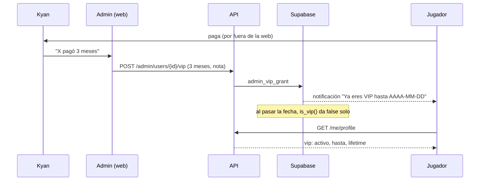
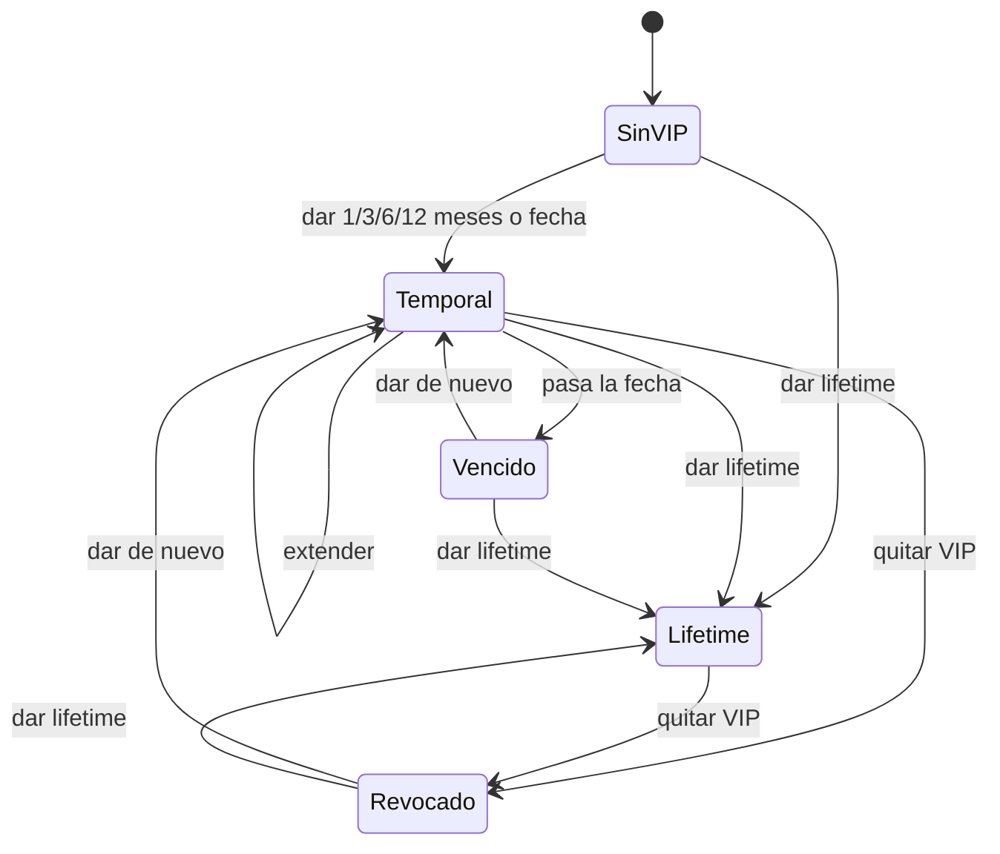

# Plan: VIP, fase 0 (membresías)

> Planeación original. Estado: **aprobado** por Daniel el 2026-10-28 (Kyan es admin: da el VIP él mismo).

Kyan empezó a ofrecer VIP en la comunidad, con una lista de beneficios para la web, el juego y Discord. Antes de cualquier beneficio hace falta saber **quién es VIP y hasta cuándo**. Esta fase arma solo eso: las membresías en la base, la forma de darlas y quitarlas desde el admin, y el dato `vip` en la API para que las fases siguientes lo usen.

Los beneficios (insignia, banner, chat VIP, rol de Discord…) quedan para las fases 1 a 4, que se planean aparte cuando Kyan aclare las dudas de su lista.

## Decisiones tomadas

| Tema | Decisión | Por qué / quién |
|---|---|---|
| Alcance de la fase 0 | Base (replanteo `32`), API y la pantalla de admin. Sin beneficios todavía | Daniel, 2026-10-28 |
| Cobro | **Manual:** Kyan cobra por fuera y un admin da el VIP desde la web. Sin pasarela de pago | Lo más simple para arrancar; la pasarela se piensa en la fase 4 si hace falta |
| Vencimiento | Cada VIP tiene fecha de fin. **Sin fecha = lifetime** | Daniel, 2026-10-28: algunos VIP son lifetime |
| Vencimiento automático | El VIP se apaga solo al pasar la fecha: `is_vip()` compara con `now()`, sin tarea programada | Nadie tiene que acordarse de quitarlo |
| A quién se le da | A la **cuenta** de la web (`profiles`), no a la ficha | Los beneficios de la web son de la cuenta. Para el juego se llega a los SteamID por la ficha de la cuenta |
| Historial | **Una fila por cada vez que se da** el VIP. No se borra nada: se revoca | Saber desde cuándo es VIP cada uno (medalla de bienvenida, Top VIP del mes) y auditoría |
| Extender | Si el VIP está vigente, el período nuevo **empieza donde termina el actual**; si ya venció, empieza ahora | El que paga antes de tiempo no pierde días |
| Duraciones | 1, 3, 6 o 12 meses, una fecha elegida a mano o lifetime | Cubre los casos de Kyan sin que el admin haga cuentas |
| Lifetime con un VIP temporal | Dar lifetime a quien tiene un temporal está permitido. Dar un temporal a quien ya es lifetime se rechaza | El temporal no le suma nada |
| Quitar el VIP | "Quitar VIP" revoca **todos** los períodos vigentes o futuros de la cuenta, incluido un lifetime, con motivo obligatorio | Un solo botón; por ejemplo, para un jugador baneado |
| Quién lo da y lo quita | Solo **admins** (`is_admin()`), con las reglas en la base | Hay plata de por medio. Si Kyan tiene que darlo él, ver el punto 6 |
| Visibilidad | Que alguien es VIP es **público** (`vip: true/false`). Las fechas y las notas, solo el dueño y los admins | La insignia de la fase 1 es pública; lo que pagó cada uno, no |
| Avisos | Notificación en la web al dar y al quitar el VIP (categoría `account`). El aviso de "tu VIP vence en 3 días" queda para cuando exista la tarea programada de las notificaciones | La segunda etapa de las notificaciones (tareas programadas) todavía no existe |
| Plugin | No se toca en esta fase. La función con la lista de SteamID VIP se hace en la fase 3, junto con el chat VIP | Orden de trabajo: web primero, plugins al final |
| Descartado: columna `vip_until` en `profiles` | No | Pierde el historial y no distingue "lifetime" de "nunca fue VIP" sin un segundo campo |
| Descartado: rol `vip` en `profiles.role` | No | Un VIP puede ser admin, moderador u organizador a la vez, y el rol no tiene vencimiento |

## 1. El flujo completo

### Estados de un VIP

## 2. Base de datos (replanteo `32`)

Va después de la `31` (baneos), que está en la rama `feat/backend-api-fase-1`.

### Tabla `vip_memberships`

| Columna | Qué guarda |
|---|---|
| `id` | uuid |
| `user_id` | La cuenta (`profiles.id`) |
| `starts_at` | Desde cuándo vale el período (puede ser futuro si es una extensión) |
| `ends_at` | Hasta cuándo. **null = lifetime**. Si no es null, tiene que ser mayor que `starts_at` |
| `source` | `manual` (desde el admin) o `import` (la carga inicial de los VIP de Kyan) |
| `note` | Texto libre, opcional, con largo máximo ("pagó 3 meses", "lifetime por apoyo inicial") |
| `granted_by` | Admin que lo dio (null en `import`) |
| `created_at` | Fecha en que se cargó |
| `revoked_at`, `revoked_by`, `revoke_reason` | Si se quitó, cuándo, quién y por qué |

Un período está **vigente** si `revoked_at` es null, `starts_at <= now()` y (`ends_at` es null o mayor que `now()`).

### Funciones

| Función | Qué hace |
|---|---|
| `is_vip(p_user uuid default auth.uid())` | `true` si la cuenta tiene un período vigente. `stable`, para usarla en vistas y en las reglas de las fases siguientes |
| `admin_vip_grant(p_user, p_months, p_until, p_lifetime, p_note)` | Da el VIP. Recibe **una sola** de las tres formas (meses, fecha o lifetime). Con meses, calcula el inicio según la regla de extender. Rechaza un temporal si la cuenta ya es lifetime, y una fecha que quede antes del inicio. Solo `is_admin()` |
| `admin_vip_revoke(p_user, p_reason)` | Revoca los períodos vigentes y futuros de la cuenta. Falla si no tiene ninguno. Solo `is_admin()` |

### Vista `vip_status`

Una fila por cuenta que fue VIP alguna vez: `user_id`, `active`, `lifetime` (vigente y sin fin), `until` (el fin más lejano de los períodos no revocados; null si es lifetime o si no está activo), `since` (inicio del primer período, revocado o no) y `last_change`.

### Permisos (RLS)

- `vip_memberships`: cada uno lee sus filas; los admins leen todas. **Nadie escribe directo**: solo con las dos funciones (`security definer`).
- `is_vip()` la puede llamar cualquiera, también sin sesión, para que el flag público salga en las vistas de jugadores y de ranking.

### Notificaciones

Dos tipos nuevos en la categoría `account` de `notification_category()`: `vip_granted` (con el fin o "lifetime") y `vip_revoked` (con el motivo). Los dispara un trigger sobre `vip_memberships`, igual que los demás de la `28`. La carga inicial (`import`) no notifica.

## 3. API

| Endpoint | Quién | Qué |
|---|---|---|
| `GET /api/v1/admin/vips` | Admin | Lista paginada desde `vip_status`, con el alias y la foto. Filtros: `status` (`active`, `lifetime`, `expired`, `revoked`), `q` (alias) y `expiring` (vencen en los próximos N días). `sort`: **`until` asc** (también `since`, `alias`) |
| `GET /api/v1/admin/users/{id}/vip` | Admin | Historial de períodos de la cuenta, con quién lo dio, la nota y la revocación |
| `POST /api/v1/admin/users/{id}/vip` | Admin | Dar o extender. Body: `months` (1, 3, 6 o 12) **o** `until` (ISO 8601) **o** `lifetime: true`, y `note`. Responde el estado nuevo |
| `POST /api/v1/admin/users/{id}/vip/revoke` | Admin | Quitar el VIP. Body: `reason` (obligatorio) |

Lo que cambia en los endpoints que ya existen:

- `GET /api/v1/me/profile` suma `vip`: `{ active, lifetime, until, since }`, o `null` si nunca fue VIP.
- `GET /api/v1/players/{id}`, `GET /api/v1/ranking/players`, `GET /api/v1/players/compare` y la lista de jugadores suman `vip: boolean` en el jugador (`false` para una ficha sin cuenta). No traen fechas.
- `GET /api/v1/admin/users` suma `vip` con el mismo objeto que `/me/profile`, para el botón de la pantalla de usuarios.
- Errores: dar con más de una forma o con ninguna da `400`; un temporal a un lifetime o una fecha pasada, `BUSINESS_RULE`; quitar sin VIP vigente, `BUSINESS_RULE`; cuenta que no existe, `404`.

El contrato del frontend se actualiza en `admin.md`, `cuenta.md` y `jugadores.md`, con una fila en las novedades del índice y las decisiones en `decisiones.md`.

## 4. Frontend

- **Administración › VIP:** la lista con sus filtros y una marca en los que vencen en los próximos 7 días (para que Kyan sepa a quién cobrarle). Acciones: "Dar VIP", "Extender" y "Quitar VIP".
- **Formulario "Dar VIP":** buscar la cuenta, elegir 1, 3, 6 o 12 meses, "Hasta una fecha" o "Lifetime", y una nota. Muestra cómo queda ("VIP hasta el AAAA-MM-DD"). Si ya es lifetime, no ofrece las duraciones.
- **Administración › Usuarios:** el estado VIP en cada fila y los mismos botones.
- **Mi perfil:** "VIP hasta el AAAA-MM-DD" o "VIP lifetime" en la sección de la cuenta. Nada más: la insignia y los demás beneficios son de la fase 1.

## 5. Carga inicial de los VIP actuales

Kyan pasa la lista de los VIP que ya tiene: alias o cuenta, si es lifetime y, si no, hasta cuándo. Se carga una sola vez con un SQL en `pruebas/` (`source = 'import'`, sin notificar), en el corte. Si alguien de la lista no tiene cuenta, se anota y se carga cuando la cree.

## 6. Requisitos antes de empezar

- Aprobación de este plan.
- **Quién da el VIP:** el plan dice solo admins. Si tiene que hacerlo Kyan y Kyan no es admin, hay que decidir si se lo hace admin, si se crea un permiso aparte o si Kyan le pasa los pagos a un admin.
- **La lista de Kyan** para la carga inicial (punto 5). No bloquea la implementación, sí el corte.
- **Corte:** la tabla vive en el replanteo `32`, que se aplica en el corte, después de la `31`.

## 7. Pruebas

- **Base:** pruebas SQL de `is_vip()` (vigente, vencido, futuro, revocado, lifetime), de la regla de extender (vigente y vencido), del rechazo de un temporal a un lifetime y de las fechas inválidas, de la revocación de todos los períodos, de los permisos (un usuario no puede darse VIP ni leer el de otro) y de las notificaciones.
- **API:** unitarias y de integración: los cuatro endpoints, los errores, los filtros y el orden, y `vip` en `/me/profile`, la ficha, el ranking, el comparador y los usuarios del admin.
- **Frontend:** Vitest con MSW: lista, formulario (las tres formas), Extender, Quitar con motivo, Mi perfil con temporal, lifetime y sin VIP.

## 8. Orden de implementación

1. Replanteo `32`: tabla, funciones, vista, permisos, notificaciones, inversa y pruebas SQL.
2. API: endpoints nuevos, `vip` en los que ya existen, esquemas OpenAPI, tipos y pruebas.
3. Contrato del frontend.
4. Frontend: Administración › VIP, botones en Usuarios y el estado en Mi perfil.
5. SQL de la carga inicial con la lista de Kyan.
6. Despliegue en el corte: la `32` después de la `31`, y la carga inicial.
