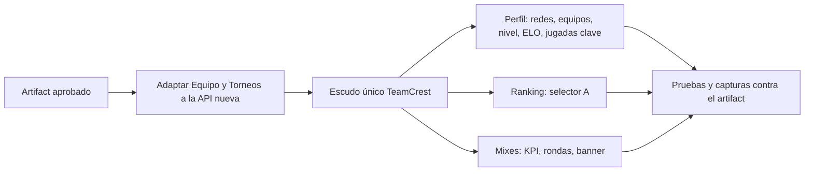

# Plan: ajustes visuales del perfil público, el ranking y los mixes

> Planeación original. Estado: **aprobado** el 2026-10-29 (decisiones de Esteban sobre el artifact, abajo). Pendiente de implementar: va después de adaptar Equipo y Torneos a la API nueva.

Esteban revisó los módulos que implementó Daniel (perfil público, ranking y mixes) y pidió 9 correcciones visuales. Regla suya: toda mejora visual se muestra primero en un artifact y se implementa cuando la aprueba.

- **Artifact con las propuestas:** https://claude.ai/artifact/2LSZ42Yqkxn5E7BBYp2hAo (5 tableros, claro y oscuro).

## Decisiones tomadas

| Tema | Decisión | Por qué |
|---|---|---|
| Perfil · redes | **Aprobado:** Steam, Discord y FACEIT con los íconos de marca de Vinculación (`BrandTile`, Simple Icons). Steam y FACEIT abren el perfil; Discord copia el usuario | Discord no tiene link público |
| Perfil · pestaña Equipos | **Aprobado:** escudo de Mi equipo (`TeamCrest`) y chip de estado: Activo verde (`win`), Suplente gris, Coach `primary`, Ex integrante apagado; "Líder" como chip con corona | Homologar con Mi equipo |
| Escudo único | **Aprobado:** los `TagBox` de ranking, torneos y perfil pasan a `TeamCrest`, en tamaños fijos (24, 32, 44, 56, 104) | Hoy hay tres cuadros distintos |
| Perfil · ELO sin datos | **Aprobado:** gráfico fantasma (curva punteada y área tenue) con "La curva aparece con el segundo mix" | `EloChart` necesita al menos 2 puntos |
| Perfil · Nivel sin datos | **Aprobado:** insignia hexagonal con "?", escala 1-10 en gris, "Sin nivel todavía" y "Ver mixes en vivo" | Ilustración en SVG con tokens (claro y oscuro), sin imágenes |
| Perfil · Jugadas clave | **Opción B** (siluetas de Game Icons) con marca de agua por bloque y calaveras de 2 a 5 en los multi-kills; **la bomba es un C4** | Pedido de Esteban |
| Ícono de C4 | **Propio**, dibujado en SVG (cargas, teclado, pantalla y cables), porque Game Icons no tiene C4 | Sin licencia de terceros; no se usan gráficos de Valve |
| Ranking · Histórico | **Opción A:** control segmentado "Temporada en curso · Anteriores ▾ · Histórico"; mismo `?season=` | Pedido de Esteban |
| Mixes · KPI en vivo | **Aprobado:** con mixes, punto rojo que late, cantidad y "Ver" (filtra En vivo); sin mixes, enchufe desconectado y "Ningún mix en juego" | "El último terminó hace…" solo si la API lo trae |
| Mixes · Rondas | **Opción A:** el número del ganador en verde y negrita, el del perdedor apagado | Pedido de Esteban |
| Mixes · banner de la sala | **Aprobado:** sigla del equipo si el lado es un equipo; si no, iniciales del bando (`crestText`), con el estilo del escudo | Reemplaza "A" y "B" |
| Librería de íconos | **Game Icons** (CC BY 3.0) para lo temático, con crédito en el pie de la web; Lucide para la interfaz | La única con iconografía de juego de uso libre |

## 1. El flujo

## 2. Cambios en el frontend (`web/frontend/src/`)

- **Escudo:** `TeamCrest` se mueve a `components/brand/` (o se exporta desde `features/teams/ui.tsx`) con los cinco tamaños; reemplaza a `TagBox` en `features/ranking/parts.tsx`, `features/events/ui.tsx` y `features/player/tabs.tsx`.
- **Íconos de juego:** `@iconify-json/game-icons` (o los SVG puntuales copiados con su crédito) y el C4 propio en `components/icons/`. Crédito "Íconos de juego: game-icons.net (CC BY 3.0)" en el pie.
- **Ilustraciones:** `components/illustrations/` con `NoLevel` y `GhostChart`, reutilizables para otros estados vacíos.
- **Perfil:** `player/PlayerProfile.tsx` (`SocialLink`, `LevelCard`, `EloCard`), `player/EloChart.tsx`, `player/KeyPlays.tsx`, `player/tabs.tsx` (`Teams`).
- **Ranking:** `ranking/SeasonBar.tsx`.
- **Mixes:** `mixes/MixesList.tsx` (`MixKpis`, `MixRow`) y `mixes/MixRoom.tsx` (`SideTag`).

## 3. Requisitos antes de empezar

- Equipo y Torneos adaptados a la API nueva (commit `9b4eefa` del backend), así el typecheck queda limpio antes de tocar el resto.
- Avisar antes de sumar `@iconify-json/game-icons` (pnpm, antigüedad mínima de 7 días).

## 4. Pruebas

- Unitarias de Daniel que tocan esos componentes (`PlayerProfile.test.tsx`, `KeyPlays.test.tsx`, `Ranking.test.tsx`, `MixesList.test.tsx`, `MixRoom.test.tsx`), más las de los estados nuevos.
- e2e: redes con su ícono, pestaña Equipos, selector de ranking (Histórico y vuelta), KPI en vivo con y sin mixes simulados.
- Capturas en claro y oscuro, de 320 a 1440px, comparadas con el artifact.

## 5. Orden de implementación

1. Escudo único.
2. Íconos (Game Icons y C4) e ilustraciones.
3. Perfil.
4. Ranking.
5. Mixes.
6. Pruebas, capturas, `DOCUMENTACION.md`, `GUIA_IMPLEMENTACION.md` y la fila del `README.md`.
