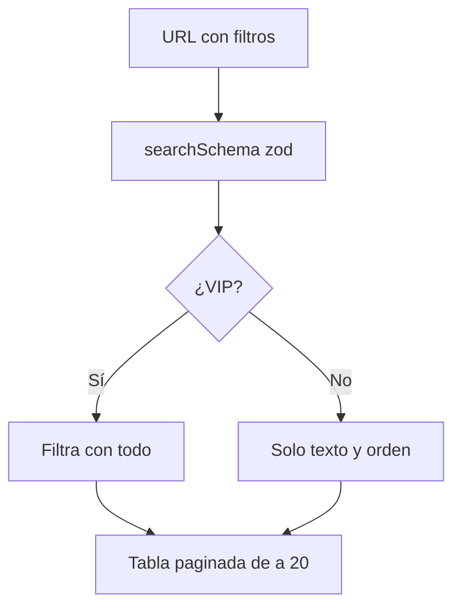

# Buscador y filtros avanzados (prototipo VIP)

Prototipo de Kyan para que lo terminen Daniel (backend) y Esteban (frontend). Está en el frontend nuevo (`C:/Users/Agus/Documents/repo-mm-ejemplo`, rama `kyan/ejemplo-matchmaking`), en la ruta `/demo/buscador`, solo con `pnpm dev`.

## Qué hace

Un buscador con dos pestañas, **Jugadores** y **Partidas**.

- **Gratis:** buscar por texto y ordenar.
- **Con VIP:** el panel **Filtros avanzados** y guardar búsquedas.

| Pestaña | Filtros avanzados | Orden |
|---|---|---|
| Jugadores | Nivel (rango), ELO (rango), K/D, rating y HS % mínimos, mixes jugados, activo en los últimos 7/30/90 días, mapa favorito, país, con o sin equipo, solo VIP | ELO, K/D, Rating, Mixes, Última partida |
| Partidas | Con un jugador, contra un jugador (en el otro bando), mapa, tipo (mix, PCW, oficial), desde y hasta, diferencia de rondas máxima, solo con demo, incluir canceladas | Más nuevas, Más parejas, Mejor MVP |

- **Chips:** cada filtro activo aparece como un chip que se saca con un clic. "Limpiar filtros" los saca todos.
- **URL:** todos los filtros van en la URL (por ejemplo `?tab=partidas&with=ruoncs&vs=rory5`), así una búsqueda se comparte con el link.
- **Búsquedas guardadas:** hasta 5 con nombre. Tocar una la aplica entera.
- **Partidas:** los nicks buscados se resaltan en los bandos.
- **Sin VIP:** el panel se ve borroso con un cartel. Si la URL trae filtros avanzados, los chips salen tachados con "No se aplican sin VIP" y los resultados los ignoran.
- La barra Demo tiene el switch "Ser VIP" y dos búsquedas de ejemplo.

## Cómo está hecho

| Archivo (en `web/frontend/src/`) | Qué tiene |
|---|---|
| `features/search/demo.ts` | 220 jugadores y 420 partidas generados con una semilla fija. El 85 % de las partidas las juegan 40 habituales, así "con" y "contra" encuentran partidas. Los resultados son MR12 (13 a 0–11, o 16 a 13–14) |
| `features/search/filters.ts` | `searchSchema` (estado en la URL), las listas de claves VIP (`PLAYER_ADVANCED`, `MATCH_ADVANCED`), `filterPlayers`, `filterMatches` y `activeChips` |
| `features/search/AdvancedSearch.tsx` | La pantalla: pestañas, buscador (reusa `SearchBox` del ranking), orden, panel, chips, búsquedas guardadas y tablas |
| `routes/demo.buscador.tsx` | La ruta con `validateSearch` y la barra Demo |

- Los sliders muestran el valor mientras se arrastran y escriben en la URL recién al soltar.
- Los campos de texto escriben en la URL al salir del campo o con Enter.
- Las búsquedas guardadas van en `localStorage` (`demo-buscador-guardadas`). Si el navegador no deja guardar, duran lo que dura la página.

## Niveles

Los niveles usan los mismos pisos de ELO en todos lados: `0, 501, 751, 901, 1051, 1201, 1351, 1531, 1751, 2001`.

| Dónde | Archivo |
|---|---|
| Backend | `LEVEL_FLOORS` y `levelBounds` en `web/backend/src/lib/db.ts` |
| Base | `28_notificaciones.sql` del replanteo |
| Frontend nuevo | `LEVEL_FLOORS` en `features/player/labels.ts`, que es lo que importan los dos prototipos |
| Web vieja | `niveles.js` |

- **Cómo filtra el buscador:** el filtro de nivel no compara un nivel guardado. Lo pasa a un rango de ELO con `levelRange` (`filters.ts`), igual que `levelBounds` del backend: nivel 10 es `elo >= 2001`, de 7 a 9 es `1351 <= elo < 2001` y de 1 a 6 es `elo < 1351`.
- **Qué cambia en el backend:** `levelBounds` hoy acepta solo `10`, `7-9` y `1-6`. Para el buscador tiene que aceptar cualquier rango (`lvMin` y `lvMax`) con la misma cuenta.
- **El test:** `features/search/levels.test.ts` falla si los pisos del frontend dejan de coincidir con los del backend, si `levelRange` corta distinto que `levelBounds` o si filtrar por un nivel devuelve jugadores de otro nivel.
- **Colores:** `niveles.js` de la web vieja usa otros colores que `LevelBadge` del frontend nuevo (verde, amarillo, naranja y rojo contra gris, blanco y naranja). Los cortes son los mismos.

## Lo que falta para la versión real

- **Daniel:**
  - Los mismos parámetros de `searchSchema` en `GET /api/v1/ranking/players` (o una ruta `/search/players`) y en `GET /api/v1/mixes`.
  - El chequeo de VIP del lado del servidor: sin VIP, ignorar las claves avanzadas.
  - Las búsquedas guardadas en la cuenta, en lugar del navegador.
  - Datos que hoy no existen en la API: el mapa favorito, los días desde la última partida y "contra el jugador" (bandos de cada mix).
- **Esteban:** llevar el panel a `/players` (hoy es un `Placeholder`) y al listado de mixes con los datos reales.

## Pruebas (2026-10-29, en el navegador del frontend local)

- **"Buenos y activos"** (`eloMin=1500&kd=1.1&act=30`): 21 jugadores y 3 chips.
- **Búsqueda guardada:** se guardó "Buenos activos" y aparece en "Guardadas".
- **"Partidas parejas con demo":** 79 partidas, ordenadas de la más pareja a la menos pareja.
- **Con `ruoncs` contra `rory5`:** 16 partidas, siempre en bandos distintos y con los dos nicks resaltados.
- **Sin VIP:** el panel queda bloqueado, los chips tachados y vuelven a salir las 396 partidas sin canceladas.
- **Solo nivel 10** (`?lvMin=10`): 4 jugadores, todos con la insignia de nivel 10 y el más bajo con 2027 de ELO.
- **`levels.test.ts`:** 3 tests, pasan.
- No hubo errores en la consola.
