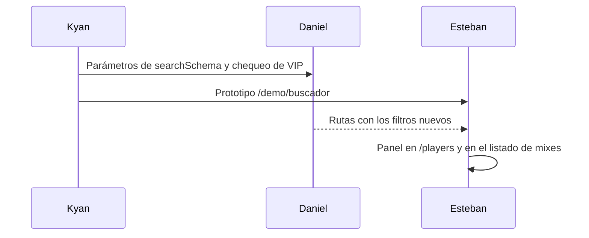

# Guía: buscador y filtros avanzados (prototipo)

## Ver el prototipo

1. Levantar el frontend nuevo con la configuración `frontend-mm-ejemplo` de `.claude/launch.json` (puerto 5173).
2. Abrir `http://localhost:5173/demo/buscador`.

Links útiles:

- `http://localhost:5173/demo/buscador?eloMin=1500&kd=1.1&act=30`
- `http://localhost:5173/demo/buscador?tab=partidas&with=ruoncs&vs=rory5`

No necesita la API ni la base: los datos están en memoria.

## Cambios respecto del plan

- Los datos de ejemplo se ajustaron:
  - El 85 % de las partidas las juegan 40 habituales. Si no, "con" y "contra" casi nunca encontraban nada.
  - Los resultados son MR12.
  - El rango de ELO llega a nivel 10.

## Archivos nuevos

En `repo-mm-ejemplo/web/frontend/src/` (rama `kyan/ejemplo-matchmaking`, **sin commit**):

- `features/search/demo.ts`
- `features/search/filters.ts`
- `features/search/AdvancedSearch.tsx`
- `routes/demo.buscador.tsx`
- `features/search/levels.test.ts` (se corre con `pnpm exec vitest run src/features/search`)

## Cambio pedido durante la implementación

Kyan pidió que los niveles queden sincronizados con el frontend y el backend:

- El filtro de nivel pasó a cortar por ELO con los pisos del backend (`levelRange`).
- Se agregó un test que lo controla.
- El detalle está en la sección "Niveles" de `DOCUMENTACION.md`.

## Pasar a la versión real

- No toca el plugin: no hay nada que subir al servidor real ni a RBK.
- No tiene `CHANGELOG_DISCORD.txt` porque los jugadores todavía no lo pueden usar. Se escribe cuando Esteban lo publique.

## Revertir

Borrar los cuatro archivos nuevos.
