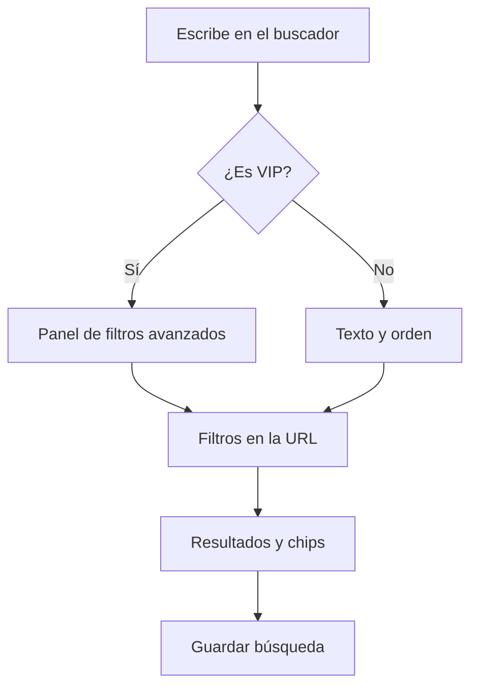

# Plan: Buscador y filtros avanzados (VIP)

> Planeación original. Estado: **propuesta**, prototipo para pasarle a Daniel (backend) y a Esteban (frontend).

## Decisiones tomadas

| Tema | Decisión | Por qué |
|---|---|---|
| Dónde se ve | Ruta `/demo/buscador` del frontend nuevo (`repo-mm-ejemplo`, rama `kyan/ejemplo-matchmaking`), solo en `pnpm dev` | Es el patrón de los demás demos |
| Qué se busca | Dos pestañas: **Jugadores** y **Partidas** | Hoy el ranking y el listado de mixes solo filtran por texto, nivel y mapa |
| Datos | Unos 200 jugadores y 400 mixes generados en memoria con una semilla fija | Siempre salen los mismos y se puede filtrar de verdad |
| Sin VIP | Buscar por texto y ordenar es gratis; los filtros avanzados se ven con candado | Muestra el beneficio sin esconder el buscador |
| Estado en la URL | Los filtros van en la URL con `zod`, como `features/ranking/search.ts` | Se puede compartir una búsqueda con un link |
| Filtros guardados | Hasta 5 búsquedas con nombre, guardadas en el navegador en el demo | En la versión real irían a la cuenta (Daniel) |
| Chips | Cada filtro activo aparece como chip para sacarlo con un clic | Se entiende qué está filtrando sin abrir el panel |

## 1. El flujo completo

## 2. Filtros de jugadores

- Texto (nick o tag del equipo).
- Rango de nivel y rango de ELO.
- K/D, rating y HS % mínimos.
- Mixes jugados mínimos y activo en los últimos 7, 30 o 90 días.
- Mapa favorito, país, con equipo o sin equipo, solo VIP.
- Orden por ELO, K/D, rating, mixes o última partida.

## 3. Filtros de partidas

- Texto (nick de un jugador que estuvo).
- Con un jugador y contra otro.
- Mapa, rango de fechas, tipo (mix, PCW, oficial).
- Diferencia de rondas máxima (partidas parejas), rondas totales.
- Solo con demo, solo terminadas.
- Orden por fecha, diferencia o rating del MVP.

## 4. Lo que tendría que hacer cada uno

- **Daniel (backend):** los parámetros nuevos en `GET /api/v1/ranking/players` (o una ruta `/search/players`) y en `GET /api/v1/mixes`, el chequeo de VIP del lado del servidor para los filtros avanzados y las búsquedas guardadas en la cuenta.
- **Esteban (frontend):** llevar el panel a `/players` (hoy es un `Placeholder`) y al listado de mixes.

## 5. Requisitos antes de empezar

- Ninguno: no hay dependencias nuevas ni cambios en la base.

## 6. Orden de implementación

1. `features/search/demo.ts`: generador de datos con semilla.
2. `features/search/filters.ts`: esquema de la URL y funciones que filtran.
3. `features/search/AdvancedSearch.tsx`: panel, chips, resultados y búsquedas guardadas.
4. `routes/demo.buscador.tsx`: la pantalla con la barra Demo (switch VIP).
5. Probar en el navegador.
