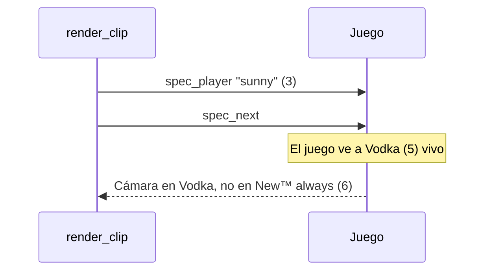

# Clips con la cámara en otro jugador y el menú al final: documentación

## Qué pasaba

Los dos 3k de "New™ always" en de_cbble (mix `flow-20261029T201550-b630`, 2026-10-29, rondas 18 y 29) se grabaron desde los ojos de Vodka. El de la ronda 29 además terminaba con el menú del juego.

### La cámara

"New™ always" tiene un carácter (™) que no se puede escribir en la consola del juego. Para esos casos, `render_clip.spec_target` sigue a otro jugador vivo con nombre escribible y avanza con `spec_next`, que pasa al siguiente jugador vivo por número de entidad. Para saber cuántos pasos dar, usa la lista de vivos de `leer_demo.py`.

Vodka se desconectó y volvió a entrar a los pocos minutos (userid 75, entidad 5). Esa reconexión llega en la demo como una actualización de la tabla `userinfo` (`svc_UpdateStringTable`), y el lector leía mal ese mensaje: tomaba el largo en 20 bits, cuando en este protocolo son 16. Así que no veía a Vodka (sus kills salían como "userid 75") y se perdía el resto del paquete.

Con la lista de vivos sin Vodka, el plan era `spec_player "sunny"` (entidad 3) y un `spec_next` para llegar a la entidad 6. Pero en el juego la siguiente viva era la 5, Vodka.

Ahora el lector ve la reconexión y el plan es `spec_player "Vodka"` y un `spec_next`, que llega a la entidad 6.

Además, el tick de los paquetes de signon no es de la grabación (en esta demo, 234850 en una de 232332 ticks). El lugar inicial de cada jugador quedaba fechado después de todo lo demás, así que un cambio de lugar durante el mix nunca se aplicaba. Ahora el estado de los signon cuenta desde el tick 0. Las fichas `STEAM_ID_PENDING` (el jugador mientras se conecta) no se guardan: el mismo jugador llega enseguida con su SteamID.

### El menú al final

El plugin corta la grabación de SourceTV cuando termina el mix. En este caso, en el mismo tick de la última kill (232332). El tramo de la jugada pedía 2 s después de esa kill, que no existen en la demo: al acabarse, el juego mostraba el menú y se grababa eso.

Ahora `render_clip.segments` recibe el último tick de la demo (`playback_ticks` de la cabecera) y no deja que un tramo termine después de ese tick menos `END_MARGIN_SECONDS` (0,1 s). Una jugada de la última ronda queda más corta, sin los segundos de después.

## Alcance

- Afecta a cualquier mix con alguien que entró o se reconectó durante la partida y tiene una jugada de un jugador con nombre no escribible, o que cuenta en los `spec_next` de otro.
- Con nombres escribibles, la cámara usa `spec_player` con el nombre y el error no influía.
- Las rondas, las kills y sus ticks no cambian: en esta demo, la versión vieja y la nueva dan las mismas 205 kills.

## Dónde está cada cosa

| Qué | Archivo |
|---|---|
| Largo de la actualización, tick de los signon y `STEAM_ID_PENDING` | `render/leer_demo.py` |
| Corte al final de la demo (`segments`, `END_MARGIN_SECONDS`) | `render/render_clip.py` |
| Último tick al armar las jugadas | `render/procesar.py` (`build_job`) |
| Análisis de las jugadas | `pruebas/analizar_jugadas.py` |
| Reproceso de los dos clips | `pruebas/reprocesar_cbble.sql` |
